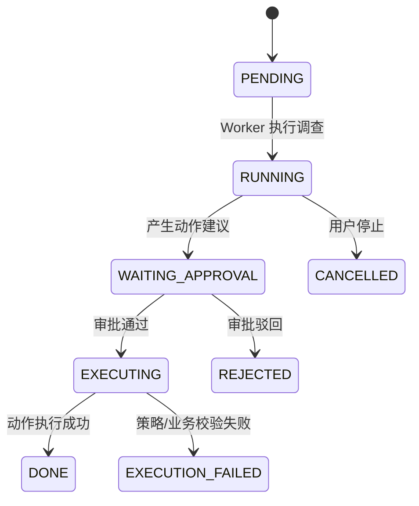

# Human-in-the-loop 人工审批

> 人工审批不是前端弹窗，而是一个可审计、可幂等、参数被绑定的一次授权过程。

状态口径：**已实现** = 代码可核对；**部分实现** = 主链路可用但有缺口；**已设计** = 有方案未上线；**规划中** = 未开始。

## 1. 为什么需要人工审批

Agent 可以分析、建议、生成草稿，但「是否真的改业务状态」不应由模型单独决定。Qianke 的定位是 Decision Support Agent，因此把写操作拆成两类：

```text
低风险：生成草稿，用户确认后落库（运营跟进任务）
高风险：先生成动作建议，人工审批后再执行（取消订单、售后、发货、退款）
```

不适合自动执行的操作清单：

| 操作 | 建议控制 |
|---|---|
| 查询销售数据 | 自动执行，受权限约束 |
| 生成分析结论 | 自动生成，保留证据 |
| 生成营销文案 | 自动生成，人工选择 |
| 批量发送消息 | 审批后执行 |
| 修改订单状态 / 退款 | 审批或严格策略 |
| 大额补偿 / 删除数据 | 人工审核或禁止 |

审批要回答的问题远不止「点一下同意」：谁可以审批？针对哪一次执行？审批时看到哪些参数和证据？审批结果如何记录？审批后参数能否被修改？超时怎么办？重复提交如何避免重复执行？

最后一条最关键：**审批通过的操作与最终执行的操作必须是同一个操作，不能在审批后悄悄替换参数。**

## 2. 基本机制

Qianke 有三条受控确认/审批链路，形态不同：

| 链路 | 触发 | 人工动作 | 落库结果 |
|---|---|---|---|
| B 端 Agent 草稿 | `prepare_followup_task` | 确认 / 取消 / 完成 | `agent_action` 状态机 |
| Super-agent 动作 | `propose_action` 建议 | 审批 / 驳回 | `sa_approval` + ACTION Job |
| C 端成交/砍价 | `prepare_order` 草稿、砍价报价 | 用户逐单确认 / 接受或拒绝报价 | `c_order`、`c_bargain_approval` |

草稿状态机是 `DRAFT → CONFIRMED → COMPLETED`，另有 `CANCELLED` 分支；每一步都校验归属与当前状态。

Super-agent 状态机：



## 3. 总体架构

```text
Agent 侧：Tool 只能生成「草稿 / 建议」，不能直接执行高风险动作
审批侧：B 端确认 API / Super-agent approve API / 企业微信命令与卡片
执行侧：确认后由独立服务或 ACTION Job 落库，执行前再校验商家策略
记录侧：agent_action 状态字段 / sa_approval / 企业微信审批 note
```

关键边界：审批对象是「一次具体动作建议（含参数、订单、动作类型）」；审批人是有权限的账号或通过签名回调确认的企业微信用户；执行器与 Agent 分离，只做校验与执行，不做「理解」。

## 4. 关键设计

### 4.1 草稿模式：先落库，再确认

`prepare_followup_task` 只写 `agent_action.status = DRAFT`，返回 `requires_confirmation = true`；用户点击确认后调用 `POST /api/agent/actions/{id}/confirm`，状态变 `CONFIRMED`。没有用户确认，就没有正式任务。

### 4.2 归属与幂等

```text
只能确认自己账号创建的 DRAFT（ACTION_FORBIDDEN）
非 DRAFT 不能重复确认（ACTION_NOT_DRAFT）
只有 CONFIRMED 才能标记完成（ACTION_NOT_CONFIRMED）
```

这四条把「越权确认」「重复确认」「跳过确认」都堵在服务端，而不是靠前端按钮状态。

### 4.3 Super-agent 审批与执行分离

Worker 调查后只登记 `propose_action` 并进入 `WAITING_APPROVAL`；owner/admin 调 approve API 后 `decide_approval` → `EXECUTING` → enqueue ACTION Job → `execute_approved` 重新校验商家策略后执行。

执行前会再次读取 `c_merchant_policy`：动作未开放、补偿/退款超上限、要求原因但为空都会拒绝。**审批参数不能绕过策略**，这是「审批通过 ≠ 无限授权」的具体实现。

### 4.4 企业微信内审批

```text
签名回调 + AES 解密
→ 精确命令解析（同意 <短码> [参数] / 驳回 <短码>）
→ 校验发起人或 QIANKE_WECOM_APPROVERS 白名单
→ update_approval_action → decide_approval → ACTION Job
→ 结果回写企业微信
```

限制被刻意保留：只接受精确命令，不解析模糊自然语言；重复命令因状态已不是 `WAITING_APPROVAL` 而被拒绝；所有审批记录 `note = "企业微信审批 by <from_user>"`。

### 4.5 审批卡片

企业微信原生按钮卡片把按钮事件映射为既有审批命令（`approve + REFUND_ONLY` → `同意 <短码> 仅退款`），复用同一套权限、参数与队列逻辑。复杂参数（如补偿金额）走签名审批页人工填写，不由按钮直接带值。

### 4.6 interrupt 原语与统一 HITL 的差距

Qianke 已有 LangGraph `interrupt_before_tools` 原语与 checkpointer 测试，但普通 Agent 请求尚未接入统一审批流程。当前 HITL 是「三条业务链路各自实现」，不是「一个通用审批服务」。

```text
已实现：草稿确认、Super-agent 审批、企业微信命令/卡片、审批记录
部分实现：参数绑定（执行前重校验策略，但无参数哈希）
未实现：统一 HITL API、多级审批、审批超时自动升级、四眼原则产品化
```

### 4.7 ToCToU 与失效模式

审批类系统最典型的安全问题是 ToCToU（Time-of-Check to Time-of-Use）：审批时看到的参数与执行时使用的参数不一致。Qianke 当前用「执行前重新校验策略 + 动作参数来自已存 approval 记录」降低风险，但还没有「参数哈希绑定 + 执行时比对」的强保证。后续应在审批记录中保存参数摘要，执行器校验摘要一致后才执行。

## 5. 工程实现

| 能力 | 代码位置 |
|---|---|
| 草稿创建 / 确认 / 取消 / 完成 | `src/rag_demo/agent/actions.py`、`api/main.py` |
| 草稿状态字段 | `agent_action`（DRAFT/CONFIRMED/COMPLETED/CANCELLED） |
| Super-agent 审批 API | `src/rag_demo/api/superagent.py::approve_work_item` |
| 审批记录 | `sa_approval`、`sa_work_item` |
| 动作执行器 | `superagent/actions.py::execute_approved` |
| 商家策略校验 | `c_merchant_policy`、`store.get_merchant_policy` |
| 企业微信审批 | `superagent/wecom_approval.py`、`wecom_native_card.py` |
| interrupt 原语 | `agent/loop.py::build_graph(interrupt_before_tools=True)` |

## 6. 企业级要求

| 维度 | 要求 | 当前状态 |
|---|---|---|
| 授权 | 只有有权限的人能审批 | 已实现（B 端 owner/admin；企业微信发起人/白名单；C 端买家本人订单归属校验） |
| 绑定 | 审批对象、参数、执行结果可对应 | 部分实现（有记录，无参数哈希） |
| 幂等 | 重复审批不重复执行 | 已实现（状态机拒绝重复） |
| 可审计 | 谁、何时、对什么、结果如何 | 已实现（审批与执行字段 + 审计页） |
| 时效 | 超时提醒、升级、自动关闭 | 部分实现（watchdog 扫描卡住项，无审批超时策略） |
| 多级 / 统一 | 分级审批链、所有 Agent 共用入口 | 未实现（三条链路各自实现） |

## 7. 方案对比

| 方案 | 描述 | 优点 | 缺点 | Qianke |
|---|---|---|---|---|
| 前端弹窗确认 | 只在 UI 弹确认框 | 实现快 | 无服务端状态，刷新即丢 | 不采用 |
| 草稿表 + 确认 API | 先落 DRAFT，再确认 | 可恢复、可审计、幂等 | 需要状态机与清理 | 当前采用（B 端） |
| 审批工作流引擎 | 通用多级审批 | 表达力强 | 引入外部系统与建模成本 | 规划中 |
| interrupt 挂起 | 图执行到审批点暂停 | 与 Runtime 一体 | 需要持久化与恢复语义 | 原语已实现，未接入主链路 |

Qianke 的选择是「按业务链路实现最小审批」，而不是先上通用工作流引擎。这与项目「避免过度工程化」的原则一致，但代价是三条链路的体验与字段不统一。

## 8. Qianke Engine 实践

| 能力 | 状态 | 证据 |
|---|---|---|
| 草稿确认（DRAFT → CONFIRMED） | 已实现 | `agent/actions.py`、`confirm_agent_action` |
| 草稿归属 / 幂等 / 状态机 | 已实现 | `ACTION_FORBIDDEN`、`ACTION_NOT_DRAFT` |
| Super-agent WAITING_APPROVAL 审批 | 已实现 | `api/superagent.py`、`sa_approval` |
| 审批后 ACTION Job 执行 | 已实现 | `superagent/runtime.py::_run_action_job` |
| 执行前商家策略重校验 | 已实现 | `c_merchant_policy`、`ACTION_NOT_ALLOWED_BY_POLICY` |
| 企业微信命令审批 | 已实现 | `wecom_approval.py`、签名校验 |
| 企业微信原生卡片审批 | 已实现 | `wecom_native_card.py`、真实点击闭环记录 |
| interrupt 原语 | 已实现 | `build_graph(interrupt_before_tools=True)` |
| 通用 HITL / 多级审批 / 超时升级 | 未实现或规划中 | 无统一服务 |
| 参数哈希绑定（ToCToU 强保证） | 已设计 | 尚未落地 |

必须准确表述：Qianke 的 HITL 是「三条业务链路的受控确认/审批」，不是「统一人工审批平台」；不能把 `interrupt_before_tools` 的存在写成普通请求已接入审批。

## 9. 评估 / 验收

```text
[ ] 未确认的草稿不会出现在正式任务列表；非创建者确认返回 403
[ ] 重复确认 / 跳过状态返回结构化错误
[ ] 未审批的 Super-agent 动作不会进入执行；驳回后不执行
[ ] 执行期策略校验能拦住审批后新增的限制
[ ] 企业微信重复点击/重复命令不会重复执行
[ ] 审批与执行记录能按 work_item / order 关联查询
```

指标建议：`pending_approval_count`、`approval_latency_p95`、`approval_rejected_rate`、`execution_after_approval_failure_rate`、`duplicate_approval_attempts`。

## 10. 常见误区

1. **审批只做前端弹窗**：刷新、重放、直接调 API 都能绕过。
2. **审批通过后按当前参数执行**：审批的是 A 操作，执行可能变成 B 操作。
3. **没有幂等**：用户重复点击、消息重试都可能重复执行。
4. **审批与执行强耦合在同一次请求里**：超时、崩溃后状态不一致。
5. **把审批当授权**：审批只针对一次具体操作，不等于给该类操作长期权限。
6. **没有超时策略**：工作项永远停在待审批，业务被卡死。
7. **审批记录只有结果没有证据**：事后无法解释为什么批准。

## 11. 总结

```text
HITL 的本质是把“不可逆动作”的执行权从模型手里拿回到一个可审计的人工决策。
Qianke 已实现 B 端草稿确认、Super-agent 审批、C 端成交/砍价确认三条主链路，含状态机、归属校验与执行前策略重校验。
统一审批服务、多级审批、超时升级与参数哈希绑定仍是缺口，不能宣称“通用 HITL 已完成”。
```

## 12. 延伸阅读

- 内部：[Agent 权限治理](04-agent-permission-governance.md)、[操作审计与追踪](09-operation-audit-tracing.md)、[企业级安全体系设计](10-enterprise-security-architecture.md)
- 代码：`src/rag_demo/agent/actions.py`、`src/rag_demo/api/superagent.py`、`src/rag_demo/superagent/wecom_approval.py`
- 证据：`docs/agent-write-action.md`、`docs/e2e/superagent-wecom-approval.md`、`docs/e2e/superagent-wecom-native-card.md`
- LangGraph human-in-the-loop：<https://langchain-ai.github.io/langgraph/how-tos/human_in_the_loop/>
- NIST AI RMF（Human-AI 交互）：<https://www.nist.gov/itl/ai-risk-management-framework>
