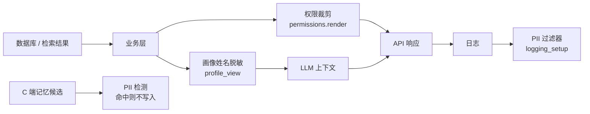

# 数据隐私与脱敏

> 脱敏不是把手机号中间的几位打星号，而是「不该看的人在任何出口都看不到，该看的人只看到必要部分」。

状态口径：**已实现** = 代码可核对；**部分实现** = 主链路可用但有缺口；**已设计** = 有方案未上线；**规划中** = 未开始。

## 1. 为什么需要数据隐私工程

Qianke 处理的数据包括用户画像（姓名、年龄、城市、会员等级、消费记录）、联系方式（手机号、邮箱、身份证号）、订单与售后、对话内容与长期记忆、日志/Trace/评测样本。隐私风险不只来自「数据库被拖走」，更常见的泄露路径是日志（请求参数、异常堆栈）、模型输出（检索到完整姓名后复述）、来源片段（低权角色看到原文）、长期记忆与日记、审计/Trace 全文入库、CSV 导出。

Qianke 的定位是「企业分析助手」，很多数据本身已经脱敏入库；但工程上仍需要假设「任何出口都可能泄露」，逐层设防。

## 2. 基本机制

数据隐私的工程化通常分四步：分类分级（哪些字段敏感）、最小化（不采集/不返回/不进 Prompt）、脱敏（展示层/日志层/模型层分别处理）、审计与保留（谁看过、保存多久、如何删除）。Qianke 当前的脱敏发生在多个位置：



分层原则是：源数据层尽量存脱敏数据；展示层按权限裁剪字段；日志层写入前统一 PII 过滤；记忆层命中 PII 不写入；模型层提示「系统采用脱敏存储」并禁止编造。

## 3. 总体架构

```text
数据入口：CSV 接入、画像库、订单/售后、C 端会话
处理层：profile_view（姓名脱敏）、user_pool（消息脱敏）、memory（PII 拒绝写入）
出口层：permissions.render（字段分级）、answer_guard（事实兜底）、API 响应
观测层：logging_setup（日志 PII 过滤）、event_trace、ai_traces/ai_spans
```

关键事实：**Qianke 没有统一的数据分级标签与字段级策略引擎**。哪些字段算敏感、谁能看，目前由各模块的知识与权限矩阵决定。

## 4. 关键设计

### 4.1 日志脱敏（已实现）

`logging_setup.py` 给控制台与文件 handler 都挂 PII Filter：

```text
13800138000          → 138****8000
alice@example.com    → a***@example.com
110101199001011234   → 110101********4
```

过滤器处理字符串消息、tuple 参数和 dict 参数的值，不递归处理 list/嵌套结构；同时吞掉脱敏异常（脱敏失败不能中断业务）。这是「最小代价、最高收益」的一层：日志是最容易被忽视的泄露源。

### 4.2 画像姓名脱敏（已实现）

`profile_view.py` 从 `profile_text` 提取姓名并替换为 `张**`，只返回结构化字段（年龄、城市、会员等级等），不返回完整姓名与原文。`b_end/insights.py` 对回答正文与 `sources` 逐条替换，防止检索片段把姓名带出去。

### 4.3 消息与记忆的 PII 防线（已实现）

```text
b_end/user_pool.py：消息原文命中手机号/邮箱/证件号 → 替换为 [已脱敏]，不把原文交给模型
c_end/store.py：记忆写入前用 _MEMORY_PII_RE 检查
c_end/memory_daily.py：日记候选命中 PII 则放弃当天日记
c_end/chat_profile.py：画像抽取结果命中 PII 则不落
```

这里的取舍很明确：**宁可少存一条记忆，也不把 PII 写进模型上下文。**

### 4.4 按权限裁剪输出（已实现）

`permissions.render()` 按能力分级：

```text
L1：只有回答
L2：+ 来源列表（编号 + 来源名）
L3：+ 检索式、原文片段、精排分数、图片
L4：+ SQL 原文、数据概况、召回对比
```

被裁字段整键移除；`trace` 内部再分级；历史会话回放时按当前权限重新裁剪，避免「旧的高权会话在降权后泄露过程数据」。

### 4.5 模型侧约束（部分实现）

Prompt 要求：涉及手机号、身份证号时，如果检索到的是脱敏数据，要明确告知「系统采用脱敏存储」；没有的字段如实说「资料未提供」，不编造。模型输出不是可靠边界，所以这层只能作为提示。

### 4.6 数据最小化

```text
画像接口不返回 profile_text
SQL 只返回 columns/rows，不分页导出全量
RAG 返回片段与来源，不返回整篇文档
Trace 记录输入输出摘要（详见《操作审计与追踪》）
```

### 4.7 还没做的部分

```text
PII 存储加密（数据库字段级加密）        —— 未实现
数据分级标签与字段级访问策略            —— 未实现
输出侧 DLP（自动识别并拦截敏感字段）    —— 未实现
数据保留期、删除流程、用户数据导出      —— 未实现
Trace 中 prompt/response 全文是否脱敏   —— 待核验
第三方模型调用时的数据出境评估          —— 未实现
```

`docs/e2e/security-hardening.md` 明确把「PII 存储加密 / 数据分级」「数据保留与删除策略」列为生产阻断项。

## 5. 工程实现

| 能力 | 代码位置 |
|---|---|
| 日志 PII 过滤 | `src/rag_demo/logging_setup.py` |
| 联系方式脱敏展示 | `auth.contact_label` |
| 画像姓名脱敏 | `src/rag_demo/profile_view.py` |
| 消息脱敏 | `src/rag_demo/b_end/user_pool.py` |
| 记忆 PII 拒绝 | `src/rag_demo/c_end/store.py`、`memory_daily.py` |
| 输出权限裁剪 | `src/rag_demo/permissions.py::render` |
| 事实兜底（非隐私） | `src/rag_demo/answer_guard.py` |
| PII 评测用例 | `src/rag_demo/tests/eval_questions.json`（type=pii） |

测试文件存在但本文未执行：`tests/test_security_headers.py`、`tests/test_c_end_memory.py` 等；PII 用例多为人工判定（`acceptance` 要求「只给脱敏后内容」）。

## 6. 企业级要求

| 维度 | 要求 | 当前状态 |
|---|---|---|
| 分类分级 | 字段敏感级别可配置 | 未实现 |
| 最小化 | 只采集/返回必要字段 | 部分实现（画像、SQL 有收敛） |
| 展示脱敏 | 姓名、手机号、邮箱、证件号 | 已实现（多处分散） |
| 权限隔离 | 敏感字段只对授权角色可见 | 部分实现（能力分级 + 租户隔离，无字段级策略） |
| 存储加密 | 敏感字段落库加密 | 未实现 |
| 可删除 | 用户数据删除与导出 | 未实现 |
| 审计 | 谁看过敏感数据 | 部分实现（Trace 有，无敏感字段访问审计） |
| 合规 | 数据出境、第三方模型评估 | 规划中 |

## 7. 方案对比

| 方案 | 优点 | 缺点 | Qianke |
|---|---|---|---|
| 展示层脱敏 | 实现简单、覆盖出口 | 原文仍在库里与内存 | 当前主要方式 |
| 源数据脱敏 | 泄露面最小 | 可能影响分析与对账 | 部分数据已脱敏 |
| 字段级加密 | 库泄露也不可用 | 密钥管理、查询复杂度 | 规划中 |
| 令牌化 / 假名化 | 可关联分析、降低敏感度 | 需要映射表与治理 | 未采用 |
| DLP 输出拦截 | 兜底强 | 误报、性能、规则维护 | 规划中 |

Qianke 的现状是「多出口分散脱敏 + 权限裁剪」，适合当前规模；但要满足企业合规（尤其是数据出境与删除权），需要补数据分级、字段级策略与保留删除流程。

## 8. Qianke Engine 实践

| 能力 | 状态 | 证据 |
|---|---|---|
| 日志 PII 过滤 | 已实现 | `logging_setup.py`、`docs/e2e/security-hardening.md` |
| 画像姓名脱敏 | 已实现 | `profile_view.py`、`b_end/insights.py` |
| 消息脱敏 | 已实现 | `b_end/user_pool.py` |
| 记忆/日记 PII 拒绝 | 已实现 | `c_end/store.py`、`memory_daily.py` |
| 按权限裁剪输出 | 已实现 | `permissions.render()` |
| PII 评测用例 | 部分实现 | `eval_questions.json`（人工判定） |
| 数据分级 / 字段级策略 | 已设计 | 无代码 |
| 存储加密 / DLP / 保留删除 | 规划中 | 安全加固文档列为阻断项 |

必须准确表述：Qianke 已有「日志 + 画像 + 消息 + 记忆」的脱敏与权限裁剪，但**没有统一数据分级、没有存储加密、没有保留删除流程**，不能宣称「隐私合规已完成」。

## 9. 评估 / 验收

```text
[ ] 日志中不出现完整手机号、邮箱、身份证号
[ ] 画像回答不出现完整姓名；来源片段同样脱敏
[ ] L1/L2 角色看不到原文片段、精排分数、SQL 原文
[ ] 历史会话降权回放不会泄露过程字段
[ ] 命中 PII 的消息不进入模型上下文；记忆/日记不写入
[ ] PII 类评测用例只输出脱敏内容，不编造缺失字段
[ ] Trace 中的 prompt/response 不包含未脱敏 PII（待核验）
```

指标建议：`pii_leak_findings`、`redaction_hit_total`、`sensitive_field_access_total`、`retention_overdue_records`。建议先做数据分类清单，再补字段级策略与删除流程。

## 10. 常见误区

1. **只脱敏页面**：日志、Trace、导出、错误信息同样会泄露。
2. **只做手机号**：姓名、地址、订单、对话内容同样敏感。
3. **脱敏后仍把原文传给模型**：模型上下文就是新的泄露面。
4. **把权限裁剪当脱敏**：裁剪解决「谁能看」，脱敏解决「看到什么」。
5. **memory 不做 PII 检查**：长期记忆会把一次泄露固化下来。
6. **认为「库里本来就是脱敏数据」**：来源、日志、导出不一定同步。
7. **没有删除与保留策略**：合规要求的删除权无法执行。

## 11. 总结

```text
隐私工程 = 分类分级 + 最小化 + 多出口脱敏 + 权限裁剪 + 保留删除 + 审计。
Qianke 已实现日志、画像、消息、记忆的脱敏与按能力裁剪输出，这是可验证的基础。
统一数据分级、存储加密、DLP、保留删除与第三方数据出境仍是缺口，不能写成“已合规”。
```

## 12. 延伸阅读

- 内部：[RBAC 与 ABAC 权限模型](02-rbac-abac.md)、[Prompt Injection 防护](07-prompt-injection-defense.md)、[操作审计与追踪](09-operation-audit-tracing.md)
- 代码：`src/rag_demo/logging_setup.py`、`profile_view.py`、`b_end/user_pool.py`、`c_end/store.py`
- 证据：`docs/e2e/security-hardening.md`、`docs/product/b-chat-user-profile.md`
- OWASP Privacy Risks：<https://owasp.org/www-project-top-10-privacy-risks/>
- NIST Privacy Framework：<https://www.nist.gov/privacy-framework>
- 个人信息保护法（中国）：<https://www.gov.cn/xinwen/2021-08/20/content_5632486.htm>
