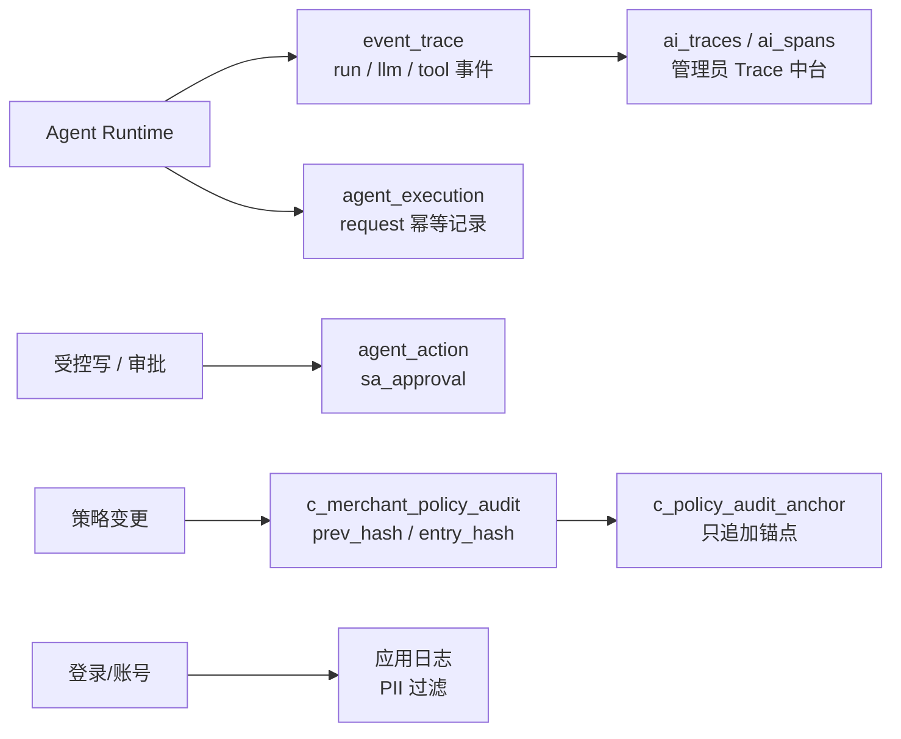

# 操作审计与追踪

> Tracing 回答「这次执行发生了什么」，Audit 回答「谁在什么时候做了什么、能不能被追责」。两者数据结构相似，责任完全不同。

状态口径：**已实现** = 代码可核对；**部分实现** = 主链路可用但有缺口；**已设计** = 有方案未上线；**规划中** = 未开始。

## 1. 为什么需要审计与追踪

Agent 系统的执行是「模型决策 + 工具执行 + 人工审批 + 异步任务」的组合，出了问题必须能回答：这次请求是谁发起的、代表哪个租户或商家？模型调用了哪些工具、传了什么、返回了什么？失败发生在哪一步？谁审批了这笔退款、依据是什么？策略什么时候被谁改过？

没有这些信息，故障排查只能靠猜，安全事件无法追责，合规审计也无法交付。

Qianke 的审计需求分成三类：

| 类型 | 面向 | 典型问题 |
|---|---|---|
| 执行追踪 | 研发/运维 | 为什么这次 Agent 超时/答错 |
| 业务审计 | 运营/财务 | 谁批了退款、金额多少、依据是什么 |
| 安全审计 | 安全/合规 | 有没有越权、有没有绕过审批、配置被谁改过 |

## 2. 基本机制

```text
身份：actor（人/系统）+ tenant + request_id + execution_id
动作：action、resource、参数摘要、结果、耗时、错误码
证据：关联 Trace、审批记录、策略版本
完整性：只追加、哈希链、锚点、备份
```

Qianke 的审计数据分布在多处：



## 3. 总体架构

```text
执行层：request_id / execution_id / parent_execution_id 串联一次请求与重试
事件层：event_trace 记录 LLM、Tool、Chain、错误与耗时
存储层：agent_execution（幂等）、ai_traces/ai_spans（Trace）、agent_action / sa_approval（业务动作）、c_merchant_policy_audit（策略）
展示层：管理员 Agent 调用监控、B 工作台执行审计页、CSV 导出
完整性：策略审计哈希链 + 锚点 + 只追加触发器；其余审计依赖数据库权限与备份
```

## 4. 关键设计

### 4.1 执行身份贯穿全链路

```text
request_id：一次用户请求（幂等键）
execution_id：一次具体执行（retry 会新建）
parent_execution_id：记录重试血缘
```

Agent 返回、Trace、审计记录都带这三个 ID，才能把「一次用户请求 → 多次执行 → 每次的工具调用与错误」串起来。

### 4.2 event_trace 记录执行事实

`TraceCallbackHandler` 记录：

```text
run_started / run_failed / run_finished
llm_started / llm_finished / llm_failed（含 token usage、耗时）
tool_started / tool_finished / tool_failed（含工具名、参数、结果、耗时）
chain 事件（还原 LangGraph 父子层级）
```

Trace 既用于研发排障，也用于管理员监控。需要注意：**Trace 保存的是执行事实，不是业务事实**；业务状态仍以订单、审批、动作表为准。

### 4.3 业务动作审计

```text
agent_action：account_id / dataset / request_id / status / confirmed_by / 时间戳
sa_approval + sa_work_item：动作类型、订单、审批状态、执行状态、结果、失败原因
```

B 工作台「执行审计」页支持按动作类型、执行状态、关键词、时间范围筛选，分页与 CSV 导出（上限 5000 行）；商家账号只能看自己租户，系统管理员可带 `merchant_id`。

### 4.4 策略审计哈希链与锚点

每条记录保存 `prev_hash` 与 `entry_hash = SHA256(prev_hash | canonical(payload))`；锚点表 `c_policy_audit_anchor` 只允许 INSERT（SQLite/PG 触发器拒绝 UPDATE/DELETE）。校验入口是 `GET /api/superagent/audit/policy/verify` 与 `scripts/verify_policy_audit_chain.py`，写入锚点用 `scripts/anchor_policy_audit.py`。

这解决的是「尾部删除/篡改」问题：链能发现中间被改，锚点能发现尾部被删。局限也写进了文档：历史记录不回填、锚点在本机 PG、灾难级删除仍需异地 WORM 备份。

### 4.5 登录与账号变更的审计缺口

```text
登录失败写 c_login_attempt（用于限流，不是完整登录审计）
账号审核/改角色/停用只写应用日志（logger.info）
权限配置变更写 var/permissions.json 的 version/updated_by + 日志
```

也就是说：**账号与权限变更目前没有结构化审计表**，无法按账号、时间、操作人查询历史。这是审计体系里最明显的缺口之一。

### 4.6 Trace 中台的边界

管理员 Agent 调用监控已实现列表、详情、Trace Tree、标签、评分、对比、从 Trace 建数据集与评测实验；LLM prompt/response 与 Tool 参数/结果保存上限 12KB。它解决了「执行可回放」，但带来两个待答题：

```text
Trace 中的 prompt/response 是否已做 PII 脱敏（待核验）
Trace 的保留期、访问审计与导出控制是否满足合规（未实现）
```

## 5. 工程实现

| 能力 | 代码 / 表 |
|---|---|
| 执行 Trace | `src/rag_demo/agent/loop.py::TraceCallbackHandler` |
| 执行记录 / 幂等 | `agent/execution_store.py`、`agent_execution` |
| 管理员 Trace 中台 | `src/rag_demo/ai_monitor.py`、`api/monitor.py`、`ai_traces/ai_spans` |
| 草稿动作审计字段 | `agent/actions.py`、`agent_action` |
| 审批与执行审计 | `superagent/store.py`、`sa_approval`、`sa_work_item` |
| 策略审计哈希链 | `c_end/store.py`、`c_merchant_policy_audit` |
| 锚点与只追加 | `scripts/anchor_policy_audit.py`、`c_policy_audit_anchor` |
| 登录限流记录 | `api/security.py`、`c_login_attempt` |

测试文件存在但本文未执行：`tests/test_merchant_policy.py`（策略审计）、`tests/test_agent_monitoring.py`、`tests/test_admin_agent_monitor_api.py`。

## 6. 企业级要求

| 维度 | 要求 | 当前状态 |
|---|---|---|
| 完整性 | 关键动作都有记录 | 部分实现（Agent/动作/策略有，账号/权限缺） |
| 可关联 | 一次请求可还原完整链路 | 已实现（request/execution ID + Trace） |
| 不可篡改 | 只追加、可校验 | 部分实现（策略审计有哈希链，其余无） |
| 可查询 | 按人/时间/动作/结果筛选 | 部分实现（业务审计与 Trace 有；账号审计缺） |
| 保留期 | 按合规要求保存与清理 | 未实现 |
| 访问控制 | 只有授权角色可看敏感审计 | 部分实现（管理员接口；B 端按租户） |
| 告警 | 异常审计实时告警 | 未实现 |
| 导出/对接 | SIEM / 数据仓库 | 部分实现（CSV，无标准导出） |

## 7. 方案对比

| 方案 | 优点 | 缺点 | Qianke |
|---|---|---|---|
| 应用日志 | 零成本 | 非结构化、易丢、难查询 | 辅助 |
| 事件表 + 查询 API | 结构化、可筛选 | 需要建模与维护 | 当前主方案 |
| 哈希链 + 锚点 | 可发现篡改/删除 | 实现与运维成本 | 策略审计已用 |
| WORM 存储 | 合规级不可篡改 | 成本高、异地部署 | 规划中 |
| OpenTelemetry / SIEM | 标准、生态好 | 接入与治理成本 | 未接入（Trace 自建） |

Qianke 的选择是「先结构化、再谈不可篡改」：执行与业务动作先落表可查，策略这类低频率高敏感变更额外做哈希链与锚点。这个顺序是对的——没有结构化数据，WORM 也只是把垃圾存得更久。

## 8. Qianke Engine 实践

| 能力 | 状态 | 证据 |
|---|---|---|
| request/execution/parent ID | 已实现 | `agent/state.py`、`loop.py`、`service.py` |
| event_trace（LLM/Tool/Chain） | 已实现 | `TraceCallbackHandler` |
| 执行记录与幂等 | 已实现 | `agent_execution`、`execution_store.py` |
| 管理员 Trace 中台 | 已实现 | `ai_traces/ai_spans`、`/api/admin/agent-traces` |
| 草稿动作审计字段 | 已实现 | `agent_action` |
| 审批/执行审计与 CSV | 已实现 | `sa_approval`、`/api/superagent/audit/actions` |
| 策略审计哈希链 + 锚点 | 已实现 | `c_merchant_policy_audit`、`c_policy_audit_anchor` |
| 账号/权限变更审计表 | 未实现 | 只有日志 |
| 统一审计模型 / 保留期 / WORM | 规划中 | 无实现 |
| SIEM / 标准导出 | 规划中 | 仅 CSV |

必须准确表述：Qianke 的审计是「分模块、部分结构化、部分可校验」，不是「统一审计平台」；策略审计的哈希链不能代表所有审计都不可篡改。

## 9. 评估 / 验收

```text
[ ] 任意一次 Agent 执行能按 request_id 查到完整 Trace
[ ] 重试能通过 parent_execution_id 还原血缘
[ ] 草稿/动作/审批/执行结果可按 work_item 或 order 关联
[ ] 策略审计链校验能发现篡改；锚点能发现尾部删除
[ ] 商家账号看不到其他租户的审计数据
[ ] 审计导出带上当前筛选条件且字段完整
[ ] 账号改角色/停用能在审计中查到（当前缺失）
```

指标建议：`audit_event_total`、`audit_query_latency_p95`、`policy_chain_verify_failures`、`trace_retention_days`、`audit_export_total`。

## 10. 常见误区

1. **把日志当审计**：日志可删、可轮转，无法证明完整性。
2. **只有 Trace 没有业务审计**：能看模型调用，查不到「谁批了退款」。
3. **审计与业务写入不在同一事务**：业务成功但审计丢失，或反之。
4. **哈希链不存锚点**：只能防中间篡改，防不了尾部删除。
5. **审计表可 UPDATE/DELETE**：等于没有审计。
6. **忽略账号与权限变更**：内部人风险往往发生在这里。
7. **没有保留期与访问审计**：审计本身也可能成为泄露源。

## 11. 总结

```text
追踪保证“执行可回放”，审计保证“责任可落地”，两者都必须绑定可信身份与业务对象。
Qianke 已实现 request/execution 身份、event_trace、动作/审批审计与策略哈希链，这是可验证的基础。
账号与权限变更审计、统一审计模型、保留期、WORM 与 SIEM 仍缺失，不能宣称“审计体系完成”。
```

## 12. 延伸阅读

- 内部：[Human-in-the-loop 人工审批](06-human-in-the-loop.md)、[企业级安全体系设计](10-enterprise-security-architecture.md)、[Prompt Injection 防护](07-prompt-injection-defense.md)
- 代码：`src/rag_demo/agent/loop.py`、`agent/execution_store.py`、`ai_monitor.py`、`c_end/store.py`
- 证据：`docs/e2e/superagent-audit.md`、`docs/e2e/admin-agent-monitor.md`、`docs/e2e/security-hardening.md`
- OpenTelemetry：<https://opentelemetry.io/docs/>
- NIST SP 800-92（日志管理）：<https://csrc.nist.gov/pubs/sp/800/92/final>
- OWASP Logging Cheat Sheet：<https://cheatsheetseries.owasp.org/cheatsheets/Logging_Cheat_Sheet.html>
