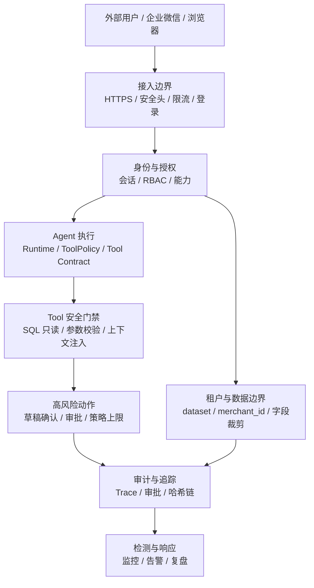

# 企业级安全体系设计

> 安全不是某个模块的功能，而是系统在「身份、权限、数据、执行、审计」五个面上同时成立的性质。

状态口径：**已实现** = 代码可核对；**部分实现** = 主链路可用但有缺口；**已设计** = 有方案未上线；**规划中** = 未开始；**理论知识** = 通用方法。

## 1. 为什么需要安全体系而不是安全功能

Qianke 的安全能力是逐项长出来的：先有登录，再有角色；先有租户切库，再有 Tool Policy；先有草稿确认，再有动作审批。单看每一项都能工作，但组合起来会暴露体系问题：身份有了但 SSO/MFA 没有；RBAC 有了但权限变更没有审计；租户切库有了但队列 Job 没有 `merchant_id`；HITL 有了但只覆盖两条业务链路；日志脱敏有了但 Trace 全文未验证。

企业安全评审不会逐项问「这个功能有没有」，而会问：信任边界在哪里？最坏情况下攻击者能拿到什么、改什么？安全事件发生后能否发现、定位、止损、追责？安全控制是否有测试、指标与负责人？

**结论：安全体系 = 威胁模型 + 纵深防御 + 默认拒绝 + 可验证证据 + 持续运营。**

## 2. 基本机制

### 2.1 威胁建模

以 Agent 系统为例，用 STRIDE 粗粒度拆解（理论知识）：

| 威胁 | Agent 场景 | 主要控制 |
|---|---|---|
| Spoofing | 伪造身份、伪造企业微信回调 | 登录态、签名、AES |
| Tampering | 篡改审批参数、篡改审计 | 参数绑定、哈希链、只追加 |
| Repudiation | 否认审批/执行 | 审批记录、Trace、审计 |
| Information Disclosure | 跨租户、PII、提示词泄露 | 租户隔离、脱敏、权限裁剪 |
| DoS / Elevation | 刷接口、超大查询、越权 Tool | 限流、超时、fetch 上限、ToolPolicy |

### 2.2 纵深防御

```text
边界层：HTTPS/HSTS、安全响应头、CSP、登录限流；生产关闭 API 文档（`RAG_ENABLE_API_DOCS=0`，`/api/docs` 与 `/api/openapi.json`；`/docs` 为公开 Handbook）
身份层：会话、密码哈希、账号状态、SSO/MFA（规划）
授权层：RBAC、能力判断、ToolPolicy、商家角色
数据层：租户作用域、字段裁剪、脱敏、只读 SQL
执行层：Tool Contract、参数校验、动作白名单、HITL、幂等
观测层：Trace、审计、告警、指标
```

任一层都可能失效，所以关键动作不能只依赖单层。例如「禁止越权退款」同时依赖授权（谁能审批）、执行（动作白名单 + 金额上限）与审计（可追溯）。

### 2.3 安全控制生命周期

```text
识别：资产、数据流、信任边界、威胁
防护：身份、权限、隔离、加密、审批
检测 / 响应 / 恢复：日志、Trace、告警、限流封禁、回滚、备份、复盘
```

## 3. 总体架构



这几条主线对应本分类的前九篇：身份 → 权限 → 租户 → Agent/Tool → 数据 → 审计。下一阶段应优先补 P0 阻断项与证据，而不是继续堆功能。

## 4. 关键设计

### 4.1 默认拒绝

```text
未登录 → 401；待审核/停用 → 403
租户推导失败 → 403，不回落默认库
未授权 Tool → TOOL_NOT_ALLOWED
guest → L0，无任何能力
演示账号 → 无写权限、Tool 清空
```
默认拒绝是最便宜、最可靠的安全设计。Qianke 的「不回落默认数据集」「guest 恒 L0」都是这条原则的具体落地。

### 4.2 确定性执行边界

模型可以参与决策，但不能成为授权依据。所有高风险判断都在确定性代码里：

```text
SQL 只读/白名单/LIMIT/只读账号
Tool 白名单 + 执行复核
租户与商家作用域
动作白名单 + 金额上限 + 人工审批
```

### 4.3 信任边界清单

| 边界 | 不可信内容 | 控制 |
|---|---|---|
| 浏览器 → API | 请求参数、Cookie | 登录态、Cookie 策略、参数校验 |
| 企业微信 → 回调 | 消息、按钮事件 | 验签、AES、MsgId 去重、白名单 |
| API → 模型 | 用户输入、检索内容 | 指令层级、输出约束、能力兜底 |
| 模型 → Tool | tool_calls 与参数 | Schema、Policy、上下文注入 |
| Tool → 数据 / 外部 | 查询、结果、第三方响应 | 只读账号、白名单、fetch 上限、可信来源校验 |

### 4.4 职责分离与最小权限

```text
系统管理员：平台运维，不直接处理业务
企业管理员：只管本企业成员
商家 owner/admin：审批与操作；staff 只读
审批人 ≠ 发起人（部分场景）
```

### 4.5 安全证据化

Qianke 的做法是维护 `docs/e2e/security-hardening.md` 这类证据文档，并把生产阻断项显式列出。没有证据的「已加固」在评审中等于没有。

## 5. 工程实现

当前已落地的控制（证据见各专题文章）：

| 控制 | 位置 | 状态 |
|---|---|---|
| 密码哈希 / 会话 / 限流 | `auth.py`、`api/security.py` | 已实现 |
| 安全响应头 / CSP Report-Only / HSTS | `api/security.py` | 已实现 |
| RBAC / 能力裁剪 | `permissions.py` | 已实现 |
| 租户切库 / 商家作用域 | `_tenant_scope`、merchant repository | 已实现 |
| ToolPolicy / SQL 只读门禁 | `agent/policy.py`、`tools/sql_tool.py` | 已实现 |
| HITL 草稿 / 审批 / 策略上限 | `agent/actions.py`、`superagent/` | 已实现 |
| PII 日志过滤 / 画像脱敏 | `logging_setup.py`、`profile_view.py` | 已实现 |
| Trace / 审计 / 策略哈希链 | `ai_monitor.py`、`c_merchant_policy_audit` | 已实现 |
| 凭据轮换 / 监控告警 | `scripts/security_secrets_check.py`、Prometheus | 部分实现 |

## 6. 企业级要求

| 维度 | 要求 | 当前状态 |
|---|---|---|
| 身份 | SSO / MFA / 账号生命周期 | 未实现或部分 |
| 网络 | WAF、IP 白名单、DDoS 防护 | 规划中 |
| 数据 | 分级、加密、保留与删除 | 规划中 |
| 应用与供应链 | SAST/DAST、依赖扫描、SBOM、镜像签名 | 未实现 |
| 审计 | 统一审计、WORM、SIEM | 部分实现 |
| 合规与应急 | 等保/ISO 27001 映射、预案与演练 | 未开展（理论知识） |
| 密钥 | Secrets Manager、定期轮换 | 部分实现 |

`docs/e2e/security-hardening.md` 已把 SSO/MFA、WAF、审计 WORM、Secrets Manager、CSP 强制、依赖扫描、渗透测试、数据保留删除、租户配额列为生产阻断项。

## 7. 方案对比

| 方案 | 描述 | 优点 | 缺点 | Qianke |
|---|---|---|---|---|
| 单点加固 | 逐项补功能 | 见效快 | 组合缺口、难评审 | 当前阶段 |
| 纵深防御 | 多层控制 + 默认拒绝 | 抗单点失效 | 建设周期长 | 已设计 |
| 安全平台化 | 统一网关 + 策略中心 + SIEM | 一致、可运营 | 成本高 | 规划中 |
| 合规驱动 | 按等保/ISO 清单建设 | 可审计、可交付 | 容易形式化 | 未开展 |

对当前规模，正确路径是「纵深防御 + 证据化」，而不是先上安全平台。Qianke 的下一步不是加更多功能，而是把已有控制的证据、测试与指标补齐。

## 8. Qianke Engine 实践

| 领域 | 状态 | 主要证据 |
|---|---|---|
| 身份认证 | 已实现 + 部分实现 | `auth.py`、限流、Cookie 安全属性 |
| 授权模型 | 已实现 | `permissions.py`、商家 RBAC |
| 多租户 | 已实现 + 部分实现 | 切库、merchant_id；缺口见专题 |
| Agent 权限 | 部分实现 + 已设计 | ToolPolicy、草稿、动作审批 |
| Tool 安全 | 部分实现 + 已设计 | Contract、SQL 门禁、无独立 Gateway |
| HITL | 已实现 + 部分实现 | 草稿确认、Super-agent 审批 |
| 注入防护 | 部分实现 + 规划中 | 确定性边界 + 评测探针 |
| 数据隐私 | 部分实现 + 已设计 | 脱敏、裁剪；无分级/加密/删除 |
| 审计追踪 | 已实现 + 部分实现 | Trace、审批审计、哈希链；账号审计缺 |

建议优先级：

```text
P0（生产阻断）：SSO/MFA 或至少强密码策略、密钥管理、账号与权限变更审计、
                CSP 强制执行、依赖漏洞扫描、数据保留删除、统一 HITL、注入防护基线
P1：字段级数据策略、审计 WORM/异地备份、租户配额、WAF/IP 白名单、渗透测试
P2：安全平台化、SIEM 对接、红队常态化、合规认证
```

必须准确表述：Qianke 已具备「身份 + 权限 + 租户 + 工具 + HITL + 脱敏 + 审计」的主链路控制，但**未完成生产级安全体系**；「已轮换默认凭据」「有安全头」不等于「可上线」。

## 9. 评估 / 验收

安全评审清单：

```text
[ ] 每个信任边界都有确定性校验，不依赖模型自觉
[ ] 默认拒绝路径有测试（未登录/未授权/跨租户/未审批）
[ ] 高风险动作有审批与幂等，参数不可替换
[ ] 敏感数据在日志/输出/Trace 三处都有处理
[ ] 关键操作可按 request_id / work_item 追溯，审计可发现篡改
[ ] 凭据不落 Git、可轮换；生产阻断项有负责人与关闭条件
```

指标建议：`auth_failure_rate`、`cross_tenant_access_attempts`、`unauthorized_tool_attempts`、`hitl_bypass_attempts`、`pii_leak_findings`、`audit_completeness`、`open_security_blockers`。建议每季度做一次安全复盘与威胁模型更新。

## 10. 常见误区

1. **把安全当功能清单**：勾完功能不等于体系成立，组合缺口才是事故来源。
2. **把 Prompt 当安全边界**：模型不是策略执行点。
3. **只做认证不做授权与隔离**：登录了不等于只能看自己的数据。
4. **只做防护不做检测与响应**：没有日志、Trace、告警，出事无法发现与止损。
5. **把审计当备份**：可改可删的审计不是审计。
6. **用「已加固」代替证据**：没有代码、测试、运行记录，评审不成立。
7. **为了上线砍掉阻断项**：安全欠债会在生产环境以更高成本偿还。

## 11. 总结

```text
企业级安全 = 威胁模型 + 纵深防御 + 默认拒绝 + 职责分离 + 可审计 + 可运营。
Qianke 的主链路控制（身份、权限、租户、Tool、HITL、脱敏、审计）已可核对，但生产级体系仍未完成。
下一阶段的重点不是加功能，而是补 P0 阻断项、补证据、补指标与应急能力。
```

## 12. 延伸阅读

- 本分类：[身份认证与权限管理](01-identity-and-access-management.md)、[RBAC 与 ABAC](02-rbac-abac.md)、[多租户隔离](03-multi-tenancy-isolation.md)、[Agent 权限治理](04-agent-permission-governance.md)、[Tool Gateway](05-tool-gateway-security.md)、[HITL](06-human-in-the-loop.md)、[Prompt Injection](07-prompt-injection-defense.md)、[数据隐私](08-data-privacy-redaction.md)、[审计追踪](09-operation-audit-tracing.md)
- 证据：`docs/e2e/security-hardening.md`、`docs/e2e/secrets-baseline.md`、`docs/e2e/production-preflight.md`
- OWASP ASVS：<https://owasp.org/www-project-application-security-verification-standard/>
- OWASP LLM Top 10：<https://genai.owasp.org/llm-top-10/>
- NIST AI RMF：<https://www.nist.gov/itl/ai-risk-management-framework>
- ISO/IEC 27001：<https://www.iso.org/standard/27001>
