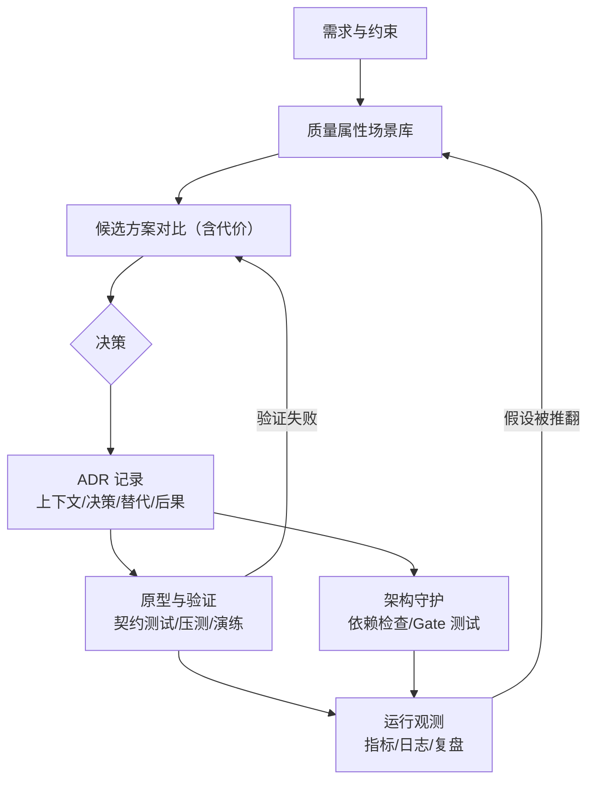

# 企业级系统架构设计方法

> **状态约定**：`已实现` = 代码/测试可核验；`部分实现` = 有实现但有明确缺口；`已设计` = 方案确定未上线；`规划中` = 方向性设想；`理论知识` = 通用方法，不代表 Qianke 已采用。
>
> 本篇讲方法；Qianke 的具体实现只作为样本，并在第 8 节标注边界。

## 1. 为什么需要架构设计方法

企业系统的复杂度来自约束同时存在：数据不能错、租户不能串、任务不能重复、故障不能扩散。没有方法，架构讨论会退化为“先画图再倒推理由”“只比技术名词不比代价”“把目标态当现状”。

架构方法解决的是：**在信息不完整、资源有限时，把不确定性转化成可评审、可验证、可回滚的决策**。它不保证一次设计正确，只保证错误可见、可纠正。

## 2. 基本机制：质量属性驱动设计

```text
业务目标与约束 → 质量属性场景（可度量）
→ 候选方案（至少两个） → 决策（ADR）
→ 契约测试/压测验证 → 运行观测 → 回到约束
```

| 概念 | 含义 | 常见错误 |
|---|---|---|
| 约束 | 不可谈判：合规、预算、团队、已有数据库 | 把习惯当约束 |
| 场景 | 刺激+环境+响应+度量，如“20 并发下确认订单 p95 ≤ 2s” | 只写“高性能” |
| 决策 | 选了什么、放弃什么、何时重审 | 只记结论不记替代 |
| 验证 | 测试/压测/契约检查证明假设 | 用评审会代替验证 |

## 3. 总体架构：设计闭环的四类产出



四类产出缺一不可：场景库（要什么）、候选对比（有什么选择）、决策记录（为什么选）、验证证据（凭什么相信）。没有第四类，前三类都只是意见。

## 4. 关键设计

**区分可逆与不可逆决策。**

| 类型 | 例子 | 决策方式 |
|---|---|---|
| 可逆 | 进程内缓存换 Redis、日志格式 | 快速试错 |
| 半可逆 | 单体拆服务、引入消息队列 | 小范围试点，保留退路 |
| 不可逆 | 数据库选型、租户隔离模型、分库方式 | 必须写 ADR + 迁移回滚 |

`AGENTS.md` 已把这一原则写成硬规则：改核心架构前先说明影响面、迁移与回滚方案。

**用代价而不是优点做比较。** 每个候选方案必须写清放弃的收益：

```text
继续 SQLite：零运维、易开发；但不能多实例共享、无行锁。
迁 PostgreSQL 独立 schema：可共享、有事务与行锁；
代价是迁移脚本、切换窗口、双后端维护。（Qianke 选择）
```

**把假设写成可执行检查。** 能写成测试的不只写在文档：仓储双后端契约测试、租户隔离测试、队列并发 claim 测试、迁移行数/校验和检查。Qianke 已有 `tests/test_control_repository_contract.py`、`test_tenant_isolation_pg.py`、`test_control_job_queue.py`，属于“部分实现”的架构守护。

## 5. 工程实现：一份 ADR 的结构

```markdown
# ADR-00X：决策标题
## 状态        提议 / 已接受 / 已废弃 / 被取代
## 背景与约束  当前问题、业务背景、不可谈判条件
## 候选方案    A/B/C，各写优点、代价、适用条件
## 决策        选哪个、为什么
## 后果        正面/负面影响、技术债、迁移步骤
## 验证与回滚  如何证明有效、失败如何退回
```

Qianke 的 `docs/decisions/control_plane_postgres_migration_v0.1.md` 已具备该结构：现状、目标架构、类型映射、切换策略、回滚、验收与风险。`merchant_dashboard_v1_1_m0_adr.md` 是另一个模块级样本。

## 6. 企业级要求

| 维度 | 设计要求 | 检查方式 |
|---|---|---|
| 安全 | 权限在服务端，不依赖前端/Prompt | 越权测试、审计 |
| 数据正确性 | 事务边界、幂等、对账 | 并发测试、故障注入 |
| 可用性 | 单点识别与降级 | 依赖故障演练 |
| 性能 | 分层指标与容量水位 | 压测、慢查询 |
| 可观测 | 请求标识、错误分类、指标 | 日志/Trace/看板 |
| 可维护 | 模块边界、契约、ADR | 依赖检查、评审 |
| 可迁移 | 数据迁移与回滚可执行 | 迁移演练 |
| 成本 | 资源与复杂度可承受 | 容量与人力评估 |

## 7. 方案对比

| 驱动方式 | 表现 | 风险 | 适用 |
|---|---|---|---|
| 技术驱动 | 先选中间件再找场景 | 过度工程 | 技术预研 |
| 需求驱动 | 只满足当前功能 | 忽略质量属性 | 一次性工具 |
| 质量属性驱动 | 场景→方案→验证 | 前期投入高 | 企业系统（推荐） |

Qianke 这类单团队、2C4G 项目不需要全套重量级流程：按风险分层——金额、库存、租户隔离、审批严格设计；展示与内部分析允许快速迭代。

## 8. Qianke Engine 实践

**状态：理论知识 + 部分实现。**

| 能力 | 状态 | 证据 / 说明 |
|---|---|---|
| ADR/决策文档 | 已实现 | `docs/decisions/*.md` |
| 现状 vs 目标分栏 | 已实现 | `docs/agent-design-current-vs-target.md` |
| 架构图 | 部分实现 | `docs/architecture-diagrams.md` 自述部分过期 |
| 迁移含回滚/验收 | 已实现 | 控制面迁移方案 §7–§10 |
| 仓储双后端契约测试 | 已实现 | `test_control_repository_contract.py` 等 |
| 统一架构评审流程 | 规划中 | 无模板化评审记录 |
| 场景库/架构度量 | 规划中 | 无质量属性场景台账 |
| 依赖方向守护 | 规划中 | 仅 AGENTS 规则，无 CI 检查 |

注意：`docs/decisions/` 中部分文档自述“未实施/待确认”，必须以文档状态行与代码为准，不能把方案当上线能力。

## 9. 评估与验收

```text
[ ] 约束区分“必须”与“偏好”
[ ] 每个质量属性场景有数值与验证方式
[ ] 至少两个候选方案，写清放弃的收益
[ ] 决策记录含回滚与重审条件
[ ] 迁移有演练记录或可执行脚本
[ ] 关键边界有自动化测试（隔离/幂等/并发）
[ ] 架构图与正文、代码一致，且标注更新时间
```

## 10. 常见误区

1. **把分层图当架构设计**：分层只说明调用方向，不回答隔离、事务与失败处理。
2. **只写目标态**：评审对象应是“从现状到目标的可执行路径”。
3. **用“业界都这么做”替代约束分析**：真正的约束是团队、预算与数据规模。
4. **忽略回滚**：不能回滚的迁移方案在故障时等于没有方案。

## 11. 总结

- 架构方法的本质是把约束翻译成可度量场景，再在候选方案间做有记录的取舍。
- 可逆决策快速试错，不可逆决策必须写 ADR 并准备迁移回滚。
- 能自动化的假设写成测试，比评审会更能证明架构。
- Qianke 已具备 ADR、现状/目标分栏、迁移回滚与部分契约测试；统一评审与架构度量仍属规划。
- 不要用目标态文档伪装已实现能力。

## 12. 延伸阅读

### 项目内部资料

- `docs/decisions/control_plane_postgres_migration_v0.1.md`
- `docs/decisions/three_agent_platform_architecture_decisions_v0.1.md`
- `docs/agent-design-current-vs-target.md`
- `AGENTS.md`（修改核心架构前必须回答的问题）

### 官方资料

- SEI ATAM：https://www.sei.cmu.edu/architecture/research/arch-analysis/atam/
- arc42：https://arc42.org/
- ADR：https://adr.github.io/
- C4 model：https://c4model.com/
