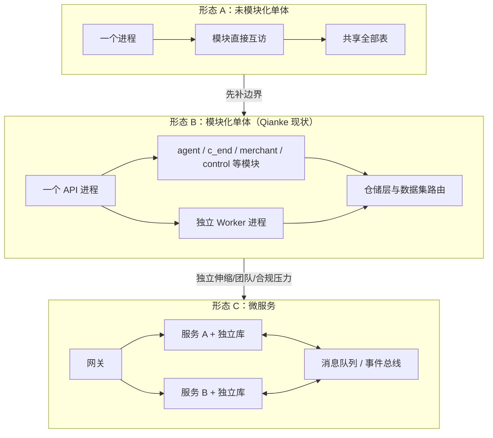

# 模块化单体与微服务架构

> 本篇不讨论“哪个更好”，而讨论：在当前团队规模、数据规模与运维预算下，哪种部署形态能让边界清晰、故障可控、演进成本最低。
>
> Qianke 的实际情况是：**模块化单体（已实现） + 独立 Worker 进程（已实现） + 微服务拆分（已设计/规划中）**。
> 状态约定：已实现 / 部分实现 / 已设计 / 规划中 / 理论知识，正文按事实标注，不把规划写成已实现。

## 1. 为什么需要讨论这个选择

项目小时所有代码放一个进程也能跑；到多团队、多租户时，问题变成：

```text
改一个模块要不要重新部署整站？
一个模块故障会不会拖垮全站？
多实例部署时会话、缓存、任务能不能共享？
拆服务后事务与查询变成跨网络调用，错误率与延迟怎么算？
```

企业需要的是“可独立演进且不互相踩踏”，不是服务数量。微服务只是手段，代价是网络分区、分布式事务、服务发现与链路追踪。正确顺序是：**先把单体内部边界做对，再按真实压力拆分**。

## 2. 基本机制

| 概念 | 关注点 | 典型问题 |
|---|---|---|
| 部署单元 | 进程/容器的粒度 | 一次发布影响多少功能 |
| 模块边界 | 代码与数据归属 | 谁能读谁的表、谁依赖谁 |
| 数据所有权 | 每份数据只有一个写入口 | 多处写同一表导致状态冲突 |

**模块化单体**：一个部署单元，内部按业务能力划模块，模块间通过明确接口调用，禁止直接操作对方表。**微服务**：多个部署单元，每个服务独占数据与发布节奏，通过网络契约通信。两者共同前提是**边界先成立**；没有边界的微服务只是“分布式大泥球”。

康威定律：系统结构会向组织沟通结构收敛。单人项目强行拆 8 个服务，会得到“8 套部署脚本 + 1 个人维护”。

## 3. 总体架构：三种形态与演进路径



Qianke 落在形态 B：模块化单体 + 独立 Worker。它兼具“单进程部署简单”与“长任务不阻塞 HTTP”。

## 4. 关键设计

**按业务能力划模块，而不是按技术分层。** Qianke 的包结构体现了这一点：

```text
src/rag_demo/
├── agent/       B 端 Agent Runtime 与 Tool
├── api/         HTTP 路由与入口（唯一组装点）
├── c_end/       C 端消费者、IM、订单、对账
├── merchant/    商家商品/库存/订单仓储（PG/SQLite）
├── control/     控制面仓储与 Job 队列
├── superagent/  工作项、审批、执行
├── db/          数据集连接、schema、只读账号
└── retrieval/ generation/   检索与生成
```

模块间通信按风险排序：1）进程内函数调用最快，但形成代码依赖；2）共享数据库/队列解耦进程，但引入轮询与幂等；3）网络 API 边界最硬，但增加超时、重试与部署复杂度。原则是：**同进程优先函数调用，异步任务走队列，真正需要独立部署才走网络 API**。

事务边界：模块化单体仍可用本地事务；一旦拆服务，库存预占与订单创建会变成跨服务一致性。Qianke 当前把订单、库存、售后写操作分别放在商家库事务与控制面事务中：两个仓储、两个提交点，跨存储并不原子，存在不一致窗口；靠补偿、幂等与对账兜底。拆服务不会消除这部分一致性成本。

## 5. 工程实现

**单进程部署**：

```text
docker-compose.yml
├── db        PostgreSQL 16 + pgvector
├── backend   FastAPI（uvicorn，单进程）
└── frontend  Nginx（静态资源 + 反向代理）
```

`web/dist` 由 FastAPI 挂到 `/v2`，也可由 Nginx 托管；两种方式都要求前端路由与 API 前缀分离。

**独立 Worker** 不是拆服务，而是把执行角色从 API 拿出去：

```powershell
python scripts/sa_worker.py      # → runtime.run_worker_loop(poll_seconds=2)
# API 侧可设 QIANKE_SUPERAGENT_QUEUE_DISPATCHER=0
#               QIANKE_QUEUE_BACKEND=postgres
```

API 崩溃不丢任务，Worker 可独立扩容。这是 Qianke 最接近服务拆分的实践，但边界是队列而不是 HTTP。

**拆分触发条件**：

| 信号 | 动作 |
|---|---|
| 某模块 CPU/内存明显高于其他模块 | 评估独立部署 |
| 发布频率差异大、互相阻塞 | 评估独立发布 |
| 某模块故障拖垮整站 | 先降级，再拆分 |
| 需要独立数据库账号/物理库 | 先分库，再考虑分服务 |
| 多人并行修改同一模块冲突频繁 | 先划边界与 owner |

## 6. 企业级要求

| 维度 | 模块化单体 | 微服务 |
|---|---|---|
| 部署 | 简单，一次发布全量 | 复杂，需编排与灰度 |
| 事务 | 本地事务可达 | 需 Saga/补偿/对账 |
| 故障域 | 单进程共享 | 网络隔离，故障组合更多 |
| 可观测 | 一个日志流即可 | 必须全链路追踪 |
| 数据隔离 | 靠代码与 schema | 可物理隔离 |
| 成本 | 低 | 显著上升 |

没有独立伸缩、独立合规、独立团队需求时，模块化单体是更稳的企业选择。

## 7. 方案对比

| 方案 | 优点 | 代价 | 适用 |
|---|---|---|---|
| 未模块化单体 | 开发最快 | 边界腐化 | 原型 |
| 模块化单体 | 部署简单、事务好处理 | 单点、模块仍可能耦合 | 小团队/早期产品 |
| 单体 + 独立 Worker | 长任务隔离、Worker 可扩 | 队列与幂等复杂度 | 有异步任务的产品 |
| 微服务 | 独立部署/伸缩/隔离 | 分布式一致性、运维成本 | 多团队/大规模 |
| Serverless | 弹性、按量计费 | 冷启动、运行时限制 | 事件型轻任务 |

## 8. Qianke Engine 实践

**状态：已实现（模块化单体 + 独立 Worker） + 已设计（三端架构） + 规划中（微服务拆分）。**

| 能力 | 状态 | 证据 / 说明 |
|---|---|---|
| FastAPI 单进程 + 模块化包结构 | 已实现 | `src/rag_demo/` 下 agent/api/c_end/merchant/control/superagent 等 |
| 路由统一组装 | 已实现 | `api/main.py` 的 `register_*` 调用 |
| 独立 Worker 进程 | 已实现 | `scripts/sa_worker.py`、`runtime.run_worker_loop` |
| PG 队列（SKIP LOCKED） | 已实现 | `superagent/queue_pg.py`、`control/job_queue.py` |
| 3 服务容器编排 | 已实现 | `docker-compose.yml` |
| 模块依赖方向检查 | 规划中 | 靠评审与 import 约定，无 CI |
| 独立服务/服务注册 | 规划中 | 无内部 RPC/服务发现 |
| 三端独立 Graph/数据隔离 | 已设计 | `three_agent_platform_architecture_decisions_v0.1.md` |

必须说明：独立 Worker 与 API 共用同一套代码、数据库与配置，只是执行角色不同；把它描述成“已微服务化”不准确。

## 9. 评估与验收

```text
[ ] 模块边界图与代码目录一致，每个模块有 owner
[ ] 关键模块之间无直接跨表写入
[ ] 单次发布影响面可说明
[ ] API 关闭 dispatcher 后 Worker 仍能消费任务
[ ] 跨模块调用有超时/错误码/幂等约定
[ ] 拆分评估有量化触发条件
[ ] 模块级契约测试存在
```

## 10. 常见误区

1. **把“微服务”当架构等级**：服务数量不代表质量，反而放大不一致与观测成本。
2. **先拆服务再拆数据**：共享数据库的微服务只是分布式单体。
3. **把分目录当模块化**：没有依赖约束与数据所有权，目录只是整理。
4. **为未来规模提前拆**：没有压测与团队压力，拆分收益不可验证。

## 11. 总结

- 部署形态由真实约束决定：独立伸缩、故障隔离、合规与团队规模。
- 模块化单体的前提是边界与数据所有权，否则只是一个大程序。
- “单体 + 独立 Worker + PG 队列”是中等规模系统性价比很高的折中，Qianke 已落地。
- 微服务拆分应以量化信号触发，先完成数据隔离与可观测性。
- 文档必须把“已实现形态”和“目标形态”分开写。

## 12. 延伸阅读

### 项目内部资料

- `docker-compose.yml`
- `scripts/sa_worker.py`、`deploy/systemd/qianke-b-profile-worker.service`
- `src/rag_demo/superagent/runtime.py`
- `docs/decisions/three_agent_platform_architecture_decisions_v0.1.md`

### 官方资料

- Sam Newman《Monolith to Microservices》
- Martin Fowler：Microservices：https://martinfowler.com/articles/microservices.html
- Martin Fowler：MonolithFirst：https://martinfowler.com/bliki/MonolithFirst.html
- microservices.io：https://microservices.io/patterns/
