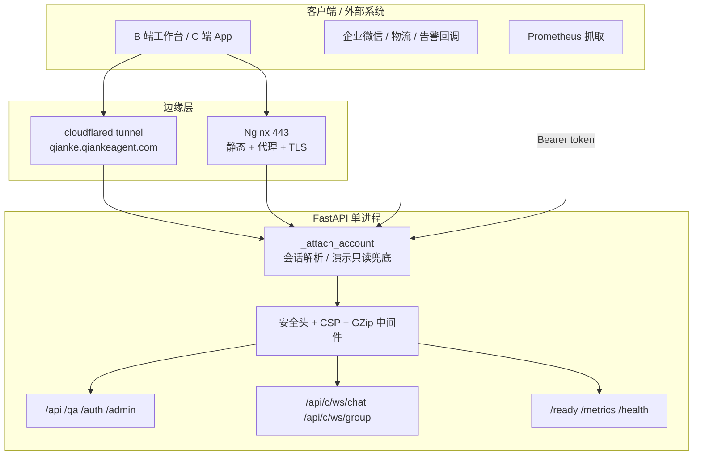

# API Gateway 设计

> API Gateway 不是“多一个 Nginx 配置”，而是**所有南北向流量的统一边界**：外部身份在这里收口，流量在这里被限速，异常在这里被转换，观测数据在这里生成。
>
> Qianke 现状：**边缘代理已实现（cloudflared / Nginx），应用内治理已实现（FastAPI 中间件），独立 API Gateway 产品未引入（规划中）**。
> 状态约定：已实现 / 部分实现 / 已设计 / 规划中 / 理论知识，正文按事实标注，不把规划写成已实现。

## 1. 为什么需要 API Gateway

多种客户端（B 端工作台、C 端 App、企业微信、物流回调、监控抓取）并存时，会同时出现：TLS 证书放哪、静态与 API 如何统一路由、登录态在网关还是每接口校验、限流/超时/SSE 缓冲在哪配、外部回调验签与重放保护归谁、`/metrics` 能否暴露公网。

如果每个模块各答一次，就会得到多套不一致的安全策略。Gateway 的价值是把这些**横切关注点**集中到可审计的边界。

## 2. 基本机制

| 职责 | 典型实现 | 不做的后果 |
|---|---|---|
| 路由 | 按路径/域名转发 | 客户端绑定内部地址 |
| TLS 终止 | 证书与协议统一 | 每服务维护证书 |
| 身份收口 | 会话/Token/回调验签 | 越权面扩散 |
| 限流配额 | IP/账号/设备维度 | 暴力破解与资源耗尽 |
| 请求约束 | 上传大小、超时、缓冲 | 慢请求拖垮后端 |
| 可观测/治理 | 访问日志、Trace、灰度熔断 | 故障无法定位或扩散 |

反向代理只解决“转给谁”；API Gateway 还解决“**允不允许、允许多少、如何被观测**”。纯 Nginx 可实现大部分能力，但策略与测试要自己维护。

小团队常见做法：边缘代理（cloudflared/Nginx）+ 应用内中间件（FastAPI），不引入独立网关产品。Qianke 属于这一类。

## 3. 总体架构



读图要点：① `ops/cloudflared.yml` 当前把公网域名指向 `127.0.0.1:8000`，即绕过 Nginx；`docker-compose.yml` 则是 `Nginx → backend:8000`，两种拓扑都真实存在，排障前必须确认实际部署。② `/api/c/ws/*` 需要代理支持 Upgrade，`/qa/stream` 是 SSE，Nginx 必须关闭 `proxy_buffering`。当前 `nginx.conf` 的 `/api/` location 未配置 `Upgrade`/`Connection`，按配置推断经 Nginx 时 WebSocket 不可用；生产实际入口为 cloudflared→8000，部署前需按拓扑确认，未做浏览器实测。

## 4. 关键设计

**路由表按“客户端类型 + 资源前缀”设计。** 不能只代理 `/api/`：

```text
/v2/          → 前端 SPA（try_files 回退 index.html）
/api/ /qa /qa/stream /auth/ /whoami /login /static/ /admin/
/health /ready /metrics /api/openapi.json /api/docs → 运维与 API 文档
/docs → 公开 Architecture Handbook
/             → 302 /v2/
```

遗漏 `/static/` 登录页无样式；遗漏 `/api/c/ws/` 实时消息不可用；该路径还需要代理支持 Upgrade。

**认证在入口，授权在业务。** 会话 Cookie 在 `_attach_account` 统一解析；演示账号在入口只读兜底；生产关闭 `X-Role`/`X-User` 覆盖（`RAG_ALLOW_HEADER_AUTH=0`）；外部回调在路由内验签。网关知道“你是谁”，业务仍需判断“你能操作哪条数据”。

**超时与缓冲按业务区分**：

| 场景 | 配置 | 原因 |
|---|---|---|
| 普通 API | Nginx `proxy_read_timeout 300s` | 长查询 |
| SSE 问答 | 600s + `proxy_buffering off` | 流式必须实时 |
| 上传 | `client_max_body_size 50m` | 文档/图片 |
| 外部模型 | `MODEL_API_TIMEOUT=60` | 防拖死请求 |
| Agent 请求 | `QIANKE_AGENT_WALL_TIMEOUT_SECONDS=70` | 保证返回 504 |

## 5. 工程实现

```nginx
# nginx.conf 关键片段（SSE）
location = /qa/stream {
    proxy_pass http://qianke_backend;
    proxy_http_version 1.1;
    proxy_set_header Connection "";
    proxy_buffering off;      # SSE 必须实时下发
    proxy_cache off;
    proxy_read_timeout 600s;
}
```

```python
# src/rag_demo/api/main.py / security.py / ops.py
app.add_middleware(GZipMiddleware, minimum_size=1024)
install_security_headers(app)     # 安全头 + HSTS + CSP-Report-Only
install_csp_report(app)           # POST /security/csp-report
# GET /ready → control_store / superagent_store / queue / merchant_store
# GET /metrics → Prometheus 文本，QIANKE_METRICS_TOKEN 鉴权
```

登录限流（`api/security.py`）：`LoginRateLimiter` 单进程滑动窗口（5 次/300 秒）；`PostgresLoginRateLimiter` 固定窗口，多进程共享；PG 不可用时回退内存版并记录警告。

## 6. 企业级要求

| 维度 | 要求 | Qianke 状态 |
|---|---|---|
| 身份 | 统一登录、会话吊销、回调验签 | 已实现 |
| 限流 | 登录、写接口、抓取端点 | 部分实现（仅登录限流） |
| TLS/安全头 | 强协议、HSTS、安全头 | 已实现 |
| 请求约束 | 上传大小、超时、缓冲 | 已实现 |
| 可观测 | 日志、请求 ID、指标 | 部分实现（Trace ID 未统一） |
| 灰度/熔断 | 路由级灰度、下游熔断 | 规划中 |

## 7. 方案对比

| 方案 | 优点 | 代价 | 适用 |
|---|---|---|---|
| Nginx 自建 | 可控、成熟、成本低 | 策略需自己维护 | 小团队（Qianke） |
| 云 API Gateway | 托管、限流鉴权开箱即用 | 费用、厂商绑定 | 云上多服务 |
| Kong/APISIX | 插件生态完善 | 运维与学习成本 | 多服务/多团队 |
| 应用内中间件 | 零额外组件 | 无法保护应用本身 | 单服务/早期 |

Qianke 的取舍与实际规模匹配：等出现多服务、多实例、多团队时再评估独立网关。

## 8. Qianke Engine 实践

**状态：部分实现。**

| 能力 | 状态 | 证据 / 说明 |
|---|---|---|
| TLS + 静态 + API 反代 | 已实现 | `nginx.conf`（443、/v2、/api、/qa、/auth） |
| SSE 不缓冲 | 已实现 | `location = /qa/stream` |
| 公网隧道入口 | 已实现 | `ops/cloudflared.yml` |
| 会话解析与演示只读 | 已实现 | `api/main.py::_attach_account` |
| 安全头 / CSP 上报 | 已实现 | `api/security.py` |
| 登录限流（内存/PG） | 已实现 | `LoginRateLimiter`、`PostgresLoginRateLimiter` |
| 就绪探针 / 指标鉴权 | 已实现 | `api/ops.py` `/ready`、`/metrics` |
| 统一配额/熔断/灰度 | 规划中 | 无网关级配置与看板 |
| 独立 API Gateway | 规划中 | 未引入 Kong/APISIX/云网关 |

**未核验项**：`ops/cloudflared.yml` 指向 8000，而 AGENTS 变更记录提到曾指向 8080 后恢复，生产实际链路需以当前部署与 tunnel 配置为准。

## 9. 评估与验收

```text
[ ] 所有入口域名与证书可用，80 跳 443 正常
[ ] 深链刷新不 404，SSE 不被整段缓冲
[ ] WebSocket 可握手，断线有回退策略
[ ] 上传超限返回明确错误
[ ] 登录失败触发限流，阈值符合配置
[ ] 生产 `/api/docs` 与 `/api/openapi.json` 关闭（`/docs` 为公开 Handbook）
[ ] /metrics 无 token 401；/health 与 /ready 语义区分
[ ] HTTPS 响应包含安全头
```

## 10. 常见误区

1. **把网关当反向代理**：只转发，不做认证、限流与观测。
2. **认证只在网关做**：数据级授权仍必须由业务代码完成。
3. **忽略 SSE/WS 代理特性**：缓冲、超时、Upgrade 处理错，功能会“偶尔不可用”。
4. **指标端点裸奔**：`/metrics` 必须鉴权；`/api/docs` 与 `/api/openapi.json` 生产关闭；`/docs` 为公开静态 Handbook，不得混放内部接口。
5. **忽略多实例限流一致性**：内存限流在多实例下形同虚设。

## 11. 总结

- API Gateway 的核心是横切关注点收口，而不是引入某个产品。
- 路由必须覆盖真实调用面（静态、SSE、WS、回调、运维端点）。
- 认证在入口、授权在业务；网关不能替代数据级权限。
- Qianke 已实现边缘代理与应用内治理，统一配额、熔断、灰度与独立网关仍属规划。
- 部署拓扑存在 Nginx 与 cloudflared 直连两种，排障前先确认实际路径。

## 12. 延伸阅读

### 项目内部资料

- `nginx.conf`、`ops/cloudflared.yml`、`ops/prometheus.yml`
- `src/rag_demo/api/security.py`、`api/ops.py`、`api/main.py`
- `tests/test_security_headers.py`、`test_login_rate_limit_pg.py`、`test_ops.py`

### 官方资料

- Nginx：https://nginx.org/en/docs/
- Cloudflare Tunnel：https://developers.cloudflare.com/cloudflare-one/connections/connect-networks/
- FastAPI Middleware：https://fastapi.tiangolo.com/tutorial/middleware/
- Microsoft API Gateway 模式：https://learn.microsoft.com/azure/architecture/microservices/design/gateway
