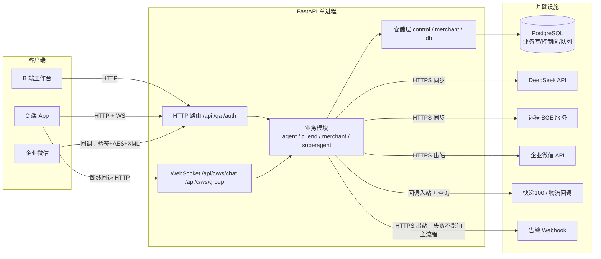

# 服务间通信

> “服务间通信”不只有 RPC。进程内调用、共享数据库、HTTP、WebSocket、Webhook、消息队列都是通信方式，区别在于**耦合程度、失败语义与可观测成本**。
>
> Qianke 现状：模块间以**进程内调用 + 共享数据库/队列**为主（已实现）；对外部系统使用 **HTTP 与 Webhook**（已实现）；**消息总线与统一 RPC 契约未引入（规划中）**。
> 状态约定：已实现 / 部分实现 / 已设计 / 规划中 / 理论知识，正文按事实标注，不把规划写成已实现。

## 1. 为什么需要专门设计通信

系统最容易出问题的地方是模块交界：

```text
上游超时了，下游还在执行吗？
同一回调重复到达，会不会重复处理？
WebSocket 断开后消息会不会丢？
对方字段改名，我方解析会不会静默返回空？
重试三次后业务状态被改了几遍？
```

这些失败的共同点是：**发生在边界上，而边界通常没有统一所有权**。通信设计要给每个边界明确：协议、超时、错误码、幂等、谁重试、谁观测。

## 2. 基本机制

| 方式 | 耦合 | 失败语义 | 典型场景 |
|---|---|---|---|
| 进程内调用 | 强（代码级） | 异常直接抛出 | 同进程模块协作 |
| 同步 HTTP | 中（契约级） | 超时、5xx、连接失败 | 查询外部服务 |
| WebSocket | 中（连接级） | 断线、消息丢失 | 实时双向 |
| Webhook | 弱（事件级） | 重复、乱序、延迟 | 外部回调 |
| 消息队列 | 弱（事件级） | at-least-once、死信 | 异步任务 |

选择标准不是“哪个先进”，而是**调用方是否必须立刻拿到结果，以及失败能否补偿**：用户等待结果用同步（限超时）；不等待可重试用异步/Webhook；实时双向用 WebSocket。

任何跨边界调用都必须回答四件事：超时多少、失败是否可重试、错误如何表达、如何追踪。

## 3. 总体架构



读图要点：① 模块之间没有内部 HTTP，靠函数调用与同一仓储层协作；② API 与 Worker 之间通过 PG 队列通信（见第 5 篇），不是 RPC；③ 外部依赖一律有超时，告警失败不阻断主流程，查询失败必须结构化返回。

## 4. 关键设计

**超时分级**：

| 链路 | 配置 | 语义 |
|---|---|---|
| 外部模型 HTTP | `MODEL_API_TIMEOUT=60` | 单次 embedding/rerank |
| Agent 请求级 | `QIANKE_AGENT_WALL_TIMEOUT_SECONDS=70` | 调用方最多等待 |
| 物流查询 | `QIANKE_KUAIDI100_TIMEOUT=8` | 第三方查询 |
| Nginx API / SSE | 300s / 600s | 长查询 / 流式 |

超时必须小于上游等待上限。Qianke 的 60s < 70s 是正确方向；但“超时 ≠ 被调用方停止”（wall timeout 不是硬取消）。

**幂等是跨边界重复的第一道防线**：客户端消息 `client_message_id` + 内容指纹 → `claim/release/complete`；Agent `request_id` → Execution Store；回调 MsgId/事件 ID 去重；队列 `UNIQUE(work_item_id, kind)`。

**回调安全**：企业微信 `msg_signature + timestamp + nonce` 验签后 AES 解密、XML 解析；物流回调 HMAC 验签 + 时间窗口 + 事件幂等；通用 Webhook 用共享密钥头 `X-Superagent-Secret` 与配置值做常量时间比较（`hmac.compare_digest`），不是报文 HMAC 签名；未配置密钥必须拒绝，不能静默放行。

**WebSocket 优先、HTTP 回退**：C 端 IM 正常走 `/api/c/ws/chat/{friend_id}` 或 `/api/c/ws/group/{group_id}`；断线按退避重连，期间仍可 HTTP POST；两条通道共用 `client_message_id`，避免重连重发造成重复。

注意：对外完整路径带 `/api/c` 前缀；当前 `nginx.conf` 的 `/api/` location 未配置 `Upgrade`/`Connection`，按配置推断经 Nginx 时 WS 不可用；生产实际入口为 cloudflared→8000，部署前需按拓扑确认。

## 5. 工程实现

| 能力 | 代码位置 |
|---|---|
| 会话身份注入 | `src/rag_demo/api/main.py::_attach_account` |
| C 端 WebSocket | `api/c_end.py::chat_websocket/group_chat_websocket` |
| 消息幂等 | `c_end/idempotency.py`、`c_end.py` 的 `client_message_id` |
| 企业微信回调 | `api/superagent.py::wecom_callback_message` |
| 企业微信出站 | `superagent/wecom_send.py` |
| 通用 Webhook 入站 | `superagent/triggers.py`、`api/superagent.py` |
| 物流回调 | `api/c_end.py::/webhooks/logistics/signed` |
| 对账告警出站 | `c_end/alerts.py`（generic/企微/钉钉） |
| 远程模型 HTTP | `config.py` 的 `MODEL_API_BASE` 及检索调用方 |

```python
# C 端消息幂等（结构简化，真实实现见 c_end/idempotency.py）
claim = idempotency.claim(client_id, request_fingerprint)
if claim.is_running:
    raise idempotency.IdempotencyConflict("同一条消息正在处理中，请勿重复发送")
# 成功后 complete，失败后 release，允许客户端安全重试
```

## 6. 企业级要求

| 维度 | 要求 | Qianke 现状 |
|---|---|---|
| 契约 | 版本化、错误码稳定 | 部分实现（结构化错误；无统一 OpenAPI 契约治理） |
| 超时/重试 | 每条链路明确上限，只重试可重试错误 | 部分实现（超时已实现；出站重试策略分散） |
| 幂等 | 跨网络重复可识别 | 已实现（消息/请求/回调/队列） |
| 可观测 | trace_id 跨边界、错误分类 | 部分实现（有 request_id/execution_id） |
| 降级 | 外部依赖失败不拖垮主流程 | 已实现（告警失败不影响对账等） |

## 7. 方案对比

| 方案 | 优点 | 代价 | 适用 |
|---|---|---|---|
| 同步 HTTP | 简单、易调试 | 级联延迟与故障传播 | 查询、实时结果 |
| 消息队列 | 解耦、削峰、可重试 | 最终一致、积压与死信 | 长任务、通知 |
| Webhook | 实时、省轮询 | 重复/乱序/丢失、需验签 | 第三方事件 |
| WebSocket | 双向实时 | 连接管理、重连 | IM/在线状态 |
| 进程内调用 | 零网络成本 | 代码耦合、无法独立部署 | 模块化单体（Qianke） |

## 8. Qianke Engine 实践

**状态：已实现 + 部分实现 + 规划中。**

| 能力 | 状态 | 证据 / 说明 |
|---|---|---|
| 进程内模块调用 | 已实现 | `api/main.py` 注册路由后直接调用业务模块 |
| 远程 embedding/rerank HTTP | 已实现 | `MODEL_API_BASE`、`MODEL_API_TIMEOUT` |
| C 端 WebSocket | 已实现 | `/api/c/ws/chat`、`/api/c/ws/group`，HTTP 回退 |
| 企业微信回调验签+AES | 已实现 | `api/superagent.py`、`superagent/wecom.py` |
| 企业微信消息去重 | 部分实现 | 进程内 `_WECOM_SEEN`，5000 上限，重启丢失 |
| 物流回调 HMAC+幂等 | 已实现 | `api/c_end.py::/webhooks/logistics/signed` |
| 对账告警 Webhook 出站 | 已实现 | `c_end/alerts.py`，失败不阻断对账 |
| 通用 Webhook 入站 | 已实现 | `superagent/triggers.py`，密钥未配置则拒绝 |
| 统一 HTTP 客户端/重试治理 | 规划中 | 各调用点自建超时，无统一熔断/重试 |
| 全链路 Trace 透传 | 规划中 | 有 request_id/execution_id，未跨 HTTP 统一 |

**未核验项**：企业微信回调去重只覆盖单进程，容量上限与清空策略是否满足真实回调量需评估；物流回调签名算法与时间窗口细节需对照实现与第三方文档进一步核验。

## 9. 评估与验收

```text
[ ] 每个外部调用有超时，且小于上游等待上限
[ ] 重复请求/重复回调不产生重复业务结果
[ ] WebSocket 断线可重连，重连期间 HTTP 回退可用
[ ] 回调验签失败、密钥未配置时明确拒绝
[ ] 关键链路请求标识可跨 API、队列、Worker 追踪
```

## 10. 常见误区

1. **同步调用层层嵌套**：任何一层变慢都放大到用户请求。
2. **重试不看幂等**：超时后重试写操作，造成重复下单/重复执行。
3. **把 Webhook 当可靠消息**：第三方回调可能重复、乱序、延迟。
4. **只做“回调成功返回 200”**：处理失败也返回成功会导致事件永久丢失。
5. **忽略超时后的执行者**：调用方超时，被调用方可能仍在写，需要状态确认与补偿。

## 11. 总结

- 通信方式由“是否等待结果、失败能否补偿、是否实时双向”决定。
- 超时、幂等、错误码、验签与可观测是跨边界通信的最小完备集。
- Qianke 的模块间以进程内调用与共享存储为主，外部以 HTTP/Webhook/WS 为主。
- 已实现消息幂等、回调验签与 WebSocket 回退；统一 HTTP 治理与全链路 Trace 仍是缺口。

## 12. 延伸阅读

### 项目内部资料

- `src/rag_demo/c_end/idempotency.py`、`c_end/alerts.py`
- `src/rag_demo/superagent/triggers.py`、`wecom.py`、`wecom_send.py`
- `tests/test_c_end_idempotency.py`、`test_c_logistics_webhook.py`

### 官方资料

- RFC 9110 HTTP Semantics：https://www.rfc-editor.org/rfc/rfc9110
- Google API Design Guide：https://cloud.google.com/apis/design
- FastAPI WebSocket：https://fastapi.tiangolo.com/advanced/websockets/
- 企业微信回调文档：https://developer.work.weixin.qq.com/document/
