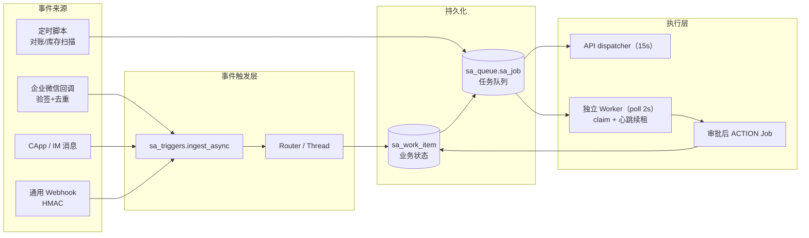
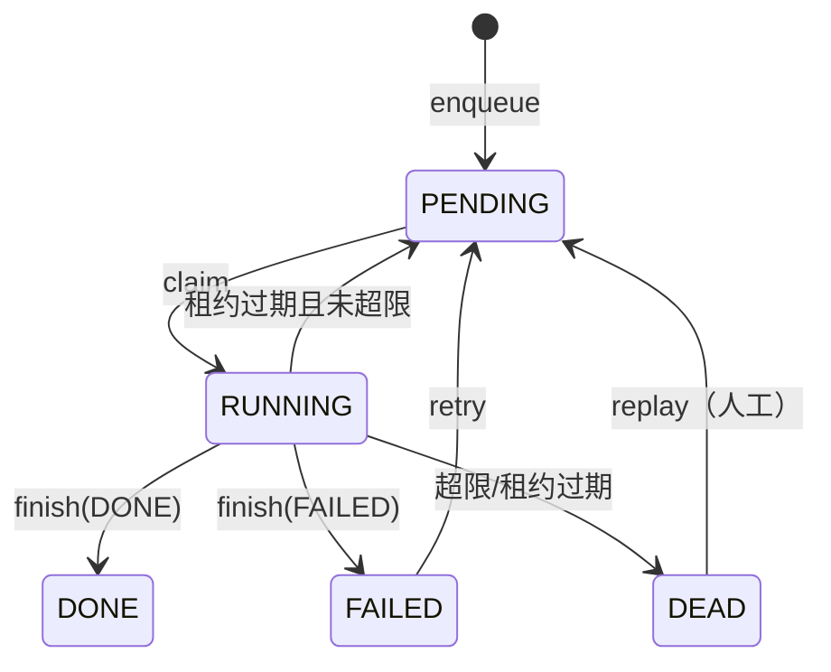

# 消息队列与事件驱动架构

> 消息队列解决的不只是“异步”，而是**把“做什么”与“什么时候做、由谁做、失败怎么办”分开**；事件驱动进一步要求系统接受最终一致，并为重复、乱序、延迟设计兜底。
>
> Qianke 现状：**基于 PostgreSQL 的持久化 Job 队列已实现**（租约、重试、死信、重放）；**事件接入已实现**（企业微信、CApp、通用 Webhook）；**Kafka/RabbitMQ/独立事件总线未引入（规划中）**。
> 状态约定：已实现 / 部分实现 / 已设计 / 规划中 / 理论知识，正文按事实标注，不把规划写成已实现。

## 1. 为什么需要消息队列

HTTP 请求是秒级的，但很多任务不是：Super-agent 调查工单要几十秒到几分钟；对账与库存扫描要定时批量；企业微信回调必须快速返回 success；模型调用失败要重试但不能让用户一直等。直接放在请求线程里会导致超时、重复提交、进程重启丢任务。队列把执行从请求中剥离：请求线程校验→入队→立即返回；Worker 领取→执行→确认/重试，执行因此变得可恢复、可观测、可重放。

## 2. 基本机制

| 概念 | 模型 | 消费语义 |
|---|---|---|
| 任务队列 | 一条消息 = 一个待办 | 竞争消费，一条被一个消费者处理 |
| 发布订阅 | 一条事件 = 多个订阅者 | 广播，多消费者各自处理 |
| 事件流 | 追加日志，可回放 | 分区有序，位点管理 |

Qianke 用的是第一种：`sa_job` 表每行是一个任务，Worker 竞争领取。投递语义上采用 **at-least-once + 消费端幂等**（工程默认；exactly-once 成本高，不作默认承诺）。

队列核心字段：`status`（PENDING/RUNNING/DONE/FAILED/DEAD）、`attempts/max_attempts`、`available_at`（延迟/退避）、`lease_until/worker_id`（租约与执行者）、`last_error`、`created_at/updated_at`。

## 3. 总体架构



读图要点：① **业务状态与执行状态分离**：`sa_work_item` 保存工作项与审批，`sa_job` 只负责“运行一次执行”，Job 重试不会改坏业务状态；② API dispatcher 与独立 Worker 可同时消费，生产可用 `QIANKE_SUPERAGENT_QUEUE_DISPATCHER=0` 让 Worker 独占；③ 定时脚本直接写业务表/告警表，不强行经过 Job 队列。

## 4. 关键设计

**用 `FOR UPDATE SKIP LOCKED` 实现无锁竞争**（真实 SQL 简化）：

```sql
WITH candidate AS (
    SELECT job_id FROM sa_queue.sa_job
    WHERE (status='PENDING' AND available_at <= %s)
       OR (status='RUNNING' AND lease_until < %s)
    ORDER BY created_at ASC
    FOR UPDATE SKIP LOCKED
    LIMIT 1
)
UPDATE sa_queue.sa_job AS j
SET status='RUNNING', attempts=j.attempts+1,
    worker_id=%s, lease_until=%s, updated_at=%s
FROM candidate
WHERE j.job_id=candidate.job_id AND j.attempts < j.max_attempts
RETURNING j.*;
```

这段 SQL 同时完成“选任务 + 抢占 + 增计数 + 设租约”，前提是同一事务只会锁到一行。

**租约而不是“执行完再改状态”**：Worker 领取时写 `lease_until=now+1800s`，执行中每 60 秒心跳续租。Worker 崩溃后租约过期，任务可被重新领取；`attempts >= max_attempts` 则标记 DEAD。没有租约的队列，Worker 被杀后任务会永远停在 RUNNING。

**重试与死信**：异常 → `retry_job(delay=5s)`；超限 → `finish(FAILED/DEAD)`；人工 `replay_job` 将 DEAD/FAILED 重置为 PENDING。死信不是垃圾桶，需要可见、可重放、可审计、有 owner。

**幂等与去重**：队列侧 `UNIQUE(work_item_id, kind)` + `ON CONFLICT DO NOTHING`；业务侧审批动作检查“已执行”状态；事件入口有企业微信 MsgId 去重（进程内集合）与物流事件幂等。

## 5. 工程实现

| 组件 | 位置 | 职责 |
|---|---|---|
| 通用队列核心 | `control/job_queue.py` | `PostgresJobQueue`：enqueue/claim/retry/finish/replay |
| Super-agent 适配 | `superagent/queue_pg.py` | 绑定 `sa_queue.sa_job`、`work_item_id` 身份列 |
| 任务执行 | `superagent/runtime.py` | dispatcher、线程池、心跳、启动恢复、Worker 循环 |
| 独立 Worker | `scripts/sa_worker.py` | `run_worker_loop(poll_seconds=2)` |
| 可观测 | `api/ops.py` `/metrics`、管理端队列页 | 状态统计、死信重放 |



指标：`/metrics` 的 `qianke_queue_jobs{status=...}`；管理端可按状态/kind 过滤、搜索、死信重放。

## 6. 企业级要求

| 维度 | 要求 | Qianke 现状 |
|---|---|---|
| 持久化 | 进程重启不丢任务 | 已实现（PG；SQLite 仅开发回退） |
| 投递语义 | 明确 at-least-once 并要求幂等 | 部分实现（语义清晰；消费端幂等依赖业务） |
| 租约 | Worker 崩溃可恢复 | 已实现 |
| 重试/死信 | 上限、退避、可见、可重放 | 已实现 |
| 多租户隔离 | 租户字段、消费隔离 | 部分实现（work item 有 merchant_id；队列层未隔离） |

## 7. 方案对比

| 方案 | 优点 | 代价 | 适用 |
|---|---|---|---|
| PostgreSQL 队列（Qianke） | 复用 DB、事务一致、零新增组件 | 吞吐受 DB 限制 | 中小吞吐、已有 PG |
| Redis Stream | 轻量、快、有消费组 | 持久化与运维需设计 | 缓存型/短任务 |
| RabbitMQ | 成熟路由、ack、DLX | 额外组件与运维 | 企业消息集成 |
| Kafka | 高吞吐、可回放 | 运维重、语义复杂 | 数据管道/高吞吐事件流 |

Qianke 的选择理由：已有 PG、任务量不大、需要业务状态与任务状态同库一致；引入 Kafka/RabbitMQ 的运维成本高于收益。事件量与跨服务订阅显著增长后再评估独立 MQ。

## 8. Qianke Engine 实践

**状态：已实现（PG Job 队列、事件接入） + 部分实现（去重、告警队列） + 规划中（事件总线、Outbox）。**

| 能力 | 状态 | 证据 / 说明 |
|---|---|---|
| PG Job 队列（SKIP LOCKED） | 已实现 | `control/job_queue.py`、`superagent/queue_pg.py` |
| 租约+心跳+过期回收 | 已实现 | `claim_next`/`renew`/`requeue_expired`；心跳 60s |
| 重试+死信+重放 | 已实现 | `attempts/max_attempts`、`DEAD`、`replay_job` |
| 启动恢复 | 已实现 | `runtime.recover_jobs`、dispatcher 每 15s |
| 独立 Worker 进程 | 已实现 | `scripts/sa_worker.py` |
| 事件接入（企微/CApp/Webhook） | 已实现 | `superagent/triggers.py`、`api/superagent.py` |
| 事件去重（企微） | 部分实现 | 进程内 `_WECOM_SEEN`，5000 上限，重启丢失 |
| Outbox/CDC/事件版本化 | 规划中 | 无实现 |
| 独立消息中间件 | 规划中 | 未引入 Kafka/RabbitMQ |

**未核验项**：SQLite 队列与 PG 队列路径的行为一致性需按测试覆盖范围确认；claim 排序只按 `created_at`，同一工作项不同 kind 的先后顺序无显式约束。

## 9. 评估与验收

```text
[ ] 多 Worker 并发 claim，同一 Job 不会被同时执行
[ ] Worker 崩溃后租约过期，任务可重新领取；超限进入 DEAD
[ ] 重复重放不产生重复业务副作用
[ ] 队列积压、最老 PENDING、DEAD 数量可观测
[ ] 事件重复/验签失败被正确拒绝或去重
```

## 10. 常见误区

1. **把队列当 RPC**：用队列同步等结果，把异步优势变成更复杂的同步。
2. **不做幂等就重试**：at-least-once 必然重复，重复写操作会造成真实损失。
3. **只看入队不看积压**：能收不代表能消化，需要积压与延迟指标。
4. **死信不处理**：DEAD 无人看，最终变成业务静默丢失。
5. **把内存去重当可靠去重**：进程重启或多实例后会重复消费。

## 11. 总结

- 队列的价值是把执行从请求中剥离，并让失败可恢复、可观测、可重放。
- at-least-once + 幂等是工程默认；exactly-once 代价高，不应默认承诺。
- PostgreSQL `SKIP LOCKED` 队列在中等规模系统性价比很高，Qianke 已落地租约、重试、死信与重放。
- 事件驱动需要契约、可靠生产与幂等消费；Qianke 目前只有“事件接入”，进程内去重与无 Outbox 是明确缺口。

## 12. 延伸阅读

### 项目内部资料

- `src/rag_demo/control/job_queue.py`、`superagent/queue_pg.py`
- `src/rag_demo/superagent/runtime.py`、`scripts/sa_worker.py`
- `src/rag_demo/superagent/triggers.py`、`api/superagent.py`
- `tests/test_control_job_queue.py`、`tests/test_superagent.py`

### 官方资料

- PostgreSQL `SKIP LOCKED`：https://www.postgresql.org/docs/current/sql-select.html
- Enterprise Integration Patterns：https://www.enterpriseintegrationpatterns.com/
- RabbitMQ：https://www.rabbitmq.com/docs
- Kafka：https://kafka.apache.org/documentation/
