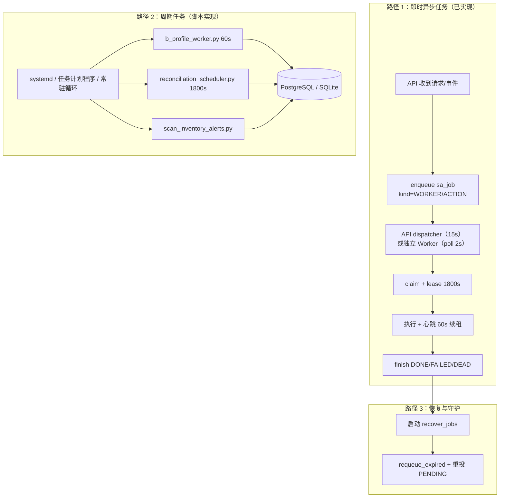

# 分布式任务调度

> 任务调度要解决的不是“怎么写定时器”，而是：**任务在哪个进程执行、失败后谁接、如何避免重复、如何知道它卡住了**。
>
> Qianke 现状：**PG 队列 + 独立 Worker（已实现）**、**常驻扫描脚本 + systemd（已实现）**、**定时脚本（已实现但依赖操作系统调度）**；**统一调度中心与 cron 表达式引擎未实现（规划中）**。
> 状态约定：已实现 / 部分实现 / 已设计 / 规划中 / 理论知识，正文按事实标注，不把规划写成已实现。

## 1. 为什么需要任务调度

系统中有三类时间语义不同的任务：即时异步任务（Super-agent 工单、审批后执行）、延迟/重试任务（5 秒后重试、租约过期回收）、周期任务（对账 30 分钟、库存扫描、画像扫描 60 秒）。只靠请求线程或单机 cron 会超时、丢任务、多实例重复执行、无执行记录与告警。因此需要把任务定义为**可持久化、可观察、可恢复**的实体，并明确谁调度、谁执行。

## 2. 基本机制

调度系统三角色：调度器（决定何时有任务）、任务存储（持久化状态）、执行器（领取执行并反馈）。三者可合并部署，但职责必须清晰。

| 模型 | 机制 | 优点 | 风险 |
|---|---|---|---|
| 中心调度+执行器 | 调度器派发 | 可控、可路由 | 调度器单点 |
| 无主抢占 | Worker 竞争 claim | 简单、天然扩容 | 不保证顺序、需租约 |
| 单机 cron | OS 定时执行脚本 | 零依赖 | 多实例重复、无状态 |

Qianke 采用**无主抢占**：Worker 没有主从，谁抢到谁执行。这使 Worker 可水平扩容，但也意味着不能依赖“某个 Worker 一定执行”。任何调度模型都至少执行一次（租约过期、崩溃、重试），因此任务必须：重复执行结果不变、失败可安全重试或进死信、超时有租约回收与卡住检测。

## 3. 总体架构



读图要点：① 即时任务由事件入队，周期任务由 OS/循环脚本触发，二者最终都落到数据库状态；② 启动恢复依赖租约与数据库，不是“任务一定恢复”的承诺；③ Watchdog 是兜底而非主调度器，默认关闭（`QIANKE_SUPERAGENT_WATCHDOG_ENABLED=0`）。

## 4. 关键设计

**为什么选“无主抢占 + 租约”**：

| 需求 | 满足方式 |
|---|---|
| 多 Worker 扩容 | 新增进程即可，无需注册 |
| Worker 崩溃恢复 | 租约到期后任务被重新领取 |
| 避免重复执行 | 行锁 + SKIP LOCKED 保证一次只有一个 Worker 领到 |

代价是不保证同一业务任务顺序执行；需要串行时用状态机或任务去重，不能依赖队列顺序。

**周期任务原则：只检查与留痕，不自动改关键业务状态。** 对账生成 run 记录与告警，不自动改订单；库存扫描写告警队列，不自动改库存；画像扫描失败不退出常驻进程。自动“修复”数据往往比漏跑更危险。

**失败处理矩阵**：

| 场景 | 处理 |
|---|---|
| 执行抛异常（未超限） | `retry_job(delay=5s)` |
| 超过 max_attempts | `finish(DEAD)`，等人工重放 |
| 进程崩溃重启 | `recover_jobs` 重投 PENDING、回收过期 RUNNING |
| 任务长期卡住 | Watchdog 标记（需开启） |

**时区语义**：`reconciliation_scheduler.py` 的 interval 由 `QIANKE_RECONCILE_INTERVAL_SECONDS` 控制（默认 1800 秒），`--once` 便于外部任务计划程序调用；自然日/自然月等业务口径必须由任务参数明确传入，不能依赖服务器本地时区。

## 5. 工程实现

**Worker 主循环**（真实入口 `scripts/sa_worker.py`）：

```python
stop_event = threading.Event()
runtime.run_worker_loop(poll_seconds=2.0, stop_event=stop_event)

# runtime 内部（简化）
sa_store.requeue_expired_jobs()
while not stop_event.is_set():
    job = sa_store.claim_next_job(_WORKER_ID, lease_seconds=1800)
    if job is None:
        stop_event.wait(2.0)
        continue
    _execute_claimed(job)   # 内部启动 heartbeat 线程续租
```

**常驻服务**（`deploy/systemd/qianke-b-profile-worker.service`）：

```text
ExecStart=/opt/qianke/.venv/bin/python scripts/b_profile_worker.py --interval 60
Restart=always
Environment=QIANKE_CEND_BACKEND=postgres / QIANKE_CONTROL_BACKEND=postgres
```

这是 Qianke 最接近“生产调度”的形态：systemd 负责进程存活，脚本负责周期循环与失败不退出。

| 脚本 | 默认周期 | 作用 |
|---|---|---|
| `b_profile_worker.py` | 60s | 扫描 30 分钟空闲会话并抽取画像 |
| `reconciliation_scheduler.py` | 1800s | C/商家订单对账，留痕+告警 |
| `scan_inventory_alerts.py` | 外部调度 | 扫描低库存并写告警队列 |

**缺失项**：无统一任务注册表（名称/owner/周期/失败联系人）；无 cron 表达式与“下次执行时间”；无任务依赖 DAG；无调度级暂停/恢复/手动触发 UI；无跨时区统一处理层。

## 6. 企业级要求

| 维度 | 要求 | Qianke 现状 |
|---|---|---|
| 任务持久化 | 崩溃后恢复 | 已实现（即时任务）；周期任务依赖外部调度器 |
| 幂等 | 重复执行结果一致 | 部分实现（队列去重+业务状态检查） |
| 超时/租约 | 卡住任务可发现 | 已实现（租约；Watchdog 默认关闭） |
| 失败告警 | 失败通知到人 | 部分实现（日志；无统一任务告警） |
| 隔离/容量 | 多租户互不影响 | 部分实现（数据有 merchant_id；资源未隔离） |

## 7. 方案对比

| 方案 | 优点 | 代价 | 适用 |
|---|---|---|---|
| OS cron/systemd timer | 最简单、零依赖 | 多实例重复、无统一观测 | 单机/少量周期任务 |
| APScheduler | 与代码同进程、配置简单 | 多实例重复、重启丢内存任务 | 单实例非关键任务 |
| Celery beat+worker | 生态成熟、任务路由 | 需 Broker 与运维 | 中等规模 Python 项目 |
| Airflow/DolphinScheduler | DAG、可视化、补数 | 重、集成成本高 | 数据管道/批处理 |
| DB 队列+无主 Worker（Qianke） | 零新增组件、事务一致、可扩容 | 无 DAG、顺序性弱 | 业务异步任务 |

Qianke 的组合是“DB 队列 Worker 处理业务异步任务 + OS 调度运行周期脚本”，在单团队、单实例为主、任务量中等阶段是合理取舍。

## 8. Qianke Engine 实践

**状态：已实现 + 部分实现。**

| 能力 | 状态 | 证据 / 说明 |
|---|---|---|
| 持久化 Job 队列 | 已实现 | `sa_queue.sa_job`、`control/job_queue.py` |
| 多 Worker 竞争领取 | 已实现 | `FOR UPDATE SKIP LOCKED` |
| 租约与心跳续租 | 已实现 | `lease_until=1800s`、每 60s 续租 |
| 启动恢复 | 已实现 | `recover_jobs`、dispatcher 15s |
| 独立 Worker 进程 | 已实现 | `scripts/sa_worker.py` |
| 周期任务 | 已实现（脚本） | `b_profile_worker.py`、`reconciliation_scheduler.py` 等 |
| systemd 集成 | 已实现 | `deploy/systemd/qianke-b-profile-worker.service` |
| 统一调度中心/任务注册表 | 规划中 | 无 |
| cron 表达式/下次执行时间 | 规划中 | 无 |
| 任务失败告警 | 部分实现 | 主要靠日志与管理端查询 |

**未核验项**：`reconciliation_scheduler.py` 在 Windows 任务计划程序中的实际计划配置不在仓库内；`scan_inventory_alerts.py` 的调度方式同样需部署侧确认。

## 9. 评估与验收

```text
[ ] Worker 被杀后任务能重新领取，且不产生重复业务结果
[ ] 同一工作项不会被重复入队
[ ] 超限进入 DEAD，管理端可查看与重放
[ ] 周期任务可 --once 单次执行，便于测试与外部调度
[ ] 周期任务失败不退出常驻进程，日志可见
[ ] 多实例部署时周期任务不会重复执行（或幂等保证）
```

## 10. 常见误区

1. **把单机 cron 当分布式调度**：多实例部署时任务被执行多次。
2. **任务没有 owner**：失败无人处理，最终变成静默数据缺陷。
3. **超时任务无限重试**：耗尽资源且掩盖根因。
4. **定时任务直接修数据**：没有审计与人工确认，错误会被自动放大。
5. **依赖内存调度**：进程重启后内存中的定时任务直接消失。
## 11. 总结

- 调度系统由调度器、任务存储、执行器组成，可合并部署，但职责必须清晰。
- 无主抢占+租约适合业务异步任务：扩容简单、可恢复，代价是不保证顺序。
- 周期任务应由外部调度器或常驻脚本承担，坚持“只检查、留痕、告警，不自动改数据”。
- Qianke 已实现队列 Worker、租约恢复、dispatcher 与 systemd 常驻；统一调度中心、cron 引擎、任务告警仍是缺口。

## 12. 延伸阅读

### 项目内部资料

- `src/rag_demo/superagent/runtime.py`、`watchdog.py`
- `scripts/reconciliation_scheduler.py`、`scripts/scan_inventory_alerts.py`
- `deploy/systemd/qianke-b-profile-worker.service`
- `tests/test_control_job_queue.py`、`tests/test_superagent.py`

### 官方资料

- PostgreSQL `SKIP LOCKED`：https://www.postgresql.org/docs/current/sql-select.html
- systemd.timer：https://www.freedesktop.org/software/systemd/man/systemd.timer.html
- Celery：https://docs.celeryq.dev/
- Kubernetes CronJob：https://kubernetes.io/docs/concepts/workloads/controllers/cron-jobs/
