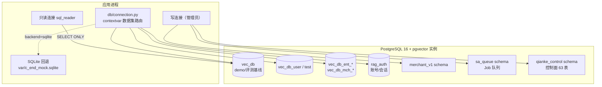

# 数据库架构设计

> 数据库架构的核心问题不是“用哪个数据库”，而是：**数据归谁所有、如何隔离、事务边界在哪、结构如何演进、故障如何恢复**。
>
> Qianke 现状：**PostgreSQL 16 + pgvector 为主库（已实现）**，按数据集/租户物理分库（已实现），控制面 SQLite/PostgreSQL 双后端（已实现），Alembic 基线（已实现）；**读写分离、分片与高可用未实现（规划中）；连接池部分实现（控制面/商家仓储已用线程池，数据集连接层未用池）**。
> 状态约定：已实现 / 部分实现 / 已设计 / 规划中 / 理论知识，正文按事实标注，不把规划写成已实现。

## 1. 为什么需要数据库架构

系统从“一个 demo 库”成长为“多租户 + AI 检索 + 交易控制面”时，会出现冲突：企业数据与演示数据能否同表（隔离）；向量检索与订单事务能否共用连接（职责）；LLM 生成的 SQL 如何保证只读（权限）；控制面从 SQLite 迁 PG 如何回滚（迁移）；备份能否恢复到某个时间点（恢复）。数据库架构的任务是提前回答这些问题，而不是等数据混在一起后再拆。

## 2. 基本机制

| 层次 | 内容 | 关注点 |
|---|---|---|
| 业务数据 | 订单、库存、售后、商品 | 事务、状态机、审计 |
| 控制面 | 账号绑定、审批、队列、策略 | 多实例共享、并发控制 |
| 知识/检索数据 | 画像向量、文档分块、BM25 索引 | 索引结构、重建成本 |
| 运行数据 | 日志、监控、临时文件 | 生命周期与清理 |

多租户隔离三方式：同库同表 + `tenant_id`（最省资源、最易串数据）；同实例 + 独立 database/schema（隔离与成本平衡）；独立实例（隔离最强、运维最重）。Qianke 选择第二种：企业/商户独立物理库，控制面与业务共实例但独立 schema，SQLite 仅开发回退。

迁移原则：加新列/新表（兼容）→ 双写或回填并校验 → 切换读路径 → 删除旧路径。控制面迁移正是按“维护窗口切换 + 回填 + 校验 + 回滚”设计。

## 3. 总体架构



读图要点：① 分库发生在连接层，`DATASETS` 是唯一真源，所有表（含 BM25 派生表）跟着连接走；② 只读账号是 SQL 安全的最终边界，应用层正则只是早失败提示；③ 控制面与业务库同实例但独立 schema；④ SQLite 是开发回退，不是生产多实例方案。

## 4. 关键设计

**数据集路由与写守卫**（`src/rag_demo/db/connection.py`）：

```python
_current = contextvars.ContextVar("rag_dataset", default=DEFAULT_DATASET)
use_dataset(name) / reset_dataset(token)
get_conn(dataset=None)          # 每数据集一条连接 + SELECT 1 探活
get_readonly_conn(dataset=None) # Text2SQL 专用只读连接
writes_to(dataset)              # 写作用域；未声明抛 UnsafeWriteError
```

线程/线程池不会自动继承 contextvar；若写操作静默落到默认 `demo` 库，会清空评测基线。因此“忘记声明”必须是显式错误。

**只读账号**：`ensure_readonly_access()` 幂等创建 `sql_reader` 并授予 `CONNECT/USAGE/SELECT`，无写权限。Text2SQL 即使绕过应用层校验，也无法写库或读授权外的表。

**派生索引不是缓存**：`search_index` 保存 BM25 分词与稀疏向量，`search_index_meta` 保存语料指纹；修改源数据后必须重建，否则检索静默使用旧索引。

**双后端仓储**：`control/factory.py`、`merchant/factory.py`、`c_end/store.py` 按环境变量选择 PG/SQLite；同一接口两套实现靠契约测试保证行为一致（迁移期工程，不是最终形态）。

## 5. 工程实现

| 能力 | 位置 |
|---|---|
| 连接与数据集路由 | `src/rag_demo/db/connection.py` |
| 建表与索引 | `src/rag_demo/db/schema.py` |
| 控制面 PG schema（63 表，2026-11-23 快照） | `src/rag_demo/control/schema_pg.sql` |
| Alembic 基线 | `alembic/versions/0001_merchant_v1.py` |
| 商家仓储契约 | `src/rag_demo/merchant/repository.py` |
| 账号/会话库 | `src/rag_demo/auth.py`（`rag_auth`） |
| 备份恢复 | `scripts/backup_control_plane.py`、`restore_control_plane.py` |

连接管理是分层取舍：数据集连接层（`db/connection.py`）每个数据集各持一条连接，按单机单用户不做池；控制面/认证仓储（`auth.py` 1..8、`control/postgres_repository.py` 1..4）与商家仓储（`merchant/postgres_repository.py` 1..8）已使用 `ThreadedConnectionPool`。

索引：画像表 `embedding` 使用 HNSW + `vector_cosine_ops`，`city`/`member_level` 建 B-tree 服务 Text2SQL 过滤；BM25 与稀疏权重落在 `search_index`，通过 `sparsevec` 在库内计算。

## 6. 企业级要求

| 维度 | 要求 | Qianke 现状 |
|---|---|---|
| 隔离 | 租户数据物理/逻辑隔离 | 已实现（企业/商户独立库） |
| 权限 | 最小权限、只读账号 | 已实现（`sql_reader`） |
| 事务 | 关键写路径有锁与约束 | 已实现（行锁、CAS、UNIQUE） |
| 迁移 | 版本化、可回滚、有校验 | 已实现（Alembic + 迁移方案；回滚演练有限） |
| 备份恢复 | 定期备份、恢复演练 | 部分实现（脚本存在；执行与演练待确认） |
| 高可用 | 主从/故障切换 | 规划中（单实例） |
| 扩展性 | 读写分离、分片 | 规划中（连接池部分实现，见 §5） |
| 审计 | 关键表写入可追溯 | 部分实现（审批/策略/执行审计；通用变更审计缺） |

## 7. 方案对比

| 决策点 | 方案 A | 方案 B | Qianke 选择 |
|---|---|---|---|
| 多租户 | 同表 tenant_id | 独立库 | 独立库 |
| 控制面存储 | SQLite | PostgreSQL | PG 主用、SQLite 回退 |
| 向量检索 | 独立向量库 | PG + pgvector | PG + pgvector |
| 迁移 | 停机全量 | 维护窗口/在线 | 维护窗口（数据量小） |
| 搜索索引 | 进程内 pkl | 数据库表 | 数据库表 |
| 连接管理 | 数据集层长连接；控制面/商家仓储线程池 | 每数据集长连接 | 数据集长连接 + 控制面/商家池 |

取舍逻辑是**优先减少组件与运维复杂度**，代价是放弃部分弹性与高可用；这在当前阶段合理，但必须标注为限制而不是优势。

## 8. Qianke Engine 实践

**状态：已实现 + 部分实现。**

| 能力 | 状态 | 证据 / 说明 |
|---|---|---|
| PostgreSQL 16 + pgvector | 已实现 | `docker-compose.yml`（pgvector/pgvector:pg16） |
| 数据集物理分库 | 已实现 | `config.DATASETS`、`enterprise_db_name`、`merchant_db_name` |
| contextvar 数据集路由 | 已实现 | `db/connection.py` |
| 写作用域守卫 | 已实现 | `writes_to`、`require_write_scope` |
| Text2SQL 只读账号 | 已实现 | `ensure_readonly_access`、`get_readonly_conn` |
| 控制面 PG schema | 已实现 | `control/schema_pg.sql`、控制面迁移 ADR |
| 双后端仓储 + 契约测试 | 已实现 | `tests/test_control_repository_contract.py` 等 |
| Alembic 基线 | 已实现 | `alembic/versions/0001_merchant_v1.py` |
| BM25/稀疏索引落库 | 已实现 | `search_index`、`search_index_meta` |
| 备份/恢复脚本 | 部分实现 | 脚本存在；无定期演练证据 |
| 连接池 | 部分实现 | 控制面/商家仓储已用线程池；数据集连接层明确不做池 |
| 读写分离/分片/HA | 规划中 | 无实现 |

**分层说明**：`AGENTS.md` 1.9.7 的“PostgreSQL 连接池”指控制面/商家仓储；`db/connection.py` 注释指数据集连接层，两者不是同一模块。C 端默认后端仍为 sqlite（`QIANKE_CEND_BACKEND`），生产实际使用哪种后端需按部署环境变量确认。

## 9. 评估与验收

```text
[ ] 租户/数据集之间无法跨库读取（隔离测试通过）
[ ] 写操作未声明数据集时明确失败，而不是写默认库
[ ] Text2SQL 使用只读账号，写语句被数据库拒绝
[ ] 迁移脚本可重复执行，失败可回滚
[ ] 备份可恢复且校验行数/校验和
[ ] 关键查询走索引（EXPLAIN 验证无全表扫描）
[ ] 派生索引与源数据一致性有检查脚本
```

## 10. 常见误区

1. **先分库再想事务**：跨库写没有本地事务，必须提前设计补偿与对账。
2. **把向量库当业务库**：向量索引适合检索，不适合承载订单状态。
3. **没有迁移版本**：直接改表结构，回滚时不知道原状。
4. **权限全用超级用户**：LLM 生成 SQL 的场景必须使用只读账号。
5. **备份等于可恢复**：没有恢复演练的备份只是文件。

## 11. 总结

- 数据库架构要先定数据所有权与隔离方式，再谈选型与性能。
- Qianke 以 PostgreSQL + pgvector 为核心，按数据集物理分库，控制面独立 schema，只读账号形成 SQL 安全边界。
- 双后端仓储与契约测试是迁移期正确手段，但长期会积累维护成本，需要明确收敛时间。
- 单实例、数据集层无连接池、无读写分离/HA 是当前明确限制；控制面/商家仓储已有线程池。
- 文档必须把“代码事实”与“变更记录/方案目标”分开，避免把未核验能力写成已实现。

## 12. 延伸阅读

### 项目内部资料

- `docs/数据模型.md`
- `docs/decisions/control_plane_postgres_migration_v0.1.md`
- `src/rag_demo/db/connection.py`、`db/schema.py`、`control/schema_pg.sql`
- `tests/test_control_repository_contract.py`、`test_tenant_isolation_pg.py`、`test_cend_pg_runtime.py`

### 官方资料

- PostgreSQL：https://www.postgresql.org/docs/
- pgvector：https://github.com/pgvector/pgvector
- Alembic：https://alembic.sqlalchemy.org/
- PostgreSQL 事务隔离：https://www.postgresql.org/docs/current/transaction-iso.html
