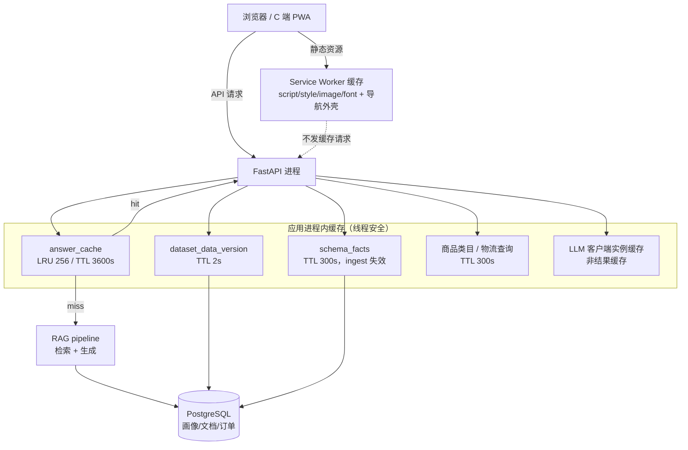

# 缓存系统设计

> 缓存不是“加一层 Redis”。它首先是一个**一致性契约**：允许用户在什么时间窗口内看到旧数据，以及如何保证不把错误数据缓存下来。
>
> Qianke 现状：**进程内 LRU + TTL 缓存已实现**（问答结果、schema facts、商品类目、物流查询），**数据版本驱动失效已实现**，**PWA 静态缓存已实现**；**分布式缓存（Redis）、CDN 统一缓存、缓存告警未实现（规划中）**。
> 状态约定：已实现 / 部分实现 / 已设计 / 规划中 / 理论知识，正文按事实标注，不把规划写成已实现。

## 1. 为什么需要缓存

Qianke 的性能数据来自代码注释与实测记录：“一次问答 9~17 秒，其中 92~96% 花在 LLM 生成。”同一问题在调试、评测、演示中被反复提问时，重复调用 LLM 既慢又贵，缓存命中后可降到毫秒级。缓存还承担：降低数据库与检索压力（schema facts、商品类目）、降低第三方接口成本（物流查询）、提升弱网/离线体验（PWA 静态缓存）。

## 2. 基本机制

| 位置 | 例子 | 特点 |
|---|---|---|
| 浏览器 | PWA Service Worker、HTTP Cache | 离用户最近，不可控 |
| CDN/网关 | 静态资源 CDN、Nginx 缓存 | 减少回源，需版本化 URL |
| 应用进程 | LRU/字典缓存 | 最快，多实例不一致 |
| 分布式缓存 | Redis/Memcached | 多实例共享，增加组件 |
| 数据库 | 物化视图、派生索引 | 持久、可重建，写入成本高 |

淘汰与失效：容量用 LRU；时间用 TTL；主动失效用 clear / 版本号；被动校验用键里的数据版本。

三个经典问题：缓存穿透（查不存在的数据，每次打 DB；解：空值缓存、参数校验）、缓存击穿（热点键过期瞬间打 DB；解：单飞、逻辑过期）、缓存雪崩（大量键同时过期或缓存层故障；解：TTL 抖动、降级、限流）。Qianke 的问答缓存是“可选加速”，失效时回退完整链路，不会造成数据错误；但没有单飞保护，热点问题过期瞬间可能并发重复计算。

## 3. 总体架构



读图要点：① 浏览器缓存只覆盖静态资源与导航外壳，`/api/`、`/auth/`、`/admin/`、`/whoami` 明确不缓存，避免把身份响应缓存到本地；② `answer_cache` 是最大收益点，命中直接返回，miss 才进入完整链路；③ `dataset_data_version` 让问答缓存在数据重建后自然失效；④ LLM 客户端实例缓存不是答案缓存，不能计入命中率。

## 4. 关键设计

**缓存键必须包含所有影响结果的维度。** 真实代码（`cache.py::AnswerCache.make_key`）包含：`dataset | question | dept | keyword_mode | profile_limit | deep_thinking | history_key | data_version | persona_key | rrf_k`。

| 维度 | 不进键的后果 |
|---|---|
| dataset | 用户库命中 demo 库答案（跨租户串数据） |
| keyword_mode | 切换 BM25/稀疏后拿到旧策略结果 |
| deep_thinking | 勾选深度思考却返回未思考的旧答案 |
| rrf_k | 消融实验切换 k 后命中旧排序 |
| data_version | 数据重建后仍返回旧答案 |
| history_key | 多轮上下文串话 |

**角色为什么不进键**：缓存存完整结果，角色裁剪发生在响应序列化阶段（`permissions.render`）。角色进键会让同一问题按角色重复计算；先裁剪再缓存会让低权角色先提问污染高权缓存。安全与性能的平衡是：缓存内容不含权限裁剪，裁剪逻辑确定性执行。

**数据版本驱动失效**：优先级为 `last_build.at`（最近构建时间）→ ingest manifest 哈希（旧库无 last_build）→ `unknown`。版本缓存 TTL 只有 2 秒，避免每次问答读 meta 表；数据重建后最多 2 秒新版本生效，旧问答缓存自然不再命中。

**容量与线程安全**：LRU 上限 256、TTL 默认 3600 秒、`threading.Lock` 保证 API 与后台构建并发安全。`clear()` 整体清空而非按数据集清空：键存哈希，事后无法按数据集筛，构建完成后整体清空的代价只是 demo 缓存重算一遍。

## 5. 工程实现

| 能力 | 位置 |
|---|---|
| 问答缓存 | `src/rag_demo/cache.py::AnswerCache` |
| 数据版本 | `cache.py::dataset_data_version` |
| 缓存读写 | `src/rag_demo/pipeline.py`、`api/main.py` |
| 统计与清理 | `GET /cache/stats`、`POST /admin/clear-cache`（仅系统管理员） |
| schema facts 缓存 | `db/schema_facts.py`（TTL 300s，ingest 失效） |
| 类目/物流缓存 | `c_end/catalog_search.py`、`c_end/express.py`（300s） |
| PWA 静态缓存 | `web/public/sw.js`（版本化缓存名，排除 API/鉴权） |

```json
// GET /cache/stats（仅系统管理员）
{"size": 42, "maxsize": 256, "ttl": 3600, "hits": 130, "misses": 88, "hit_rate": 59.6}
```

PWA 缓存边界（`sw.js` 真实逻辑）：`/api/`、`/auth/` 直接 return；`/whoami`、`/admin/` 不缓存；只缓存 script/style/image/font 与导航外壳。排除清单比包含清单更重要——身份或业务数据被错误缓存，会出现“换账号仍看到上一位用户数据”。

## 6. 企业级要求

| 维度 | 要求 | Qianke 现状 |
|---|---|---|
| 一致性 | 明确可接受的陈旧窗口 | 已实现（TTL + 数据版本） |
| 隔离 | 租户/角色数据不串 | 键含 dataset；角色靠响应裁剪 |
| 性能 | 命中率与延迟可观测 | 部分实现（有 stats；无告警） |
| 容量 | 内存上限可配置 | 已实现（LRU 256） |
| 失效 | 数据更新可主动/被动失效 | 已实现（版本键 + clear） |
| 故障降级 | 缓存故障不影响正确性 | 已实现（失效即回源） |
| 多实例 | 共享缓存与一致失效 | 规划中（当前为进程内缓存） |
| 敏感数据 | 不缓存越权内容/过期签名 URL | 已实现（图片只存 key，响应时签名） |

## 7. 方案对比

| 方案 | 优点 | 代价 | 适用 |
|---|---|---|---|
| 进程内 LRU+TTL（Qianke） | 零组件、纳秒级、实现简单 | 多实例不共享、重启丢失 | 单实例/可回源场景 |
| Redis | 多实例共享、结构丰富 | 新增组件、序列化、网络延迟 | 多实例热点数据 |
| 数据库物化/派生表 | 持久、可重建 | 写入成本、更新延迟 | 检索索引、统计 |
| CDN | 边缘加速、减回源 | 缓存策略与版本化要求高 | 静态资源/图片 |
| 客户端 PWA | 离线可用、省流量 | 版本管理与更新复杂 | C 端应用 |

Qianke 的取舍是“先用进程内缓存拿到 80% 收益，等跨实例一致性成为真实问题时再引入 Redis”。

## 8. Qianke Engine 实践

**状态：已实现（进程内缓存与失效） + 部分实现（多层小缓存） + 规划中（分布式缓存）。**

| 能力 | 状态 | 证据 / 说明 |
|---|---|---|
| 问答结果 LRU+TTL | 已实现 | `cache.py::AnswerCache`，256/3600s，线程安全 |
| 缓存键维度完整 | 已实现 | `make_key` 显式拼接 + sha256 |
| 数据版本失效 | 已实现 | `dataset_data_version`（2s 版本缓存） |
| 缓存统计与清理 | 已实现 | `/cache/stats`、`/admin/clear-cache`（管理员） |
| schema facts 缓存 | 已实现 | `schema_facts.py`，ingest 时 invalidate |
| 类目/物流缓存 | 已实现 | `catalog_search.py`、`express.py`（300s） |
| PWA 静态缓存 | 已实现 | `web/public/sw.js`，排除 API/鉴权/管理 |
| 分布式缓存（Redis） | 规划中 | 依赖列表中无 Redis 客户端 |
| 缓存告警/命中率看板 | 规划中 | 仅接口返回 stats |
| 防击穿（单飞）/空值缓存 | 规划中 | 未实现 |

**未核验项**：`schema_facts` 的 ingest 失效链路需按 `ingest_data.py` 末尾的 invalidate 调用核验覆盖范围；PWA 缓存版本号（当前 `v24`）与发布流程是否强制更新，需按构建脚本确认。

## 9. 评估与验收

```text
[ ] 相同问题第二次请求命中缓存，响应明显变快
[ ] 数据重建后旧答案不再命中（data_version 生效）
[ ] 不同数据集/参数维度不会互相覆盖
[ ] 低权角色无法通过缓存拿到高权内容
[ ] 缓存容量达到上限后按 LRU 淘汰
[ ] /cache/stats 与 /admin/clear-cache 仅管理员可访问
[ ] PWA 不缓存 /api、/auth、/whoami、/admin
[ ] 缓存故障时回源可用，不阻断业务
```

## 10. 常见误区

1. **键漏维度**：少一个参数就把不同结果混在一起，表现为“时对时错”。
2. **先裁剪再缓存**：低权角色先请求会污染高权角色的缓存。
3. **缓存永不过期**：数据更新后永远返回旧结果且无法察觉。
4. **把缓存当数据库**：缓存丢失就丢业务数据，说明用错了。
5. **多实例用本地缓存却承诺一致性**：各实例各有一份，失效互不通知。
6. **缓存敏感数据**：签名 URL、身份证号、完整权限对象不应进缓存。

## 11. 总结

- 缓存首先是正确性问题：键、失效、隔离、裁剪时机决定它是否安全。
- Qianke 用进程内 LRU+TTL 解决了“重复问题重复烧 LLM”的高价值场景，并用数据版本保证重建后失效。
- 角色不进键、响应时裁剪、图片只存 key，是值得复用的安全设计。
- 分布式缓存、缓存告警、防击穿仍是规划；多实例部署前必须补齐共享缓存或接受一致性问题。

## 12. 延伸阅读

### 项目内部资料

- `src/rag_demo/cache.py`（含键设计与失效策略注释）
- `src/rag_demo/pipeline.py`、`api/main.py`、`db/schema_facts.py`
- `web/public/sw.js`
- `tests/test_cache_version.py`

### 官方资料

- Redis：https://redis.io/docs/
- HTTP Caching（RFC 9111）：https://www.rfc-editor.org/rfc/rfc9111
- MDN Service Worker：https://developer.mozilla.org/docs/Web/API/Service_Worker_API
- web.dev：Service Worker 缓存：https://web.dev/articles/service-workers-cache-storage
