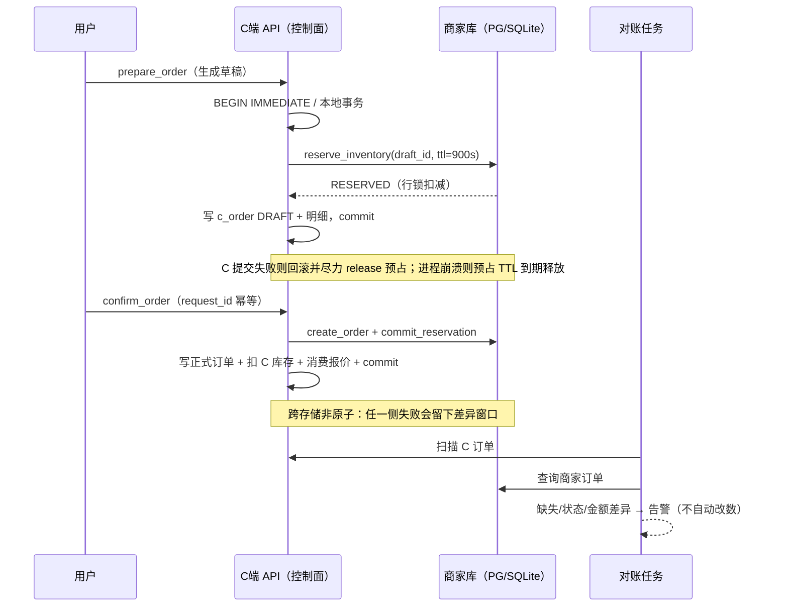

# 分布式事务与数据一致性

> 分布式事务的难点不是“如何让两段代码同时成功”，而是**如何让系统在部分成功时仍然可解释、可发现、可修复**。
>
> Qianke 现状：**未使用 2PC/XA/Saga 框架（规划中）**；采用**同一存储内本地事务 + 跨存储补偿 + 幂等键 + 定时对账 + 审计链（部分实现）**。本文明确区分“哪些是强一致，哪些是最终一致”。
> 状态约定：已实现 / 部分实现 / 已设计 / 规划中 / 理论知识，正文按事实标注，不把规划写成已实现。

## 1. 为什么需要专门设计一致性

AI 电商系统里，一次“确认订单”可能同时涉及：C 端订单库（正式订单、明细、草稿状态、消费报价）、商家库（创建订单、预占转提交、扣减库存、记录金额）、奖励/回访（伙伴积分、购后回访计划）。这些写操作分布在两个存储（控制面 SQLite/PG、商家 PG）中，不存在一个能同时覆盖它们的本地事务。部分成功会产生：商家扣了库存但 C 端订单没创建；C 端订单创建了但商家订单缺失；两边金额不一致；重复点击导致重复下单。

一致性设计的任务就是把这些窗口变小、让差异可发现、让修复可审计。

## 2. 基本机制

ACID 是单库事务保证；BASE（基本可用、软状态、最终一致）是跨服务/跨库的工程取舍。强一致只应给“金额、库存、订单状态”等核心数据；展示、通知、统计可以最终一致。

| 方案 | 机制 | 优点 | 代价 |
|---|---|---|---|
| 2PC/XA | 协调者两阶段提交 | 强一致语义清晰 | 阻塞、单点、性能差 |
| TCC | Try-Confirm-Cancel | 业务级可控 | 需三接口、空回滚/悬挂处理 |
| Saga | 本地事务 + 补偿 | 无长期锁、适合长流程 | 补偿复杂、中间态可见 |
| Outbox | 业务事务内写消息，异步投递 | 可靠、实现简单 | 需投递器与幂等消费 |
| 对账+补偿 | 定时核对，发现差异后修复 | 兜底能力最强 | 有滞后、需要运营流程 |

一致性的四个工程支柱：幂等（重复请求/消息不产生重复副作用）、补偿（失败时释放已占资源或回滚状态）、对账（跨存储差异可被发现）、审计（每次状态变化可追溯，修复动作有记录）。

## 3. 总体架构



读图要点：① 跨存储写入没有全局事务，一致性依赖提交顺序、失败释放、TTL 与对账；② 幂等键在 C 端订单上（`idempotency_key UNIQUE`），重复确认返回同一订单；③ 对账只“发现并告警”，建议人工走受控接口修复，禁止直接改库。

## 4. 关键设计

**同库内本地事务，跨库用补偿。** C 端草稿、正式订单、明细、报价消费在同一控制面事务内（SQLite `BEGIN IMMEDIATE` 或 PG `BEGIN`）；商家预占/提交在商家库事务内，用 `SELECT ... FOR UPDATE` 保证并发不超卖；跨库失败时执行补偿：取消草稿释放预占、取消订单触发商家退款与库存回补。

**库存预占状态机**：

```text
RESERVED  → 预占中：available 已扣、reserved 已加，可 release 或 commit
COMMITTED → 已提交为订单：available 保持扣减，reserved 转出
（过期）  → TTL 到期释放，避免长期占用
```

预占 TTL 默认 900 秒（`_reserve_merchant_stock` 传 `ttl_seconds=900`），是“草稿长时间不确认”的兜底。

**幂等设计清单**：

| 场景 | 幂等键 | 实现 |
|---|---|---|
| Agent 请求 | `request_id` | Execution Store claim/complete/fail |
| C 端订单确认 | `request_id` / `idempotency_key UNIQUE` | 重复请求返回已有订单 |
| 客户端消息 | `client_message_id` + 内容指纹 | `c_end/idempotency.py` |
| 回调事件 | MsgId / 事件 ID | 企微进程内去重、物流事件幂等 |
| 售后/补偿 | `OPEN` 唯一部分索引、`order_id UNIQUE` | 数据库约束兜底 |
| 队列任务 | `UNIQUE(work_item_id, kind)` | 重复入队不产生新任务 |

**对账与审计**：`reconcile_orders` 扫描 C 订单，核对商家订单是否存在、状态是否一致（CONFIRMED/CANCELLED/REFUNDED）、原始金额是否一致；`c_reconciliation_alert` 去重、自动 resolved、Webhook 推送；策略审计采用哈希链 + 锚点 + 只追加触发器（可 verify）。对账不自动改数是有意的：错误修复必须经过受控接口与人工确认。

## 5. 工程实现

| 能力 | 位置 |
|---|---|
| 草稿/确认/取消 | `c_end/store.py`（`prepare_order`/`confirm_order`/`cancel_confirmed_order`） |
| 商家库存预占 | `merchant/postgres_repository.py`（reserve/commit/release） |
| 客户端幂等 | `c_end/idempotency.py`、`c_client_request` |
| 对账 | `c_end/store.py::reconcile_orders`、`run_reconciliation` |
| 对账告警 | `c_end/alerts.py`、`c_reconciliation_alert` |
| 定时对账 | `scripts/reconciliation_scheduler.py`（默认 1800s） |
| 策略审计链 | `_audit_chain_hash`、`anchor_policy_audit`、`verify_policy_audit_chain` |

关键约束（来自控制面迁移方案）：`c_order.idempotency_key UNIQUE`、`c_order_item PK(order_id, product_id)`、`c_after_sale OPEN` 唯一部分索引、`c_compensation.order_id UNIQUE`、`sa_job(work_item_id, kind) UNIQUE`。数据库唯一约束是一致性的最后防线，应用层判断只能减少冲突。

事务并发热点：`confirm_order`、`cancel_order`、`resolve_after_sale`、`receive_after_sale`、`create_compensation`、`decide_approval`、`complete_execution`、`upsert_merchant_policy`。这些点在迁移方案中被列为必须逐项加锁/约束的热点，是评审一致性设计的最小清单。

## 6. 企业级要求

| 维度 | 要求 | Qianke 现状 |
|---|---|---|
| 核心数据强一致 | 订单/库存/金额不出现双写成功 | 部分实现（单存储内强一致；跨存储最终一致） |
| 幂等 | 重复请求不重复执行 | 已实现（订单/消息/任务/Agent） |
| 补偿 | 失败可释放资源 | 部分实现（预占释放、取消退款、TTL 兜底） |
| 对账 | 差异可发现、可追踪 | 已实现（C→商家方向）；反向/资金对账待补 |
| 审计 | 状态变化可追溯 | 部分实现（策略审计链；订单操作审计分散） |
| 人工兜底 | 修复走受控流程 | 已实现（告警建议“不要直接改库”） |
| 故障演练 | 部分成功场景验证 | 部分实现（有并发/幂等测试；跨存储故障注入未成体系） |

## 7. 方案对比

| 方案 | 是否采用 | 原因 |
|---|---|---|
| 2PC/XA | 未采用 | 跨异构存储成本高、阻塞、与 SQLite/PG 双后端不兼容 |
| TCC | 未采用 | 每个业务动作要实现 Try/Confirm/Cancel，当前接口量不划算 |
| Saga 框架 | 未采用 | 无统一编排器；用显式补偿函数替代 |
| 本地事务+补偿+对账 | 已采用 | 与模块化单体、双后端现状匹配，落地成本最低 |
| Outbox/CDC | 规划中 | 事件可靠生产需要，当前未实现 |
| 幂等框架化 | 部分采用 | 订单/消息/队列各自实现，未统一抽象 |

## 8. Qianke Engine 实践

**状态：部分实现 + 理论知识。** 理论知识指 2PC/TCC/Saga 等通用方案；Qianke 实际采用“本地事务 + 补偿 + 对账”。

| 能力 | 状态 | 证据 / 说明 |
|---|---|---|
| 本地事务（控制面/商家库） | 已实现 | `BEGIN IMMEDIATE` / PG 事务 |
| 库存预占 + 行锁 | 已实现 | `reserve_inventory`、`FOR UPDATE`、状态机 |
| 预占 TTL 兜底 | 已实现 | `ttl_seconds=900` |
| 订单确认幂等 | 已实现 | `idempotency_key UNIQUE`、`request_id` |
| 客户端消息幂等 | 已实现 | `c_end/idempotency.py` |
| 失败补偿 | 部分实现 | 草稿失败释放预占；取消/退款/退货回补 |
| 定时对账+告警 | 已实现 | `reconcile_orders`、`reconciliation_scheduler.py` |
| 对账告警去重/恢复 | 已实现 | `_sync_reconciliation_alerts` |
| 策略审计哈希链 | 已实现 | `anchor_policy_audit`、`verify_policy_audit_chain` |
| 跨存储全局事务 | 未实现/规划中 | 无 2PC/XA；跨库写非原子 |
| 反向对账（商家→C） | 未核验/缺口 | `reconcile_orders` 以 C 订单为主表扫描 |
| 自动修复 | 未实现（有意） | 告警给人工建议，不自动改数 |
| Outbox/CDC | 规划中 | 无实现 |

**未核验项**：① `reconcile_orders` 只遍历 C 订单，“商家订单已创建但 C 订单写入失败”可能不被当前扫描发现（需确认是否存在反向任务）；② 控制面与商家后端都配 PG 时，两者是否同一数据库实例/连接不等于同一事务，代码仍按两个仓储调用；③ 售后/退款链路一致性覆盖范围需按 `tests/test_c_end_merchant_transactions.py`、`test_c_end_reconciliation_runs.py` 核验。

## 9. 评估与验收

```text
[ ] 并发生成/确认订单不超卖
[ ] 同一 request_id 重复确认返回同一订单，不重复扣库存
[ ] 草稿创建失败后商家预占被释放（或 TTL 自动释放）
[ ] 取消订单后商家库存与 C 库存均恢复
[ ] 对账可发现缺失订单、状态差异、金额差异
[ ] 对账告警可去重、可标记已解决、可推送
[ ] 审计链可校验，篡改可被发现
[ ] 关键修复动作必须走受控接口，不允许直接改库
```

## 10. 常见误区

1. **用重试代替幂等**：重试只会增加重复执行概率。
2. **跨库长事务**：把网络调用包在数据库事务里，锁持有时间不可控。
3. **认为“有对账就万事大吉”**：对账只能发现已建模的差异，未覆盖方向会静默漏掉。
4. **把最终一致说成强一致**：用户看到“已支付但订单未创建”时，一致性承诺已经破产。
5. **自动修复代替人工确认**：金额/库存错误被自动“修正”，可能扩大损失。
6. **审计只记结果不记依据**：无法判断修复是否合规。

## 11. 总结

- 分布式一致性不是“选一个框架”，而是设计失败窗口、补偿动作、发现机制与修复权限。
- Qianke 采用“本地事务 + 库存预占 + 幂等键 + 补偿 + 定时对账 + 审计链”，未引入 2PC/TCC/Saga。
- 强一致只覆盖单存储内；跨存储是最终一致，存在可观测的时间窗口。
- 对账不应自动改数；告警 + 人工受控修复是当前阶段更安全的选择。
- 反向对账、Outbox、资金级对账仍是缺口或规划项。

## 12. 延伸阅读

### 项目内部资料

- `src/rag_demo/c_end/store.py`、`merchant/postgres_repository.py`
- `src/rag_demo/c_end/idempotency.py`
- `docs/decisions/control_plane_postgres_migration_v0.1.md` §5.3
- `tests/test_c_end_merchant_transactions.py`、`test_c_end_idempotency.py`、`test_c_end_reconciliation_runs.py`

### 官方资料

- Martin Kleppmann《Designing Data-Intensive Applications》第 7–9 章
- microservices.io：Saga / Transactional Outbox：https://microservices.io/patterns/
- PostgreSQL 事务隔离：https://www.postgresql.org/docs/current/transaction-iso.html
- Pat Helland：Life Beyond Distributed Transactions（论文）
