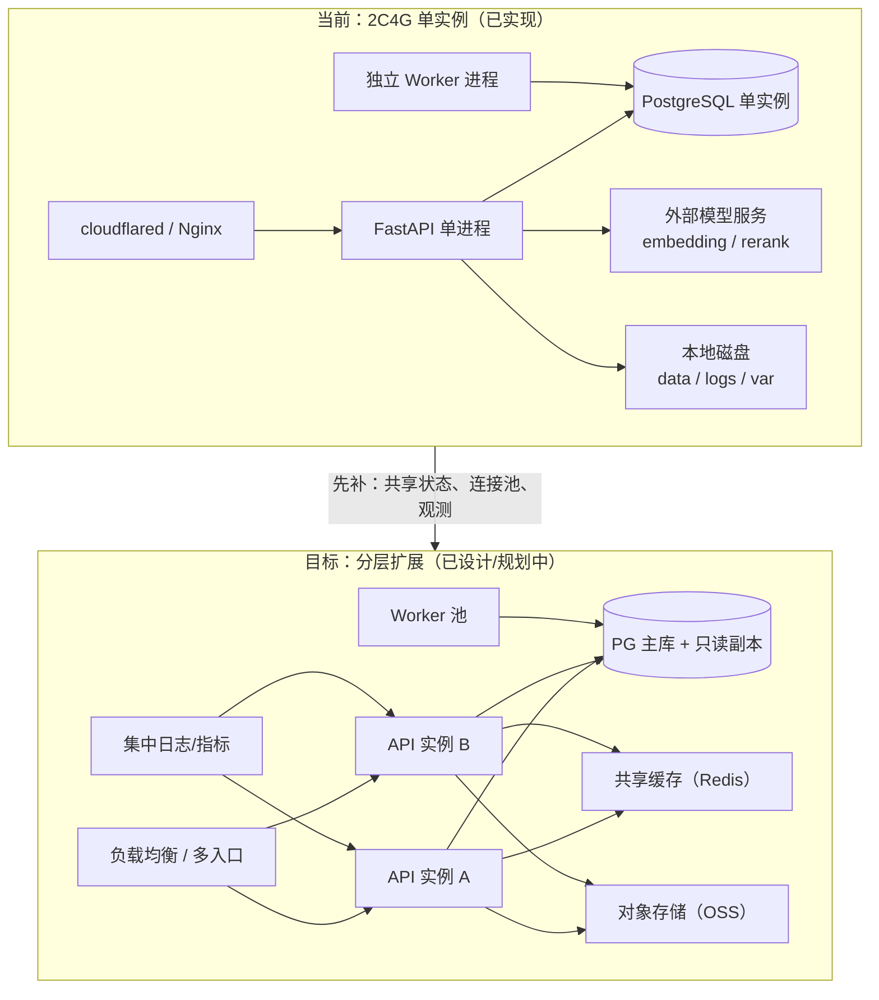

# 系统扩展性设计

> 扩展性不是“能上多少机器”，而是：**当请求量、租户数、数据量或任务量增长时，系统能否以可预测的成本保持可接受的延迟与正确性**。
>
> Qianke 现状：**当前为单实例部署（已实现）**，通过“外部模型服务 + PG 队列多 Worker + PG 控制面”具备部分横向扩展条件（已实现）；**多 API 实例一致性、读写分离、分片与弹性伸缩未实现（规划中/已设计）；连接池为部分实现（控制面/商家仓储有线程池，数据集层未用池）**。
> 状态约定：已实现 / 部分实现 / 已设计 / 规划中 / 理论知识，正文按事实标注，不把规划写成已实现。

## 1. 为什么需要扩展性设计

Qianke 当前目标是 2 核 4G 云服务器。这个约束下最先耗尽的往往不是 CPU，而是：本地加载 BGE-M3/reranker 的内存与显存；LLM 长耗时请求占满 Worker；单进程 LRU 缓存与单例数据库连接在多实例下失效；上传文件、日志、checkpoint 存在本地磁盘；PostgreSQL 单实例承担业务、控制面与队列三种负载。

扩展性设计要回答：**先扩哪一层、扩了之后哪里先崩、用什么指标判断该扩了**。

## 2. 基本机制

| 方式 | 做法 | 优点 | 限制 |
|---|---|---|---|
| 垂直扩展 | 加 CPU/内存/磁盘 | 改动最小 | 有上限、成本非线性 |
| 水平扩展 | 加实例/Worker | 理论无上限 | 要求无状态、共享存储 |

无状态化的检查清单：会话状态在外部存储；缓存可共享或可接受不一致；上传文件在对象存储或共享卷；日志写集中式系统；定时任务不会多实例重复；指标可按实例聚合。

| 扩展维度 | 增长信号 | 优先手段 |
|---|---|---|
| 请求量 | QPS/并发/p95 上升 | 水平扩 API、加缓存、限流 |
| 任务量 | 队列积压、最老 PENDING | 扩 Worker、拆队列 |
| 数据量 | 表大小、索引膨胀、慢查询 | 分区、归档、读副本、分片 |
| 租户数 | 独立库数量、连接数 | 数据库编排、连接池/代理 |
| 输出成本 | Token/调用费用 | 缓存、模型路由、预算控制 |

**瓶颈定位先于扩容。** Qianke 已有 `/ready`（依赖就绪）、`/metrics`（队列/工作项/审批/租户）、`ai_monitor`（延迟与 Token）、队列 stats，足以做粗粒度定位，但还缺按接口的 p95、并发与资源水位，不足以做容量规划。

## 3. 总体架构



读图要点：① Qianke 已把最重的模型推理**外置**（`MODEL_API_BASE`），API 进程不再需要 GPU/大内存，这是最关键的扩展决策；② Worker 与 API 已通过 PG 队列解耦，Worker 可先行水平扩展；③ 目标态的每个新增能力都对应一个当前缺口：共享缓存、对象存储、读副本、集中日志。

## 4. 关键设计

**先做“可扩展的形态”，再做“扩展动作”**：

| 设计 | 收益 | Qianke 状态 |
|---|---|---|
| 模型服务外置 | API 无状态、不占 GPU | 已实现 |
| 队列持久化 | Worker 可独立扩容 | 已实现 |
| 控制面共享存储 | 多实例共享任务/审批 | 已实现（PG；SQLite 回退） |
| 会话不存进程内存 | API 可多实例 | 已实现（Cookie + DB） |
| 静态资源外置 | 减少 API 压力 | 部分实现（Nginx/OSS 可选） |
| 共享缓存 | 多实例命中一致 | 未实现 |
| 连接池/代理 | 多实例连接可控 | 部分实现（控制面/商家仓储线程池；数据集层未用池） |
| 对象存储统一上传 | 多实例可读 | 部分实现（OSS 可选，本地回退） |

**分阶段扩容顺序**：纵向扩容（4C8G，最低成本，先验证是否真受资源限制）→ 模型服务独立扩容 → Worker 多实例（PG SKIP LOCKED 已支持）→ API 多实例（需先补共享缓存/上传/日志）→ 数据库读副本与连接池 → 按租户/业务分库或拆服务（最后手段）。原则：**先扩无状态且已解耦的部分，再动有状态且影响正确性的部分**。

**限流与降级**：入口限流（目前只有登录限流，通用配额未实现）、慢请求超时（Nginx/Agent wall timeout 已有）、外部依赖降级（告警失败不影响主流程已实现）、队列积压保护（高水位拒绝新任务未实现）。

**容量指标与 SLO**（示例，不是当前承诺）：交互式问答 p95 ≤ 30s、工具调用 p95 ≤ 3s、异步任务 p95 ≤ 5min、队列积压阈值告警、DB 连接使用率 < 70%、内存水位 < 80%。

## 5. 工程实现

当前部署约束（`docker-compose.yml`）：db `mem_limit: 1g, cpus: 1.0`；backend `mem_limit: 2g, cpus: 1.5`；frontend `mem_limit: 256m, cpus: 0.5`。2C4G 下内存限额已接近上限；若模型仍在 API 进程内加载，2G 明显不够，因此生产推荐外部模型服务。

| 扩展点 | 代码/配置 |
|---|---|
| 模型服务外置 | `MODEL_API_BASE`、`MODEL_API_TIMEOUT` |
| Worker 独立进程 | `scripts/sa_worker.py`、`run_worker_loop` |
| 关闭 API 内 dispatcher | `QIANKE_SUPERAGENT_QUEUE_DISPATCHER=0` |
| PG 队列 | `QIANKE_QUEUE_BACKEND=postgres` |
| 控制面 PG | `QIANKE_CONTROL_BACKEND=postgres` |
| 静态资源 | Nginx / `web/dist`；PWA 缓存 |
| 图片存储 | 本地 `var/uploads` 或 OSS |

**阻碍多实例的现状**：① `answer_cache` 进程内 LRU，多实例命中率下降且失效互不通知；② `db/connection.py` 每数据集一条连接、数据集层无连接池，多实例连接数线性增长；控制面/商家仓储已有线程池，但不解决数据集层问题；③ 上传文件默认落本地磁盘，多实例需共享卷或对象存储；④ Agent checkpoint 是本地 SQLite（`var/agent_checkpoints.sqlite`）；⑤ 日志写本地 `logs/`；⑥ `/metrics` 是进程级指标；⑦ 登录限流有 PG 版，但通用接口限流未实现。

## 6. 企业级要求

| 维度 | 要求 | Qianke 现状 |
|---|---|---|
| 容量规划 | 按业务指标估算资源 | 部分实现（有部署限额；缺压测基线） |
| 弹性 | 高峰自动扩容 | 规划中（单实例手动） |
| 隔离 | 单租户异常不拖垮全站 | 部分实现（限流缺失；租户配额未实现） |
| 降级 | 依赖故障可降级 | 部分实现（告警/模型失败有兜底） |
| 可观测 | 分层延迟、资源、积压 | 部分实现（队列与就绪有；接口级 SLO 缺） |
| 成本 | 扩容成本可预测 | 部分实现（外部模型按量；无预算看板） |
| 数据层扩展 | 读副本/分片/归档 | 规划中 |
| 演练 | 扩容与故障演练 | 规划中 |

## 7. 方案对比

| 方案 | 优点 | 代价 | 适用阶段 |
|---|---|---|---|
| 纵向扩容 | 最快、不改代码 | 有上限、单点 | 当前（2C4G→4C8G） |
| API 多实例+共享缓存 | 提升吞吐与可用性 | 需改造缓存/上传/日志 | 中期 |
| Worker 多实例 | 提升任务吞吐 | DB 队列压力上升 | 当前可做 |
| 读写分离 | 缓解读压力 | 一致性延迟、运维复杂 | 读多写少后 |
| 分库分表 | 突破单库瓶颈 | 事务与查询复杂度大增 | 数据量真正到瓶颈 |
| 拆微服务 | 独立伸缩/隔离 | 分布式复杂度 | 多团队/大规模 |
| 上 K8s | 弹性与编排 | 学习与运维成本 | 需要弹性时 |

Qianke 当前应优先“纵向扩容 + Worker 多实例 + 共享状态补齐”，而不是直接上 K8s 或分片。

## 8. Qianke Engine 实践

**状态：已设计 + 规划中（扩展动作），部分扩展条件已实现。**

| 能力 | 状态 | 证据 / 说明 |
|---|---|---|
| 单实例部署 | 已实现 | `docker-compose.yml`，2C4G 限额 |
| 模型推理外置 | 已实现 | `MODEL_API_BASE`（云端不装 torch） |
| PG 队列 Worker 横向扩容 | 已实现 | SKIP LOCKED + 独立 `sa_worker.py` |
| 控制面共享（PG） | 已实现 | `QIANKE_CONTROL_BACKEND=postgres` |
| 会话不存进程内存 | 已实现 | Cookie 会话 + `rag_auth` |
| 静态/图片资源外置 | 部分实现 | Nginx/PWA；OSS 可选、本地回退 |
| 共享缓存 | 规划中 | 无 Redis |
| 连接池/数据库代理 | 部分实现 | 控制面/商家仓储已用线程池；`db/connection.py` 数据集层明确不做池 |
| 通用限流/配额 | 规划中 | 仅登录限流 |
| 读写分离/分片/HA | 规划中 | 单实例 PG |
| 全链路压测基线 | 规划中/待核验 | 仓库内未见统一压测报告 |

**未核验项**：仓库中没有找到统一的容量/压测基线（2C4G 下的并发承载、p95 延迟），因此本文不给出“可支撑 N 并发”的结论；如需容量承诺，必须先做压测并记录环境、数据量与脚本。

## 9. 评估与验收

```text
[ ] 有单实例容量基线（并发、p95、错误率、资源水位）
[ ] 扩容前能定位瓶颈层（API/DB/队列/模型/网络）
[ ] Worker 增加实例后任务吞吐提升，且无重复执行
[ ] API 多实例前完成共享缓存/上传/日志改造
[ ] 依赖故障时降级路径可用
[ ] 队列积压有阈值告警
[ ] 数据库连接数与慢查询可观测
[ ] 扩容后有成本对比（实例费用 vs 性能收益）
```

## 10. 常见误区

1. **先扩容后定位瓶颈**：扩了 API，瓶颈在 DB，结果只是更贵。
2. **口号式无状态**：代码里仍有进程内缓存、本地文件、内存限流，多实例一上线就出问题。
3. **只扩 API 不扩 Worker**：长任务积压，用户仍看到“处理中”。
4. **用缓存掩盖慢查询**：缓存命中率下降时数据库会瞬间被击穿。
5. **过早分库分表**：数据量没到瓶颈，先付出了事务与运维复杂度。
6. **把目标架构当现状**：Qianke 仍以单实例为主，不应对外宣称“已支持弹性伸缩”。

## 11. 总结

- 扩展性是“可预测的成本 + 可接受延迟 + 不破坏正确性”，不是服务器数量。
- 扩容顺序由瓶颈定位决定：先纵向、再 Worker、再 API、最后数据库与服务拆分。
- Qianke 已具备关键扩展条件（模型外置、PG 队列、PG 控制面、Cookie 会话）；共享缓存、数据集层连接池、对象存储、限流与容量基线仍是缺口，控制面/商家仓储已有线程池。
- 多 API 实例不是加机器就行，必须先补齐共享状态与集中观测。
- 在没有压测数据前，不要给出容量承诺。

## 12. 延伸阅读

### 项目内部资料

- `docker-compose.yml`、`docs/部署指南.md`
- `src/rag_demo/db/connection.py`（连接管理取舍）
- `src/rag_demo/superagent/runtime.py`、`scripts/sa_worker.py`
- `src/rag_demo/api/ops.py`、`ops/prometheus.yml`

### 官方资料

- Google SRE Book：https://sre.google/sre-book/table-of-contents/
- Martin Kleppmann《Designing Data-Intensive Applications》
- AWS Well-Architected：https://aws.amazon.com/architecture/well-architected/
- PostgreSQL 高可用：https://www.postgresql.org/docs/current/high-availability.html
