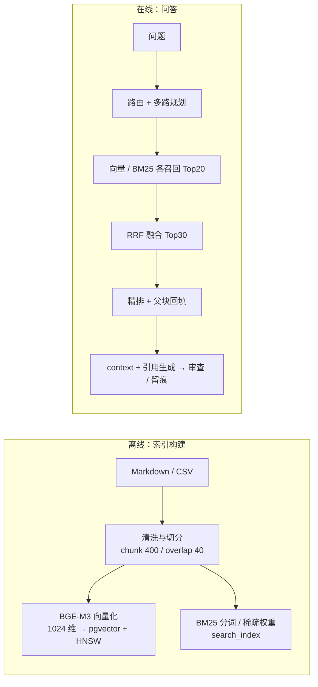
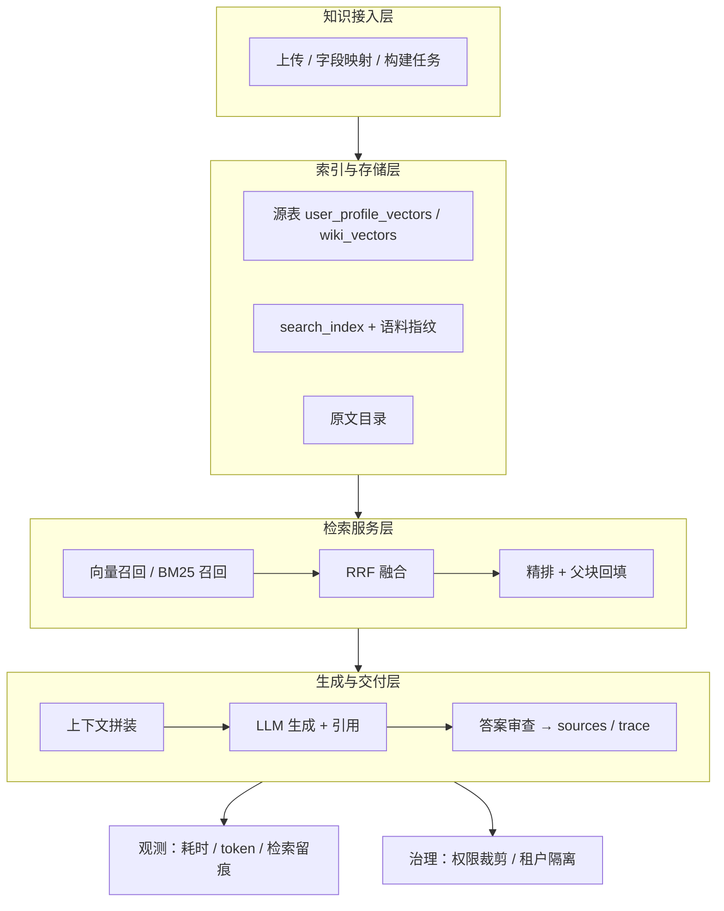

# RAG 系统架构

> 第 1 篇 · 04 · Data & Knowledge  
> RAG 的价值不是“把文档塞进 Prompt”，而是让每个结论都能追溯到一份可核验的资料。

## 1. 为什么需要 RAG 系统架构

纯 LLM 撞上三道坎：**知识边界**（没有企业 SOP 与指标口径）、**时效性**（数据变了参数不会变）、**可溯源**（“净销售额下降 10%”指不回哪张表）。微调能注入知识，但解决不了“今天上传、明天可查”，也给不出引用。

RAG 在企业里是**知识工具**，不是问答机器人本身。Qianke 的分工：

```text
RAG Tool  ：只返回 content / score / source，不生成最终答案
Agent    ：决定何时检索、是否需要 SQL、如何组织结论
确定性代码：权限、缓存、审查、索引新鲜度，不交给模型
```

一个可用的 RAG 必须回答：资料从哪来怎么更新？召回 30 条凭什么只给模型 5 条？检索挂了和资料里没有，用户看到的是不是同一句话？回答错了能否复盘？

## 2. 基本机制

RAG 分**离线索引**与**在线问答**两条链路，通过索引连接。



在线骨架：路由 → 多路规划 → 召回 → RRF 融合 → 精排 → 父块回填 → 生成 → 审查。融合用 RRF（`Σ 1/(k+rank+1)`），只用名次不用原始分数，因为向量相似度、BM25 分、稀疏内积量纲不可比。

索引不更新，在线链路会安静地使用旧数据——不报错，这是 RAG 最隐蔽的故障。

## 3. 总体架构



分层的意义在于**每层失败长得不一样**：接入层失败要提示文件名与字段；索引层失败要提示索引过期；检索层数据库不可用必须报“服务不可用”；生成层限流要提示可重试。混成一个“无法回答”，排查方向会被带偏。

## 4. 关键设计

**分池取舍**：画像求相关，文档求覆盖。画像候选全部入池、用原问题统一精排取全局 Top-K；文档每路各自精排保名额再合并去重。两个池都“全局精排”会让分解类问题的文档名额被一路占满；都“分路保名额”会让画像混入弱路凑数项。

**父块回填**：按 400 字切 chunk 保精度，命中后回填所属标题章节（≤1600 字）保完整性。代价是上下文变长，实测 11.0s → 15.1s（+16%，代码注释记录）。

**多路规划与 SQL 旁路**：一次 LLM 调用同时产出路由复核、是否需要 SQL、检索变体；直接检索永远执行兜底，变体数量有上限。

**引用与留痕**：context 分两段——`[检索资料]` 可归纳，`[结构化查询结果]` 必须原样引用。每条资料带原问题、改写检索式、命中路径。

**失败语义分开**：检索不可用（`error`）、空结果、LLM 不可用（`llm_error`）必须区分。

## 5. 工程实现

```text
pipeline.py               统一编排（缓存 + 路由 + 检索 + 生成）
retrieval/query_processor.py  多路规划、并行检索、分池取舍
retrieval/hybrid_retriever.py 向量 + 关键词 + RRF
retrieval/reranker.py     bge-reranker-v2-m3 精排与父块回填
generation/generator.py   上下文拼装与 LLM 调用
answer_guard.py           生成后事实审查
agent/tools/rag.py        rag_search Tool（只返回片段与来源）
```

关键参数（`config.py`）：`TOP_K_VECTOR=20`、`TOP_K_BM25=20`、`TOP_K_RRF=30`、`TOP_K_PROFILE=3`、`TOP_K_WIKI=3`、`ENABLE_MULTI_QUERY=True`。问答缓存键包含数据集、问题、检索参数、数据版本、RRF k、历史与人格；构建完成后清空 BM25 内存索引与缓存，并写回语料指纹。

```python
# 上下文两段式（伪代码，依据 generator.build_context）
parts = []
if candidates:
    parts.append("[检索资料]\n" + "\n".join(带溯源标签的资料))
if sql_rows:
    parts.append("[结构化查询结果]\n" + "\n".join(截断后的结果行))
```

## 6. 企业级要求

| 要求 | 含义 | Qianke 现状 |
|---|---|---|
| 租户隔离 | 企业间数据不可见 | 已实现：独立物理库 |
| 权限裁剪 | 按角色隐藏来源/SQL/过程 | 已实现：统一 `render()` |
| 可溯源 | 结论能指回资料与查询 | 已实现：sources + trace |
| 索引新鲜度 | 数据更新后不能静默用旧索引 | 部分实现：指纹 + 显式重建 |
| 可降级 | 检索/模型故障有明确文案 | 已实现：error/llm_error 分开 |
| 成本可控 | token 与调用次数可观测 | 部分实现：usage 记录，无预算 |

## 7. 方案对比

| 方案 | 优点 | 缺点 | 适用 |
|---|---|---|---|
| 纯向量 RAG | 简单、语义泛化好 | 编号/专名召回弱 | 通用文档问答 |
| 混合检索 + 重排 | 兼顾语义与精确，质量稳 | 组件多、延迟高 | 企业知识库 |
| 纯 SQL / Text2SQL | 数字准确、可聚合 | 不懂非结构化知识 | 指标与统计 |
| Agentic RAG | 可多轮检索自检 | 延迟高、评测难 | 复杂调查任务 |

## 8. Qianke Engine 实践

```text
已实现：切分/父块/CSV 画像聚合/BGE-M3 向量/HNSW；
        路由、多路规划、并行混合检索、RRF、精排、父块回填、引用生成；
        问答缓存、索引指纹、分池取舍、trace、answer_guard、RAG Tool 契约
部分实现：索引新鲜度能判定但不会自动重建；检索侧过滤存在但未统一策略
规划中：GraphRAG、多跳推理、自动索引失效与重建、文档级 ACL 过滤
```

已知限制（不写成已实现）：

```text
多路规划本身是一次 LLM 调用，实测约 6s，占单次问答约 31%（代码注释记录）
整次问答 9~17s，92~96% 花在生成，检索不是主要瓶颈
demo 的 user_id 不是稳定实体键，画像结论只能当样本口径（docs/数据模型.md）
索引一致性靠显式重建，没有自动失效机制
```

## 9. 评估/验收

评估至少覆盖三层：检索层看来源召回（macro/micro）、MRR、hit@k；生成层看忠实度、答案相关性、上下文相关性（RAGAS 四指标）；端到端看通过率、拒答正确率、延迟与成本。

Qianke 离线评测（2026-11-11，33 题，LLM-as-a-Judge）：通过率 90.9%（30/33），来源召回宏平均 97.8%、微平均 96.7%。

```text
[ ] 新增文档重建后能检索到并正确引用
[ ] 索引落后时能给出 stale 判定
[ ] 数据库断开返回“服务不可用”而非“资料里没有”
[ ] 权限不足的角色看不到 SQL 原文与过程信息
[ ] 换数据集后答案不串数据
[ ] 失败样本能定位到召回、重排还是生成
```

## 10. 常见误区

1. 把 RAG 等同于向量库：切分、融合、重排、引用、失败语义同样决定质量。
2. 召回越多越好：上下文越满噪声越多，名额分配比数量重要。
3. chunk 越小越好：章节级问题会答不出来，需要父块回填。
4. 多路一定更强：每路都增加成本，收益要在评测集上证明。
5. 索引会自动更新：Qianke 靠显式重建，不重建就是静默用旧数据。
6. 把检索失败当资料缺失：这是两个完全不同的信号。
7. 只看答案像不像：不评估来源召回与忠实度，改 prompt 就可能“看起来更好”。

## 11. 总结

```text
1. RAG 是企业知识的证据供应链，不是问答机器人。
2. 离线索引决定上限，在线编排决定下限；索引过期是最隐蔽的故障。
3. 分池取舍、融合、精排、父块回填共同决定上下文质量。
4. 失败语义、权限裁剪、可溯源与可评估，是企业级与 Demo 的分界线。
5. Qianke 主链路已实现并有离线评测；自动索引治理、统一数据访问策略仍在演进。
```

## 12. 延伸阅读

### 项目内部

- [向量数据库原理](02-vector-database.md)
- [混合检索与重排序](03-hybrid-retrieval-reranking.md)
- `docs/agent.md`、`docs/数据模型.md`、`tests/eval_report.md`
- [Agent 工具调用机制](../01-agent-architecture/09-agent-tool-calling.md)

### 外部资料

- RAG 原始论文：<https://arxiv.org/abs/2005.11401>
- RAGAS 评估框架：<https://arxiv.org/abs/2309.15217>
- BGE-M3 论文：<https://arxiv.org/abs/2402.03216>
- pgvector 仓库：<https://github.com/pgvector/pgvector>
