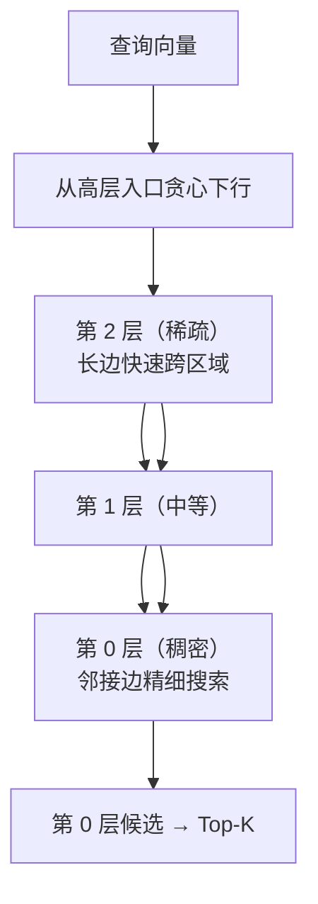
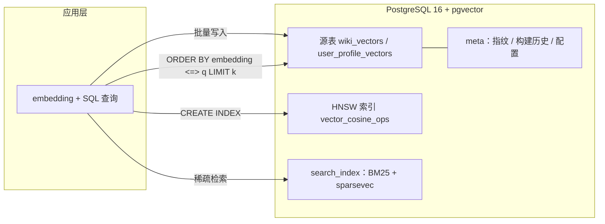

# 向量数据库原理

> 第 2 篇 · 04 · Data & Knowledge  
> 向量数据库不是“存数组的数据库”，而是用近似算法在时间与召回率之间做交易。

## 1. 为什么需要向量数据库

关键词检索按词精确匹配：用户问“最近想买户外装备的客户”，文档写“露营、徒步、冲锋衣”，没有共同词就失配。向量检索把文本映射成稠密向量，语义相近的文本距离更近。

但“存向量”不是难点。真正的难点是：**在百万级向量里用毫秒级时间找到最近 K 条，同时接受一定概率的漏召回**。向量数据库的四项职责是：存储（向量 + 元数据 + 原文）、索引（HNSW/IVF/PQ）、查询（距离 Top-K + 条件过滤）、维护（导入/更新/删除/重建/观测）。

企业常选“数据库插件”而非专用向量库：少一个组件（备份、监控、权限、连接池都复用 PostgreSQL）、向量与业务数据同事务、SQL 过滤一门语言；代价是分布式与索引类型不如专用系统。

## 2. 基本机制

距离度量有三种：余弦（只看夹角，文本最常用）、内积（夹角 + 长度，适合归一化向量）、欧氏距离（图像/坐标）。pgvector 对应 `<=>`、`<#>`、`<->`，它们返回的是**距离**，越小越近，转相似度要显式换算。

精确检索是全表扫描，O(N×d)，百万级 1024 维时不可接受；ANN 用索引换时间，只访问“可能最近”的候选，召回率通常 95%~99%+，延迟降 10~100 倍。核心质量指标是 `Recall@K`，不是“查询快不快”。

HNSW 把向量组织成多层图：



三个工程事实：建索引比扫描慢且占内存；查询是近似的，参数影响召回与延迟；频繁删改有图维护成本。

## 3. 总体架构



职责：存储层保存原文、向量、结构化字段；索引层用 HNSW 加速稠密检索；查询层用 SQL 完成“距离排序 + 过滤 + LIMIT”；运维层负责构建历史、指纹与缺失统计。

## 4. 关键设计

**维度与模型绑定**。Qianke 用 BGE-M3，1024 维，建表与查询共用 `EMBED_DIM`：

```sql
-- 节选：完整建表与索引定义见 src/rag_demo/db/schema.py
CREATE TABLE IF NOT EXISTS wiki_vectors (
    id SERIAL PRIMARY KEY, doc_name VARCHAR(100), chunk_text TEXT NOT NULL,
    embedding vector(1024), dept VARCHAR(50), sensitivity INT DEFAULT 1,
    metadata JSONB, parent_key TEXT, parent_text TEXT
);
CREATE INDEX IF NOT EXISTS wiki_vectors_embedding_idx
    ON wiki_vectors USING hnsw (embedding vector_cosine_ops);
```

换模型必须重建表或加新列，不能在同一列混存。

**距离与分数换算**：排序用距离、展示用相似度，过滤放 WHERE：

```sql
-- 简化示意：实际查询见 retrieval/hybrid_retriever.vector_search
SELECT id, chunk_text, 1 - (embedding <=> %s::vector) AS score
FROM wiki_vectors WHERE sensitivity <= %s
ORDER BY embedding <=> %s::vector LIMIT %s;
```

**过滤与 ANN 的冲突**：先 ANN 取 Top-K 再过滤，过滤选择性高时会只剩几条甚至为空。处理方式：过滤字段建 B-tree 索引、过滤后在小候选集上精确重排、或按过滤维度分区而不是硬筛。

**稀疏向量**：BGE-M3 的稀疏权重存 `sparsevec(250002)`，检索在库内完成。但稀疏 HNSW 默认不建（`ENABLE_SPARSE_HNSW = False`）：当前规模精确扫描够快，HNSW 会引入结果不一致风险，规模上去再开。

**索引新鲜度**：向量索引不会自动跟随源表。Qianke 用语料指纹判定：

```text
指纹 = COUNT + md5(按主键排序的 (id, md5(文本)) 拼接)
状态：fresh（一致）/ stale（源表变了）/ unknown（没有基线）
```

不能只比条数：重导画像后条数可能不变，但文本内容已变。

## 5. 工程实现

```text
db/schema.py          建表、HNSW、search_index、指纹与构建历史
db/connection.py      按数据集隔离的连接与 contextvar
retrieval/hybrid_retriever.py  向量召回、BM25、RRF
tools/build_search_index.py    BM25 / 稀疏索引构建
```

写入路径：模型 encode → 批量 INSERT（每批 50 条，commit 并回调进度）→ 重建 search_index → 写指纹与构建历史。注意顺序：`ensure_base_tables` 先于 `ALTER ADD COLUMN`；空输入必须直接报错，不能走到 `TRUNCATE`。

查询路径（伪代码）：

```python
def vector_search(query, top_k=20, sensitivity_max=3):
    qvec = model.encode(query)
    cur.execute("""SELECT id, profile_text,
                   1 - (embedding <=> %s::vector) AS score
                   FROM user_profile_vectors WHERE sensitivity <= %s
                   ORDER BY embedding <=> %s::vector LIMIT %s""",
                (qvec, sensitivity_max, qvec, top_k))
```

读事务必须显式 `rollback()`：pgvector 查询持有 `AccessShareLock`，连接停在 `idle in transaction` 会阻塞 `ALTER TABLE` / `CREATE INDEX`，严重时一卡几十分钟（代码注释记录了真实事故）。

数据集隔离是**独立物理库**（demo / user / test / 企业库 / 商户库），漏切换会明确报错，而不是静默查别人的数据。

## 6. 企业级要求

| 要求 | 做法 | 现状 |
|---|---|---|
| 隔离 | 按企业独立物理库 | 已实现 |
| 权限 | dept / sensitivity 过滤 | 部分实现，未统一策略 |
| 一致性 | 写入与索引重建分离 + 指纹校验 | 已实现 |
| 备份恢复 | 复用 PostgreSQL 备份 | 已实现（控制面脚本） |
| 可观测 | 索引条数、缺失列、构建历史 | 已实现 |
| 规模 | HNSW 与精确扫描按规模切换 | 小规模可用，未压测百万级 |

## 7. 方案对比

| 方案 | 优点 | 缺点 | 适用规模 |
|---|---|---|---|
| 暴力精确检索 | 召回 100%、实现简单 | 线性变慢 | 万级以下 |
| pgvector + HNSW | 事务一致、SQL 过滤、复用 PG | 超大规模与分布式弱 | 十万~百万 |
| 专用向量数据库 | 索引多、水平扩展 | 多一套组件与运维 | 千万级以上 |
| 内存索引（faiss） | 快、灵活 | 持久化与一致性要自建 | 离线/评测 |

Qianke 当前是 pgvector + HNSW，并保留“精确扫描足够快时不建 HNSW”的开关。

## 8. Qianke Engine 实践

```text
已实现：PostgreSQL 16 + pgvector（pgvector/pgvector:pg16）；
        vector(1024) + HNSW(vector_cosine_ops)；sparsevec(250002)；
        按数据集分库、连接 contextvar、写作用域守卫；
        语料指纹 fresh/stale/unknown；构建历史；索引缺失统计
部分实现：稀疏 HNSW 默认关闭；过滤与 ANN 组合未优化；无容量压测
规划中：量化、多副本、分片、跨库联邦检索
```

实测数字（仓库内实验产物）：实验时语料为画像 8110 条 + 文档 36 块 = 8146 条；BM25 单次检索 18.3ms，稀疏向量 130.6ms（含约 80ms 模型前向）。

## 9. 评估/验收

```text
质量：Recall@K、MRR；延迟：P50/P95、索引构建耗时
资源：索引大小、内存、写入吞吐；一致性：重建后结果、指纹状态

[ ] 新库能自动建表并建 HNSW 索引
[ ] 重建后指纹为 fresh；改源表后判定 stale
[ ] 带过滤条件的结果数量与预期一致
[ ] 百万级下的 Recall@K 与 P95 有实测（当前未做）
```

## 10. 常见误区

1. 认为 ANN 是精确的：过滤、参数、数据分布都会影响召回。
2. 把距离当相似度：`<=>` 越小越近，直接排序会得到相反结果。
3. 只建索引不看维护：故障大多不是“查不到”，而是“删改后索引没更新”。
4. 用条数判断索引过期：内容变了条数可能不变。
5. 在超大表上随意加过滤：先 ANN 后过滤会显著掉召回。
6. 忽略事务残留：只读查询不结束事务会阻塞 DDL。
7. 过早引入专用向量库：规模没到，运维成本大于收益。

## 11. 总结

```text
1. 向量数据库的核心是“近似 + 过滤 + 维护”，不是“存向量”。
2. HNSW 用索引换延迟，Recall@K 才是质量指标。
3. 维度必须与模型绑定；距离与相似度要显式换算。
4. 索引一致性靠指纹与显式重建，不能假设数据库会自动更新。
5. Qianke 的 pgvector 方案已支撑当前规模，大规模容量仍待验证。
```

## 12. 延伸阅读

- [RAG 系统架构](01-rag-architecture.md)
- [混合检索与重排序](03-hybrid-retrieval-reranking.md)
- `docs/数据模型.md`、`src/rag_demo/db/schema.py`
- pgvector：<https://github.com/pgvector/pgvector>
- HNSW 论文：<https://arxiv.org/abs/1603.09320>
- BGE-M3 论文：<https://arxiv.org/abs/2402.03216>
