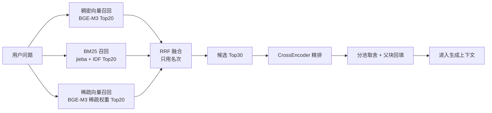
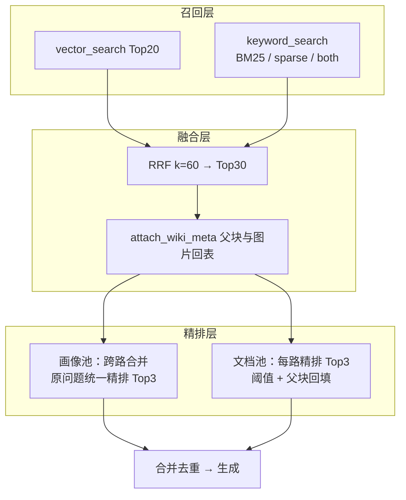

# 混合检索与重排序

> 第 3 篇 · 04 · Data & Knowledge  
> 单路召回永远有盲区；混合检索解决“找得到”，重排序解决“排得准”。

## 1. 为什么需要混合检索与重排序

单路检索有两种典型盲区：纯向量检索对编号不敏感（问“DA-01 是哪份资料里的标签口径”找不到精确编号）；纯 BM25 会给“规模”“本周”这类词计分，把到处讲“规模”的文档顶上来，真正定义标签的文件掉到第 7 名。

这不是参数没调好，而是方法的“性格”不同：

```text
BM25：数词频、靠 IDF，强在罕见结构词（编号、专有名词、固定说法）
稀疏向量：模型学出来的词权重，强在核心实体，弱在罕见结构词
稠密向量：语义泛化好，弱在精确匹配
```

重排序解决的是另一件事：召回阶段（向量 + 关键词）追求“不漏”，候选池 20~30 条允许有噪声；直接塞进上下文会噪声挤占、排序不可靠、跨模态分数不可比。Rerank 用 CrossEncoder 对少量候选重新打分，精度显著更高。

Qianke 知识库里有大量 `OPT-01`、`DA-01`、`钻石会员`、`净销售额` 这类固定说法，也有“哪类客户适合召回”这类语义问题。**企业知识天然是混合的**，单路一定丢东西。

## 2. 基本机制



三路分工：稠密向量语义泛化好、编号弱；BM25 精确词强、可解释、约 18ms；稀疏向量核心实体强、需模型前向（约 130ms）。三者量纲完全不同：

```text
余弦相似度：0~1；BM25：0~几十；稀疏内积：可正可负
```

直接加权求和要归一化，而归一化本身引入偏差。RRF 只用名次：`score(d) = Σ 1/(k + rank_i(d) + 1)`。

精排不是“再排一次”，而是换更贵的模型：双塔（bi-encoder）可预计算、适合召回；交叉编码（cross-encoder）把查询与文档一起编码，精度高但只能算少量候选。

## 3. 总体架构



关键点：**融合只发生一次**。分池取舍之后不会对合并结果做第二次 RRF 或混排——画像与文档的分数出自不同 query，横向比大小没有意义。

## 4. 关键设计

**分池取舍**：画像池多路候选全部入池，用原问题统一精排取全局 Top-K（默认 3）；文档池每路各自精排保名额（默认 3），再合并去重。画像问的是“最相关的 N 个用户”，候选竞争，分路取名额会产生弱路凑数项；文档问的是“每个子问题的口径都要有”，不同改写式命中的往往是不同文件，必须分路保覆盖。

**关键词模式可切换**：`bm25`（默认）/ `sparse` / `both`。`both` 内部还有一次两级 RRF：先 BM25 与稀疏融合，再与向量结果融合；同一次检索里两级 RRF 使用同一个 k。

**阈值默认不过滤**（`WIKI_MIN_SCORE = 0.0`）。实测反例：DA-01 需要 tag_definitions.md 时精排 0.001，OPT-02 不需要某文档时 0.010——需要的最低分反而低于不需要的。根因是 chunk 粒度错配，所以改用父块回填而不是拍分数门槛。

**父块回填**：命中 chunk → 精排 → 文档类回填所属章节（`parent_text` ≤1600 字），回填粒度 `section`（默认）/ `doc` / `off`。回填发生在去重前，同一文档多路命中不同 chunk 时按父块键收敛。代价是上下文变长（11.0s → 15.1s，+16%），换的是章节级问题答得出来。

## 5. 工程实现

```text
retrieval/hybrid_retriever.py  vector_search / bm25_search / rrf_fusion / hybrid_search
retrieval/sparse_retriever.py  BGE-M3 稀疏检索（缺 FlagEmbedding 时降级）
retrieval/reranker.py          get_reranker / rerank / 父块回填
retrieval/query_processor.py   多路并行、分池取舍、trace
tools/build_search_index.py    BM25 token 与稀疏权重构建
```

RRF 实现（真实代码）：

```python
# hybrid_retriever.rrf_fusion：按 id 去重，名次累加
fused[key]["rrf_score"] += 1.0 / (k + rank + 1)
```

BM25 语料不是现场分词，而是从 `search_index` 读回已落库的分词结果，启动时省掉全量重新分词（代码注释记录约 6s）；索引按数据集各存一份，避免“用户库索引顶掉演示库索引”的静默串数据。

降级策略：稀疏依赖缺失时回退仅 BM25；混合检索抛异常时 RAG Tool 降级到关键词召回；精排失败不静默跳过（精排是基础能力，挂了应整体暴露）。

参数：`TOP_K_VECTOR=20`、`TOP_K_BM25=20`、`TOP_K_RRF=30`、`TOP_K_PROFILE=3`、`TOP_K_WIKI=3`、`RRF_K=60`（可用 `RAG_RRF_K` 覆盖）。

## 6. 企业级要求

| 要求 | 做法 | 现状 |
|---|---|---|
| 可解释 | 每路召回、策略、分数、来源进 trace | 已实现 |
| 可切换 | 关键词模式可按请求覆盖 | 已实现 |
| 可降级 | 稀疏/混合失败自动回退 | 已实现 |
| 可复现 | 参数进缓存键（RRF k、模式） | 已实现 |
| 可评估 | 消融脚本 + 固定评测集 | 已实现 |
| 性能可控 | 精排串行、检索并行 | 已实现 |
| 大规模 | 候选池与索引规模 | 未验证（待核验） |

## 7. 方案对比

| 方案 | 召回质量 | 延迟 | 复杂度 | 适用 |
|---|---|---|---|---|
| 单路向量 | 中 | 低 | 低 | 语义为主的文档 |
| 单路 BM25 | 中（精确强） | 最低 | 低 | 编号/术语密集 |
| 向量 + BM25 + RRF | 高 | 中 | 中 | 企业知识库（推荐） |
| 再加稀疏向量 | 略高 | 更高 | 高 | 实体密集、可承受成本 |
| 加 CrossEncoder 精排 | 最高 | 最高 | 中 | 对准确率敏感 |

Qianke 默认“向量 + BM25 + RRF + 精排”，稀疏向量作为可选项——实测收益不稳定，成本却确定。

## 8. Qianke Engine 实践

```text
已实现：BM25（jieba + 停用词 + 同义词归一）、稀疏向量、RRF（k 可配）、
        bge-reranker-v2-m3 精排、分池取舍、父块回填、多路并行检索
        （contextvars 逐任务拷贝，避免串数据集）、检索 trace、消融脚本
部分实现：稀疏 HNSW 默认关闭；查询级 ACL 过滤未统一；重排模型未量化加速
规划中：更大规模候选策略、多语言/多模态检索
```

实测结论（仓库内实验产物）：

```text
BM25 vs 稀疏向量（17 题，2026-10-11）：
  命中率 100% vs 94.1%；平均名次 1.4 vs 1.0；耗时 18.3ms vs 130.6ms
  17 题里 15 题打平，结论统计强度有限

RRF k 消融（33 题，2026-10-30，k=10/30/60/100）：
  k∈[30,100] 指标不可区分；k=10 仅单题级抖动；最终上下文层 4 档逐题完全相同
  该实验为纯检索口径，未调用 LLM 裁判，不报 Pass Rate
```

## 9. 评估/验收

```text
检索层：来源召回（macro/micro）、Recall@K、MRR、hit_rate
排序层：精排前后 MRR 变化、Top-K 命中率
成本层：单次检索耗时、模型调用次数、token 增量
稳定性：多路并发是否串数据集、降级是否生效

[ ] 固定评测集上混合检索的 source recall 不低于单路
[ ] RRF k 改动后指标变化有记录（消融可复现）
[ ] 稀疏不可用时自动回退 BM25 且不报错
[ ] 精排分数与父块回填进入 sources，可供前端展示
[ ] 多路检索在 user 数据集上不会误查 demo
```

## 10. 常见误区

1. 把 RRF 当加权平均：RRF 只用名次，k 不是权重。
2. 三路结果直接拼一起：不做分池与去重，同一文档会重复占位。
3. 精排可以无限用：CrossEncoder 只能算少量候选，候选越多延迟越高。
4. 给精排拍一个分数阈值：chunk 粒度错配时，需要的分可能比不需要的还低。
5. 认为多路一定更好：每一路都增加成本，收益要在评测集上验证。
6. 忽略分词与停用词：画像文本是模板化文本，处理不当会让 BM25 全是噪声。
7. 只看平均分不看逐题：17 题里 15 题打平，平均值会掩盖真实差异。

## 11. 总结

```text
1. 混合检索解决“单一方法的盲区”，不是“谁替代谁”。
2. RRF 用量级无关的名次融合，k 决定共识与头部命中的偏向。
3. 重排序用更贵的模型换更准的排序，只能作用于少量候选。
4. 分池取舍与父块回填决定了“上下文里到底有什么”。
5. Qianke 的默认组合已工程化并有实测；稀疏索引与大规模性能仍待验证。
```

## 12. 延伸阅读

- [RAG 系统架构](01-rag-architecture.md)
- [向量数据库原理](02-vector-database.md)
- `bug/10.11/2026-10-11_BM25对BGE-M3稀疏向量实验.md`、`tests/ablation_rrf_k/README.md`
- RRF 论文：<https://plg.uwaterloo.ca/~gvcormac/cormacksigir09-rrf.pdf>
- BGE Reranker 模型卡：<https://huggingface.co/BAAI/bge-reranker-v2-m3>
