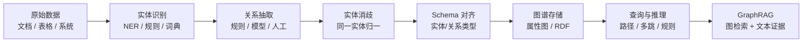
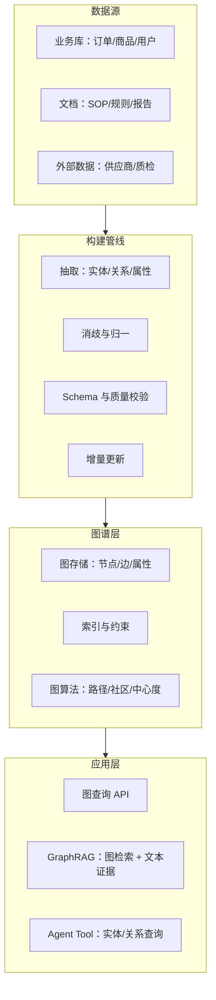

# Knowledge Graph 知识图谱

> 第 4 篇 · 04 · Data & Knowledge  
> 知识图谱擅长回答“谁和谁有什么关系、经过几跳”，但抽取、消歧与维护的代价往往被低估。

## 1. 为什么需要知识图谱

企业问题可以分成三类：事实型（“高客单用户的定义是什么”，RAG 擅长）、聚合型（“上个月深圳钻石会员有多少人”，SQL 擅长）、关系型（“买了 A 的客户还买过哪些品类，这些品类里哪些供应商质检不合格”，需要跨多跳关系）。

知识图谱（KG）把实体和关系显式建模：

```text
（用户 U2765）—[购买]→（商品 P12）—[属于]→（品类：家居）
（供应商 S3）—[供应]→（商品 P12）
（供应商 S3）—[质检不合格]→（批次 B2026-11）
```

它带来三个价值：**结构化**（散落在文档、表格、系统里的关系统一表示）、**可推理**（多跳、路径、共同邻居）、**可解释**（每条结论对应一条路径，可人工核查）。

它不适合替代全文检索（叙述性知识仍靠 RAG）、不适合替代 OLTP（交易状态变化仍应在关系库），也不适合“先建图再说”——没有明确查询需求与维护预算，图谱会烂在仓库里。

## 2. 基本机制

最基础的表示是三元组 `（主语，谓语，宾语）`；工程上更常用**属性图**：节点与边都带属性（`User {user_id, city}`、`BOUGHT {order_id, paid_at, amount}`）。

从数据到图谱：



**实体消歧**是最容易被低估的一步：“张三”“张 三”“zhangsan”“用户 U2765”是不是同一个人？同一商品在天猫与 1688 叫法不同，是不是同一个 SKU？消歧做不好，图谱就是“看起来有结构、实际全是断边”。

主流图谱存储有自己的查询语言，例如 Neo4j 的 Cypher：

```cypher
// 理论示例，不是 Qianke 现有代码
MATCH (u:User {user_id: 'U2765'})-[:BOUGHT]->(:Product)-[:IN_CATEGORY]->(c:Category)
RETURN c.name, count(*) AS cnt ORDER BY cnt DESC LIMIT 5;
```

图查询在“路径长度不定、关系类型多”时更自然；但固定表结构的聚合统计，SQL 仍然更直接。

## 3. 总体架构



工程上通常不追求“一张全企业大图”，而是按领域建子图（用户域、商品域、供应链域），再用实体 ID 关联。

## 4. 关键设计

**Schema 先行**。没有 Schema 的图谱会退化成“边随便连”的图数据库。至少确定：实体类型（User/Product/Category/Supplier/Order/Document）、关系类型（BOUGHT/IN_CATEGORY/SUPPLIED_BY/MENTIONED_IN）、基数约束、主键策略（业务 ID 还是代理 ID，跨系统如何对齐）。

**实体消歧策略**：强 ID 优先（订单号、商品 ID、用户 ID 能直接对齐的，不要用名字匹配）；规则 + 模型（手机号/邮箱归一、地址标准化、名称相似度）；人工兜底（高价值实体保留确认环节）；可回溯（每个合并动作留记录，允许拆分误合并）。

**图与文本、表格的关系**：图谱管关系与路径，文本管解释与规则（RAG），表格管精确聚合与交易事实（SQL）。GraphRAG 的常见做法是图检索找到实体与路径，再把关联文档片段与结构化数据一起交给模型。

**增量与时效**：全量重建简单可复现但成本高；增量更新需要变更捕获与幂等写入；关系变更要能回答“这条边是什么时候出现的”。

**质量指标**：实体覆盖率、关系准确率、冲突率、连通性（孤立节点/平均度数）、更新延迟。

## 5. 工程实现

技术选型：

| 类型 | 代表 | 适用 |
|---|---|---|
| 属性图数据库 | Neo4j、NebulaGraph | 多跳查询、图算法 |
| RDF 三元组库 | Apache Jena、Virtuoso | 标准本体、知识共享 |
| 关系库模拟 | PostgreSQL 邻接表 | 关系简单、规模小 |
| 图计算框架 | Spark GraphX、NetworkX | 离线分析 |

没有图数据库时可用邻接表表达简单关系：

```sql
-- 理论示例：Qianke 当前没有这两张表
CREATE TABLE entity_edge (
    src_type TEXT, src_id TEXT, rel_type TEXT,
    dst_type TEXT, dst_id TEXT, props JSONB,
    PRIMARY KEY (src_type, src_id, rel_type, dst_type, dst_id)
);
```

这能支持一跳查询，多跳需要递归 CTE，深度与性能都受限。

构建流水线：业务库导出实体与关系 → 文档抽取实体提及与关系（需人工抽检）→ 消歧合并 → 写入图存储并建约束/索引 → 质量校验（孤立点、冲突、覆盖率）→ 发布查询 API 与 GraphRAG 接口。

## 6. 企业级要求

| 要求 | 说明 |
|---|---|
| 权限 | 图上的节点/边同样受租户与角色约束，不能绕过 |
| 血缘 | 每条边能追溯到来源系统或文档 |
| 质量 | 抽样准确率、冲突率、覆盖率有基线 |
| 更新 | 增量更新幂等，失败可重放 |
| 可解释 | 查询返回路径，而不只是答案 |
| 成本 | 抽取与维护的人力成本要提前算 |

知识图谱最贵的不是存储，而是**持续维护**；没有明确 owner 的图谱，三个月后就会与业务脱节。

## 7. 方案对比

| 方案 | 关系查询 | 叙述知识 | 聚合统计 | 维护成本 |
|---|---|---|---|---|
| RAG（向量 + 关键词） | 弱 | 强 | 弱 | 中 |
| SQL / 数据仓库 | 中（复杂 SQL） | 无 | 强 | 中 |
| 知识图谱 | 强 | 中（需挂文本） | 中 | 高 |
| GraphRAG（图 + 文本） | 强 | 强 | 中 | 高 |

选型建议：问题主要是“文档里说了什么”用 RAG；主要是“数字是多少”用 SQL/数仓；主要是“关系与路径”用图谱；三类都有且关系查询占比高，再分阶段建设 GraphRAG。

## 8. Qianke Engine 实践

**当前状态：未实现（理论知识 + 规划中）。**

```text
无图数据库、无三元组存储、无实体/关系抽取管线、无 GraphRAG
代码中不存在 neo4j / networkx / 图谱相关模块（已检索确认）；
现有能力只有关系型表、SQL 查询、向量 + BM25 检索
```

已知的数据前提问题：`docs/数据模型.md` 明确记录 demo 数据的 `user_id` **不是稳定实体键**，同一 ID 在不同行/平台的姓名、年龄、城市会冲突。这意味着：

```text
在 demo 数据上建图，第一步（实体消歧）就无法可靠完成，图谱结论只能当演示
```

规划中的方向（不作为已实现）：先在真实业务库上做实体消歧、确定稳定主键；用关系库邻接表或轻量图存储验证 1~2 个高价值多跳查询；收益验证后再评估专用图数据库与 GraphRAG；始终保留“图 + 文本 + 表格”三条证据链。

## 9. 评估/验收

图谱项目的验收必须包含“值不值得”：业务指标（多跳问题回答准确率、人工核查时间下降）、质量指标（实体覆盖率、关系准确率、冲突率、孤立点比例）、工程指标（查询 P95、增量更新延迟、存储成本）、维护指标（抽取抽检通过率、owner 明确性）。

```text
[ ] 选定 3~5 个真实多跳问题，SQL/人工与图谱答案一致
[ ] 抽检 100 条关系，准确率达到约定阈值；实体误合并可回滚
[ ] 图谱不可用时能回退到 RAG/SQL，而不是整体失败
```

## 10. 常见误区

1. 先建图再找场景：没有查询需求驱动的图谱，最终没人用。
2. 低估实体消歧：ID 不统一时，图谱只是“看起来有结构”。
3. 把图谱当 RAG 替代品：叙述性知识仍然需要文本检索。
4. 一次追求全企业大图：按领域建子图、增量扩展更现实。
5. 忽略权限与血缘：图查询可能泄露跨租户关系，边从哪来也说不清。
6. 把抽取准确率当 100%：必须有人工抽检与冲突处理机制。

## 11. 总结

```text
1. 知识图谱擅长关系与多跳，不擅长叙述文本与高频交易。
2. 实体消歧与持续维护是最大成本，不是存储与查询。
3. 图谱、文本、表格应组合使用，而不是互相替代。
4. Qianke 当前没有图谱能力，demo 数据也不具备可直接建图的实体键。
5. 合理路线是：先解决数据实体化，再用真实多跳问题验证收益。
```

## 12. 延伸阅读

- [RAG 系统架构](01-rag-architecture.md)、[企业级知识库架构](10-enterprise-knowledge-base.md)
- `docs/数据模型.md`（数据不变量与实体消歧问题）
- Neo4j 文档：<https://neo4j.com/docs/>；GraphRAG 论文：<https://arxiv.org/abs/2404.16130>
