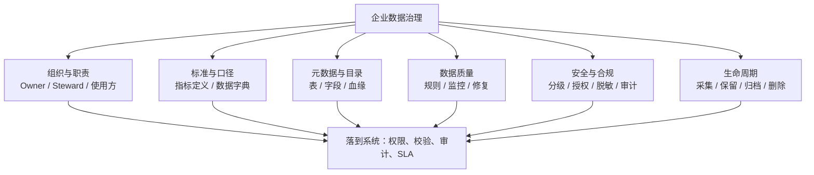
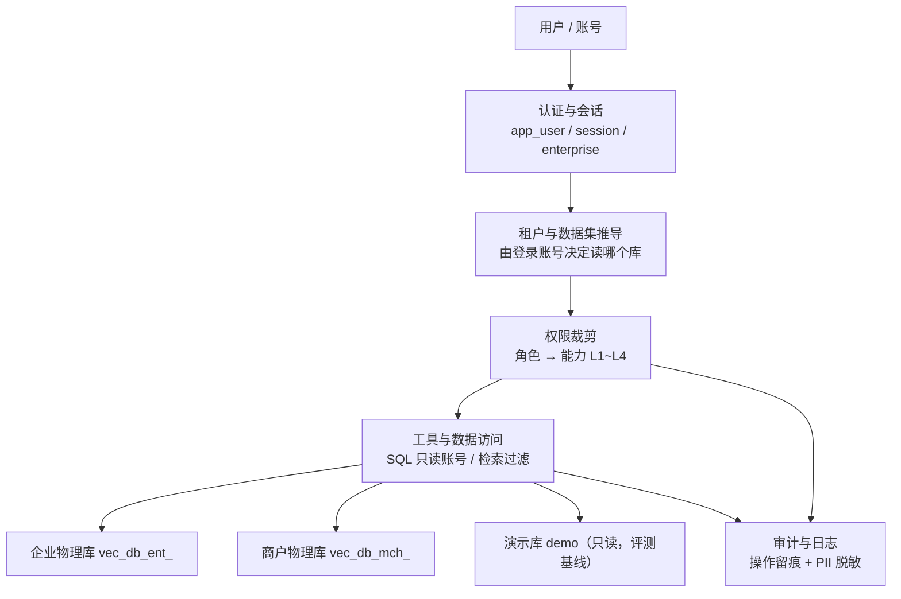

# 企业数据治理

> 第 5 篇 · 04 · Data & Knowledge  
> 数据治理不是写一份制度文档，而是让“谁能看什么、数据对不对、出了事查得到”变成系统能力。

## 1. 为什么需要企业数据治理

没有治理的数据平台通常按这个顺序出问题：数据重复（同一指标三种口径）→ 数据不可信（报表对不上）→ 权限失控（谁都能连库导出）→ 责任不清（出错没人认领）→ 合规风险（个人信息随意使用）→ 成本失控（重复建设、无限保留）。

Agent 接入数据后问题会被放大：模型不会“自觉”遵守口径，也不会判断某个字段是否敏感。**治理必须是确定性系统约束，不是提示词约束。**

治理的四个目标：**可用**（找得到、看得懂）、**可信**（口径一致、质量可度量）、**安全**（最小权限、可审计）、**可控**（采集、保留、归档、删除可管理）。

## 2. 基本机制



六个支柱里，只有落到系统（而不是制度）的部分才真正生效。

数据分级常见做法：L1 公开、L2 内部、L3 敏感（需审批、脱敏、留痕）、L4 高度敏感（默认不可查询）。Qianke 表结构里有 `sensitivity INT` 与 `dept`，检索时按敏感度上限过滤，但**分级标准与审批流程尚未产品化**——这是“部分实现”，不是“已完成治理”。

最小权限与职责分离：只给完成工作必需的库/表/字段/时间范围；申请、审批、执行分离；默认拒绝；离职/转岗可快速回收。

审计要回答四个问题：谁（账号/角色/租户）、做了什么（查询/导出/修改/配置变更）、对什么（库/表/字段/数据集）、结果如何（成功/失败/被拒绝）。日志本身也要保护，不能把敏感字段原样写进日志。

## 3. 总体架构



核心设计：读哪个库只由登录账号推导，不接受前端参数；物理分库而不是同库加租户列，漏切换会明确报错；权限统一在响应出口裁剪；写操作必须显式声明目标数据集。

## 4. 关键设计

**租户隔离：物理分库。**

```text
demo → vec_db（演示 + 评测基线，只读）
user → vec_db_user（用户上传构建）
test → vec_db_test（真实链路首跑）
ent_<id> → vec_db_ent_<id>（企业）
mch_<id> → vec_db_mch_<id>（商户画像）
```

为什么不用 `tenant_id` 列：分库时所有表（含派生索引）在连接层自动跟随，漏切会连不上表并报错；同库漏加 `WHERE tenant_id` 会安静地查到别人的数据。代价是建库、迁移、备份逐个执行，需要数据库编排。

**权限模型：角色 → 能力。** 管理员配“某个等级能干什么”，业务代码只判“有没有某个能力”：

```text
L1 基础：回答
L2 依据：+ 来源列表 / 返回用户数
L3 内部：+ 检索过程（检索式 / 原文片段 / 精排分数）
L4 完全：+ SQL 原文 / 数据概况 / 召回对比 / 运维接口
```

约束：裁剪只发生在响应序列化那一刻（`permissions.render`），缓存里始终完整；未识别身份固定 L0、不参与配置；`route == error` 必须对所有人透出，否则“服务坏了”会被当成“资料里没有”。

**SQL 安全：四层保险。** 正则预检（只读起点、关键字黑名单、必须 LIMIT、表白名单）→ 数据库只读账号（写操作与授权外表由 PG 拒绝）→ `fetchmany(SQL_FETCH_MAX=100)` 截断 → `statement_timeout = 10s`。注释写得很直接：正则“本身可被双引号表名等写法绕过”，真正的边界是数据库权限。

**敏感信息与脱敏。** 日志层统一脱敏手机号/邮箱/身份证（`logging_setup.PiiRedactionFilter`）；画像卡牌不返回 `profile_text` / `embedding`，姓名按规则打码（`profile_view`）；日志层与画像卡牌展示已脱敏；进入生成上下文的 `profile_text` 尚未脱敏。

**审计与变更留痕。** session 只存 token 哈希；`upload_owner` 防止拿到 upload_id 越权构建/查询；商户策略变更有哈希链与校验接口（`c_policy_audit_anchor`）；`build_history` 记录每次构建的模式、耗时、规模、成败。

## 5. 工程实现

```text
auth.py             企业 / 账号 / 会话 / 上传归属
permissions.py      角色 → 能力，统一 render 裁剪
db/connection.py    数据集解析、写作用域守卫、数据集锁
config.py           DATASETS 白名单、租户/商户库命名
tools/sql_tool.py   SQL 校验 + 只读账号执行
logging_setup.py    PII 脱敏
profile_view.py     画像字段脱敏
```

写作用域守卫是真实行为：

```python
# 简化示意；写操作必须声明目标数据集，否则直接抛错
with writes_to(dataset):
    ...  # TRUNCATE / INSERT / 重建索引

def write_to_db(...):
    dataset = require_write_scope("write_to_db")  # 函数第一行校验
```

为什么是异常而不是警告：写操作第一步往往是 `TRUNCATE`，落到默认数据集上就是清空演示库，不可逆。数据集锁保证同一时刻只有一个构建，一次问答也会整段持锁。

## 6. 企业级要求

| 要求 | 目标 | Qianke 现状 |
|---|---|---|
| 租户隔离 | 企业间数据不可见 | 已实现（物理分库） |
| 最小权限 | 按角色/能力裁剪 | 已实现（L1~L4 + capability） |
| 敏感数据 | 分级、脱敏、可审计 | 部分实现（sensitivity/dept + 日志脱敏） |
| 数据目录 | 表/字段/负责人可查 | 未实现（仅文档） |
| 指标口径 | 唯一定义、可追溯 | 部分实现（详见第 8 篇） |
| 生命周期 | 保留、归档、删除策略 | 未实现 |
| 合规 | 等保/隐私合规证据链 | 未实现（需企业侧评估） |
| 审计 | 关键操作可追溯 | 部分实现（审计表 + 日志，未统一） |

## 7. 方案对比

| 方案 | 优点 | 缺点 | 适用 |
|---|---|---|---|
| 集中式治理 | 标准统一、管控强 | 响应慢、离业务远 | 强监管行业 |
| 联邦式治理 | 业务自治、落地快 | 标准易漂移 | 多业务线集团 |
| 混合式（推荐） | 中央定标准、业务管落地 | 需清晰职责边界 | 多数企业 |

Qianke 更接近“系统内嵌治理”：不建独立平台，而是在连接层、权限层、日志层把关键约束写死。这适合早期；规模上来后仍需独立治理平台。

## 8. Qianke Engine 实践

```text
已实现：按企业/商户物理分库；demo 只读；登录账号推导数据集；
        角色 → 能力（L1~L4），统一响应出口裁剪；写作用域守卫 + 数据集锁；
        SQL 只读账号 + 正则预检 + LIMIT + timeout + fetch 截断；
        日志 PII 脱敏；画像展示脱敏；上传归属校验；备份脚本、构建历史、策略审计哈希链
部分实现：敏感度分级只有字段与检索过滤，没有标准与审批流；
          审计有表与日志，缺统一查询入口与保留策略；
          数据目录只有 docs/数据模型.md，没有可查询的元数据服务
规划中：Owner 注册、字段级分类分级、保留与删除策略、使用审批流、
        合规报告、统一 Data Access Policy Engine
```

## 9. 评估/验收

治理的验收必须是“可验证的系统行为”，不是“制度已发布”：

```text
[ ] 跨租户访问被拒绝，且拒绝原因明确（不是空结果）
[ ] 前端传 dataset 参数无法切换库
[ ] 普通角色看不到 SQL 原文与检索过程
[ ] SQL 写操作、非白名单表被数据库层拒绝
[ ] 日志中不出现完整手机号/邮箱/身份证
[ ] 构建失败不会留下半成品数据（事务一致性）
[ ] 关键操作能从审计表/日志追溯到人
[ ] 删除/清空操作有二次确认与不可逆提示
```

补充指标：越权尝试次数、审计覆盖率、敏感字段脱敏命中数、数据资产目录覆盖率（有 owner 的表/字段占比）。

## 10. 常见误区

1. 把治理当文档工作：没有系统约束的规范等于没有。
2. 用 Prompt 做权限：模型可以被诱导，权限必须由服务端代码判断。
3. 只看认证不看授权：登录成功不代表能看所有数据。
4. 同库加 tenant_id 就当隔离：漏写 WHERE 就串数据，且不报错。
5. 日志随便打：日志是最容易泄露 PII 的地方。
6. 没有 owner：数据出错时无人认领，治理无法持续。
7. 一开始追求大而全平台：先把隔离、权限、审计三条线做实。

## 11. 总结

```text
1. 治理的目标是可用、可信、安全、可控，不是“有制度”。
2. 物理分库、默认拒绝、最小权限、可追溯，是四条硬约束。
3. 治理必须落到代码与数据库权限，Prompt 不是边界。
4. Qianke 已实现隔离、权限裁剪、只读账号、脱敏与部分审计；
   数据目录、生命周期、统一策略引擎仍未建成。
5. 治理是持续投入，不是一次性项目。
```

## 12. 延伸阅读

- [数据血缘与质量管理](09-data-lineage-quality.md)
- [企业级知识库架构](10-enterprise-knowledge-base.md)
- `docs/数据模型.md`、`docs/decisions/three_agent_platform_architecture_decisions_v0.1.md`
- DAMA-DMBOK：<https://www.dama.org/cpages/body-of-knowledge>
- NIST 隐私框架：<https://www.nist.gov/privacy-framework>；PostgreSQL RLS：<https://www.postgresql.org/docs/current/ddl-rowsecurity.html>
