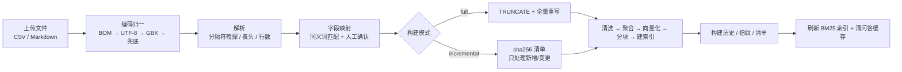
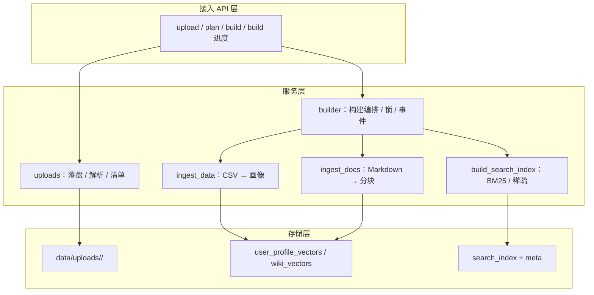

# 数据接入与 ETL

> 第 6 篇 · 04 · Data & Knowledge  
> 接入层的价值不是“把文件读进来”，而是让脏数据在进入系统之前就被发现、被确认、可回滚。

## 1. 为什么需要数据接入与 ETL

企业数据进入 AI 系统的现状通常是：业务库（订单、会员、商品、库存，字段命名各异）、导出的 CSV/Excel（编码、分隔符、列名都不统一）、文档（SOP、规则、口径，Markdown/Word/PDF）、以及缺失值、异常长文本、重复行、同一实体多个 ID 等质量问题。

直接丢给模型或检索库，会得到三个后果：检索库被脏数据污染、Text2SQL 无法稳定生成、出错后无法回滚（用户不知道“现在库里到底是什么”）。

接入层要保证四件事：**可解析**（编码、分隔符、表头、文件类型）、**可映射**（业务字段对上系统字段且用户确认）、**可验证**（行数、字段、缺失、异常在导入前可见）、**可回滚**（失败不留半成品，全量有明确替换语义）。

Qianke 的分工很明确：LLM 可以理解数据含义、建议字段映射、解释异常；**不负责**直接写库、绕过校验、决定 DDL/DML、跳过人工确认。数据处理、校验、事务、写入必须由确定性代码完成。

## 2. 基本机制



五个构建阶段（`mvp/mock_data.py::BUILD_STEPS`，权重之和 100）：

| 阶段 | 权重 | 作用 |
|---|---:|---|
| 清洗交易数据 | 22 | 解析 CSV、列名映射、类型转换 |
| 聚合用户画像 | 18 | 按 user_id 聚合画像文本与结构化字段 |
| 生成画像向量 | 24 | BGE-M3 编码、批量写入 |
| 切分规则文档 | 16 | Markdown 按标题 + 长度切分 |
| 建立检索索引 | 20 | BM25 token + 稀疏权重落库 |

全量（full）清空后重建，简单可复现；增量（incremental）按文件 sha256 清单只处理新增/变更。增量不是“追加”：画像要按 user_id 合并（新订单累加），文档变更要替换旧分块，因此必须先做只读预检。

## 3. 总体架构



关键边界：上传层只把文件变成本地可读文本，不碰数据库；构建层负责“在正确的数据集上、用正确的模式”执行；写入层负责事务一致性与空输入保护；索引层负责派生数据重建，与源表分开存。

## 4. 关键设计

**编码处理顺序不能反**：BOM → 严格 UTF-8 → GBK → 兜底（替换坏字符）。GBK 几乎能解码任意字节流，先试它会把 UTF-8 中文读成乱码；兜底至少让用户看见哪一行坏了，而不是整批失败。

**解析交给真正的 CSV 解析器**：早期按 `\n` 切行、按逗号数列，字段带换行或引号就错位。现在用 pandas（`sep=None` + python 引擎）嗅探分隔符，兼容 `\t` / `;`；嗅探失败退回逗号，宁可读成“一列巨长的名字”，也不直接报错挡住用户。

**字段映射精确优先、包含兜底**：列名归一（去空格/下划线/中划线、转小写）后先精确命中同义词，再做包含匹配（短词 <2 字符不参与）。系统字段：用户 ID、订单金额、下单时间、城市、性别、年龄、会员等级、商品类目、商品名称；只有 `user_id` 必填，其余允许跳过——用户判断优先于系统替他决定。

**不替用户编造业务口径**。会员等级是最典型的例子：

```text
历史：没映射等级列时按人均客单价分位推导“钻石/黄金/…”
问题：真实等级可能由合同、渠道、人工评定决定，按金额推导等于编造等级体系
现状：没映射 → member_level 记为未知（None），level_source="none"
```

**增量清单与合并**：

```text
ingested_csv  {文件名: {sha256, rows, ingested_at}}
ingested_docs {文件名: {sha256, chunks, ingested_at}}
```

没有清单就无法判断“这次上传是新数据还是已经算过的”。漏判会重复累加（订单数翻倍且不报错），误判会把新增当已入库（用户只能全量重建恢复）。画像增量按 user_id 字段级合并（金额累加、时间取最新、缺失值不覆盖），文档变更整篇替换。

**事务与空输入保护**：空输入必须直接报错，不能走到 `TRUNCATE`，否则“一行都没解析出来”会变成“原有数据被清空”；写入按批（50 条）commit；失败也写 `build_history(status=failed)`。

## 5. 工程实现

```text
mvp/app.py           上传 / 构建计划 / 构建 / 进度接口
mvp/uploads.py       编码归一、解析、清单、sha256、文件分类
mvp/builder.py       构建编排、全量/增量、锁、记录
mvp/mock_data.py     字段定义、同义词、构建步骤
ingest_data.py       CSV → 清洗 → 聚合画像 → 向量写入
ingest_docs.py       Markdown → 切分 → 向量写入
tools/build_search_index.py  BM25 / 稀疏索引构建
splitter.py          切分策略（wiki / profile）
```

构建接口的关键校验：目标数据集必须在白名单内（demo 永远不允许写）；同一数据集同时只能有一个构建（数据集锁）；增量模式先做只读预检；必填字段未映射时拦截（仅当本次真的要合并新 CSV）；登录态下数据集由账号推导，前端传的 dataset 不采纳。

构建完成后必须：`reload_bm25(dataset)` 刷新内存索引、`answer_cache.clear()` 清空问答缓存（缓存键已含数据版本，仍需保留显式清理）、写入语料指纹。不重建索引的后果是“数据更新了，回答还是旧的”，而且不报错。

## 6. 企业级要求

| 要求 | 目标 | Qianke 现状 |
|---|---|---|
| 幂等 | 同一批文件重复构建不产生重复数据 | 已实现（sha256 + 全量替换） |
| 可回滚 | 构建失败不留半成品 | 部分实现（事务 + 空输入保护；全量 TRUNCATE 不可逆） |
| 可观测 | 进度、历史、失败原因 | 已实现（事件 + build_history） |
| 隔离 | 不同租户/商户互不影响 | 已实现（分库 + 锁） |
| 数据源广度 | 数据库、API、CDC、消息队列 | 未实现（仅 CSV / Markdown / 图片） |
| 调度 | 定时增量、失败重试 | 未实现（人工触发） |
| 校验规则 | 类型、范围、唯一性、外键 | 部分实现（必填、截断、类型容错） |

## 7. 方案对比

| 方案 | 优点 | 缺点 | 适用 |
|---|---|---|---|
| 文件上传 + 批处理 | 简单、可控、适合首版 | 依赖人工、时效差 | 早期 / 中小数据量 |
| 定时批量同步 | 可自动化 | 延迟、需调度与去重 | 日级更新 |
| CDC | 准实时、增量小 | 实现复杂、需数据库支持 | 交易类高频数据 |
| API 拉取 | 标准化、权限清晰 | 受第三方限流与字段限制 | SaaS 数据源 |
| 流式接入 | 实时性最好 | 架构与运维成本最高 | 实时风控/推荐 |

Qianke 当前选择“文件上传 + 批处理”，与其阶段匹配：先保证链路正确、可解释、可回滚，再考虑自动化。

## 8. Qianke Engine 实践

```text
已实现：CSV / Markdown / 图片上传（多文件、追加、删除）；编码归一、分隔符嗅探、
        表头与行数解析；字段同义词映射 + 用户确认；仅 user_id 必填；
        全量构建与增量构建（sha256 清单）；五阶段进度事件、构建历史、
        last_build / last_full_build；构建锁、写作用域守卫、空输入保护、失败留痕；
        派生索引重建与问答缓存清理
部分实现：数据校验为硬编码（必填/截断/类型容错/NaN → NULL），无规则引擎；
          全量清空后失败不可自动恢复；文档仅 Markdown
规划中：数据库直连、CDC、定时调度、失败重试、字段级数据契约、质量规则 DSL
```

已知限制：demo 的 `user_id` 是随机抽样 ID，不是稳定实体键，聚合出的 8110 个“用户”是样本口径；`order_count` 实为购买记录行数（CSV 无订单号）。详见 `docs/数据模型.md` 与 `data/dianshuang/数据集详情.md`。

## 9. 评估/验收

```text
[ ] UTF-8 / GBK / 带 BOM 的文件都能正确解析
[ ] 同名列/缺失 user_id 时给出明确中文错误
[ ] 空文件不会触发 TRUNCATE
[ ] 全量构建后条数、画像数、索引条数一致
[ ] 增量构建重复上传同一文件不会重复累加
[ ] 构建失败后 build_history 有 failed 记录与原因
[ ] 构建完成后 BM25 索引与问答缓存已刷新
[ ] 构建期间其他构建返回 409，不会两边同时 TRUNCATE
```

建议指标：构建耗时（分阶段）、清洗行数、画像数、失败率、增量命中率。

## 10. 常见误区

1. 先 TRUNCATE 再解析：解析失败就变成“数据被清空”，必须空输入先报错。
2. 编码猜测顺序反了：先 GBK 会把 UTF-8 中文读成乱码。
3. 按行切分 CSV：字段有换行/引号就错位，必须用真正的解析器。
4. 让模型直接写库：绕过校验与确认，出错无法回滚。
5. 没有增量清单：重复累加静默发生，用户订单数翻倍。
6. 系统替用户推导业务口径：会员等级按金额分档就是编造事实。
7. 构建完成不重建索引：数据更新了，回答还是旧的。

## 11. 总结

```text
1. 接入层的核心是“解析正确、映射确认、失败可回滚”。
2. 确定性代码负责数据与事务，LLM 只做理解与建议。
3. 全量简单、增量复杂；增量必须有清单与预检。
4. 派生索引与缓存必须跟随构建刷新，否则故障是静默的。
5. Qianke 已打通 CSV/Markdown 完整链路；数据库直连、调度与质量规则仍在规划中。
```

## 12. 延伸阅读

- [企业数据治理](05-enterprise-data-governance.md)、[数据血缘与质量管理](09-data-lineage-quality.md)
- [企业级知识库架构](10-enterprise-knowledge-base.md)
- `docs/数据模型.md`、`data/dianshuang/数据集详情.md`
- pandas I/O：<https://pandas.pydata.org/docs/user_guide/io.html>；dbt：<https://docs.getdbt.com/>
