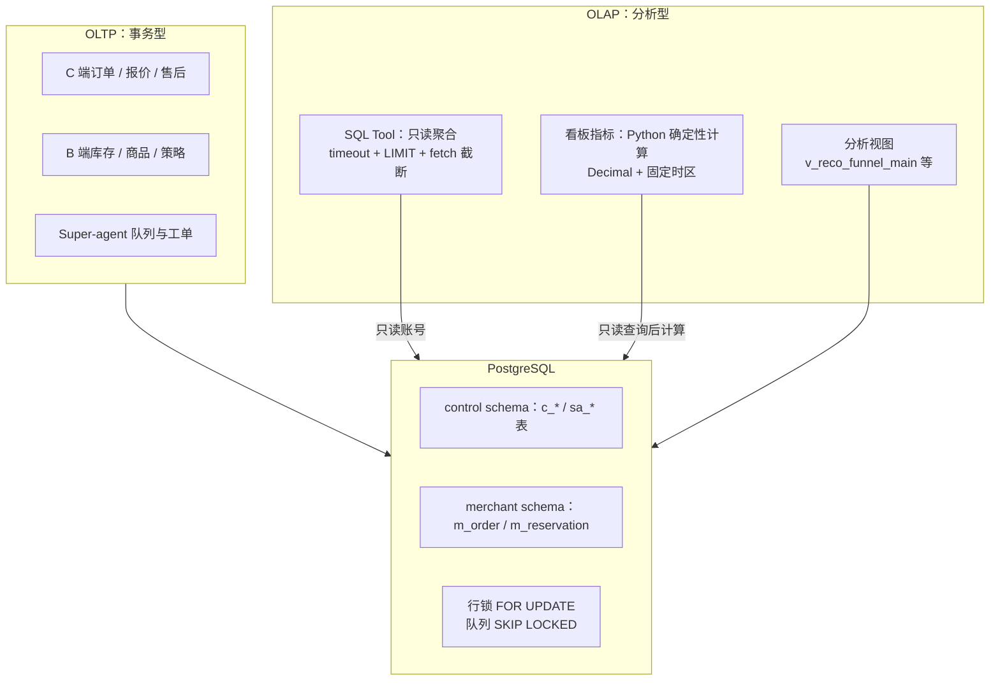

# OLTP 与 OLAP

> 第 7 篇 · 04 · Data & Knowledge  
> 交易求“每次都对、并发不冲突”，分析求“扫很多行、算一个数”；两类负载硬塞进一套设计，通常两边都不满意。

## 1. 为什么需要区分事务与分析

OLTP（订单、库存、支付、审批）单次操作涉及少量行，要求低延迟、强一致、高并发，典型语句是 `INSERT/UPDATE` 与主键查询；OLAP（报表、看板、归因、趋势）单次查询扫描大量行，要求吞吐与聚合效率，典型语句是 `GROUP BY` 聚合。

放在同一个库、同一批索引上会冲突：分析查询扫大表占用 IO/CPU，拖慢交易请求；交易表频繁更新让分析读到中间状态或长事务阻塞；为分析加大量索引又拖慢写入。

Qianke 里同时存在三类访问：Agent 调 SQL Tool 做聚合统计（分析型，但只读账号、限时限量）、业务系统写订单/库存/审批（事务型，要求并发安全）、后台看板算指标（分析型，要求口径稳定）。不区分的话，一次失控的聚合查询可能拖垮交易库；为分析改宽表，写路径复杂度又会急升。

需要强调：**逻辑分离与物理分离是两件事**。逻辑分离指读写账号、查询入口、超时、资源配额、指标口径分开；物理分离指只读副本、独立数仓、列存引擎。小规模先用逻辑分离 + PostgreSQL 就够。

## 2. 基本机制

行存一行连续存储，按主键取整行快，适合 OLTP；列存一列连续存储，聚合时只读需要的列、压缩率高，适合 OLAP。对比：查“订单 A 的详情”行存读 1 行、列存要拼多列；查“所有订单金额总和”行存扫全表所有列、列存只读金额列。

OLTP 依赖事务：`BEGIN → 写多张表 → COMMIT/ROLLBACK`；隔离级别决定“别人能看到什么”。并发写同一行必须加锁，否则会超卖、重复扣减：

```sql
-- 库存扣减：先锁行再判断（真实代码位于 merchant/postgres_repository.py）
SELECT * FROM m_order WHERE order_id = %s FOR UPDATE;

-- 队列领取：跳过已被锁住的行（真实代码位于 control/job_queue.py）
SELECT * FROM sa_job WHERE status = 'PENDING'
ORDER BY created_at LIMIT 1 FOR UPDATE SKIP LOCKED;
```

分析查询必须限制对交易库的影响：

```text
只读账号：只有 SELECT 权限
statement_timeout：单条查询最多 10s（Qianke SQL Tool 当前值）
LIMIT 强制：没有 LIMIT 的查询直接拒绝
取数截断：fetchmany(100)，防止 LIMIT 写成 1000000
表白名单：只允许查授权的表
```

指标计算有三种落点：SQL 聚合（数据库内，适合大表）、应用层计算（口径可单测、可复用，但要把数据取回内存）、预计算（物化视图/宽表，查询快但更新与一致性成本高）。Qianke 商家看板选择应用层计算：`dashboard_metrics.py` 明确“只做确定性计算，不访问数据库、不调用 LLM”。

## 3. 总体架构



三条边界：写路径走事务 + 行锁/队列锁；读路径走只读账号 + 超时 + 限量；指标口径集中在确定性代码，SQL 只负责取数。

## 4. 关键设计

**控制面与数据面分离**：控制面（账号、租户、订单、审批、队列、审计）集中在 `qianke_control` schema，表结构在 `control/schema_pg.sql`，含外键、唯一约束与索引；数据面是向量与检索（`vec_db*`）。控制面支持 SQLite / PostgreSQL 双后端（`QIANKE_CONTROL_BACKEND`）。

**并发安全：锁与幂等**。行锁用于订单状态流转、库存预占/释放、退款，先 `SELECT ... FOR UPDATE` 再判断；队列锁用 `SKIP LOCKED` 让多 Worker 并行消费而不重复领取；`request_id` / 业务主键做幂等；唯一索引防重复记录。这些是 OLTP 的核心资产，不能用分析库替代。

**分析视图固化口径**（节选，完整定义见 `control/schema_pg.sql`）：

```sql
CREATE OR REPLACE VIEW v_reco_funnel_main AS
SELECT substr(server_ts, 1, 10) AS day, merchant_id, strategy, position,
       SUM(CASE WHEN event_type = 'expose' THEN 1 ELSE 0 END) AS exposes,
       SUM(CASE WHEN event_type = 'click'  THEN 1 ELSE 0 END) AS clicks,
       SUM(CASE WHEN event_type = 'cart'   THEN 1 ELSE 0 END) AS carts,
       SUM(CASE WHEN event_type = 'order'  THEN 1 ELSE 0 END) AS orders
FROM c_reco_event
WHERE is_exploration = 0 AND source = 'client' AND is_simulated = 0
GROUP BY 1, 2, 3, 4;
```

视图的价值是口径只有一处：主报表、探索位、模拟数据各自一个视图，避免每个查询各写一遍 WHERE。

**时间语义**最容易错：按 `paid_at` 还是 `created_at`、业务时区 `Asia/Shanghai` 还是 UTC、半开区间 `start <= t < end`。商家看板定义（设计文档）：`paid_order_count` 按 `paid_at`、`net_revenue = gross_paid_amount - refund_amount_attributed`（退款归属原订单周期）、`cash_refund_amount` 按 `refunded_at` 且不参与 `net_revenue`。

**金额精度**：数据库 `NUMERIC`、应用层 `Decimal` 并 quantize 到分、API 输出字符串；禁止 float 中转与前端二次计算。

## 5. 工程实现

```text
control/schema_pg.sql          控制面 OLTP 表 + 分析视图
control/postgres_repository.py 控制面读写
control/job_queue.py           SKIP LOCKED 任务队列
merchant/postgres_repository.py 商家订单/库存行锁
merchant/dashboard_metrics.py  看板指标确定性计算
tools/sql_tool.py              Agent 侧只读 SQL
db/schema.py                   画像/文档表与检索索引
```

Agent 的 SQL 旁路与业务交易共用同一个库，但边界不同：`execute_sql` → `sql_tool.execute_sql_dict` 先做只读起点、关键字黑名单、必须 LIMIT、表白名单校验，再用只读账号 + `statement_timeout=10s` + `fetchmany(100)` 执行。即使模型生成危险 SQL 也会被数据库权限拒绝；即使校验被绕过，也只读、只白名单表、只返回 100 行。

商家看板数据流（伪代码）：

```python
orders = repo.list_orders_by_paid_at(merchant_id, start, end)   # 只读查询
metrics = build_overview(paid_orders=orders, completed_orders=..., start_date=start, end_date=end)
# net_revenue = sum(total_amount) - sum(order_refund)，全部 Decimal
```

指标计算不碰数据库、不调 LLM，因此可脱离数据库做单元测试。

## 6. 企业级要求

| 要求 | OLTP | OLAP | Qianke 现状 |
|---|---|---|---|
| 延迟 | 单请求低延迟 | 查询可秒级 | 交易低延迟；分析未做 SLO |
| 一致性 | 强一致 | 可接受最终一致 | 同一库，强一致 |
| 并发 | 行锁/队列锁 | 只读资源隔离 | 已实现锁；分析靠超时与限量 |
| 扩展 | 垂直 + 分库 | 列存/数仓/副本 | 未做读写分离 |
| 口径 | 业务规则 | 指标定义 | 部分实现（看板口径文档 + 代码） |

## 7. 方案对比

| 方案 | 优点 | 缺点 | 适用 |
|---|---|---|---|
| 单库同时承载 | 简单、强一致 | 分析拖慢交易 | 小规模（Qianke 当前） |
| 只读副本 | 隔离分析流量 | 复制延迟、成本 | 中等规模 |
| 独立数据仓库 | 列存、弹性、口径层 | 数据同步、成本 | 中大规模 |
| 湖仓一体 | 统一存储、开放格式 | 运维复杂 | 大数据团队 |

升级信号的判断标准：分析查询开始影响交易 P95、单表数据量使聚合超出可接受时间、多数据源需要统一口径与历史快照。

## 8. Qianke Engine 实践

```text
已实现：PostgreSQL 控制面（订单、库存、售后、审批、队列、审计表与索引）；
        SQLite / PostgreSQL 双后端开关；行锁保障订单状态与库存并发安全；
        FOR UPDATE SKIP LOCKED 支持多 Worker；分析视图固化推荐漏斗口径；
        商家看板 Decimal + 固定时区 + 应用层确定性计算；
        Agent SQL Tool 只读账号 + timeout + LIMIT + fetch 截断
部分实现：读写分离未做；分析查询仅靠超时与限量隔离；指标未统一到语义层
规划中：数据仓库 / 列存引擎、CDC 同步、物化视图、OLAP SLO 与容量规划
```

已知限制（设计文档明确记录）：V1.0 退款为订单级单次退款，不支持多次退款累计与退款流水；历史周期的净成交金额会因后续退款发生变化；商家看板的 P95 延迟尚无正式 SLO（待核验）。

## 9. 评估/验收

```text
[ ] 并发扣库存不会超卖（FOR UPDATE 生效）
[ ] 多 Worker 不会重复领取同一任务（SKIP LOCKED 生效）
[ ] 分析查询有 timeout / LIMIT / fetch 截断，无法拖垮服务
[ ] 看板指标与手工 SQL 对账一致（同口径、同时区、同半开区间）
[ ] 退款、取消场景下 net_revenue 与订单明细能对上
[ ] 控制面在 SQLite 与 PostgreSQL 下行为一致（契约测试）
```

建议指标：交易 P95/P99、锁等待、队列积压与死信；分析查询 P95、超时率、被拒绝的非法 SQL 数；对账差异条数。

## 10. 常见误区

1. 用 OLTP 表直接跑大报表：不隔离资源，早晚拖慢交易。
2. 为了分析随意加索引：写入变慢、维护成本上升。
3. 忽略时间口径：支付/下单/完成时间混用，报表永远对不上。
4. 用 float 算钱：精度误差在汇总时被放大。
5. 没有 LIMIT 保护：一条 `SELECT *` 就能把服务打满。
6. 把“最终一致”套到交易上：库存、支付必须强一致。
7. 过早引入数仓：规模没到就上复杂架构，成本大于收益。

## 11. 总结

```text
1. OLTP 求正确与并发，OLAP 求吞吐与口径，两者要逻辑或物理分离。
2. 行锁、队列锁、唯一约束是交易正确性的基础，不能被分析需求破坏。
3. 分析查询必须有限制：只读账号、超时、LIMIT、取数截断。
4. 指标口径与时间语义决定了分析结果的“正确性”。
5. Qianke 用 PostgreSQL 单库 + 逻辑隔离支撑当前规模；数仓与副本仍是演进项。
```

## 12. 延伸阅读

- [指标语义层设计](08-metric-semantic-layer.md)、[向量数据库原理](02-vector-database.md)
- `docs/product/merchant-dashboard-v1-technical-design.md`
- `src/rag_demo/control/schema_pg.sql`、`src/rag_demo/merchant/dashboard_metrics.py`
- PostgreSQL 并发控制：<https://www.postgresql.org/docs/current/mvcc.html>
- ClickHouse 文档：<https://clickhouse.com/docs>
