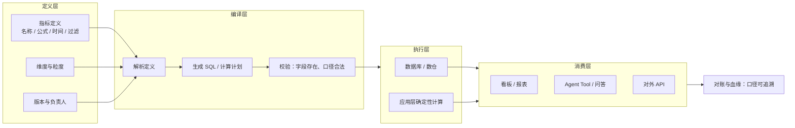

# 指标语义层设计

> 第 8 篇 · 04 · Data & Knowledge  
> 指标语义层不是“再写一份指标文档”，而是让同一个指标在全系统里只有一个可执行的定义。

## 1. 为什么需要指标语义层

同一个“销售额”，不同团队可能指：支付成功金额、支付金额减退款（净销售额）、已完成订单金额、含运费/优惠前的原价。没有唯一定义，Agent、看板、报表各算各的，用户看到三个数，信任立刻崩塌。

指标失真有四类根因：**口径**（支付/下单/完成时间归属不同，退款是否扣减，是否含税/运费）、**时间**（时区、半开与闭区间、自然月与滚动 30 天）、**数据**（空值当 0、重复订单、部分退款、跨期退款）、**版本**（定义改了但历史报表没有重算）。

Agent 时代问题更突出：用户问“上个月卖得怎么样”，模型可能自己选时间范围、自己决定是否扣退款、自己把“销售额”理解成订单原价。没有语义层，每次回答都是一次口径赌博。

## 2. 基本机制

一个指标定义至少包含：

```text
名称与唯一标识：net_revenue / 净销售额
业务定义：一句话说明它回答什么问题
计算公式：gross_paid_amount - refund_amount_attributed
数据来源：表、字段、过滤条件
时间口径：按 paid_at 归属，半开区间，Asia/Shanghai
粒度与维度：可按日/周/月、商家、品类、渠道
空值与边界：分母为 0 时返回 null，不返回 0
负责人：谁对口径负责
版本：定义变更记录与生效时间
```

语义层可以是一个独立服务，也可以是“代码库 + 定义文件”的组合，关键是**只有一个定义源**。

指标分层：原子指标（直接来自事实表，如 `gross_paid_amount`）、派生指标（由原子指标计算，如 `net_revenue`）、复合指标（比率、同比、环比，如 `average_order_value`、`repeat_rate`）。分层的好处是复用：改退款口径只改原子指标，派生指标自动跟随。

## 3. 总体架构



语义层的核心不是“多加一层服务”，而是把指标定义从 SQL 语句和口头约定里抽出来，变成有版本、有 owner、可校验的资产。

## 4. 关键设计

**唯一定义源**。反例：看板 SQL 写一遍口径、Agent 提示词再写一遍、文档再写一遍，结果改一处漏两处。正确做法二选一：定义在语义层平台（Looker / dbt Semantic Layer / 自研注册表），所有消费方调用；或定义在代码库（如 `metrics.py` + 设计文档），测试保证公式与文档一致。Qianke 当前是后者。

**时间语义必须写死**：

```text
归属字段：paid_at / created_at / completed_at / refunded_at
区间：start <= t < end（半开，避免边界重复）
时区：业务时区 Asia/Shanghai，存储可 UTC
粒度：自然日/周/月 vs 滚动窗口
```

Qianke 商家看板定义：`paid_order_count` 按 `paid_at`；`gross_paid_amount` 是该周期内 `paid_at` 订单的 `total_amount` 合计；`refund_amount_attributed` 是这些订单的退款（归属原订单 `paid_at` 周期）；`net_revenue = gross - refund_attributed`；`cash_refund_amount` 按 `refunded_at` 统计且不参与 `net_revenue`。

`refund_amount_attributed` 与 `cash_refund_amount` 是两个不同指标：前者回答“这批订单后来退了多少”，后者回答“本期实际退出去多少钱”。很多报表错就错在把两者混用。

**空值与边界**：`paid_order_count = 0` 时客单价返回 `null` 而不是 0；占比分母为 0 返回 null；退款金额不得超过订单总额。“0 元客单价”与“没有客单价”是两件事，API 返回 null、前端显示 `--` 比返回 0 更诚实。

**版本化与生效时间**：定义变更要记录改了什么、为什么改、从哪天生效；历史数据是否按新口径重算要明确（重算 / 不重算 / 双口径并存）。否则会出现“同一张报表上周和本周对不上，但没人改过代码”。

**权限**：指标也受权限约束——谁能看定义、谁能看明细、谁能改口径。Qianke 的能力体系（L1~L4）可复用，但指标级可见性尚未实现。

## 5. 工程实现

Qianke 当前有两种“语义层”：

```text
商家看板：代码即口径
  merchant/dashboard_metrics.py（Decimal、固定时区、纯函数）
  docs/product/merchant-dashboard-v1-technical-design.md（公式与边界说明）
  tests/test_dashboard_metrics.py 等测试保证行为

用户分析：文档即口径
  data/docs/tag_definitions.md（高价值/高客单/流失预警等标签定义）
  通过 RAG 检索进入提示词，由模型按文档口径解释
  评测集把“引用口径文档”作为期望来源
```

分工逻辑：需要精确计算用代码即口径（看板）；需要解释与判断用文档即口径（标签、策略）。

Text2SQL 的 `db/schema_facts.py` 从当前数据集实时采集表结构、条数、枚举取值、时间覆盖、客单价分位，注入提示词。它的好处是换数据集不改提示词，但边界也要说清：**这是数据结构事实，不是业务口径定义**。把 schema facts 当语义层是常见误解。

演进路径：把现有指标整理成注册表（YAML/JSON/数据库表）→ 注册表生成计算代码或 SQL，测试保证与旧实现一致 → Agent Tool 查指标注册表而不是自由写 SQL → 加版本、owner、血缘与对账。

## 6. 企业级要求

| 要求 | 目标 | Qianke 现状 |
|---|---|---|
| 唯一口径 | 同一指标全系统一致 | 部分实现（看板单一口径；Agent 仍可能自由解释） |
| 可追溯 | 指标能追到字段与计算 | 部分实现（代码 + 设计文档） |
| 版本化 | 定义变更可查 | 未实现 |
| 权限 | 指标级可见性 | 未实现（仅能力级） |
| 对账 | 看板 vs 明细可核对 | 部分实现（测试覆盖；无线上对账） |
| 性能 | 指标查询可缓存/预计算 | 未实现（实时计算） |

## 7. 方案对比

| 方案 | 优点 | 缺点 | 适用 |
|---|---|---|---|
| 指标写在 SQL 里 | 直接、快 | 口径分散、难复用 | 临时分析 |
| 指标写在代码里 | 可测试、可版本化 | 非工程人员难维护 | 产品指标（Qianke 看板） |
| 指标写在文档里 | 易读、可解释 | 不可执行、容易过期 | 标签/策略定义 |
| 独立语义层平台 | 统一、可治理、多消费方 | 建设成本高 | 多团队/多系统 |

Qianke 当前是“代码 + 文档”的混合形态，适合早期；指标数量与消费方增加后需要注册表化。

## 8. Qianke Engine 实践

```text
已实现：商家看板指标（net_revenue / gross_paid_amount / refund_amount_attributed /
        cash_refund_amount / average_order_value / repeat_rate 等）全部 Decimal、
        固定 Asia/Shanghai、纯函数、可单测；指标口径设计文档；
        标签口径文档（RAG 可检索，评测期望来源）；Text2SQL schema facts
部分实现：看板内部口径一致，但 Agent 问答仍可能对“销售额”做不同解释；
          有测试无线上定时对账；版本只在 git 历史与文档变更记录里
规划中：统一指标注册表 / 语义层服务、指标级权限、指标血缘、
        Agent 通过指标 API 取数（而不是自由生成 SQL）
```

## 9. 评估/验收

```text
[ ] 同一指标在看板、报表、Agent 回答中数值一致（同口径同时段）
[ ] 时间边界：周期首尾各 1 秒的数据不重复、不遗漏
[ ] 退款场景：跨期退款在 net_revenue 与 cash_refund_amount 中分别正确
[ ] 分母为 0 时返回 null，前端显示 --
[ ] 指标定义变更后，历史报表是否有明确的重算策略
[ ] 指标能追到来源字段与计算公式
```

## 10. 常见误区

1. 把指标文档当语义层：文档不可执行，代码改了文档不会自动跟随。
2. 让 LLM 自由解释指标：模型会“合理地”选一个口径，但不是你要的。
3. 忽略退款归属：退款算在支付期还是退款期，结果完全不同。
4. 用 0 表示缺失：0 元与无数据是两种业务含义。
5. 时区随便设：跨时区业务在自然月边界必然出错。
6. 指标没有 owner：口径争议时无人拍板。
7. 一次建大而全的语义层：先把核心 10 个指标注册化，比建平台更有效。

## 11. 总结

```text
1. 指标语义层的本质是“唯一定义 + 可执行 + 可追溯”。
2. 时间口径、退款归属、空值语义，是指标失真的三大高发点。
3. 代码即口径适合精确计算，文档即口径适合解释判断，两者要配合。
4. Qianke 已有看板口径与标签文档，但缺少统一注册表、版本与指标级权限。
5. 演进方向是“指标注册表 + Agent 调指标 API”，而不是让模型自由写 SQL。
```

## 12. 延伸阅读

- [OLTP 与 OLAP](07-oltp-olap.md)、[数据血缘与质量管理](09-data-lineage-quality.md)
- `docs/product/merchant-dashboard-v1-technical-design.md`
- `src/rag_demo/merchant/dashboard_metrics.py`、`data/docs/tag_definitions.md`
- dbt Semantic Layer：<https://docs.getdbt.com/docs/build/semantic-models>
- Looker LookML：<https://cloud.google.com/looker/docs/lookml-terms-and-concepts>
- MetricFlow：<https://docs.getdbt.com/docs/build/about-metricflow>
