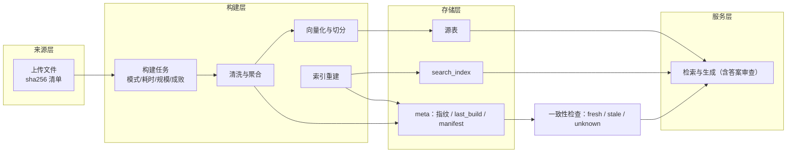

# 数据血缘与质量管理

> 第 9 篇 · 04 · Data & Knowledge  
> 血缘回答“从哪来”，质量回答“能不能用”；两者结合，才能在数据出错时快速定位并判断影响范围。

## 1. 为什么需要数据血缘与质量管理

一个典型故障：用户反馈“昨天报表里的净销售额是错的”。排查要回答：数据源改了吗？哪次构建覆盖了它？是金额字段映射错了，还是退款口径变了？受影响的只有这张报表，还是所有引用该数据集的问答？

没有血缘，只能从头翻代码与日志；有血缘，可以直接沿链路定位到“哪个文件、哪次构建、哪个字段”。

没有质量约束，脏数据会穿透到答案：编码错误的 CSV → 列名乱码 → 字段映射失败 → 画像全空；重复上传 → 订单金额翻倍 → 客单价虚高；超过列长的城市名 → INSERT 失败 → 整批构建回滚。这些问题不会停在数据库里，它们会变成用户看到的错误结论，而模型还会用流畅的语言把它讲得像真的。

必须回答三个问题：**来源**（哪个文件/批次/系统产生）、**过程**（经过哪些清洗、聚合、切分、索引步骤）、**状态**（当前是否最新、完整、可信）。

## 2. 基本机制

血缘分三个层次：系统级（从哪个源系统/接口进入）、表/文件级（哪张表、哪个上传批次、哪次构建）、字段级（某个字段来自源文件哪一列、经过什么转换、被哪些指标引用）。层次越细建设成本越高，多数团队先做表/文件级，再逐步补字段级。

数据质量六个维度：完整性（user_id 缺失、文档为空）、准确性（金额为负、年龄 200 岁）、一致性（看板与明细对不上）、唯一性（同一文件重复上传）、及时性（索引未随源表重建）、有效性（性别写成 “Female”）。

质量门禁的位置决定成本：

```text
接入时：格式、编码、必填、类型（拒绝坏数据进入）
构建后：条数、空值率、异常值（发现异常但不一定阻断）
服务前：索引新鲜度、可用性（决定是否降级）
输出后：答案事实审查、评测（兜住模型错误）
```

门禁越靠前越便宜：坏文件在接入时拒绝，比进入数据库后再清洗便宜得多。

## 3. 总体架构



三条元数据链：**清单**（哪些文件已入库，sha256 + 行数/分块数 + 时间）、**构建历史**（每次构建的模式、耗时、规模、成败、错误）、**语料指纹**（源表内容摘要，判断索引是否落后）。

## 4. 关键设计

**内容指纹：不能只比条数。**

```text
指纹 = COUNT + md5(按主键排序的 (id, md5(文本)) 拼接)
状态：fresh（一致）/ stale（源表变了）/ unknown（没有基线）
```

为什么不能只比条数：重导画像后条数可能仍是 8110 条，但文本内容已变，检索会静默使用旧索引。`unknown` 必须与 `stale` 区分：老库第一次检查没有基线，直接报 stale 会误导。

**增量清单：sha256 是血缘的最小单元。**

```text
ingested_csv  {文件名: {sha256, rows, ingested_at}}
ingested_docs {文件名: {sha256, chunks, ingested_at}}
```
它同时承担两个职责：去重（同一文件不重复入库）与血缘（当前数据由哪些文件、哪次上传产生）。清单丢失或损坏时，系统无法判断“哪些文件已入库”，只能要求全量重建——这是血缘缺失的直接代价。

**构建历史：失败也要留痕。**

```text
build_history：built_at / mode / elapsed_s / rows / profiles / status / error
last_build：最近一次成功构建的源（upload_id + fields），用于一键重建
last_full_build：最近一次全量的规模与耗时
```

只记成功会让“昨天为什么没更新”无法回答。Qianke 在构建异常时也会写一条 `status=failed` 的历史。

**质量检查的现有位置**：接入（文件类型、大小、编码、空文件、同名）、解析（列名可读、可行数）、映射（user_id 必填）、聚合（文本截断、NaN → NULL、类型容错）、写入（空输入报错，避免 TRUNCATE 后失败）、索引（缺失 token/稀疏权重统计）、服务（新鲜度、检索不可用与空结果区分）、输出（`answer_guard` 拦截编造未来数据）。这些检查有效但**不成体系**：没有统一规则配置、没有质量分、没有告警。

**数据缺陷要进文档。** Qianke demo 数据有三个必须写清的缺陷：`user_id` 不是稳定实体键（同一 ID 在不同行/平台姓名、年龄、城市互相冲突）；`order_count` 实为购买记录行数（CSV 无订单号）；聚合出的 8110 个“用户”是样本口径。只存在于某个人脑子里的缺陷，会让后续所有分析与 Agent 结论被误读。

## 5. 工程实现

```text
db/schema.py          指纹、构建历史、last_build、清单 meta
mvp/builder.py        构建编排与失败留痕
mvp/uploads.py        sha256、文件分类、清单状态
ingest_data.py        清洗、聚合、写入校验
api/kb.py + kb_stats.py  概况接口（freshness / totals / last_source）
answer_guard.py       输出事实审查
```

概况接口返回：`dataset / mode / ready / empty / can_write`、`totals`（文档数、分块数、画像数）、`docs`（按文档聚合）、`built_at`、`freshness`（status + reason）、`last_source`（最近构建的源是否还在，决定能否一键重建）。这组信息让用户能回答“我的库里有什么、什么时候建的、还新不新、重建要什么”。

血缘查询（伪代码，基于现有 meta）：

```python
meta = read_index_meta("last_build")      # 最近构建的 upload_id + fields
manifest = read_ingest_manifest()         # 哪些文件已入库
history = read_build_history(limit=20)    # 每次构建的成败与规模
freshness = index_freshness()             # 索引是否落后
```

## 6. 企业级要求

| 要求 | 目标 | Qianke 现状 |
|---|---|---|
| 批次血缘 | 数据能追到文件与构建 | 已实现（manifest + build_history + last_build） |
| 字段血缘 | 字段能追到来源列与转换 | 未实现 |
| 指标血缘 | 指标能追到字段与公式 | 未实现 |
| 一致性 | 索引与源表一致可判定 | 已实现（指纹 fresh/stale/unknown） |
| 质量规则 | 可配置、可告警 | 未实现（硬编码检查） |
| 质量分 | 每个数据集有质量评分 | 未实现 |
| 告警 | 异常主动通知 | 未实现（仅日志） |

## 7. 方案对比

| 方案 | 优点 | 缺点 | 适用 |
|---|---|---|---|
| 手工文档记录 | 成本低 | 易过期、不可查询 | 极早期 |
| 元数据表（Qianke 现状） | 简单、与业务同库、可查询 | 需自己维护、无标准模型 | 中小规模 |
| 数据目录平台（DataHub 等） | 标准化、可视化、跨系统 | 建设与维护成本高 | 多系统/多团队 |
| 数据可观测平台 | 自动监控、异常检测 | 成本高、需接入改造 | 大规模生产 |

Qianke 当前是“元数据表”阶段：够用、可解释，但无法回答字段级问题。

## 8. Qianke Engine 实践

```text
已实现：sha256 文件清单（增量去重 + 批次血缘）；构建历史（成功/失败、模式、
        耗时、规模、错误）；last_build / last_full_build；语料指纹（内容级一致性，
        fresh/stale/unknown）；索引缺失统计；接入期质量检查（编码、空文件、必填、
        文本截断、类型容错）；输出期 answer_guard
部分实现：血缘只到“文件/批次/构建”级，没有字段级与指标级；
          质量检查硬编码，没有规则引擎、质量分、告警；历史保留期未定义
规划中：字段级血缘、Schema 变更影响分析、质量规则 DSL、质量看板与告警、
        跨系统血缘（业务库 → 数据平台 → Agent）
```

## 9. 评估/验收

```text
[ ] 任意一条数据能追到来源文件与构建批次
[ ] 构建失败有历史记录与错误原因
[ ] 源表变更后，索引新鲜度判定为 stale
[ ] 没有基线时判定为 unknown（不是 stale）
[ ] 重复上传同一文件不会重复累加；空文件/坏编码不会清空已有数据
[ ] 索引缺失统计能被读取（不静默）
```

建议指标：构建成功率、失败原因分布、stale 持续时间、质量检查拦截数（按类型）、血缘覆盖率（有来源记录的数据占比）。

## 10. 常见误区

1. 只记成功不记失败：故障排查时最需要的是失败记录。
2. 用条数判断一致性：内容变了条数可能不变。
3. 把 unknown 当 stale：没有基线不等于过期，误报会掩盖真问题。
4. 质量检查只做一次：数据在变、模型在更新，检查要持续。
5. 血缘只画在 PPT 上：不能查询的血缘无法用于定位。
6. 忽略数据缺陷文档化：demo 的 user_id 问题不写清，结论会被误读。
7. 把日志当血缘：日志是过程记录，血缘需要结构化的来源与依赖。
8. 只关注当前状态：没有历史快照，就无法回答“上周这个指标是多少”。
## 11. 总结

```text
1. 血缘回答“从哪来、经过什么”，质量回答“能不能用”。
2. 最小可用血缘 = 文件 sha256 + 构建历史 + 内容指纹。
3. 一致性检查必须区分 fresh / stale / unknown，不能只比条数。
4. 质量门禁前移：接入时拒绝坏数据，比事后清洗便宜。
5. Qianke 已具备批次级血缘与索引一致性；字段级血缘、质量规则与告警仍未建成。
```

## 12. 延伸阅读

- [数据接入与 ETL](06-data-ingestion-etl.md)、[指标语义层设计](08-metric-semantic-layer.md)
- `docs/数据模型.md`、`src/rag_demo/db/schema.py`、`src/rag_demo/kb_stats.py`
- DataHub：<https://datahubproject.io/docs/>；OpenLineage：<https://openlineage.io/docs/>
- Great Expectations：<https://docs.greatexpectations.io/docs/>
