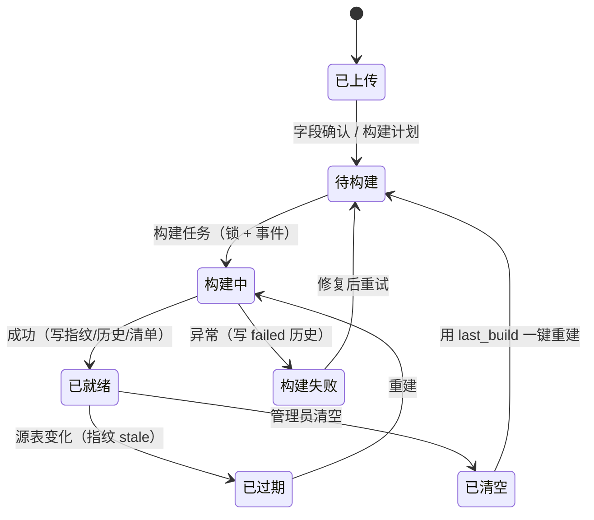
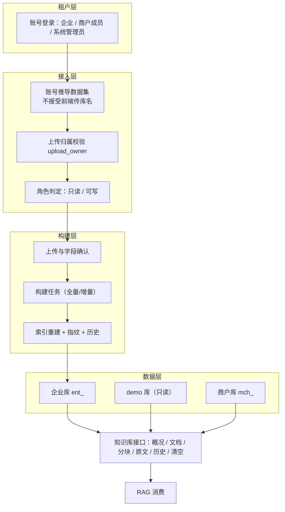

# 企业级知识库架构

> 第 10 篇 · 04 · Data & Knowledge  
> 企业知识库不是“文档列表 + 搜索框”，而是一个有租户边界、有构建生命周期、有权限与新鲜度的数据空间。

## 1. 为什么需要企业级知识库架构

企业文档管理有四个断层：**存储**（散在网盘、Wiki、聊天记录）、**结构**（Word/PDF/Markdown/Excel 混杂，没有统一切分与索引）、**权限**（谁能看哪份文档靠人工转发）、**生命周期**（上传后没人知道有没有更新、索引是否过期）。直接做“上传 → 搜索”只解决“能搜到”，解决不了“搜到的是谁的数据、是不是最新、该不该给他看”。

知识库与 RAG 的分工：**知识库**管理知识资产（谁的数据、有哪些文档、何时构建、是否新鲜），**RAG** 使用知识资产（检索、重排、生成、引用）。两者混成一个模块，管理逻辑与检索逻辑互相耦合，权限和生命周期难以收口。

最低要求：租户隔离（物理隔离，不靠“记得加 WHERE”）、可接入、可查询（文档列表/分块/原文）、可判断（构建时间、新鲜度、规模）、可维护（重建/清空/历史）、可控制（读写权限按角色/租户）。

## 2. 基本机制

```text
租户（enterprise）→ 数据集（dataset）→ 物理库（vec_db_ent_<id>）
  ├── wiki_vectors：文档分块 + 向量 + 父块 + metadata
  ├── user_profile_vectors：画像（若同时导入用户数据）
  ├── search_index：BM25 token + 稀疏权重
  └── meta：指纹 / 构建历史 / last_build / UI 配置
```

一个租户可以有多个上传批次，但只有一个当前生效的数据空间。文档生命周期：



读接口：概况（数据集、文档数、分块数、画像数、构建时间、新鲜度、最近来源）、画像（分页卡片，不返回 `profile_text`/`embedding`）、文档（按文档聚合分块数、字符数、更新时间）、分块（按 doc_id 取，限制条数并标记截断）、原文（Markdown，源文件不在时用分块拼回）、历史（构建历史）。这些接口让“知识库状态”可被看见。

## 3. 总体架构



三条硬约束：读哪个库由登录账号推导，接口不接受 `dataset` 参数；写操作必须显式声明数据集；演示库只读，不能作为任何人的“练习库”被覆盖。

## 4. 关键设计

**租户隔离：物理分库。** 企业 `ent_<id> → vec_db_ent_<id>`、商户 `mch_<id> → vec_db_mch_<id>`、演示 `demo → vec_db`（只读）。为什么不用同库加 `tenant_id`：分库时所有表与派生索引自动跟随，漏切会连不上表并报错；同库漏写 WHERE 会安静地读到别人的数据。代价是建库、迁移、备份逐个执行。

**数据集推导**：系统管理员 → 演示库（不能写业务数据）；企业管理员/员工 → 本企业库；商户操作者 → 本商户库。`/api/kb/*` 全部不接受 `dataset` 参数；清空接口的 `confirm` 只与推导出的库名比对。

**“就绪”语义要分清**：`ready=false` 表示还没构建或库未创建（200 + 引导去构建）；`empty=true` 表示库就绪但没有数据；`403` 表示无权限。“还没有数据”与“你没有权限”是两件完全不同的事。

**文档 ID 与路径安全**：`doc_id = sha1(doc_name)[:16]`，不把原始文件名放进 URL，避免路径注入与内部文档名暴露；接口拿到 doc_id 后仍在当前数据集内反查真实文档名，找不到返回 404。

**原文回退**：优先读上传目录里的 Markdown 原文；源文件删除/迁移时用库内分块按顺序拼回并标记。知识库的“可读原文”不能因为一次磁盘清理就永久丢失。

**清空与重建**：TRUNCATE 源表与索引表，删除数据类 meta（指纹/清单/last_full_build），保留 `last_build`（重建依据）、`ui_*` 配置、`doc_source_dir`。只 TRUNCATE 不 DROP：结构保留，清空后 `ready=true, empty=true`，可一键重建。

**图片与外部资源**：文档内图片上传到对象存储，库内只存 `oss://` key 或外链；不入库签名 URL（签名有时效，写进库与缓存后会变成死链），检索返回时再换临时签名地址。

## 5. 工程实现

```text
api/kb.py          概况 / 画像 / 文档 / 分块 / 原文 / 历史 / 清空
kb_stats.py        概况数据整理（可脱离数据库单测）
mvp/app.py         上传 / 构建计划 / 构建 / 进度
mvp/builder.py     构建编排（全量/增量/锁/记录）
db/schema.py       表、索引、指纹、构建历史、meta
auth.py            企业 / 账号 / 上传归属
config.py          数据集注册表与租户库命名
```

已实现接口：

```text
GET  /api/kb/overview / profiles / documents / documents/{doc_id}/chunks
GET  /api/kb/docs/{doc_id}/raw / history
POST /api/kb/clear（管理员 + 确认）、/admin/enterprise/invite-code/reset
GET  /admin/enterprises（系统管理员）
```

构建流水线：上传（编码归一、解析、同名校验）→ 字段确认（同义词匹配 + 用户确认）→ 构建计划（增量可行性、已有规模）→ 构建任务（全量/增量，锁 + 事件）→ 索引重建 + 指纹 + 历史 + 清单 → 刷新 BM25 与问答缓存。

## 6. 企业级要求

| 要求 | 目标 | Qianke 现状 |
|---|---|---|
| 租户隔离 | 企业间数据不可见 | 已实现（物理分库） |
| 权限 | 读/写按角色区分 | 已实现（管理员可写、员工只读、demo 只读） |
| 生命周期 | 上传-构建-重建-清空 | 已实现 |
| 可观测 | 规模、构建时间、新鲜度 | 已实现 |
| 文档级权限 | 某份文档只对部分人可见 | 未实现（仅 dept/sensitivity） |
| 版本管理 | 历史版本、回滚 | 未实现（只保留当前版本） |
| 外部连接器 | 飞书/Confluence/网盘同步 | 未实现（仅上传） |
| 审核发布 | 文档发布审批流 | 未实现 |

## 7. 方案对比

| 方案 | 优点 | 缺点 | 适用 |
|---|---|---|---|
| SaaS 知识库（Notion/Confluence） | 协作好、生态成熟 | 数据在外部、权限模型难对接 | 通用协作文档 |
| Git 文档库 | 版本清晰、可评审 | 非技术用户门槛高、无租户隔离 | 工程文档 |
| 企业自建知识库（Qianke 方向） | 租户隔离、可接 RAG、可控 | 建设成本高、需持续维护 | 企业内部知识 + Agent |

Qianke 选择“自建 + 物理分库”，是把知识库当作 Agent 的数据底座，而不是独立文档工具。

## 8. Qianke Engine 实践

```text
已实现：按企业/商户物理分库；demo 只读作为评测基线；知识库接口
        （概况 / 画像 / 文档 / 分块 / 原文 / 历史 / 清空）；
        登录账号推导数据集；上传归属校验；角色判定；
        构建流水线（全量/增量、锁、进度、历史、清单）；
        语料指纹与新鲜度（fresh/stale/unknown）；
        原文回退（分块拼回）、doc_id 路径安全、图片存 OSS key
部分实现：文档级 ACL 只有 dept / sensitivity 粗粒度过滤；
          版本管理只保留当前版本；审计有记录但无统一视图；外部连接仅文件上传
规划中：文档审批发布流、细粒度文档权限、外部连接器、
        多知识库（同一租户多个独立库）、知识库级配额与计费
```

## 9. 评估/验收

```text
[ ] 企业 A 的账号无法通过任何参数访问企业 B 的库
[ ] 未构建的企业库返回 ready=false，而不是 403 或 500
[ ] 员工账号不能清空/构建，企业管理员可以
[ ] 文档列表、分块、原文三者能互相对上
[ ] 源文件丢失时，原文接口能回退到分块拼接并标记
[ ] 构建完成后新鲜度为 fresh；改源表后为 stale
[ ] 清空后结构保留、ready=true、empty=true，可一键重建
```

建议指标：知识库就绪率、构建成功率、stale 持续时长、平均构建耗时、文档覆盖率、原文可读率。

## 10. 常见误区

1. 把知识库当文件列表：没有构建、索引、新鲜度，就只是网盘。
2. 用同一个库给所有租户：漏写过滤条件就会串数据。
3. 允许前端指定 dataset：等于把切库能力开放给调用方。
4. 清空后 DROP 表：结构没了，重建要从零开始，风险更大。
5. 把签名 URL 存进库：过期后全部变成死链。
6. 只记构建成功：失败记录才是排障入口。
7. 忽略“还没数据”与“没权限”的区别：用户会被引导到错误方向。

## 11. 总结

```text
1. 企业知识库是“有租户边界、有生命周期、有权限”的数据空间。
2. 物理分库 + 数据集推导 + 上传归属，是隔离的三件套。
3. 构建流水线、指纹、历史与清单，决定了知识库是否可维护。
4. 读接口让状态可见：概况、文档、分块、原文、历史缺一不可。
5. Qianke 已实现租户库与管理接口；文档级权限、版本与外部连接器仍是演进项。
```

## 12. 延伸阅读

- [RAG 系统架构](01-rag-architecture.md)、[数据接入与 ETL](06-data-ingestion-etl.md)
- [企业数据治理](05-enterprise-data-governance.md)、`src/rag_demo/api/kb.py`
- PostgreSQL 权限：<https://www.postgresql.org/docs/current/ddl-priv.html>
- OWASP 文件上传安全：<https://owasp.org/www-community/vulnerabilities/Unrestricted_File_Upload>
- S3 预签名 URL：<https://docs.aws.amazon.com/AmazonS3/latest/userguide/using-presigned-url.html>
