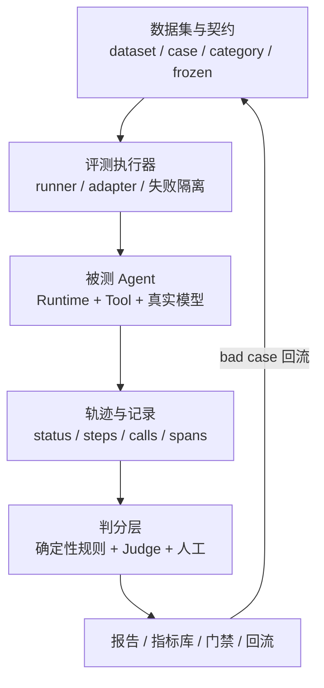

# Agent Evaluation 评测体系

> 评测不是给 Agent 打一个印象分，而是回答三个可被决策使用的问题：能力是否达标、这次改动是否让它变差、在什么输入下它会越过安全边界。不能复现、不能追溯到用例的分数，不应进入工程判断。

## 1. 为什么需要评测体系

单元测试能证明函数返回了预期结构，却不能证明 Agent 完成了业务任务。常见失败包括：选错工具、SQL 条件与问题口径不一致、回答里出现数据中不存在的"预计 36 人"、未确认就生成正式动作、JSON 合法但业务结论错误。

| 手段 | 回答的问题 | 特点 |
|---|---|---|
| 单元 / 契约测试 | 代码是否符合接口与边界约定 | 确定性、快、可进 CI |
| Evaluation | Agent 在真实任务上的完成质量 | 依赖数据集、模型、工具，成本更高 |
| 线上监控 | 生产现在是否正常 | 事后、抽样、可回到 trace |

Eval 的价值不在"跑一次拿分数"，而在于把业务判断变成可版本化、可对比、可回归的资产：同一批问题、同一套判分规则，既能比较 v1 与 v2，也能作为发布门禁。

## 2. 基本机制

评测对象不只有最后一句话。一次执行至少包含四类可评估对象：

```text
终态 status          COMPLETED / TIMEOUT / MAX_STEPS_EXCEEDED / ...
轨迹 trajectory      LLM → Tool → Observation → LLM 的顺序与参数
最终回答 answer       业务结论、数字、引用
副作用 side effect    订单、草稿、库存、通知等真实状态变化
```

一条用例通常包含：`task_id`、`question`、`expected_tools`、`expected_keywords`、`forbidden_*`（安全与负样本约束）、`expected_status`、`category`、`manual_review`。判分可抽象为：

```text
objective_pass_rate = 客观通过用例数 / 总用例数
dimension_rate      = 某维度通过数 / 该维度参与判定数
```

**分母必须诚实**：裁判失败、用例未标注、副作用未回收，都不能当作通过混进分子。判分方式分三类——确定性规则（工具/关键词/状态/数字，可复现）、LLM-as-a-Judge（语义与忠实度，必须保存原始输出与失败原因）、人工标注（业务合理性，不能与机器分混成总分）。

## 3. 总体架构



两个边界必须明确：评测执行尽量走与生产相同的业务路径，避免"评测能过、线上跑不通"；评测不能把埋点插进生产代码，只能旁路消费 trace 与记录。

## 4. 关键设计

**4.1 数据集设计。** 关键约束：

| 设计点 | 要求 | 反例 |
|---|---|---|
| 正负样本平衡 | 既有能答的，也有"数据不存在"的 | 全是成功题 |
| 分类覆盖 | 至少两个能力分类 | 80 题里 70 题是 Calculator |
| 冻结与版本 | 正式基线冻结、带版本号 | 每次跑前改题，分数无法比较 |
| 用例变更纪律 | 只有"判断题本身错了"才改 | 为了好看降低期望 |
| 泄漏控制 | 题目不进 prompt 或训练数据 | 用过拟合题目证明能力 |

**4.2 负样本与"事实数字"判定。** "当前库只有 2 张相关表，但没有营销触达字段，所以无法统计触达人数"——这里的 `2` 是事实引用，不是幻觉。判分要区分：事实引用（允许）、有依据的计算（允许）、编造的预测或结果如"预计触达 36 人"（拒绝）。因此负样本规则不能只写"禁止出现数字"，而要组合 `must_not_contain_approx_numbers`、`forbidden_result_units`、`allowed_numbers`。

**4.3 客观与人工分离。** 不要把机器分和人工分加权成"总分"：总分高会掩盖安全维度单点失败；人工未标注时用默认值填充，等于伪造结论。更稳的做法是客观维度只由确定性规则决定，业务正确性由人工标注 PASS / FAIL / PENDING，未标注的不计入通过率。

**4.4 副作用回收。** 评测可能产生草稿、模拟订单、库存预占。评测结束必须 `teardown` 回收，未完全回收应直接判失败；副作用未回收的运行不能作为发布基线。

## 5. 工程实现

Qianke 现有两套评测代码，职责不同：

```text
tests/evals/agent/      v1 任务级评测：runner.py / evaluator.py / compare.py
                        regression/dataset.v1.json、benchmark/dataset.v1.json
tests/evals/v2/         v2 统一核心：core/contracts.py、evaluators.py、runner.py、
                        storage.py、report.py；agents/b、agents/c Adapter
```

```bash
python tests/evals/agent/runner.py --suite regression --validate-only   # 只校验契约
python tests/evals/agent/runner.py --suite regression                   # 真实执行
python tests/evals/v2/cli.py run --agent b_analyst --suite regression
python scripts/check_eval_v2_gate.py --min-pass 0.80                    # 手动/按需门禁，未接入 CI
```

v2 把运行结果写 PostgreSQL `ae2_*` 表（`ae2_run / ae2_case_result / ae2_metric` 等），并与落盘 JSON 通过 `run_id` 关联：机器可查询聚合，人可直接审计原始轨迹。

## 6. 企业级要求

| 要求 | 具体含义 | 落地要点 |
|---|---|---|
| 可复现 | 同一数据集与规则得到同一结论 | 固定数据集版本、温度、模型版本 |
| 可追溯 | 每个失败回到用例与 trace | 用例 ID + run_id + 轨迹记录 |
| 隔离 | 评测不污染生产 | 独立评测库、专用 fixture、teardown |
| 成本可控 | 花费可计量 | 记录 token / 模型 / 耗时 |
| 时效 | 核心变更能及时回归 | 小 Regression 每次跑，Benchmark 阶段跑 |
| 不伪造 | 裁判失败就是失败 | 记录 `judge_error`，不补默认分 |

## 7. 方案对比

| 方案 | 优点 | 缺点 | 适用 |
|---|---|---|---|
| 纯字符串匹配 | 快、确定、零模型费用 | 同义表达误判 | 关键事实、安全禁词 |
| 确定性规则组合 | 可解释、可审计 | 规则设计成本高 | 工具选择、状态、数字约束 |
| LLM-as-a-Judge | 能判语义与忠实度 | 不稳定、有成本 | 开放问答、RAG 忠实度 |
| 人工标注 | 业务判断最准 | 慢、贵 | 业务正确性、边界样例 |

Qianke 的选择是分层：Agent 主评测以确定性规则为主，RAG 离线评测使用 LLM Judge 且严格解析 JSON、失败不伪造分数，v2 的业务正确性交给人工标注。

## 8. Qianke Engine 实践

| 能力 | 状态 | 证据 |
|---|---|---|
| Agent Eval v1（Regression 20 / Benchmark 80） | 已实现 | `tests/evals/agent/runner.py`；数据集实际 20 / 80 条 |
| 确定性指标（任务成功率、工具选择/执行、错误恢复） | 已实现 | `tests/evals/agent/README.md` |
| 负样本与数字语义约束 | 已实现 | `must_not_contain_approx_numbers`、`forbidden_result_units` 等 |
| Eval v2 统一核心 + B/C Adapter | 已实现 | `tests/evals/v2/core/`、`tests/evals/v2/agents/` |
| 客观/人工分离、无合成总分 | 已实现 | v2 `Verdict` 与 `report.py`；测试断言无 `total_score` |
| 副作用 teardown | 已实现 | `CEndAdapter.teardown()` 未回收判失败 |
| 指标入库 `ae2_*` | 已实现 | `src/rag_demo/agent_eval_v2_store.py` |
| v2 评测门禁脚本 | 部分实现 | `scripts/check_eval_v2_gate.py` 可手动执行；未接入 `ci.yml`；CI 仅有 RAG 离线快照门禁 |
| RAG 离线评测（LLM Judge） | 已实现 | `scripts/run_eval.py`；快照 33 题、30 通过、90.9% |
| Agent 级 LLM Judge / groundedness | 已设计 | v1 README 明确写"后续再增加"，当前未实现 |
| 线上抽样裁判与 bad case 回流 | 规划中 | `docs/评测落地方案.md` 是蓝图 |
| 实时成本预算与全量看板 | 规划中 | 仅有 token 记录与单价配置 |

```text
Qianke 已有可运行的 Agent 评测体系，但它是"确定性优先 + 人工兜底"，
不是"全自动 LLM Judge 平台"；Benchmark 80 不用于日常调优。第 2/3 节评测机制属通用理论知识，落地以第 8 节证据为准。
RAG 快照 90.9% 是门禁样例，不能外推为 Agent 任务成功率。
```

## 9. 评估/验收

```text
[ ] 数据集契约可机器校验，task_id 唯一、分类不少于 2 类
[ ] 每个失败用例能定位到用例、轨迹、最终回答
[ ] 重复运行结论方向一致（允许模型波动但需记录）
[ ] 负样本、越权样本、数据缺失样本都在集合内
[ ] 裁判失败、未标注、副作用未回收不会被算作通过
[ ] 报告含逐条结果与人工复核项，不只有平均分
[ ] 门禁阈值有版本与依据，且能被 CI 实际执行
```

对 Qianke 当前状态的判断："评测代码与门禁可运行"已核验；"评测结果稳定达到某个分数"需按当次真实运行核验；"全自动语义裁判覆盖 Agent"未实现。

## 10. 常见误区

1. **把平均分当结论**：平均 85% 可能意味着安全类用例 0/10。
2. **改题让结果变好**：用例应因"判断题错"而改，不能因 Agent 行为错而改。
3. **只测成功路径**：没有负样本，越权与幻觉永远测不出来。
4. **把 Judge 当唯一裁判**：法官会被流畅但错误的答案说服。
5. **裁判失败补默认分**：等同于伪造评测结果。
6. **把 Eval 当单测**：Eval 花钱且受模型波动影响，不能替代 pytest。
7. **数据缺失题被误判**：引用真实事实数字是允许的，编造结果数字才是幻觉。

## 11. 总结

```text
核心资产是可复现的数据集 + 诚实的判分 + 可追溯的轨迹，而不是一个总分。
确定性与语义判断要分层，机器分与人工分不能混算。
副作用回收、裁判失败处理、用例变更纪律，决定评测能否进入发布门禁。
Qianke 已具备 v1/v2 评测与 v2 门禁脚本；v2 门禁尚未接入 CI，自动语义裁判与线上回流仍属设计/规划。
```

## 12. 延伸阅读

### 项目内部

- [Agent 自动化测试](02-agent-automated-testing.md)
- [Regression Test 回归测试](03-agent-regression-test.md)
- [Benchmark 基准评测](04-agent-benchmark.md)
- `tests/evals/agent/README.md`、`tests/evals/v2/README.md`、`scripts/check_eval_v2_gate.py`

### 外部资料

- OpenAI Evals：<https://github.com/openai/evals>
- Judging LLM-as-a-Judge：<https://arxiv.org/abs/2306.05685>
- NIST AI Risk Management Framework：<https://www.nist.gov/itl/ai-risk-management-framework>
