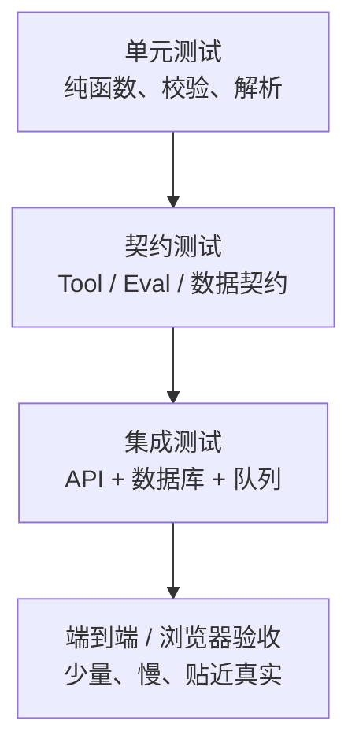
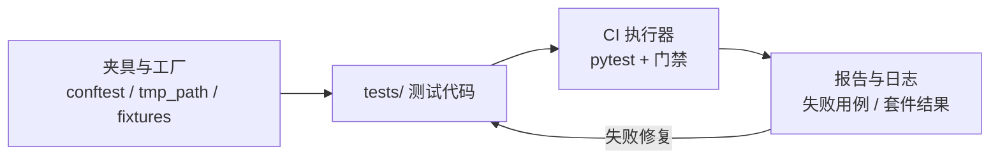

# Agent 自动化测试

> 自动化测试的任务不是证明 Agent 聪明，而是证明系统在确定的输入、状态与边界下，不会越权、不会重复写入、不会悄悄把失败伪装成成功。依赖模型"发挥"的判断交给 Eval；代码可以保证的，必须交给测试。

## 1. 为什么需要自动化测试

Agent 系统把三类不确定性叠加在一起：模型（选不同工具、不同措辞）、数据（库表随租户变化）、执行（超时、并发、外部服务抖动）。只靠人工点页面会出现三个工程问题：

| 问题 | 后果 |
|---|---|
| 回归不可见 | 昨天能用的 Tool 契约，今天被一个参数改名破坏 |
| 边界不可控 | 越权 SQL、跨租户读取只在生产才暴露 |
| 修复不可信 | 改完不知道是否引入新问题，只能"感觉没问题" |

自动化测试把可确定的部分固定下来：**结构、契约、状态机、权限、幂等、错误语义**。模型输出质量则交给 Eval 与人工评审，两者不能互相替代。

## 2. 基本机制



Agent 项目的特殊点在于：契约测试（Tool Contract、Eval Dataset Contract、Adapter Contract）必须独立成层，因为它们是跨模块协作的真正边界。三类测试替身的分工：

| 替身 | 做法 | 适合验证 | 风险 |
|---|---|---|---|
| Fake | 内存实现替换数据库/仓库 | 业务流程、权限分支 | 与真实实现行为漂移 |
| Stub | 固定返回的模型/外部服务 | 错误路径、超时路径 | 无法覆盖真实模型波动 |
| Real + 隔离 | 临时 SQLite / 测试 schema | 事务、约束、幂等 | 慢，需要清理 |

原则：能用确定性替身验证的逻辑不要依赖真实模型；必须依赖真实模型的行为放进 Eval，而不是 CI 单测。一个测试的完整生命周期是：准备夹具 → 执行 → 断言结构、状态、错误码、副作用 → 清理。清理不是可选项，共享状态会导致"单独跑过、全量跑挂"。

## 3. 总体架构



目录约定建议固定：

```text
tests/
├── test_*.py            # 单元 / 契约 / 集成测试
├── evals/               # 评测代码与数据集（不是 CI 单测）
└── conftest.py          # 公共夹具
```

## 4. 关键设计

**4.1 夹具隔离。** Agent 系统最常见的串味来源是数据库与环境变量。可靠做法是每个测试用 `tmp_path` 建独立库，并用 `monkeypatch` 改环境变量：

```python
# 实际代码：tests/test_ops.py
@pytest.fixture()
def c_store(tmp_path, monkeypatch):
    monkeypatch.setenv("QIANKE_C_END_DB", str(tmp_path / "c_end.sqlite"))
    monkeypatch.setattr(store, "_DB_PATH", None)
    store.init()
    sa_store.init()
    return store
```

这样测试结束即销毁，不会写到开发者的本地库。

**4.2 契约测试优先于流程测试。** Tool Contract（`name` / 输入 Schema / `ToolResult`）、状态码、结构化错误码、Eval 数据契约，都是稳定的外部承诺，应独立断言，而不是断言内部实现细节。契约被破坏的后果是模型无法发现工具、前端误判状态、评测数据集损坏。

**4.3 权限与安全路径必须是独立用例。** 至少覆盖：未授权 Tool 不执行、只读 SQL 拒绝写操作、跨租户查询返回空或结构化拒绝、日志不落手机号/邮箱/身份证、`/metrics` 鉴权失败返回 401。这类用例失败应阻断发布，不能标记为 flaky。

**4.4 确定性。** 模型调用用 Stub/Fake；时间注入 clock 或断言范围；集合断言用集合相等而非列表顺序；随机 ID 只断言格式与唯一性。

## 5. 工程实现

Qianke 的实际测试结构：

```text
tests/
├── test_agent_architecture.py        # Tool Contract / 注册 / 状态 / retry / 取消
├── test_agent_execution_safety.py    # 幂等、租户隔离、超时、失败记录
├── test_agent_checkpoint.py          # Checkpointer 与 interrupt 原语
├── test_ops.py                       # /ready 与 /metrics 文本
├── test_logging_pii.py               # 日志脱敏
├── test_security_headers.py          # HSTS / CSP / metrics 鉴权
├── test_tenant_isolation_pg.py       # PostgreSQL 租户隔离
└── evals/v2/test_core_*.py           # 评测核心自己的契约测试
```

运行方式与项目约定一致：`python -m pytest tests/ -v`，CI 中为 `python -m pytest tests/ -q`。`.github/workflows/ci.yml` 在 push / PR 到 main 时安装 uv 与 Python 3.12，按清单安装测试依赖（不使用 `uv sync`，避免 Linux 缺失 Windows 专用 torch wheel），随后跑 pytest 与离线评测快照门禁。测试使用假 Key（`sk-ci-placeholder`），不产生真实模型费用。

测试与 Eval 的分工：工具/契约/权限必须由 pytest 覆盖，业务答案质量交给 Eval；pytest 毫秒级且阻断 CI，Eval 分钟级、有模型费用，只做快照或阶段门禁。

## 6. 企业级要求

| 要求 | 具体做法 |
|---|---|
| 可重复 | 固定依赖版本、隔离数据库、确定性替身 |
| 可定位 | 失败信息含输入、期望、实际；日志可查 |
| 覆盖关键路径 | 正常、边界、异常、安全四类路径都写 |
| 不伪造通过 | 未执行就是未执行，skip 必须有原因 |
| 可维护 | 一个测试只验证一件事；夹具集中在 conftest |
| 可扩展 | 新 Tool 必须同步契约测试与权限测试 |
| 成本可控 | CI 单测不调用真实模型；真实评测单独任务 |

## 7. 方案对比

| 方案 | 优点 | 缺点 | 适用 |
|---|---|---|---|
| pytest 单测 + 契约 | 快、确定、生态成熟 | 不验证真实模型质量 | 代码、权限、状态机 |
| 真实模型集成测试 | 贴近真实行为 | 慢、花钱、结果波动 | 阶段性验证 |
| 浏览器 E2E | 覆盖真实 UI 与网络 | 脆弱、维护成本高 | 关键用户路径 |
| 录制回放（VCR 式） | 可复现真实调用 | 录制过期后失真 | 外部 API 契约 |
| 变异测试 / 覆盖率门禁 | 检验测试本身质量 | 接入成本高 | 长期质量治理 |

Qianke 以 pytest 为主，浏览器验收以文档记录的真实运行结果作为证据，真实模型行为由 Eval 承担；浏览器 E2E 尚未接入 CI。

## 8. Qianke Engine 实践

| 能力 | 状态 | 证据 |
|---|---|---|
| pytest 测试体系 | 已实现 | `tests/` 顶层 126 个 `test_*.py` 文件（含子目录共 130 个） |
| Tool Contract / 权限 / 状态机测试 | 已实现 | `tests/test_agent_architecture.py` |
| 幂等 / 超时 / 隔离测试 | 已实现 | `tests/test_agent_execution_safety.py` |
| 运维探针测试 | 已实现 | `tests/test_ops.py` 断言 `/metrics` 含队列与租户指标 |
| 日志 PII 脱敏测试 | 已实现 | `tests/test_logging_pii.py` |
| 安全响应头与 metrics 鉴权测试 | 已实现 | `tests/test_security_headers.py` |
| PostgreSQL 租户隔离契约测试 | 已实现 | `tests/test_tenant_isolation_pg.py` |
| CI 自动执行 pytest | 已实现 | `.github/workflows/ci.yml` |
| 浏览器 E2E 自动进入 CI | 部分实现 | 有人工执行与截图记录（`docs/e2e/`），未接 CI |
| 真实模型集成测试的门禁化 | 部分实现 | Live Eval 默认 skip，需显式开启 |
| 故障注入 / 混沌测试 | 规划中 | 未见实现 |
| 变异测试 / 覆盖率硬门禁 | 规划中 | 未见实现 |

```text
"pytest 全量通过"只代表 tests/ 覆盖的路径通过；
不代表真实模型行为、生产并发、SLO 或安全对抗已验证。skip 的用例不计入通过；测试金字塔等通用方法属理论知识。
```

## 9. 评估/验收

```text
[ ] 新功能同步新增测试，覆盖正常、边界、异常、安全路径
[ ] 测试不依赖开发者本地库、本地 .env 或真实外部服务
[ ] 失败信息足以定位问题，不需要复跑猜原因
[ ] 安全路径失败会阻断合并
[ ] skip 用例有明确原因与补做计划
[ ] 测试与 Eval 的分工写清楚，不把 Eval 当单测
```

## 10. 常见误区

1. **用单测断言模型回答文本**：措辞变化就挂，最后只能退化成"包含某个词"。
2. **测试之间共享数据库**：单独跑过、全量跑挂，最后没人信测试。
3. **安全用例可跳过**：skip 越积越多，安全边界实际没人守。
4. **把"CI 绿了"当"功能好了"**：CI 只证明被覆盖的路径没坏。
5. **为了通过而放宽断言**：等于把质量门禁改成装饰。
6. **只测 happy path**：错误码、超时、权限拒绝才是 Agent 的事故高发区。
7. **用真实模型跑 CI 单测**：成本高、结果波动，最终会被关掉。

## 11. 总结

```text
自动化测试负责"确定性边界"：契约、权限、状态、幂等、错误语义。
它不能证明 Agent 聪明，但能阻止系统在已知规则上失控。
隔离、契约优先、安全独立用例、不伪造通过，是四个不可省的设计点。
Qianke 已用 pytest 与 CI 建立基础，但浏览器 E2E、故障注入、覆盖率门禁仍未自动化。
```

## 12. 延伸阅读

### 项目内部

- [Agent Evaluation 评测体系](01-agent-evaluation.md)
- [Regression Test 回归测试](03-agent-regression-test.md)
- [CI/CD 与灰度发布](10-cicd-canary-release.md)
- `.github/workflows/ci.yml`、`tests/test_agent_architecture.py`、`tests/test_agent_execution_safety.py`

### 外部资料

- pytest 官方文档：<https://docs.pytest.org/>
- LangGraph 测试指南：<https://langchain-ai.github.io/langgraph/>
- OWASP Top 10 for LLM Applications：<https://genai.owasp.org/llm-top-10/>
