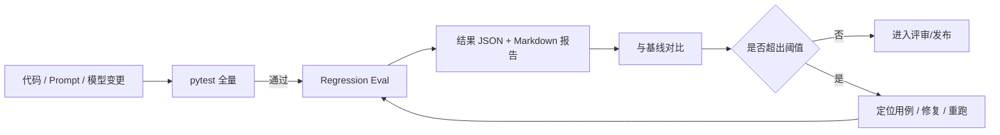

# Regression Test 回归测试

> 回归测试回答一个非常具体的问题：**这次改动有没有让原本能做对的事情做错？** 它不追求覆盖全部能力，而追求"每次改核心逻辑都跑得起、看得懂、拦得住"。

## 1. 为什么需要回归测试

Agent 系统的回归往往不是编译错误，而是行为漂移：改 System Prompt 后本该查 SQL 的问题变成闲聊；改 Tool 参数名后模型仍按旧参数调用；升级模型后多步任务成功率下降但单测全绿；调检索阈值后数据缺失题开始编造；改权限矩阵后某角色失去原本可用的工具。

这类退化有三个特点：**不报错、不一定每次复现、只在特定题型暴露**。三种质量手段的分工：

| 手段 | 目标 | 频率 |
|---|---|---|
| 单元 / 契约测试 | 代码契约不被破坏 | 每次提交 |
| 回归测试 | 已有能力不退化 | 每次核心变更 |
| Benchmark | 衡量整体能力水平 | 阶段评估 |

## 2. 基本机制

回归的机制不是"再跑一遍"，而是**基线 + 候选 + 差值 + 门禁**：

```text
基线 baseline      上一次被认可的运行结果（JSON + 报告）
候选 candidate     本次改动后的运行结果
对比 compare       逐指标计算 Δ
门禁 gate          超标即失败，不允许"先合并再说"
```

没有基线，分数再高也无法回答"是否退化"。而且不能只看任务成功率，否则会漏掉"成功率没降但成本翻倍"：

```text
task_success_rate / tool_selection_accuracy / tool_execution_success
error_recovery / avg_steps / avg_tool_calls
avg_elapsed_s / total_tokens / estimated_cost
```

回归门禁应同时观察能力指标与成本指标，否则容易用更多步数和 token 换一个虚高的成功率。

## 3. 总体架构

三类回归互补：pytest 快而确定，任务级回归覆盖真实模型行为，验收级回归覆盖跨系统链路。



工程上需要四个存储：用例集、运行结果、基线、报告。四者都要有版本，否则"上次到底跑的是什么"无法回答。

## 4. 关键设计

**4.1 用例集要小、稳、可解释。** 回归集不是越大越好，Qianke 的 Regression 是 20 题，设计目标是"每次核心变更都跑得起"：

| 设计点 | 要求 |
|---|---|
| 规模 | 控制在分钟级可完成 |
| 覆盖 | 每个失败都能对应到具体能力或安全边界 |
| 稳定性 | 避免依赖时效性数据、随机外部服务 |
| 可解释 | 用例带分类与期望，失败能快速定位 |
| 冻结 | 进入基线后不随意修改 |

**4.2 失败分诊比分数更重要。** 一次失败至少先判断类型：代码缺陷（修复代码）、Prompt 漂移（评估是否接受新行为，更新基线需说明理由）、数据集问题（仅当判断题本身错了才改）、模型波动（多次采样确认是否稳定退化）、环境问题（修复后重跑，不计入质量结论）。不分诊，团队会习惯性"重跑到过为止"，门禁就失效了。

**4.3 门禁阈值要能被解释。** 阈值不能拍脑袋：先记录若干次基线运行，观察正常波动范围，再设明显高于噪声、低于目标的阈值。Qianke 的 v2 门禁默认 `--min-pass 0.80`；当前脚本没有实现 frozen 分支，所有全量存档运行都按统一硬阈值判定；“只对 frozen 硬门禁”仍是设计意图，未在代码中实现。

**4.4 子集运行不能当基线。** 调试时常用 `--only` / `--limit` 跑单题，这类运行必须在门禁里被识别并跳过，否则"跑一条调试通过"会被误当成全量基线。Qianke 的 v2 门禁显式跳过 `total < dataset_case_count` 的子集运行。

## 5. 工程实现

```bash
# 只校验数据集，不调用模型
python tests/evals/agent/runner.py --suite regression --validate-only
# 真实运行（需要模型 Key）
python tests/evals/agent/runner.py --suite regression
# 子集调试（不能作为基线）
python tests/evals/agent/runner.py --suite regression --only calc_001,multi_001
```

默认产物为 `tests/evals/agent/regression/results/regression_v1.json` 与 `reports/regression_v1.md`。`tests/evals/agent/compare.py` 读取 `baselines/<version>.json`，输出逐指标差值表：

```bash
python tests/evals/agent/compare.py v1.9 v2.2
python tests/evals/agent/compare.py v1.9 v2.2 --json
```

对比字段包括任务成功率、业务正确性、工具策略合规、工具选择、工具执行、错误恢复、平均步数、平均工具调用、平均耗时、token 与估算成本；仓库内保留 v1.5 到 v2.2 多版基线 JSON。

v2 门禁脚本 `scripts/check_eval_v2_gate.py` 已实现，可手动/按需执行，尚未接入 `.github/workflows/ci.yml`；当前 CI 门禁只有 pytest + 离线评测快照门禁（RAG 快照通过率 ≥ 0.85、题数 ≥ 5）。CI 不真跑模型（成本与稳定性不可控），但必须防止仓库内的评测报告被悄悄改低；真实全量评测在本地或专用环境执行。

## 6. 企业级要求

| 要求 | 具体做法 |
|---|---|
| 版本化 | 用例、基线、报告都带版本；基线变更需评审 |
| 可复现 | 固定模型、温度、数据集、运行环境 |
| 可追溯 | 每个失败能回到用例、轨迹、最终回答 |
| 门禁有效 | 阈值有依据，超阈值真的阻断 |
| 成本合理 | 回归集控制在分钟级；Benchmark 不日常跑 |
| 不伪造 | 跳过、未运行、环境失败都如实记录 |
| 资产归属 | 每份基线与回归集有负责人和更新时间 |

## 7. 方案对比

| 方案 | 优点 | 缺点 | 适用 |
|---|---|---|---|
| 只跑 pytest | 快、零模型成本 | 发现不了模型行为退化 | 每次提交 |
| 固定回归集 + 基线差值 | 能定位退化、可解释 | 需要维护用例与基线 | 核心变更 |
| 全量 Benchmark 当回归 | 覆盖广 | 慢、贵、噪声大 | 阶段评估 |
| 线上流量回放 | 最贴近真实 | 隐私、采样、回放成本高 | 规划/进阶 |
| 自动接受新基线 | 省人工 | 会把退化当进步 | 不推荐 |

Qianke 的做法是"小回归集 + 基线差值 + 门禁"，Benchmark 只做阶段评估，不用作日常回归。

## 8. Qianke Engine 实践

| 能力 | 状态 | 证据 |
|---|---|---|
| Regression 20 题集合 | 已实现 | `tests/evals/agent/regression/dataset.v1.json` 实际 20 条 |
| 共用 runner 与报告 | 已实现 | `runner.py`、`evaluator.py`；结果与 Markdown 报告落盘 |
| 基线对比工具 | 已实现 | `compare.py` + `baselines/` 下 v1.5…v2.2 共 12 份 JSON |
| Eval v2 回归集（B/C 各 15 条） | 已实现 | `tests/evals/v2/datasets/` 两份 regression 数据集 |
| v2 门禁（全量运行 + 阈值；冻结集分支未实现） | 部分实现 | `scripts/check_eval_v2_gate.py`；未接入 `ci.yml` |
| CI 快照门禁 | 已实现 | `.github/workflows/ci.yml` |
| 关键链路验收回归记录 | 部分实现 | `docs/e2e/` 有回归记录，未全部自动化为 CI |
| 线上流量回放式回归 | 规划中 | 未见实现 |
| 回归失败自动分诊 | 规划中 | 目前依赖人工判断 |

```text
Regression 20 通过 ≠ 整体能力达标，它只覆盖这 20 条所代表的能力面。
Benchmark 80 不用于日常回归调优；v2 的 0.80 是默认阈值，应按自身噪声水平校准。基线与门禁方法属理论知识，本项目证据见第 8 节。
```

## 9. 评估/验收

```text
[ ] 回归集有版本、有分类、有冻结标记
[ ] 每次核心变更都能在可接受时间内跑完
[ ] 有明确基线，报告能给出逐指标差值
[ ] 门禁能区分全量运行与子集调试
[ ] 失败用例能追溯到轨迹与最终回答
[ ] 基线更新有评审记录，不是"跑低了就重设"
[ ] 文档明确回归通过不等于整体能力达标
```

## 10. 常见误区

1. **回归集越大越好**：跑不动就会被跳过，最后等于没有回归。
2. **只看成功率**：成功率没降但步数、token、延迟翻倍，同样是退化。
3. **失败就重跑**：把波动当噪声，最终掩盖真实退化。
4. **用子集结果当基线**：调试一条通过就宣布全量通过。
5. **基线跟着结果走**：每次失败后把新结果设为基线，门禁形同虚设。
6. **把回归测试当 Benchmark**：小集合无法证明整体能力，只能防退化。
7. **改题迁就 Agent**：只有判断题本身错了才改用例。

## 11. 总结

```text
回归测试的核心是"基线 + 差值 + 门禁"，不是"再跑一遍"。
回归集要小、稳、可解释；Benchmark 要独立，不能兼职回归。
阈值来自基线噪声，失败必须分诊，基线更新必须评审。
Qianke 已具备 Regression 20、基线对比与 v2 门禁脚本；v2 门禁尚未接入 CI、frozen 分支未实现，线上回放与自动分诊仍属规划。
```

## 12. 延伸阅读

### 项目内部

- [Agent Evaluation 评测体系](01-agent-evaluation.md)
- [Benchmark 基准评测](04-agent-benchmark.md)
- [CI/CD 与灰度发布](10-cicd-canary-release.md)
- `tests/evals/agent/README.md`、`tests/evals/agent/compare.py`、`scripts/check_eval_v2_gate.py`

### 外部资料

- Martin Fowler · Practical Test Pyramid：<https://martinfowler.com/articles/practical-test-pyramid.html>
- pytest 官方文档：<https://docs.pytest.org/>
- Google Testing Blog：<https://testing.googleblog.com/>
- NIST AI Risk Management Framework：<https://www.nist.gov/itl/ai-risk-management-framework>
