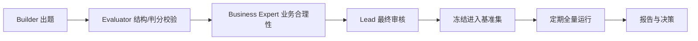
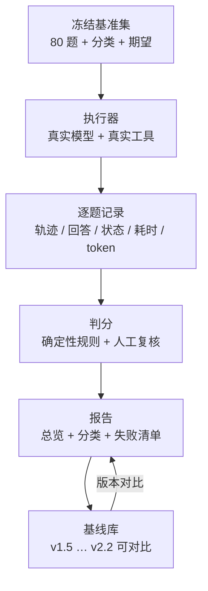

# Benchmark 基准评测

> Benchmark 不是"刷分游戏"，而是用一组稳定的、经过评审的业务题目，回答"这套 Agent 现在大概能做到什么程度、值不值得进入下一阶段"。它必须与日常调优集分开，否则分数会随着被调优而失真。

## 1. 为什么需要 Benchmark

Regression 只能证明"没变差"，不能回答"够不够好"。企业要在阶段节点做决策时，需要更有代表性的证据：当前版本能完成多少真实业务任务？不同版本之间能力提升是否真实存在？换模型或规划策略后哪类任务受益、哪类受损？当前能力是否足以进入试点？

这些问题需要一组**规模更大、覆盖更广、经过业务评审**的题目，并且**不用于日常调参**。如果 Benchmark 被反复用于调优，Prompt 会逐渐过拟合这 80 道题，分数上涨不再代表能力上涨。

| 集合 | 规模（Qianke） | 用途 | 能否日常调优 |
|---|---:|---|---|
| 单元/契约测试 | 126 个顶层 `test_*.py`（含子目录共 130 个） | 代码契约 | 可以 |
| Regression | 20 | 防退化 | 可以 |
| Benchmark | 80 | 阶段评估、对外汇报 | 不可以 |

## 2. 基本机制

一道合格的 Benchmark 题至少包含：业务场景、问题、期望工具（应用哪些、不应使用哪些）、期望结果（关键事实、计算口径、允许的表达范围）、安全约束（不得越权/编造/执行写操作）、难度与分类。题目质量比数量更重要：80 道覆盖清晰分类的题，通常比 800 道随手抓的题更能指导决策。

评测链路是：



这条链路解决"谁有资格定义正确"。如果题目由写 Prompt 的人独自决定，很容易把实现细节当成业务标准。结果解释要守三条原则：报告必须分维度，只看总分无法指导改进；通过率必须带样本量（80 题里 1 题差异是 1.25 个百分点）；失败必须分类（工具错、答案错、超时、安全拒绝，处置方式完全不同）。

## 3. 总体架构



## 4. 关键设计

**4.1 冻结与污染控制。** Benchmark 最大风险是污染：

| 风险 | 表现 | 控制手段 |
|---|---|---|
| 调优污染 | 反复针对 Benchmark 改 Prompt | 规定不得用于日常调优 |
| 数据泄漏 | 题目答案出现在知识库或 Prompt 中 | 题目与语料分离检查 |
| 版本漂移 | 每次跑前改题 | 冻结后变更需评审 |
| 选择性汇报 | 只报高分配置 | 固定运行环境与模型参数 |

**4.2 分类覆盖率。** Qianke Benchmark 的实际分类包括 calculator（确定性计算）、execute_sql（数据查询）、rag_search（知识检索）、multi_tool（多工具组合）、negative（数据不存在/不应回答）。分类让失败可解释：总分 90% 但 `negative` 只有 50%，真正的问题是幻觉与数据缺失处理。

**4.3 基线与版本对比。** 每次正式运行记录版本、模型、判分规则、题目版本、运行时间；新增基线必须说明变更原因；不允许只保留"最好看"的一次。仓库内保留每次基线说明，并配套 `compare.py` 输出差值表。

**4.4 人工复核与自动判分结合。** Benchmark 中总有"自动判分失败但人工看是对的"或相反的情况。Qianke 的基线说明有专门章节记录自动失败题的人工复核结论；正确做法是把人工结论作为报告的一部分，而不是悄悄改判分规则让分数变好看。

## 5. 工程实现

```bash
python tests/evals/agent/runner.py --suite benchmark --validate-only   # 校验题目集
DEEPSEEK_API_KEY=... python tests/evals/agent/runner.py --suite benchmark  # 全量运行
python tests/evals/agent/runner.py --suite benchmark --limit 5          # 子集，仅调试
```

产物：

```text
benchmark/dataset.v1.json          80 题
benchmark/builder_notes.md         出题记录
benchmark/review_*.md              多轮评审记录
benchmark/baseline_*.md            版本基线说明
benchmark/results|reports/         运行 JSON 与 Markdown 报告
baselines/v*.json                  对比用基线
```

报告应包含：总览（任务成功率、工具选择、工具执行、错误恢复）、效率（平均步数/工具调用/耗时）、成本（总 token、平均 token、估算成本）、分类通过数与失败原因、逐题证据与人工复核结论、环境信息（模型、参数、数据集版本、运行时间）。没有环境信息的分数不可复现，也不能进入对外材料。

## 6. 企业级要求

| 要求 | 具体做法 |
|---|---|
| 代表业务 | 题目来自真实业务问题，不全是技术构造题 |
| 评审可追溯 | 出题、判分、业务合理性、最终审核都有记录 |
| 冻结与版本 | 冻结集有版本号，变更需评审 |
| 不污染调优 | Benchmark 与 Regression/调优集物理分开 |
| 报告完整 | 分维度 + 失败清单 + 环境信息 |
| 决策可用 | 报告能支持"是否进入下一阶段"的判断 |
| 避免过度承诺 | 80 题分数不能外推为生产成功率 |

## 7. 方案对比

| 方案 | 优点 | 缺点 | 适用 |
|---|---|---|---|
| 自建业务 Benchmark | 贴合业务、可解释、可评审 | 建设成本高，需要业务专家 | 企业 Agent 主力 |
| 公开通用 Benchmark（GAIA、AgentBench 等） | 可横向比较、题目现成 | 与具体业务口径脱节 | 技术调研、模型选型 |
| 线上抽样统计 | 最真实 | 无标准答案、事后才知道 | 线上质量监控 |
| 人工体验评分 | 灵活 | 不可复现、不可扩展 | 早期探索 |

Qianke 以自建业务 Benchmark 为主，采用 "Builder → Evaluator → Business Expert → Lead" 的审核链路；公开 Benchmark 仅作为技术调研参考，不直接作为产品能力结论。

## 8. Qianke Engine 实践

| 能力 | 状态 | 证据 |
|---|---|---|
| Benchmark 80 题集合 | 已实现 | `benchmark/dataset.v1.json` 实际 80 条 |
| 出题与多轮评审记录 | 已实现 | `builder_notes.md`、`review_evaluator*.md`、`review_business*.md` |
| 版本基线与说明 | 已实现 | `baseline_v1.6.md` … `baseline_v2.2.md`，`baselines/*.json` |
| 版本差值对比 | 已实现 | `compare.py`，覆盖 12 项指标 |
| 分类指标 | 已实现 | 基线说明按 calculator / execute_sql / rag_search / multi_tool / negative 分类 |
| 自动判分 + 人工复核 | 已实现 | 基线说明包含失败题人工复核结论 |
| RAG 离线基准（33 题，LLM Judge） | 已实现 | `scripts/run_eval.py`；快照 33 题、30 过、90.9% |
| Super-agent Eval v2（24 场景） | 已实现 | `scripts/superagent_eval_v2.py`；四维评分，通过线 total ≥ 0.8 |
| 独立私有 holdout 集 | 已实现 | `tests/evals/agent/private_holdout/`，20 题；已有归档运行 17/20，本次未重跑 |
| 对外公开榜单 | 不适用 | 内部基准，不对标外部排名 |

```text
80 题通过率是"这 80 题上的能力证据"，不是生产任务成功率。
RAG 33 题快照与 Super-agent 24 场景是不同评测对象，不能混算成一个总分。
基线说明中的历史分数是当次运行记录，不能当成当前版本的默认结果；公开 Benchmark 与污染控制属理论知识。
```

## 9. 评估/验收

```text
[ ] 题目有分类、有期望、有安全约束，覆盖至少 2 类以上能力
[ ] 出题、判分、业务、最终审核四方记录齐全
[ ] 题目集冻结且有版本，变更有理由
[ ] 运行环境（模型/参数/数据集/时间）写入报告
[ ] 报告含分维度结果与失败清单
[ ] 失败题有人工复核结论，不是只报总数
[ ] 明确声明不用于日常调优，且实际执行
[ ] 明确声明分数不能外推为生产成功率
```

## 10. 常见误区

1. **把 Benchmark 当调优集**：反复针对同一批题改，分数失去意义。
2. **只报总分**：掩盖某一类任务严重退化。
3. **改题迁就实现**：题目应由业务与评审决定，不由实现决定。
4. **忽略样本量**：80 题里一题差异不代表能力变化。
5. **不记录环境**：换个模型或温度再跑，分数无法比较。
6. **把不同评测体系混算**：Agent Benchmark、RAG 评测、Super-agent 评测的对象和判分不同。
7. **对外承诺过度**：内部 80 题结果不能写成"生产可用率 90%"。

## 11. 总结

```text
Benchmark 解决"能力大概到什么水平"，Regression 解决"有没有变差"，两者不能合并。
题目质量、评审链路、冻结与污染控制，决定 Benchmark 是否可信。
报告必须分维度、带样本量、带失败清单与环境信息。
Qianke 已有 Benchmark 80、评审记录、版本基线与对比工具；私有 holdout 已有 20 题与 17/20 归档结果，尚未建立外部独立第三方 holdout。
```

## 12. 延伸阅读

### 项目内部

- [Agent Evaluation 评测体系](01-agent-evaluation.md)
- [Regression Test 回归测试](03-agent-regression-test.md)
- `tests/evals/agent/benchmark/baseline_notes.md`、`review_business_v6_confirm.md`、`compare.py`

### 外部资料

- GAIA：<https://arxiv.org/abs/2311.12983>
- AgentBench：<https://arxiv.org/abs/2308.03688>
- SWE-bench：<https://arxiv.org/abs/2310.06770>
- HELM：<https://crfm.stanford.edu/helm/>
