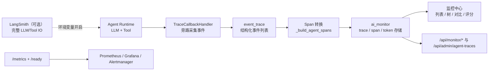

# Agent Observability 可观测性

> Agent 出问题时，最有价值的问题不是"用户说了什么"，而是：**这一轮模型看到了什么、决定了什么、调了什么工具、工具返回了什么、最后为什么这么答。** 可观测性就是把这条链路变成事后可还原的证据。

## 1. 为什么需要可观测性

传统接口排错看一次请求的入参、出参和错误堆栈就够了。Agent 不行，因为一次请求内部包含多次模型决策和工具调用：第 1 轮 LLM 决定查 SQL，第 2 轮 SQL 返回 3 行后再查 RAG 确认口径，第 3 轮用 calculator 计算，第 4 轮输出结论。没有逐轮记录，只能看到"最终答案不对"，无法判断失败在哪一层：

| 失败层 | 需要看到的数据 |
|---|---|
| 工具选择 | 模型传了哪些 tool call，参数是什么 |
| 工具执行 | 工具返回 `ok=true/false`、错误码、耗时 |
| 证据链 | 回答里的数字来自哪次 Observation |
| Runtime | 是否超时、是否达到步数上限、是否被取消 |
| 成本 | 每次 LLM 调用的 token 与模型 |

可观测性也是评测与 SLO 的数据底座：没有 trace，Eval 无法归因，SLO 无法计算。

## 2. 基本机制

可观测性有三支柱，Agent 再叠加一条轨迹支柱：

```text
Logs（日志）        离散事件与错误上下文
Metrics（指标）     可聚合的数值：成功率、延迟、队列深度、token
Traces（链路）      一次请求内部的完整调用树
Agent Trajectory    决策与工具观察序列（通常挂在 trace 下）
```

Agent 的 trajectory 不是"再记一条日志"，它需要结构化保存 `tool name / args / result / status / duration`，才能被评测、审计和回放消费。一次执行至少需要四层标识：`request_id`（请求级、幂等与重放）、`execution_id`（单次执行，retry 会产生新的）、`parent_execution_id`（retry 血缘）、`trace_id`（可观测性链路）。如果这些 ID 不统一，日志、trace、执行记录、评测结果之间就无法互相定位。

## 3. 总体架构



两条链路要分清：本地 trace 由项目自建，强调可审计、可入库、可被评测消费；外部平台（LangSmith 等）强调完整 IO 与服务端可视化。两者可以并存，但不能互相假设对方已覆盖。

## 4. 关键设计

**4.1 采集旁路，不改变主流程。** Qianke 的 `TraceCallbackHandler` 通过 LangChain callbacks 旁路采集，不改变 Graph 与 Tool Contract：`on_llm_start/end` 记录 prompt 长度、输入输出、token、耗时；`on_tool_start/end` 记录工具名、参数预览、结果预览、耗时；`on_*_error` 记录失败事件与异常类型。设计原则是**可观测性失败不能影响业务主链路**，采集异常应被吞掉并记录。

**4.2 记录"足够复盘"而非"全量原文"。** 输入输出通常只保留截断文本（Qianke 为 12000 字符上限），并同时保留预览字段。全量对话可能包含大量 token 与用户敏感信息，排错通常只需要关键片段 + 结构化字段。

**4.3 Trace 与 Eval、审计的联动。** 一条 trace 应该能回答"这次运行对应哪条评测用例 / 哪次实验 / 哪个请求"。Qianke 的监控中心支持从业务 trace 跳到 Agent 输入输出，也支持从评测结果跳到同一条 trace，把"发现问题 → 定位原因 → 补用例"闭合起来。

**4.4 采样与保留策略。** 生产 trace 不可能无限保留，需要明确全量保留、按比例/按错误/按慢请求采样、摘要长期保留 + 原始 IO 短期保留、删除请求贯穿 trace 与备份。Qianke 当前以本地全量记录为主，尚未看到通用采样与保留策略实现，属于待补能力。

## 5. 工程实现

```text
agent/loop.py          TraceCallbackHandler（事件采集）
agent/service.py       _build_agent_spans / _record_agent_monitor
ai_monitor.py          trace / span / token 存储与聚合查询
api/monitor.py         监控查询 API + 管理端 trace 标签 / 评分
api/ops.py             /ready 与 /metrics
```

实际可用的查询接口：

```text
GET  /api/monitor/overview          总览：成功率、p95 延迟、token
GET  /api/monitor/timeseries        时间序列
GET  /api/monitor/traces            最近 trace 列表
GET  /api/monitor/traces/{trace_id} 单条 trace 详情
GET  /api/admin/agent-traces        Agent trace 过滤（状态/关键词/标签/评分/延迟）
PATCH /api/admin/agent-traces/{id}/tags、POST .../feedback
GET  /ready                         依赖就绪检查（200/503）
GET  /metrics                       Prometheus 文本指标
```

`overview` 的聚合字段包含成功率、p95 延迟与 token，足以支撑最小可用的 Agent 看板。LangSmith 通过环境变量开启（`LANGSMITH_API_KEY` 非空时自动启用），完整记录 graph / chain / llm / tool 层级；项目文档要求 key 只从环境变量读取、不提交 `.env`、不作为命令行参数传递。

## 6. 企业级要求

| 要求 | 具体做法 |
|---|---|
| 可还原 | 一次失败能还原模型输入、决策、工具结果 |
| 可关联 | request / execution / trace / eval 四类 ID 互通 |
| 低侵入 | 采集失败不影响业务；不改变 Tool Contract |
| 安全 | 脱敏敏感字段，限制 trace 访问权限（系统管理员） |
| 成本可控 | 采样、截断、分级保留 |
| 可运营 | 指标可被 Prometheus 抓取，告警可配置 |
| 可治理 | 保留期限、删除流程、审计访问记录明确 |

## 7. 方案对比

| 方案 | 优点 | 缺点 | 适用 |
|---|---|---|---|
| 自建 trace 表 + 管理页 | 数据自主、可与业务/Eval 深度联动 | 需要自己维护存储与 UI | 企业核心链路 |
| LangSmith / LangFuse 等平台 | 开箱即用、可视化强 | 数据出境/隐私/成本、依赖外部服务 | 研发期、快速定位 |
| OpenTelemetry + Tempo/Jaeger | 标准协议、生态成熟 | Agent 语义需要自定义扩展 | 长期平台化 |
| 仅日志 | 实现简单 | 无法还原调用树与耗时结构 | 极简系统 |

Qianke 的选择是"自建 trace 为主 + LangSmith 可选旁路"，保证核心证据留在本地，同时研发期可以借助外部平台看完整 IO。

## 8. Qianke Engine 实践

| 能力 | 状态 | 证据 |
|---|---|---|
| 结构化 event_trace | 已实现 | `TraceCallbackHandler`；`run_started` / `llm_*` / `tool_*` / `run_finished` |
| 层级 span 转换 | 已实现 | `service.py::_build_agent_spans`，含 parent_span_id、tokens、latency、IO |
| trace / token 存储与聚合 | 已实现 | `ai_monitor.py`：overview / timeseries / traces / trace_detail |
| 监控中心 UI | 已实现 | `/v2/#/monitor-center` 三个 tab；Agent trace 树、对比、评分 |
| 业务 trace ↔ Agent trace 联动 | 已实现 | `docs/e2e/monitor-eval-centers.md` |
| trace 标签与人工评分 | 已实现 | `PATCH /tags`、`POST /feedback` |
| Prometheus 指标与就绪探针 | 已实现 | `api/ops.py`、`tests/test_ops.py` |
| LangSmith 旁路追踪 | 已实现（可选） | `docs/langsmith.md`；未配置 Key 时关闭 |
| 采样 / 分级保留 / 自动清理 | 规划中 | 未见通用实现 |
| OpenTelemetry 标准接入 | 规划中 | 当前为自建事件模型 |
| 延迟 / 成本 SLO 告警 | 规划中 | 有指标与告警规则，无正式 SLO |

必须避免的写法：不要把"有 trace 页面"写成"全链路可观测性已完成"；不要把"记录了 token"写成"成本治理已完成"；不要把 LangSmith 可选接入写成默认生产依赖。第 2 节的 span 模型与采样策略属于通用理论知识，Qianke 尚未全部采用。

## 9. 评估/验收

```text
[ ] 任取一次失败请求，能还原完整决策与工具序列
[ ] 每个 span 有父子关系、状态、耗时、输入输出摘要
[ ] 日志、trace、执行记录能通过 ID 互相定位
[ ] 采集异常不影响业务返回
[ ] 敏感信息在 trace 与日志中已脱敏
[ ] 权限：普通用户看不到跨租户 trace
[ ] 指标可被抓取，告警规则可执行
[ ] 保留策略与删除流程有文档
```

## 10. 常见误区

1. **只有日志没有 trace**：能看到报错，看不到为什么走到这一步。
2. **记录全量原文**：成本失控，还引入隐私风险。
3. **把 trace 当审计**：trace 服务于排错，审计需要不可篡改与访问控制。
4. **采集代码侵入业务**：观测失败导致主流程失败，得不偿失。
5. **只做 UI 不做数据模型**：页面好看，但无法被评测与告警消费。
6. **默认开启外部平台**：数据出境与成本问题常在事后才暴露。
7. **没有 ID 体系**：日志、trace、执行记录各说各话，排错只能靠时间猜。

## 11. 总结

```text
可观测性的核心是"还原一次执行的决策链"，而不是"多打几行日志"。
trace 需要 span 模型与关联 ID，才能被排错、评测、审计共同消费。
采集必须旁路、截断、脱敏；数据要能聚合，也要能定位。
Qianke 已具备自建 trace + 监控中心 + Prometheus 指标；采样、保留策略与 SLO 告警仍待补齐。
```

## 12. 延伸阅读

### 项目内部

- [日志、指标与链路追踪](06-logs-metrics-tracing.md)
- [SRE 与 SLO](07-sre-slo.md)
- `src/rag_demo/agent/loop.py`、`src/rag_demo/ai_monitor.py`、`docs/e2e/monitor-eval-centers.md`、`docs/langsmith.md`

### 外部资料

- OpenTelemetry 文档：<https://opentelemetry.io/docs/>
- Google SRE Book · Monitoring Distributed Systems：<https://sre.google/sre-book/monitoring-distributed-systems/>
- LangSmith 文档：<https://docs.smith.langchain.com/>
- LangGraph：<https://langchain-ai.github.io/langgraph/>
