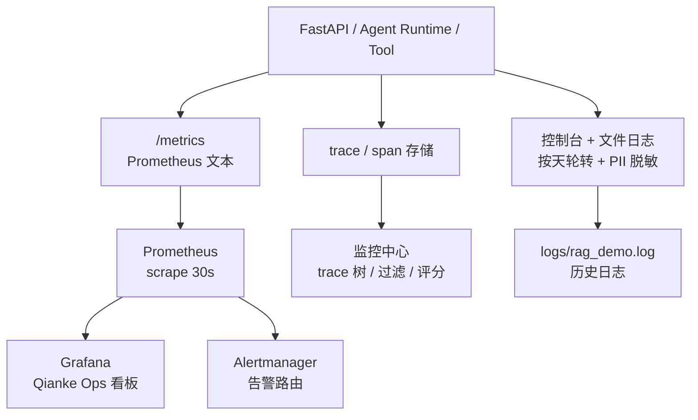

# 日志、指标与链路追踪

> 日志回答"发生了什么"，指标回答"整体是否正常"，链路追踪回答"这一次为什么这么走"。三者不是三套系统，而是同一套可观测性的三种视角，必须靠统一的标识与时间对齐。

## 1. 为什么需要三支柱

只上其中一种，都会在真实故障里卡住：

| 只有 | 排障时的困境 |
|---|---|
| 日志 | 知道有异常，但不知道一次请求调了多少工具、慢在哪一步 |
| 指标 | 知道错误率上升，但不知道是哪个租户、哪个工具、哪次执行 |
| 链路追踪 | 知道调用树，但没有聚合视角判断"是不是普遍问题" |
| 三者都有但不对齐 | 时间、ID、字段各不相同，仍然无法互相定位 |

Agent 系统还要额外记录 **LLM / Tool 语义**：模型调用耗时、token、工具参数与结果、终止状态。否则只能看到"接口 500"，看不到"第 3 轮工具返回空结果后模型编造了答案"。

## 2. 基本机制

一条可用于排障的日志至少应包含：时间（带时区）、级别、模块、事件名；关键业务标识 `request_id / execution_id / trace_id`；关键对象（脱敏后的 tool_name / model / merchant_id）；结果（status / error_code / duration_ms）。日志级别要约定用途：INFO 记录关键业务事件，WARNING 记录可恢复降级，ERROR 记录需要人介入的失败。**不能用删除日志的方式"解决"告警。**

指标类型与 Agent 场景的映射：

| 类型 | 适合表达 | Agent 示例 |
|---|---|---|
| Counter | 只增不减的累计量 | 请求总数、工具调用总数、失败总数 |
| Gauge | 当前瞬时值 | 队列积压、进行中任务、租户数 |
| Histogram | 分布与分位数 | 请求延迟、工具耗时、token 分布 |

分位数（p95/p99）必须从 Histogram 或原始样本计算，**不能用平均值代替**：平均 2 秒可能掩盖 5% 的 30 秒慢请求。

链路追踪记录一次请求的调用树：

```text
trace（一次请求）
└── span agent.execute
    ├── span llm
    ├── span tool execute_sql
    ├── span llm
    └── span tool rag_search
```

每个 span 需要 `span_id`、`parent_span_id`、开始/结束时间、状态、属性。只有平铺事件时，无法回答"这个慢 span 属于哪一轮决策"。三支柱靠 `request_id / trace_id` 与同一时间轴对齐，没有统一 ID 时的时间对齐只是"看起来差不多"。

## 3. 总体架构



工程上要区分"采集面"和"消费面"：采集面尽量旁路、低开销；消费面（看板、告警、检索）可以有独立成本与权限模型。

## 4. 关键设计

**4.1 日志：双通道 + 轮转 + 脱敏。** Qianke 的 `logging_setup.py` 做了三件关键事：控制台短格式用于日常观察；文件长格式 `%asctime | %level | %name:%lineno | %message`；`TimedRotatingFileHandler` 按天轮转、保留 7 天；手机号 / 邮箱 / 身份证在输出前打码。它还处理了 uvicorn 自有 logger 不继承根配置的问题，否则请求日志落不了盘。

**4.2 指标：先保证低基数。** Prometheus 标签基数一旦失控（如把 `user_id`、`trace_id` 放标签），存储会迅速膨胀。Qianke 当前指标只按 `status` 这类低基数字段分组：`qianke_up`、`qianke_process_start_time_seconds`、`qianke_queue_jobs{status=...}`、`qianke_work_items{status=...}`、`qianke_approvals{status=...}`、`qianke_tenants`。

**4.3 告警：从指标到可执行动作。** 告警规则必须绑定"人应该做什么"：

| 告警 | 条件 | 含义 |
|---|---|---|
| QiankeApiDown | `up == 0` 持续 2m | API 不可达，检查进程/端口/反代 |
| QiankeDeadJobs | dead job > 0 持续 5m | 有死信，需要重放或修数据 |
| QiankeQueueBacklog | pending > 50 持续 10m | Worker 未运行或处理变慢 |
| QiankeStuckWorkItems | stuck > 0 持续 5m | Watchdog 标记超时工作项 |

**4.4 追踪：采样与保留。** 全量 trace 的成本主要在存储与 IO。合理策略：错误请求全保留、慢请求全保留、正常请求按比例采样；原始 IO 短期保留，聚合指标长期保留。

## 5. 工程实现

```text
src/rag_demo/logging_setup.py        日志双通道 / 轮转 / PII 脱敏
src/rag_demo/api/ops.py              /ready、/metrics、指标鉴权
src/rag_demo/api/monitor.py          监控查询 API
src/rag_demo/agent/loop.py           TraceCallbackHandler
src/rag_demo/ai_monitor.py           trace / span / token 存储
ops/prometheus.yml                   scrape 配置
ops/alert-rules.yml                  四条告警规则
ops/alertmanager.yml                 告警路由（默认只落 UI）
ops/grafana/dashboards/qianke-ops.json  7 面板看板
```

实际指标输出（Qianke）：

```text
qianke_up 1
qianke_queue_jobs{status="pending"} 0
qianke_queue_jobs{status="dead"} 0
```

`/metrics` 支持可选 Bearer token 鉴权（`QIANKE_METRICS_TOKEN`），未配置时开放，生产建议配置。`/ready` 检查控制面、Super-agent 存储、队列、商家数据层四项，任一失败返回 503。Prometheus `scrape_interval` 为 30s，target `host.docker.internal:8000`；Grafana 的 Qianke Ops 看板共 7 个面板；Alertmanager 配置为 group_wait 10s、group_interval 30s、repeat_interval 2h。已记录的本机部署实测覆盖 Prometheus `/-/ready`、target up、Grafana `/api/health`、Alertmanager `/-/ready`、安全响应头等 10 项成功路径检查全部 PASS；另有 1 个 PostgreSQL 异常兜底检查，不计入成功项。

当前缺口：日志是文本格式、未统一 JSON，检索依赖 grep；日志与 trace 之间没有强制关联字段（如 trace_id 写入日志）；指标以 Gauge 为主，缺少延迟 Histogram 与业务成功率计数器；没有日志聚合（Loki/ELK）与 Blackbox 探针；Alertmanager 未接外部通知渠道。

## 6. 企业级要求

| 要求 | 具体做法 |
|---|---|
| 可检索 | 结构化字段、统一时间与时区、保留关键 ID |
| 可聚合 | 指标标签低基数，分位数可计算 |
| 可关联 | 日志 / 指标 / trace 共享 request_id、trace_id |
| 安全 | 日志与 trace 脱敏，敏感字段禁止落盘 |
| 成本 | 采样、轮转、保留期限、冷热分层 |
| 可靠性 | 采集失败不影响业务；磁盘满有保护 |
| 合规 | 删除请求可贯穿日志、trace、备份 |

## 7. 方案对比

| 层 | 方案 | 优点 | 缺点 |
|---|---|---|---|
| 日志 | 文件 + 轮转 | 简单、零依赖 | 难检索、难聚合 |
| 日志 | Loki / ELK | 检索强、可聚合 | 运维与存储成本 |
| 指标 | Prometheus | 生态标准、告警成熟 | 长期存储需远端方案 |
| 追踪 | 自建 trace 表 | 与业务深度联动 | 需自维护 UI 与存储 |
| 追踪 | OpenTelemetry + Tempo/Jaeger | 标准、可移植 | 接入与语义约定成本 |

Qianke 的现状是"文件日志 + Prometheus 指标 + 自建 trace"三者都已落地，但还没有统一到 OpenTelemetry 语义，也没有日志聚合与延迟直方图；第 2 节的指标类型与采样策略属于理论知识，本项目尚未全部采用。

## 8. Qianke Engine 实践

| 能力 | 状态 | 证据 |
|---|---|---|
| 控制台 + 文件双通道日志 | 已实现 | `logging_setup.py`；`logs/rag_demo.log` |
| 按天轮转 + 保留 7 天 | 已实现 | `TimedRotatingFileHandler(backupCount=7)` |
| 日志 PII 脱敏（手机/邮箱/身份证） | 已实现 | `logging_setup.py`、`tests/test_logging_pii.py` |
| /ready 四项依赖检查 | 已实现 | `api/ops.py`、`tests/test_ops.py` |
| /metrics Prometheus 文本 | 已实现 | `api/ops.py`；队列/工作项/审批/租户指标 |
| /metrics 可选鉴权 | 已实现 | `QIANKE_METRICS_TOKEN`，错误 token 返回 401 |
| Prometheus 抓取与告警规则 | 已实现 | `ops/prometheus.yml`、`ops/alert-rules.yml` |
| Grafana 看板（7 面板） | 已实现 | `ops/grafana/dashboards/qianke-ops.json` |
| 生产预检脚本 | 已实现 | `scripts/production_preflight.py`、`docs/e2e/production-preflight.md` |
| 自建 trace / span | 已实现 | `ai_monitor.py`、`agent/loop.py` |
| 日志与 trace 强制关联 | 部分实现 | 有 request_id/execution_id，但日志文本未强制写 trace_id |
| 延迟 Histogram / 成功率计数器 | 部分实现 | 成功率在 ai_monitor 聚合中可算，Prometheus 侧无 Histogram |
| 日志聚合（Loki/ELK） | 规划中 | 未见实现 |
| Alertmanager 外部通知 | 规划中 | receiver 默认只落 UI，文档注明需加 webhook |
| OpenTelemetry 标准接入 | 规划中 | 当前为自建事件模型 |

## 9. 评估/验收

```text
[ ] 日志有统一格式、时区与轮转，磁盘不会无限增长
[ ] 敏感信息在日志与 trace 中均已脱敏
[ ] 关键指标可被抓取，标签基数受控
[ ] 告警规则可触发、有明确处置说明
[ ] 一次失败请求能通过 ID 串起日志、指标、trace
[ ] 采集异常不影响业务主链路；保留期限与合规删除流程有文档
```

## 10. 常见误区

1. **只打印日志不落盘**：服务重启后现场全丢。
2. **用平均值判断延迟**：慢请求被平均值掩盖。
3. **高基数标签**：把用户 ID / trace_id 放进标签，Prometheus 直接膨胀。
4. **告警没有处置动作**：最终被静音。
5. **日志与 trace 不关联**：只能靠时间猜。
6. **记录全量敏感信息**：排障方便，合规灾难。
7. **删除日志掩盖问题**：问题仍然存在，只是看不见。

## 11. 总结

```text
三支柱要解决的是同一件事：用统一标识还原一次执行。
日志重事件、指标重聚合、追踪重因果，缺一不可。
低基数、脱敏、保留策略、可执行告警，是可观测性从"能看"到"能用"的分界。
Qianke 已落地日志脱敏、/ready、/metrics、Prometheus/Grafana 与自建 trace；日志聚合、Histogram、外部通知仍待补齐。
```

## 12. 延伸阅读

### 项目内部

- [Agent Observability 可观测性](05-agent-observability.md)
- [SRE 与 SLO](07-sre-slo.md)
- `src/rag_demo/logging_setup.py`、`src/rag_demo/api/ops.py`、`ops/prometheus.yml`、`ops/alert-rules.yml`
- `docs/e2e/observability-deployment.md`、`docs/e2e/ops-readiness-backup.md`

### 外部资料

- Prometheus 文档：<https://prometheus.io/docs/>
- Grafana 文档：<https://grafana.com/docs/>
- OpenTelemetry 文档：<https://opentelemetry.io/docs/>
- Google SRE Book · Monitoring Distributed Systems：<https://sre.google/sre-book/monitoring-distributed-systems/>
