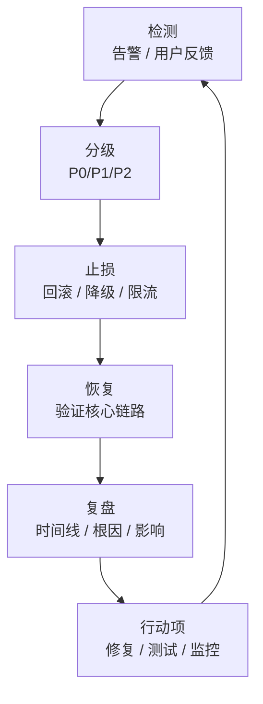
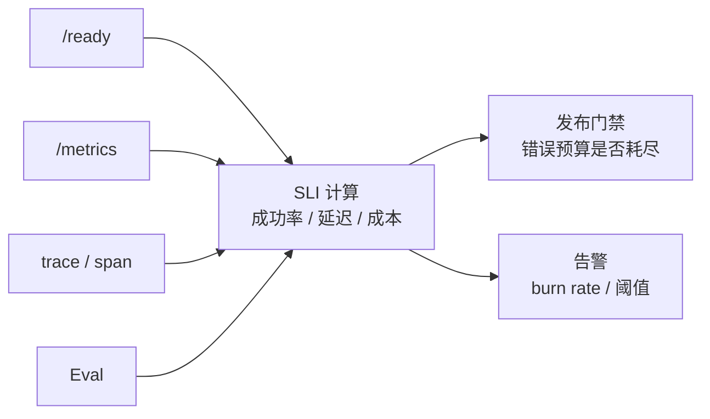

# SRE 与 SLO

> SRE 的核心不是"运维更努力"，而是用可量化的目标管理可靠性：哪些行为算失败、失败到什么程度需要停止发布、事故之后如何让系统变强。没有 SLI/SLO，可靠性只能靠感觉和救火。

## 1. 为什么需要 SRE 与 SLO

Agent 系统的可靠性比普通 Web 服务更难定义：接口 200 但回答是幻觉，算成功吗？任务 COMPLETED 但工具全部失败，算成功吗？回答正确但花了 40 秒，算达标吗？队列没有报错但积压两小时，算正常吗？如果只监控"进程是否存活"，这些情况都不会触发任何信号。

SRE 的贡献是把"可靠性"拆成：

| 概念 | 回答的问题 | 示例 |
|---|---|---|
| SLI（指标） | 我们怎么衡量这件事 | 任务成功率、p95 延迟、工具错误率 |
| SLO（目标） | 达到多少算可接受 | 30 天任务成功率 ≥ 95% |
| SLA（协议） | 对外承诺什么、违约怎么赔 | 商业合同条款，通常比 SLO 松 |
| Error Budget | 还能"坏"多少 | 1 − SLO，用完即冻结变更 |
| 事故流程 | 出问题怎么办 | 分级、止损、复盘、行动项 |

## 2. 基本机制

SLI 有四种常见类型：可用性（成功请求数 / 总请求数）、延迟（阈值内完成的请求数 / 总请求数，或 p95/p99）、吞吐（单位时间处理量）、正确性（业务判断为正确的比例）。Agent 还应增加任务成功率（COMPLETED 且业务答案正确）与成本效率（每任务 token / 费用）。

SLO 与错误预算的关系：

```text
SLO = 95%（30 天滚动窗口）
Error Budget = 5% 的总请求量（或总任务量）
Burn Rate = 当前错误率 / 预算允许错误率
```

Burn rate 让告警更有层次：慢速燃烧（几小时到几天）用于排期治理，快速燃烧（几分钟到几小时）用于立即止损。只按瞬时错误率告警，会在低流量时误报、高流量时漏报。

## 3. 总体架构



数据侧需要把四类来源对齐到同一时间窗口与同一批请求：



SRE 的关键纪律是：**复盘对事不对人**，行动项必须有负责人和截止时间，否则事故会重复发生。

## 4. 关键设计

**4.1 先定义"好"和"坏"。** SLO 定义最容易犯的错是"只写目标数字，不写判定规则"。一个可用的 SLO 说明至少包含：范围（哪个服务/入口/租户）、SLI（分子、分母、排除项如用户主动取消）、目标（百分比 + 30 天或 7 天窗口）、数据源（指标名/trace 字段/评测结果）、责任人（谁在预算耗尽时决定冻结发布）。

**4.2 Agent 场景建议的 SLI 集合。**

| 维度 | SLI | 数据来源 | 当前可观测性 |
|---|---|---|---|
| 可用性 | 成功响应数 / 总请求数 | ai_monitor / trace | 可计算，未形成正式 SLO |
| 延迟 | 交互式请求 p95 | trace total_ms | 可计算 |
| 任务质量 | 任务成功率 | Eval + 线上抽样 | Eval 有，线上抽样未接入 |
| 工具健康 | 工具错误率 | tool span status | 可计算 |
| 队列健康 | pending / dead 数量 | `/metrics` | 已实现告警 |
| 成本 | 每任务 token / 费用 | trace token | 可计算，无预算控制 |
| 安全 | 未授权调用 / 越权尝试 | Tool Policy / 审计 | 部分指标，无专项看板 |

**4.3 从"有指标"到"有 SLO"的差距。** 有指标只是能查到数值，有告警只是异常时能通知，有 SLO 才意味着明确目标、窗口、预算、发布纪律与复盘机制。很多团队停在"有告警"，于是每次告警都靠人判断要不要处理，长期必然疲劳。

**4.4 发布门禁与错误预算。** 预算充足时正常发布；消耗过半时只允许修复类变更；预算耗尽时冻结发布、优先恢复可靠性。这条规则必须事先约定，否则出事时仍然会"先发了再说"。

## 5. 工程实现

Qianke 已有的运维底座：

```text
GET /ready          四项依赖检查，任一失败返回 503
GET /metrics        Prometheus 文本指标（含队列/工作项/审批/租户）
ops/alert-rules.yml 四条告警：API 不可达、DEAD 任务、队列积压、STUCK 工作项
ops/alertmanager.yml 分组与重复间隔配置
scripts/production_preflight.py 一键检查 10 项成功路径证据（另有 1 个 PostgreSQL 异常兜底）
scripts/observation_report.py   24h 观察：ready/metrics 状态、队列、缺口
```

`observation_report.py` 会读取观察点样本并计算：`ready_status / metrics_status` 是否持续 200、采样缺口（相邻点间隔 > 180s 记为缺口）、`queue_done / queue_pending / queue_dead` 的变化、`waiting_approval` 等工作项状态，最终给出 verdict。这是"从一次性部署验证走向持续观察"的雏形，但仍不是正式 SLO 计算。

架构文档给出过如下示例，用于说明"应该怎么定义"，而非承诺已达到：

```text
交互式分析 p95 ≤ 30s
工具调用 p95 ≤ 3s
异步调查任务 p95 ≤ 5min
```

同时文档明确写明：当前没有正式 SLO，不能宣称已达到任何 SLO。

## 6. 企业级要求

| 要求 | 具体做法 |
|---|---|
| 目标可量化 | SLI 有明确分子分母与数据源 |
| 口径统一 | 可用性/延迟/质量对同一批请求计算 |
| 告警分级 | P0/P1/P2，快速燃烧与慢速燃烧分开 |
| 发布纪律 | 错误预算耗尽时冻结变更 |
| 事故可复盘 | 时间线、影响面、根因、行动项 |
| 责任明确 | 每项 SLO 与告警有负责人 |
| 数据保留 | 指标与 trace 保留足够长时间以计算窗口 |
| 不伪造 | 未建立 SLO 就写"暂无正式 SLO" |

## 7. 方案对比

| 方案 | 优点 | 缺点 | 适用 |
|---|---|---|---|
| 只看进程存活 | 简单 | 无法发现质量问题 | 早期原型 |
| 阈值告警 | 易实现 | 低流量误报、高流量漏报 | 小规模 |
| SLI + SLO + burn rate | 目标清晰、告警分层 | 需要数据与团队约定 | 生产系统 |
| 商业 APM + SLO 模块 | 开箱即用 | 成本、数据合规 | 有预算团队 |
| 纯人工巡检 | 灵活 | 不可持续、不可度量 | 不推荐 |

Qianke 当前处于"阈值告警 + 生产预检"阶段，SLO/错误预算属于设计目标，尚未形成正式制度；SLI/SLO/错误预算与 burn rate 属通用理论知识，落地以第 8 节为准。

## 8. Qianke Engine 实践

| 能力 | 状态 | 证据 |
|---|---|---|
| 就绪探针 `/ready` | 已实现 | `src/rag_demo/api/ops.py`；四项检查 |
| Prometheus 指标 `/metrics` | 已实现 | `api/ops.py`；`tests/test_ops.py` |
| 告警规则（4 条） | 已实现 | `ops/alert-rules.yml`，含 for 持续时间 |
| 告警路由配置 | 部分实现 | `ops/alertmanager.yml` 有分组与重复间隔，默认只落 UI |
| 生产预检脚本 | 已实现 | `scripts/production_preflight.py`，10 项成功路径 + 1 个异常兜底 |
| 24h 观察与缺口报告 | 已实现 | `scripts/observation_report.py` |
| 部署健康检查 | 已实现 | `docker-compose.yml` 中 db/backend/frontend healthcheck |
| 正式 SLI/SLO 定义 | 规划中 | 文档只有"建议示例"，无正式目标 |
| 错误预算与发布冻结 | 规划中 | 未见制度或自动化 |
| 值班 / on-call | 规划中 | 未见轮值与升级路径 |
| 事故复盘模板 | 规划中 | 有零散 e2e 记录，无统一模板 |
| RTO / RPO 承诺 | 已设计 | 架构决策文档给出 RPO 目标与"第一版不承诺硬性 RTO"，未演练验证 |

## 9. 评估/验收

```text
[ ] 每个核心入口都有明确 SLI 与数据源
[ ] SLO 有目标值、窗口、分子分母与排除项
[ ] 告警按燃烧速率分级，而不是只看瞬时值
[ ] 错误预算耗尽时的发布规则被团队确认
[ ] 事故有分级、止损、复盘与行动项跟踪
[ ] 值班与升级路径明确
[ ] 未建立 SLO 的部分如实标注，不拿示例目标当承诺
```

## 10. 常见误区

1. **把 99.9% 当口号**：没有定义分子分母，数字没有意义。
2. **只监控存活**：接口活着但任务全错，用户仍然受损。
3. **告警越多越好**：告警疲劳后所有告警都会被忽略。
4. **SLO 与发布脱节**：SLO 只是报表，不约束发布。
5. **事故复盘变成追责**：信息被隐藏，同类事故重复发生。
6. **把示例目标写成已达成的承诺**：对外表述与事实不符。
7. **忽略成本/质量维度**：成功率达标但成本翻倍，同样不可持续。

## 11. 总结

```text
SRE 的本质是用 SLI/SLO/错误预算管理可靠性，而不是增加巡检次数。
Agent 的 SLI 必须包含任务质量与成本，不能只看接口状态码。
告警要按燃烧速率分层，SLO 要能约束发布节奏。
Qianke 已有探针、指标、告警与预检；正式 SLO、错误预算、值班与复盘制度仍属规划。
```

## 12. 延伸阅读

### 项目内部

- [日志、指标与链路追踪](06-logs-metrics-tracing.md)
- [故障恢复与灾难恢复](09-failure-recovery-dr.md)
- `src/rag_demo/api/ops.py`、`ops/alert-rules.yml`、`scripts/production_preflight.py`、`scripts/observation_report.py`

### 外部资料

- Google SRE Book：<https://sre.google/sre-book/table-of-contents/>
- The Site Reliability Workbook：<https://sre.google/workbook/table-of-contents/>
- Prometheus Alerting：<https://prometheus.io/docs/alerting/latest/overview/>
- NIST AI Risk Management Framework：<https://www.nist.gov/itl/ai-risk-management-framework>
