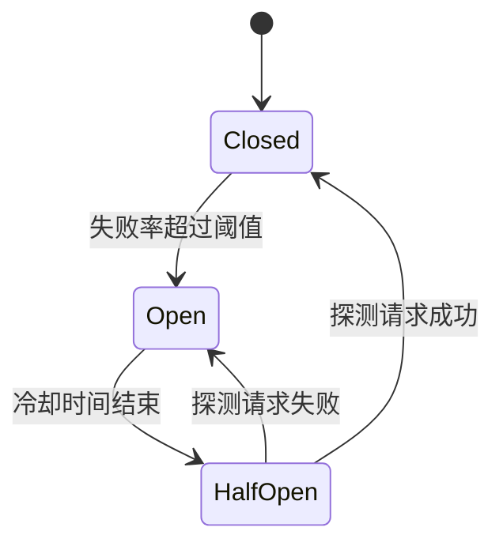
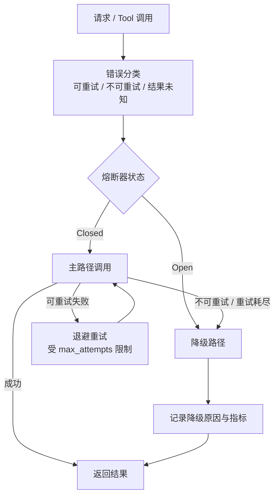

# 重试、熔断与降级

> 重试不能修复所有错误，熔断不是"放弃"，降级也不是"随便返回点什么"。韧性设计的第一原则是：先判断错误类型与副作用，再决定是否可以再来一次。

## 1. 为什么需要韧性设计

分布式系统中的失败是常态：网络抖动、模型服务限流、数据库连接池耗尽、Worker 崩溃、第三方接口 5xx。如果每个失败都直接抛给用户，可用性会被下游波动拖垮；如果每个失败都盲目重试，又可能造成：

| 盲目重试的后果 | 说明 |
|---|---|
| 重复副作用 | 写操作执行成功但响应丢失，重试导致重复下单/重复通知 |
| 雪崩 | 下游已经过载，重试进一步放大流量 |
| 掩盖故障 | 重试成功让真正的问题长期不被发现 |

因此需要三种互补手段：**重试（retry）、熔断（circuit breaker）、降级（degradation）**。

## 2. 基本机制

先分类错误，再决定策略：

| 错误类型 | 示例 | 是否重试 | 处理方式 |
|---|---|---|---|
| 瞬时网络错误 | 连接重置、5xx | 可以 | 有限次退避重试 |
| 下游限流 | 429 | 可以 | 退避 + 尊重 Retry-After |
| 超时 | 调用超时 | 谨慎 | 先确认副作用状态 |
| 权限不足 | 403 | 不应重试 | 直接失败并告警 |
| 预算/取消 | BUDGET_EXCEEDED / CANCELLED | 不应重试 | 按终态返回 |
| 写操作结果未知 | 已扣款但响应丢失 | 不可直接重试 | 幂等键 + 查询确认 |

重试策略有四个参数：最大次数（没有上限的重试等于放大故障）、退避（指数退避避免同时重试）、抖动（打散重试时间防止惊群）、重试条件（只对可重试错误重试）。

熔断器状态机：



Closed 正常放行并统计失败率；Open 直接拒绝、不再调用下游；HalfOpen 放少量探测请求，决定恢复还是继续熔断。

降级分三个层次：功能降级（关闭非核心能力，如个性化推荐 → 规则排序）、质量降级（返回较弱但可靠的结果，如混合检索 → 关键词召回）、体验降级（明确告知用户能力受限，不伪造结果）。降级必须 "fail closed"：权限、安全、资金相关能力不能因为降级而放开。

## 3. 总体架构



关键点：重试与降级都要记录"为什么走这条路"，否则事故复盘时无法区分"下游故障"和"策略配置错误"。

## 4. 关键设计

**4.1 重试必须与幂等绑定。** 写操作的可靠模式是：请求携带幂等键 → 首次执行可成功 → 重试时先查执行记录 → 已完成则回放结果，不重复执行。Qianke 的 Agent 请求使用 `request_id + scope + fingerprint` 做幂等：已完成回放、执行中返回冲突、同 ID 不同内容拒绝、失败记录不自动重跑。

**4.2 重试要区分"重新执行"与"恢复"。** Retry 是重新执行一次（新的 `execution_id`，`parent_execution_id` 记录血缘）；Resume 是从 checkpoint 继续（保留已完成的中间状态）。两者混用会导致重复调用工具；Qianke 当前 retry 是重新执行，不是 checkpoint resume。

**4.3 熔断需要"每个下游一份"。** 不能用全局熔断器：LLM、SQL、RAG、第三方物流 API 的失败特征不同，必须按下游维度独立统计，否则一个下游故障会误伤其他调用。

**4.4 降级不能编造。** 推荐服务挂了就明确返回规则排序结果并记录原因，不能随机返回商品伪装成个性化推荐；数据缺失就说明缺什么、为什么无法下结论，不能生成"预计 36 人"。Qianke 在 C 端降级中明确要求"诚实降级，不伪造商品/价格/优惠"。

## 5. 工程实现

Qianke 已实现的重试位置：

| 层 | 机制 | 参数 / 行为 |
|---|---|---|
| LLM 客户端 | LangChain `ChatOpenAI` 内置重试 | `timeout=60`、`max_retries=2` |
| Agent Runtime | `run_agent_with_retry` | 默认 `max_retries=1`；API 默认 0，按请求限制在 0–3 |
| 重试条件 | `_RETRYABLE_STATUSES` | 仅 FAILED / TIMEOUT / MAX_STEPS_EXCEEDED / MAX_TOOL_CALLS_EXCEEDED |
| 执行血缘 | 每次 attempt 新 `execution_id` | `parent_execution_id` 指向上一 attempt |
| 请求幂等 | `execute_agent` claim | 已完成回放、执行中 409、冲突 409、失败返回失败 |
| 队列 | `sa_job` attempts / max_attempts | 默认 max_attempts=2，租约 1800s，超限进 DEAD；`retry_job` / 死信重放时 attempts 归零 |
| C 端重试 | `client_message_id` 幂等 + WS 退避重连 | 重试复用 ID，HTTP 作为兜底 |

Qianke 当前没有熔断器实现。下面是为了说明设计而写的**伪代码，不是仓库代码**；熔断状态机与状态迁移属于通用理论知识：

```python
# 伪代码：仅用于说明半开状态与失败率窗口，不对应真实实现
class CircuitBreaker:
    def allow(self) -> bool:
        if state == OPEN and now() < open_until:
            return False
        if state == OPEN and now() >= open_until:
            state = HALF_OPEN
        return True
    def record(self, ok: bool) -> None:
        window.append(ok)
        if state == HALF_OPEN:
            state = CLOSED if ok else OPEN
        elif failure_rate(window) > threshold:
            state = OPEN
            open_until = now() + cooldown
```

落地前需要明确：窗口大小、失败率阈值、冷却时间、半开探测数量、按哪个下游分片。

已实现的降级路径：RAG 检索混合检索失败 → 关键词召回兜底；推荐服务内部异常 → 规则排序（`strategy=rules_fallback`）；砍价对话 LLM 超时/解析失败 → 模板回复；C 端社交店宠不可用 → 诚实说明；Super-agent Worker 异常 → `deterministic_fallback` 报告；图片签名失败 → 降级为无图；权限解析非法角色 → 降级为 guest（拒绝方向）。

每次降级至少记录：原因（哪个下游、什么错误）、策略（模板/规则/缓存）、影响范围（单请求/全租户/单工具）、是否已恢复。否则降级会悄悄变成"新的正常状态"。

## 6. 企业级要求

| 要求 | 具体做法 |
|---|---|
| 安全优先 | 权限、资金、写操作降级必须 fail closed |
| 幂等 | 重试与幂等键绑定，禁止重复副作用 |
| 有上限 | 重试次数、总时长、队列 attempts 都有上限 |
| 可观测 | 重试率、熔断状态、降级次数进入指标与日志 |
| 可配置 | 阈值与开关可配置，不需要改代码 |
| 可恢复 | 熔断恢复、降级恢复有明确条件 |
| 不伪造 | 降级结果必须诚实，不能伪装成正常结果 |

## 7. 方案对比

| 方案 | 优点 | 缺点 | 适用 |
|---|---|---|---|
| 不重试、直接失败 | 简单、无副作用 | 可用性差 | 非幂等写操作 |
| 指数退避 + 抖动 | 降低雪崩风险 | 参数需要调优 | 大多数网络调用 |
| 熔断器 | 保护下游、快速失败 | 需要阈值与恢复策略 | 强依赖外部服务 |
| 降级 + 明确告知 | 保住核心体验 | 功能不完整 | 非核心能力失败 |
| 重试 + 幂等 + 熔断组合 | 韧性最好 | 实现与运维复杂度高 | 企业级生产系统 |

Qianke 当前是"重试 + 幂等 + 降级"三件套，熔断尚未实现，属于规划项。

## 8. Qianke Engine 实践

| 能力 | 状态 | 证据 |
|---|---|---|
| LLM 客户端超时与重试 | 已实现 | `agent/loop.py`：`timeout=60`、`max_retries=2` |
| Agent attempt 级 retry | 已实现 | `run_agent_with_retry`；每次新 `execution_id`、记录 attempts；仅重试 `_RETRYABLE_STATUSES` |
| request_id 幂等（回放/冲突/失败） | 已实现 | `agent/service.py`、`agent/execution_store.py` |
| 队列重试 / 租约 / 死信 | 已实现 | `superagent/queue_pg.py`、`store.py`；`sa_job.attempts` |
| 熔断器 | 规划中 | 代码中无 CircuitBreaker 实现 |
| RAG / 推荐 / 砍价降级 | 已实现 | `tools/rag.py`、`c_end/recommend/service.py`、`bargain_dialogue.py` |
| 降级原因可观测 | 部分实现 | 有日志与部分 source 字段，无统一降级指标 |
| 重试/熔断策略配置化 | 部分实现 | 部分参数走环境变量，无统一策略中心 |

## 9. 评估/验收

```text
[ ] 每个外部依赖有超时，且超时时间小于上游等待上限
[ ] 重试只作用于可重试错误，且有次数与总时长上限
[ ] 写操作重试前有幂等键或状态确认
[ ] 熔断阈值、冷却、半开探测有明确配置
[ ] 降级路径不越过权限与安全边界，且如实记录降级原因
[ ] 重试率、熔断触发、降级次数可被监控，并有演练验证
```

## 10. 常见误区

1. **所有错误都重试**：权限错误重试一万次也不会成功。
2. **重试没有退避**：故障瞬间把下游彻底打挂。
3. **写操作直接重试**：重复下单、重复扣款。
4. **熔断后没有恢复探测**：要么永久不可用，要么一恢复就被打满。
5. **降级伪造数据**：短期好看，长期毁掉信任。
6. **降级不记录**：系统长期运行在降级状态却没人知道。
7. **把 retry 当 resume**：重复执行已完成的工具调用。

## 11. 总结

```text
韧性设计的第一步是错误分类，而不是加 try/except。
重试必须与幂等、上限、退避绑定；熔断保护下游；降级必须诚实且不越权。
三者都要可观测、可配置、可演练，否则只是纸面上的高可用。
Qianke 已实现重试、幂等与多处降级；熔断仍属规划，不能写成已实现。
```

## 12. 延伸阅读

### 项目内部

- [故障恢复与灾难恢复](09-failure-recovery-dr.md)
- [SRE 与 SLO](07-sre-slo.md)
- `src/rag_demo/agent/loop.py`、`src/rag_demo/agent/service.py`、`src/rag_demo/superagent/queue_pg.py`、`tests/test_agent_execution_safety.py`

### 外部资料

- AWS Builders' Library · Timeouts, retries, and backoff with jitter：<https://aws.amazon.com/builders-library/timeouts-retries-and-backoff-with-jitter/>
- Google SRE Book · Handling Overload：<https://sre.google/sre-book/handling-overload/>
