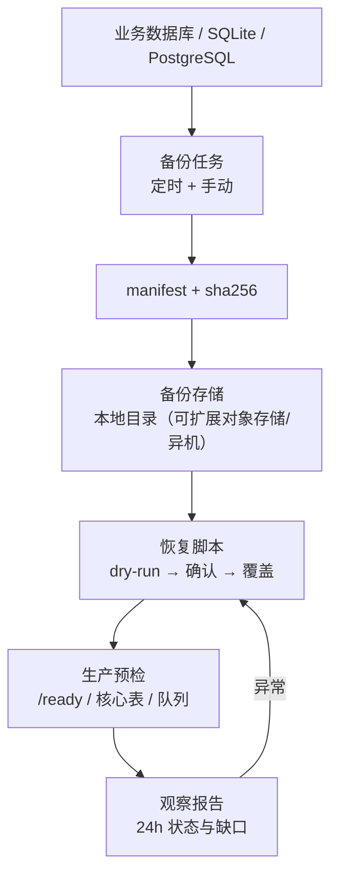

# 故障恢复与灾难恢复

> 备份不是"每天跑一个脚本"，而是"在限定时间内把系统恢复到可验证的可用状态"。恢复能力必须被演练和度量，否则备份只是一堆未被验证过的文件。

## 1. 为什么需要恢复设计

系统会遇到不同量级的故障：

| 层级 | 示例 | 恢复手段 |
|---|---|---|
| 请求级 | 超时、下游 5xx | 重试、降级、幂等 |
| 进程级 | 服务崩溃、Worker 退出 | 重启、健康检查、队列重投 |
| 数据级 | 误删、脏数据、迁移失败 | 备份恢复、纠正操作、回滚 |
| 机房/区域级 | 云区域故障、网络中断 | 灾备切换、异地副本 |

不同层级的恢复目标不同。**故障恢复（failure recovery）**关注单点故障后快速恢复服务；**灾难恢复（disaster recovery, DR）**关注大范围故障后恢复数据与业务连续性。核心指标：RTO（允许中断多久）、RPO（允许丢失多少数据，时间维度）。RTO/RPO 不是口号，而是由备份频率、复制方式、恢复流程与演练结果共同决定的工程事实。

## 2. 基本机制

备份有三种形态：全量（完整副本，恢复简单，占用大）、增量（只备变化，节省空间，恢复链更长）、时间点恢复（基于 WAL/binlog 回放到某一时刻）。对业务数据库，优先级通常是时间点恢复 > 增量 > 全量；对小型控制面库，一致性全量备份即可。

备份必须包含四样东西：数据本身、manifest（文件、大小、sha256、来源、时间）、恢复说明（依赖、顺序、验证步骤）、保留策略（保留几份、何时清理）。没有 manifest 与校验，无法确认"这个备份是不是完整的"；没有恢复说明，事故时只能现场摸索。

恢复流程：选择备份点 → 校验 manifest / sha256 → dry-run（不覆盖现有数据）→ 备份当前状态（`.before-restore-时间戳`）→ 执行恢复 → 重启服务并校验依赖 → 生产预检与核心链路验证；失败则回退到恢复前快照。

关键纪律：**恢复操作默认不可静默覆盖现有数据**，必须显式确认，并保留恢复前快照。恢复的对立面是回滚，但回滚不是"撤销"：库存已扣减、订单已创建、消息已发出时，数据库回滚不能撤回外部副作用，这类情况需要补偿（退款、释放库存、对账）或人工处理。RTO/RPO 与备份形态属于通用理论知识，本项目落地情况见第 8 节。

## 3. 总体架构



灾难恢复还需要一个当前实现未覆盖的层次：异地副本、跨区域切换、DNS 切换、冷备机房。

## 4. 关键设计

**4.1 一致性备份。** 直接复制正在写入的数据库文件可能得到损坏副本。可靠做法：SQLite 使用 `sqlite3` backup API 在线一致性复制；PostgreSQL 使用 `pg_dump`（逻辑备份）或 `pg_basebackup + WAL`（物理/PITR）。Qianke 的备份脚本对 SQLite 使用 `sqlite3.Connection.backup()`，对 PostgreSQL 优先调用宿主机 `pg_dump`，缺失时回退到 Docker 容器内执行。

**4.2 恢复安全设计。**

| 设计点 | 做法 |
|---|---|
| 默认安全 | 恢复默认 dry-run，必须 `--yes` 才覆盖 |
| 恢复前快照 | 覆盖前自动保存 `*.before-restore-<ts>` |
| 校验 | 先校验 manifest 与 sha256 |
| 最小影响 | 支持按 schema 恢复（`pg_restore -n <schema>`） |
| 可回退 | 恢复失败可回到恢复前快照 |
| 权限 | 恢复脚本需要高权限，必须限制执行者 |

**4.3 删除标记必须随恢复重放。** 如果系统支持删除用户数据，恢复旧备份会把已删除数据"复活"。架构决策文档明确要求：恢复备份时重放删除标记，确保已删除数据不会重新进入在线系统、搜索索引或 Agent 上下文。这是一条已设计但尚未见实现验证的要求。

**4.4 恢复演练。** 季度演练：从备份恢复到隔离环境，依次验证 manifest → restore → 启动 → `/ready` → 核心表计数 → 关键链路，并记录耗时（作为 RTO 证据）、发现的问题与修复项。没有演练的备份等于没有备份，演练记录也是对外说明 RTO 的唯一可信证据。

**4.5 运行态恢复：stale RUNNING 与卡住的任务。** 进程崩溃后可能留下 `RUNNING` 的执行记录或租约过期的任务：Agent Execution Record 当前没有 stale TTL 自动回收（已知限制）；队列 Job 有 `lease_until` 与 attempts，超时后可被重新领取或进入 DEAD；Work Item 由 Watchdog 扫描 STUCK 并告警。恢复机制必须区分"真的还在跑"与"已经死掉但没清理"。

## 5. 工程实现

```bash
# 备份（可选 --keep 保留最近 N 份）
python scripts/backup_control_plane.py --keep 7
python scripts/backup_control_plane.py --include-pg
# 恢复（默认 dry-run，需 --yes 才覆盖）
python scripts/restore_control_plane.py backups/20261104-003000 --yes
python scripts/restore_control_plane.py backups/... --yes --include-pg
```

产物结构：

```text
backups/<时间戳>/
├── c_end_mock.sqlite       控制面 SQLite 一致性副本
├── vec_db.dump             PostgreSQL 备份（--include-pg）
└── manifest.json           sha256 + size + source + 时间
```

定时执行：Windows 任务计划程序每天 02:00 执行 `scripts/backup_control_plane.ps1`，Linux 用 `crontab 0 2 * * * scripts/backup_control_plane.sh`；日志写 `logs/backup.log`；`--keep 7` 已验证只保留最近 N 个带 manifest 的时间戳目录。

恢复演练与切换预演：

```text
scripts/rehearse_control_pg_switch.py   控制面 PG 切换预演
scripts/observe_control_pg.py、smoke_control_pg.py  切换后观察与冒烟
scripts/production_preflight.py         一键检查 10 项成功路径证据（另有 1 个异常兜底）
```

控制面 PostgreSQL 迁移的 P2-B 文档给出的回滚方式是：恢复环境变量为 sqlite → 重启 → 恢复 SQLite 备份。这是"代码/配置回滚 + 数据恢复"组合的典型写法。

当前缺口：备份在本地目录、未加密、未异地、未接对象存储；没有自动恢复演练，只有手动 dry-run 记录；没有 stale RUNNING 自动回收；wall timeout 不保证 worker 停止（线程不能安全强杀）；没有跨区域灾备与 DNS 切换；RPO 目标尚未通过演练验证。

## 6. 企业级要求

| 要求 | 具体做法 |
|---|---|
| RTO/RPO 明确 | 每个业务域定义目标，并有演练数据支撑 |
| 备份可靠 | 一致性备份 + manifest + 定期校验 |
| 恢复安全 | dry-run、恢复前快照、权限控制 |
| 加密与隔离 | 备份加密、访问审计、异地存储 |
| 演练制度化 | 季度演练、记录耗时与问题 |
| 删除合规 | 恢复时重放删除标记 |
| 副作用处理 | 明确哪些操作不能靠回滚撤销 |
| 证据留存 | 演练报告与预检结果可复核 |

## 7. 方案对比

| 方案 | 优点 | 缺点 | 适用 |
|---|---|---|---|
| 文件直接复制 | 简单 | 可能损坏、无一致性保证 | 停机维护窗口 |
| SQLite backup API | 在线一致、轻量 | 仅适合 SQLite | 控制面小库 |
| pg_dump 逻辑备份 | 跨版本、可单 schema 恢复 | 大库慢、无 PITR | 中小库、迁移 |
| pg_basebackup + WAL | 支持 PITR、RPO 小 | 运维复杂、存储成本 | 核心业务库 |
| 异地多活 | RTO/RPO 最优 | 架构与成本极高 | 高可用核心系统 |

Qianke 当前是"SQLite 一致性备份 + 可选 pg_dump + 手动恢复演练"，异地/加密/自动演练仍属规划。

## 8. Qianke Engine 实践

| 能力 | 状态 | 证据 |
|---|---|---|
| SQLite 一致性备份 | 已实现 | `scripts/backup_control_plane.py` 使用 backup API |
| PostgreSQL 备份（pg_dump，Docker 回退） | 已实现 | `--include-pg`；`tests/test_backup_pg_fallback.py` |
| manifest + sha256 校验 | 已实现 | manifest 写入；恢复前校验 |
| 保留策略 `--keep` | 已实现 | 只保留最近 N 份带 manifest 目录 |
| 定时备份脚本 | 已实现 | `backup_control_plane.ps1` / `.sh`，计划任务/cron |
| 恢复 dry-run 与恢复前快照 | 已实现 | `restore_control_plane.py`；`.before-restore-<ts>` |
| 生产预检 | 已实现 | `scripts/production_preflight.py`；10 项成功路径 PASS，另有 1 个异常兜底 |
| 24h 观察报告 | 已实现 | `scripts/observation_report.py` |
| PG 切换预演/观察/冒烟 | 已实现 | `rehearse_control_pg_switch.py`、`observe_control_pg.py`、`smoke_control_pg.py` |
| 备份加密 / 异地存储 / 对象存储 | 规划中 | 当前备份在本地目录 |
| 自动恢复演练 | 规划中 | 仅手动 dry-run 记录 |
| stale RUNNING 自动回收 | 规划中 | 已作为已知限制记录 |
| RPO 5 分钟目标验证 | 已设计 | 架构决策文档给出目标，并明确"需测试或演练验证" |
| 硬性 RTO 承诺 | 规划中 | 文档明确第一版不承诺硬性 RTO |
| 跨区域灾备 | 规划中 | 未见实现 |

## 9. 评估/验收

```text
[ ] 备份有 manifest、校验和、保留策略
[ ] 恢复默认 dry-run，覆盖前自动保存当前状态
[ ] 从备份恢复到可用系统有时长记录（RTO 证据）
[ ] 恢复后核心表计数与关键链路验证通过
[ ] 删除标记在恢复后不会复活已删除数据
[ ] 有 RPO/RTO 目标、定期演练记录和行动项
[ ] 已知缺口（stale RUNNING、异地、加密）被如实标注
```

## 10. 常见误区

1. **备份没校验**：文件存在不等于可恢复。
2. **恢复默认覆盖**：一次误操作把生产数据洗掉。
3. **只备份不演练**：事故时才发现恢复步骤跑不通。
4. **把回滚当撤销**：外部副作用无法靠数据库回滚撤回。
5. **删除数据被恢复复活**：没有重放删除标记。
6. **RTO/RPO 只有口号**：没有演练数据支撑。
7. **备份与生产同盘**：主机故障时备份一起丢失。

## 11. 总结

```text
恢复能力的核心是"可验证"：备份要校验，恢复要演练，目标要有证据。
一致性备份、恢复前快照、权限控制、删除标记重放是四条底线。
故障恢复与灾难恢复是不同层次，不能用一个脚本覆盖所有场景。
Qianke 已有备份/恢复脚本、保留策略与预检；异地、加密、自动演练与 stale 回收仍待补齐。
```

## 12. 延伸阅读

### 项目内部

- [重试、熔断与降级](08-retry-circuit-breaker-degradation.md)
- [SRE 与 SLO](07-sre-slo.md)
- `scripts/backup_control_plane.py`、`scripts/restore_control_plane.py`、`scripts/production_preflight.py`、`docs/decisions/control_plane_postgres_migration_p2b.md`、`docs/e2e/ops-readiness-backup.md`

### 外部资料

- PostgreSQL Backup and Restore：<https://www.postgresql.org/docs/current/backup.html>
- SQLite Backup API：<https://www.sqlite.org/backup.html>
- AWS Disaster Recovery 白皮书：<https://docs.aws.amazon.com/whitepapers/latest/disaster-recovery-workloads-on-aws/disaster-recovery-workloads-on-aws.html>