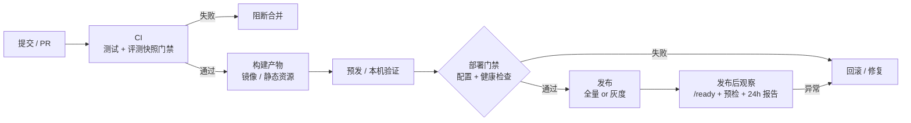

# CI/CD 与灰度发布

> CI 的目标是让"每次改动都可验证"，CD 的目标是让"每次发布都可回滚、可观察、可控爆炸半径"。对 Agent 系统，发布的不只是代码，还可能包括 Prompt、模型版本、工具契约与评测基线。

## 1. 为什么需要 CI/CD 与灰度

Agent 项目的发布风险不止来自代码：改一行 Prompt 可能让任务成功率下降；换模型版本可能改变工具调用格式与成本；改 Tool Schema 可能让模型按旧参数调用；改权限矩阵可能让某个角色突然失去能力；改数据库 schema 可能让旧版本代码读不了新列。如果没有自动验证与受控发布，这些变化只能靠"发上去看看"。

| 阶段 | 解决的问题 |
|---|---|
| CI | 每次提交自动跑测试与门禁，坏改动不进主干 |
| CD | 部署过程标准化，减少手工步骤与"漏配环境变量" |
| 灰度 | 让问题只影响一小部分流量/租户，可观测后再扩大 |

## 2. 基本机制

CI 的典型阶段是：代码检出 → 安装依赖 → 静态检查 → 单元与契约测试 → 评测门禁（快照/契约，不调用真实模型）→ 构建产物 → 归档报告。关键原则：**CI 必须确定、可重复、成本可控**；需要真实模型、真实外部服务的验证应放到独立任务或 CD 前的手动/阶段门禁。

CD 的发布策略：

| 策略 | 做法 | 优点 | 缺点 |
|---|---|---|---|
| 停机发布 | 停服务、换代码、起服务 | 简单 | 有中断、回滚慢 |
| 滚动发布 | 逐批替换实例 | 无中断、资源省 | 版本混跑兼容性要求高 |
| 蓝绿发布 | 新环境就绪后切流量 | 回滚快 | 双倍资源 |
| 金丝雀（灰度） | 先给少量流量/租户 | 爆炸半径小 | 需要流量控制与观测 |
| 功能开关 | 代码已上线但功能关闭 | 发布与放量解耦 | 开关治理复杂 |

数据库迁移的安全顺序：

```text
1. Expand：新增列/表/索引（向后兼容）
2. Migrate：回填数据（可中断、可重跑）
3. Switch：代码切换到新字段/新表
4. Contract：确认无旧版本使用后删除旧结构
```

**禁止**"先删列再发代码"或"同一次发布既改 schema 又依赖新结构"，否则回滚会失败。发布门禁分四层：代码门禁（pytest、契约测试、静态检查）、评测门禁（离线快照/数据集契约/基线对比）、部署门禁（镜像构建成功、配置齐全、健康检查通过）、发布后门禁（`/ready`、生产预检、24h 观察）。

## 3. 总体架构



Agent 项目建议在 CI 与发布之间再加一道**评测门禁**，因为测试通过不代表任务能力没退化。

## 4. 关键设计

**4.1 CI 要快，门禁要硬。** CI 常见失衡：为了"全"把所有检查塞进一次运行，结果每次 40 分钟，开发者开始绕过。合理拆分：

| 任务 | 频率 | 耗时目标 | 是否阻断 |
|---|---|---|---|
| 单元/契约测试 | 每次 PR | 分钟级 | 是 |
| 评测快照/契约校验 | 每次 PR | 秒级 | 是 |
| 真实模型 Eval | 合并前/每日 | 十分钟级 | 阶段阻断 |
| 浏览器 E2E | 合并前/每日 | 十分钟级 | 关键路径阻断 |
| 安全扫描 | 每周/发布前 | 视工具 | 发布阻断 |

**4.2 灰度不是"随机放量"。** 一次合格的灰度发布需要：可切分的流量维度（租户、账号、地域、比例）、可对比的指标（成功率、延迟、错误率、业务质量）、明确的扩大条件（观察窗口内指标不劣化）、明确的回滚条件（错误率/延迟/质量阈值）。没有观测与回滚条件的"灰度"，只是把全量发布拆成两次。

**4.3 回滚优先设计。** 代码可回滚（镜像 tag / 上一版本二进制）、配置可回滚（环境变量与开关有版本）、数据库可回滚（迁移向后兼容，保护性备份）、Prompt 可回滚（新旧版本常量都保留）。回滚不是失败，而是发布流程的一部分；发布前必须回答"如果 5 分钟后发现问题，怎么退回去"。

**4.4 Prompt / 模型也属于发布物。** 需要把 Prompt、模型名、温度、Tool Schema、评测基线纳入版本管理。只回滚代码、不回滚 Prompt，可能得到"代码是旧版、行为是新版"的混合状态。

## 5. 工程实现

`.github/workflows/ci.yml` 当前行为：

```text
触发：push / PR 到 main，或手动 workflow_dispatch
并发：同 ref 的旧运行自动取消；权限：contents: read（最小权限）
运行环境：ubuntu-latest，timeout 20 分钟
安装：uv 0.12.5 + Python 3.12，显式安装测试依赖
（不使用 uv sync：pyproject 的 torch wheel 是 Windows 专用）
执行：python -m pytest tests/ -q
门禁：读取 tests/eval_results_llm.json，要求 total ≥ 5 且 pass_rate ≥ 0.85
```

门禁脚本是内联 Python，明确打印总计、通过数与阈值，低于阈值以非 0 退出。它防的是"评测报告被悄悄改低"，不是"每次都在 CI 真跑模型"。

部署路径：

```text
docker-compose.yml    db(PostgreSQL+pgvector) + backend(FastAPI) + frontend(Nginx)
Dockerfile            后端镜像
web/Dockerfile        前端构建 + Nginx
deploy/initdb/        数据库初始化脚本
deploy/systemd/       独立 Worker 的 systemd 服务
ops/cloudflared.yml   固定域名入口（模板不入库）
```

部署方式本质是"构建镜像 → `docker compose up -d --build`"，并依赖健康检查确认依赖就绪。发布后验证包括：`scripts/production_preflight.py` 10 项成功路径证据一键检查（另有 1 个异常兜底）、`/ready` 依赖就绪、`/health` 进程健康、`scripts/observation_report.py` 24h 观察与缺口报告、`docs/e2e/` 人工验收记录与截图。

已知缺口：没有 CD 自动化，部署仍依赖人工执行 compose 与域名配置；没有灰度流量切分，无金丝雀/蓝绿/按租户比例放量机制；CI 未执行 v2 评测门禁脚本——`scripts/check_eval_v2_gate.py` 已存在且文档标注为 CI 门禁，但当前 ci.yml 只跑 pytest 与 RAG 离线快照门禁；CI 未包含 lint、类型检查、前端构建、浏览器 E2E、镜像构建；没有发布单/变更审批/版本 tag 自动生成；回滚流程有文档描述但未自动化。

## 6. 企业级要求

| 要求 | 具体做法 |
|---|---|
| 可重复构建 | 固定依赖版本、镜像可追溯 |
| 门禁有效 | 测试 + 评测门禁真的阻断 |
| 最小权限 | CI 令牌权限最小化，密钥只从 Secret 注入 |
| 环境一致 | 预发与生产使用同一镜像与配置结构 |
| 灰度可控 | 流量维度、观察指标、扩大/回滚条件明确 |
| 迁移安全 | expand/contract，向后兼容 |
| 可回滚 | 代码、配置、Prompt、数据都有回退路径 |
| 发布可观测 | 发布后自动预检与观察 |

## 7. 方案对比

| 方案 | 优点 | 缺点 | 适用 |
|---|---|---|---|
| 手工部署 | 简单直接 | 易漏步骤、难回滚 | 单机/早期 |
| CI + 手工 CD | 有验证、保留控制 | 仍有操作风险 | 当前 Qianke 阶段 |
| CI/CD + 滚动发布 | 自动化、无中断 | 需要编排平台 | 多实例服务 |
| CI/CD + 蓝绿 | 回滚快 | 资源成本高 | 关键系统 |
| CI/CD + 金丝雀 | 爆炸半径最小 | 需要流量治理与观测 | 大规模生产 |

Qianke 当前处于"CI 已自动化、CD 半自动、灰度未实现"的阶段，这个描述必须写清楚；滚动/蓝绿/金丝雀等发布策略属于通用理论知识，本项目尚未实现流量级灰度。

## 8. Qianke Engine 实践

| 能力 | 状态 | 证据 |
|---|---|---|
| GitHub Actions CI | 已实现 | `.github/workflows/ci.yml`；push/PR 触发 |
| pytest 全量执行 | 已实现 | CI 中 `python -m pytest tests/ -q` |
| 离线评测快照门禁 | 已实现 | 内联门禁：`total ≥ 5` 且 `pass_rate ≥ 0.85` |
| Eval v2 门禁脚本 | 已实现（未接入 ci.yml） | `scripts/check_eval_v2_gate.py`；v2 README 标注为 CI 门禁 |
| 镜像化部署 | 已实现 | `docker-compose.yml`、`Dockerfile`、`web/Dockerfile` |
| 健康检查 | 已实现 | compose healthcheck；`/health`、`/ready` |
| 生产预检 | 已实现 | `scripts/production_preflight.py` |
| 发布后观察 | 已实现 | `scripts/observation_report.py`、`docs/e2e/` 验收记录 |
| 环境开关（后端/认证/文档/队列） | 已实现 | `QIANKE_CONTROL_BACKEND`、`RAG_AUTH_ENABLED`、`RAG_ENABLE_API_DOCS` 等 |
| 租户试点烟测 | 已实现 | `scripts/tenant_pilot_smoke.py` 检查租户/owner/策略/工作项隔离 |
| 自动化 CD | 规划中 | 未见部署流水线；部署靠人工 compose |
| 灰度/金丝雀流量切分 | 规划中 | 无流量治理与按比例放量机制 |
| 发布单与自动回滚 | 规划中 | 回滚流程为文档描述 |

## 9. 评估/验收

```text
[ ] 每次 PR 自动跑测试与门禁，失败阻断合并
[ ] CI 使用最小权限令牌，密钥不出现在日志
[ ] 构建产物可追溯（commit → image digest）
[ ] 发布前有评测门禁结果，而不只是单测通过
[ ] 数据库迁移向后兼容，回滚路径经过验证
[ ] 发布后有预检与观察窗口
[ ] 灰度/全量发布有明确扩大与回滚条件
```

## 10. 常见误区

1. **把 CI 当 CD**：能跑测试不等于能安全发布。
2. **门禁太慢被绕过**：流水线设计要分层，不要一次塞满。
3. **直接删列迁移**：旧版本无法回滚。
4. **灰度没有观测**：出问题也不知道，只是"少坏一点"。
5. **只回滚代码不回滚 Prompt**：行为与版本不一致。
6. **用生产当测试环境**：一次误发就是事故。
7. **宣称有灰度但只有环境变量开关**：开关控制的是功能，不是流量，两者不能混淆。

## 11. 总结

```text
CI 保证每次改动可验证，CD 保证每次发布可控、可回滚、可观察。
Agent 发布物包括代码、Prompt、模型、Tool Schema 与评测基线，必须一起版本化。
数据库迁移要 expand/contract；灰度要有流量维度、指标与回滚条件。
Qianke 已实现 CI 与镜像部署、预检与观察；自动化 CD、灰度流量与发布审批仍属规划。
```

## 12. 延伸阅读

### 项目内部

- [Agent 自动化测试](02-agent-automated-testing.md)
- [Regression Test 回归测试](03-agent-regression-test.md)
- [故障恢复与灾难恢复](09-failure-recovery-dr.md)
- `.github/workflows/ci.yml`、`docker-compose.yml`、`docs/部署指南.md`

### 外部资料

- GitHub Actions 文档：<https://docs.github.com/en/actions>
- Google SRE Book · Reliable Product Launches：<https://sre.google/sre-book/reliable-product-launches/>
- Martin Fowler · BlueGreenDeployment：<https://martinfowler.com/bliki/BlueGreenDeployment.html>
