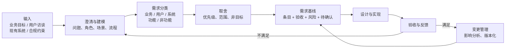

# 如何进行系统需求分析

> 需求分析的产出不是功能清单，而是**要解决的问题、不能越过的边界、可以验证的完成标准**。

## 1. 为什么需要系统需求分析

软件项目最贵的返工不是代码写错，而是方向错了：做错（解决了没人真正痛的问题）、做多（范围膨胀拖垮交付）、做漏（权限、数据、审计、失败处理没有进入需求）。代码错误可以在测试阶段修复，需求错误往往要等上线、验收或真实用户使用时才暴露，重写成本最高。

功能列表只回答“系统有什么页面、按钮和接口”。系统需求分析还要回答：谁在什么场景使用、业务目标如何衡量、哪些事情明确不做、有哪些安全/合规/性能/可靠性约束、做到什么程度算完成。

本文的定位与状态：

```text
理论知识：需求分类、边界、非功能需求、可验证性等通用方法
已实现：Qianke 已有项目背景、MVP 范围、M0 范围/非范围、验收条件等需求文档实践
部分实现：需求条目没有统一编号与追踪矩阵，需求散落在 docs/、docs/product/、docs/design/
规划中：需求基线与变更影响分析的自动化
```

## 2. 基本机制

需求分为三层：业务需求（为什么做、组织得到什么）、用户需求（谁在什么场景完成什么）、系统需求（系统必须提供的能力与约束）。只写其中一层都会出问题：只写用户需求会缺系统约束，只写系统需求会丢业务动机。

一条可用的需求条目应包含：稳定 ID、来源、问题/目标、场景、功能行为（含异常）、非功能约束、边界与非目标、验收方式、优先级与 owner。其中最容易省掉、也最不该省的是“非目标”和“验收方式”。

把“方案”还原成“问题”是需求分析的基本功。用户说“加一个报表”，真正的问题可能是“我每周要手工汇总两天才能回答一个经营问题”。前者是方案，后者才是需求；先定义问题，才能比较方案。

非功能需求必须量化。“要快、要安全、要稳定”无法验收，应写成：

| 维度 | 可验收的写法 |
|---|---|
| 性能 | 顺序请求 p95 ≤ 500ms，并发 5 p95 ≤ 1s |
| 安全 | 商家 A 无法读取商家 B 的订单，且有自动化测试 |
| 可靠性 | 超时、失败、重试均有明确终态与告警 |
| 一致性 | 金额与退款由确定性代码计算，结果可复现 |
| 成本 | 单任务 token / 模型调用次数上限与统计口径 |

## 3. 总体架构

需求分析是从输入到可验收基线的链路，而不是一次会议：



产出物是一组互相引用的资产：需求说明、范围与非目标清单、验收标准、风险与待确认清单、需求到设计/测试/Eval 的追踪关系、需求基线的版本与变更记录。

## 4. 关键设计

**先写“不做什么”。** 范围膨胀往往不是有人故意加需求，而是“不做什么”从未被写下来。Qianke 的 `docs/MVP产品目标.md` 专设“不做什么（明确边界）”一节，逐项说明原因。后来产品扩展了多租户、Agent 等能力，但当时的边界是清楚的，扩展是有意识决策而非需求失控。

**每条需求可验证。** 每条需求都应能在设计阶段找到模块、在测试阶段找到断言、在验收阶段找到证据。例如：

```text
REQ-PERF-01 售后列表接口：顺序 p95 ≤ 500ms，并发 5 p95 ≤ 1s
验收证据：本地 20 次顺序请求 + 5 并发 × 50 次统计，报告留档
```

**歧义先确认，不猜。** 需求存在多种合理解释、关键参数缺失、边界不清时，应提问并记录，而不是假设后继续实现。Qianke 的 `AGENTS.md` 把“歧义先问、架构/数据模型/安全边界先确认”写成硬规则，属于流程层面的需求治理。

**需求与风险一起管理。** 未决问题不能藏在正文里，否则设计会基于假设推进。M0 架构文档把范围、非范围、验收条件、风险、待确认决策分节列出，就是把假设显式化。

**维护追踪关系。** `需求 ID → 设计章节/ADR → 代码模块 → 测试用例 → Eval 场景 → 验收记录`。没有追踪关系，变更无法评估影响面，删除旧需求也无法确认代码能否清理。

## 5. 工程实现

一份适用于中小型迭代的轻量需求文档结构（伪文档模板，不是仓库现有文件）：

```text
1. 背景与问题（为什么现在做）
2. 目标与非目标（范围红线）
3. 角色与核心场景
4. 功能需求（ID、行为、异常）
5. 非功能需求（性能、安全、权限、可靠性、成本）
6. 数据与接口约束
7. 依赖与风险
8. 验收标准与证据形式
9. 待确认问题与 owner
10. 变更记录
```

收集需求的方法：访谈业务方时问决策场景而不是问要什么页面；观察现有流程记录手工步骤、等待时间和错误来源；分析事故与工单反推非功能需求；核对合规要求；明确哪些能力可复用、哪些必须新建。基线之后的需求变更要做影响分析：涉及哪些模块、是否需要迁移、是否影响安全边界与评测基线。

## 6. 企业级要求

企业级需求分析中，非功能要求是准入门槛，而不是加分项。需求阶段至少要问清：

| 维度 | 必须问清 |
|---|---|
| 安全与租户 | 谁能访问哪些数据？越权如何拒绝？租户上下文由谁注入？ |
| 合规 | 数据保留多久？删除后备份如何处理？ |
| 可用性 | 失败时用户看到什么？是否允许降级？ |
| 可观测 | 需要哪些日志、指标、trace？谁来消费？ |
| 变更与成本 | 需求变化如何评估回滚？token、存储、算力预算是否进入需求？ |

这些问题拖到架构完成后再补，通常会变成结构性问题，而不是局部改动。

## 7. 方案对比

| 方式 | 优点 | 缺点 | 适用场景 |
|---|---|---|---|
| 功能清单 | 快、易沟通 | 易漏非功能与边界，无法验收 | 内部小工具、探索原型 |
| 用户故事 + 验收标准 | 以用户价值为中心，便于迭代 | 系统约束与安全要求容易缺位 | 敏捷产品迭代 |
| 用例（Use Case） | 场景完整，覆盖异常流 | 编写成本较高 | 多角色、流程复杂系统 |
| 需求规格说明书（SRS） | 结构化、可追踪、可审计 | 重，变更成本高 | 企业级交付、合规场景 |

实际项目通常组合使用：用业务目标与非目标定边界，用用户故事描述场景，用非功能清单和验收标准补齐系统约束。

## 8. Qianke Engine 实践

| 实践 | 证据 | 状态 |
|---|---|---|
| 项目背景、痛点、能力边界 | `docs/项目背景.md` | 已实现 |
| MVP 范围、非目标、验收标准 | `docs/MVP产品目标.md` | 已实现（历史文档，产品范围已扩展，当前边界以 `AGENTS.md` 与 README 为准） |
| 大型迭代 M0 范围与非范围 | `docs/product/merchant-dashboard-v1.1-m0-architecture-plan.md` | 已实现 |
| 需求到验收的可执行口径 | `docs/e2e/b-end-performance-2026-11-14.md` 性能门禁 | 已实现 |
| 架构变更前的确认规则 | `AGENTS.md` §4.1、§4.3、§14 | 已实现（工作协议） |
| 统一需求编号与追踪矩阵 | 未见单一需求登记册 | 待核验 / 规划中 |

值得复用的做法是“能力边界 + 已知灰区”一起写。`docs/项目背景.md` 不只列能做什么，还明确写出不能做的预测、多跳关系推理、真实时效语义，以及口径错配、SQL 路判定漂移等灰区。这比只写“支持用户画像分析”更接近真实需求基线。

另一个做法是先冻结架构决策再进入编码。Merchant Dashboard V1.1 的 M0 阶段明确“只做架构审查与计划，不修改业务代码”，并用八项验收条件约束 M1 实施边界。需求分析不是写完文档就结束，而是要与验收和架构评审衔接。

## 9. 评估 / 验收

```text
[ ] 每条需求都能追溯到一个真实问题或约束
[ ] 功能需求有明确输入、输出、异常行为
[ ] 非功能需求有量化口径与验证方式
[ ] 有明确的非目标清单
[ ] 未决问题、风险、假设单独列出并有 owner
[ ] 验收标准可执行，不依赖主观判断
[ ] 需求已与设计、测试、Eval 建立引用关系
[ ] 相关方确认基线，变更走影响分析
```

验收人至少包括业务负责人和技术负责人：前者确认问题真实、范围可接受，后者确认约束可实现、验收可执行。

## 10. 常见误区

1. 把方案当需求：用户说“加一个按钮”，就只实现按钮，没有确认要解决的决策问题。
2. 只写功能不写非功能：上线后才发现没有权限控制、没有审计、无法定位失败。
3. 没有非目标：需求只增不减，项目永远无法收敛。
4. 验收标准写成形容词：“体验好、性能高、安全可靠”无法验证。
5. 需求文档没有 owner：写完就没人维护，实现开始后迅速过期。
6. 用“AI 可以自动理解”跳过需求澄清：模型能力不能替代业务边界与数据权限定义。
7. 把假设当事实：未验证的数据规模、并发量、合规期限直接进入架构设计。

## 11. 总结

```text
需求分析 = 问题定义 + 边界划定 + 验收设计
```

1. 需求分析的核心产出是决策依据，不是功能清单。
2. 非目标与量化验收标准，和功能需求同等重要。
3. 需求必须与设计、测试、Eval 建立可追踪关系，否则无法应对变更。

## 12. 延伸阅读

项目内部资料：

- `docs/项目背景.md`：立项背景、能力边界、已知灰区
- `docs/MVP产品目标.md`：范围、非目标、验收标准
- `docs/product/merchant-dashboard-v1.1-m0-architecture-plan.md`：M0 范围与非范围
- `docs/decisions/merchant_dashboard_v1_1_m0_adr.md`：决策与八项验收条件

外部资料：

- ISO/IEC 25010 系统与软件质量模型：https://www.iso.org/standard/78176.html
- IEEE 29148 需求工程标准：https://standards.ieee.org/ieee/29148/6937/
- INVEST 用户故事原则：https://xp123.com/articles/invest-in-good-stories-and-smart-tests/
- C4 model：https://c4model.com/
