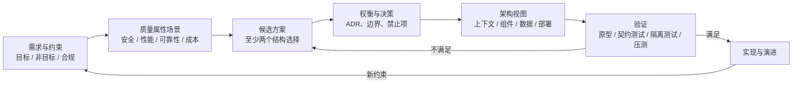

# 如何进行架构设计

> 架构不是一张图，而是一组**有理由的决策**：哪些边界必须存在、哪些依赖必须被禁止、失败时系统如何表现、未来多大概率会改。

## 1. 为什么需要架构设计

没有架构设计的系统并不是“没有架构”，而是架构以偶然的方式形成：谁先写代码谁定义边界，跨模块调用随手可达，安全与失败语义靠后来补丁。这样的系统在功能少时跑得快，在需求增加、多人协作、多租户上线后开始付出代价。

架构设计要解决的核心问题：

```text
哪些职责放在一起，哪些必须分开？
模块之间允许谁依赖谁？
权限、租户、数据一致性由哪一层保证？
关键质量属性（安全、性能、可靠性、可观测）如何被结构性支持？
哪些决策现在必须做，哪些可以延后？
```

架构的价值不在于“画得完整”，而在于让上述问题有明确答案，并且答案可以被代码、测试和评审验证。

## 2. 基本机制

架构设计从需求与约束出发，围绕质量属性做权衡，再落到视图和决策。一个可操作的流程：

| 步骤 | 核心问题 | 产出 |
|---|---|---|
| 1. 明确需求与约束 | 系统为谁解决什么问题？不能越过什么？ | 范围、非目标、约束清单 |
| 2. 定义质量属性场景 | 安全、性能、可用性、可维护性如何度量？ | 可验证的质量属性场景 |
| 3. 提出候选方案 | 至少两个结构上不同的方案 | 候选架构草图 |
| 4. 权衡与选择 | 每个方案满足哪些属性、牺牲哪些属性？ | 决策与理由 |
| 5. 描述架构 | 上下文、组件、数据、运行时、部署 | 架构视图 |
| 6. 验证 | 原型、契约测试、隔离测试、压测 | 验证证据 |
| 7. 演进 | 哪些决策可逆？哪些需要 ADR？ | 演进路线与决策记录 |

其中最重要的是质量属性场景。例如“系统要安全”无法设计，改成“商家 A 的 Agent 在任何 Tool 调用中都不能读到商家 B 的订单”，就能推导出：可信上下文、数据访问层过滤、执行时复核、隔离测试四类结构。

## 3. 总体架构

架构设计不是一次性阶段，而是一个带反馈的循环：



常见的架构视图至少包括：

```text
上下文视图：系统与用户、外部系统、上下游的关系
组件视图：模块划分、职责、接口、依赖方向
数据视图：数据所有权、租户边界、读写路径、一致性要求
运行时视图：关键请求链路、异步任务、失败与重试
部署视图：进程、数据库、模型服务、队列、网络边界
```

不要求都写全套视图，但关键风险必须有对应视图，而不是只画一张“看起来像架构”的方框图。

## 4. 关键设计

**先定边界，再定组件。** 组件可以重构，边界一旦被绕过就会长期腐蚀。Qianke 的三端架构决策明确“C/B/A 三端 Graph 独立、共享 Runtime 与基础能力”，并规定 Monorepo 下必须有依赖方向与 CI 边界检查，这就是先定边界。

**确定性系统与不确定性系统分离。** Qianke 反复强调“SQL/统计负责事实，LLM 负责解释”：模型可以规划、解释、生成建议，但金额计算、权限判断、订单状态迁移必须由确定性代码完成。这种职责分离是架构级决策，不是 Prompt 技巧。

**接口契约优先于实现共享。** 模块之间共享内部实现会形成隐式耦合；共享契约（Protocol、JSON Schema、结构化错误码）才能在演进时保持替换能力。Qianke 的 `Tool` / `ToolResult` / `ToolError` 与 `MerchantRepository` 协议都属于契约层设计。

**明确失败语义。** 超时、取消、重试、部分失败分别是什么状态，由哪一层负责，必须写进架构。Qianke 的 Agent Runtime 区分 `TIMEOUT`、`MAX_STEPS_EXCEEDED`、`BUDGET_EXCEEDED` 等终态，并把 wall timeout 与协作式取消分开描述，这是失败语义的结构化。

**区分可逆与不可逆决策。** 命名、内部函数拆分通常可逆；数据库选型、租户隔离方式、对外 API 契约、安全边界通常不可逆或代价极高。不可逆决策需要更正式的评审和 ADR，可逆决策可以快速试错。

**演进式设计。** 不为了架构图好看提前拆微服务。Qianke 的顺序是先把单 Agent 做可靠，再统一 Runtime，再按真实复杂度评估 Multi-Agent；这比提前引入分布式复杂度更稳妥。

## 5. 工程实现

架构设计在仓库中的落地形式通常有四类：

```text
1. 架构说明文档：分层、组件、数据流、部署拓扑
2. 决策记录（ADR）：关键选择、备选方案、后果
3. 代码结构：包边界、接口层、依赖注入、工厂
4. 架构验证：契约测试、隔离测试、schema 一致性测试、性能门禁
```

Qianke 的实际做法是“文档 + 代码结构 + 测试”三者并用：

- `docs/architecture-diagrams.md` 用五层结构描述 RAG 系统，并明确标注“部分内容已落后于当前实现”；
- `docs/agent-design-current-vs-target.md` 分开写当前架构与目标架构，并列出开发前需要确认的 7 个决策；
- `docs/decisions/` 保存三端平台决策、控制面 PostgreSQL 迁移方案、Dashboard ADR；
- 测试中已有租户隔离、Tool Policy、schema 双端契约；性能门禁目前是 B/C 端人工性能报告，不是自动化测试/CI 门禁。

一个可复用的验证方式是：把每条关键架构约束写成一条可执行检查。例如“SQLite 与 PostgreSQL 控制面表集合必须一致”对应 schema parity 测试，“商家 A 不能读商家 B”对应 A/B 租户越权测试。架构文档中的约束如果没有验证手段，通常会在半年内失效。

## 6. 企业级要求

| 维度 | 架构设计必须回答 |
|---|---|
| 安全 | 身份是否可信？权限在哪个服务端层执行？Prompt 能否绕过？ |
| 租户 | 隔离到库、schema、表还是行？连接与上下文如何注入？ |
| 可靠性 | 失败如何分类？重试是否幂等？崩溃后能否恢复？ |
| 可观测 | 请求、执行、工具、模型调用是否可追踪？ |
| 合规 | 数据保留、删除、备份恢复如何满足要求？ |
| 演进 | 模块边界是否支持独立替换？迁移与回滚路径是什么？ |
| 团队 | 边界是否与 ownership 对齐？跨团队依赖是否有契约？ |

企业级架构的第一原则不是“先进”，而是“边界可靠、失败可控、可以演进”。Qianke 的优先级排序是安全 > 数据正确性 > 架构稳定 > 可测试 > 可观测 > 业务正确 > 功能 > 速度，这直接决定了架构取舍顺序。

## 7. 方案对比

| 方案 | 优点 | 代价 | 适用场景 |
|---|---|---|---|
| 重量级前期设计 | 关键决策提前暴露 | 反馈慢，容易过度设计 | 高风险、强合规、不可逆决策多 |
| 演进式设计 | 反馈快，避免空想 | 需要持续治理，容易累积债务 | 需求不确定、可快速验证 |
| 模块化单体 | 保留单体部署，先理清边界 | 需要依赖约束与测试守护 | 大多数企业应用的默认选择 |
| 微服务 | 独立部署、故障隔离 | 分布式复杂度、数据一致性成本 | 边界稳定、团队与负载确有必要 |

Qianke 当前是“单包 Python 应用 + 多模块目录 + 独立进程（Worker）”，目标态是“渐进式模块化 Monorepo，先模块化、后拆部署”。这是演进式设计的典型选择。

## 8. Qianke Engine 实践

| 架构资产 | 证据 | 状态 |
|---|---|---|
| RAG 系统五层架构图 | `docs/architecture-diagrams.md` | 已实现（文档自述部分内容已落后） |
| 企业级 Agent 六层架构 | `docs/handbook/01-agent-architecture/01-enterprise-agent-architecture-v0.5.2.md` | 已实现（文档 + 部分代码对应） |
| 当前/目标 Agent 架构对照 | `docs/agent-design-current-vs-target.md` | 已实现 |
| 三端平台架构决策 | `docs/decisions/three_agent_platform_architecture_decisions_v0.1.md` | 已设计（待技术验证与正式评审） |
| 控制面 PostgreSQL 迁移方案 | `docs/decisions/control_plane_postgres_migration_v0.1.md` | 已实现（P1–P3 已实施，生产观察待补） |
| Dashboard V1.1 架构基线 | `docs/decisions/merchant_dashboard_v1_1_m0_adr.md`；`docs/product/merchant-dashboard-v1.1-m0-closure.md` | 已实现（M0 ACCEPTED 2026-11-22；M1 未批准） |
| 统一 C/B/A Runtime | `docs/agent-design-current-vs-target.md` | 已设计，未上线 |
| 架构约束自动化门禁 | 部分测试覆盖，未见统一依赖边界 CI | 部分实现 / 规划中 |

一个具体案例是“WBS 之前的 M0”。Merchant Dashboard V1.1 在写业务代码前先冻结五项决策、三项不可违反边界和八项 M0 验收条件，明确哪些能改、哪些不能碰、验收证据是什么。它把架构设计从“写一份计划”变成了“可验收的决策基线”。

另一个案例是控制面数据库迁移。方案先盘点 SQLite 28 张表、437 处占位符、31 处 `BEGIN IMMEDIATE` 等方言依赖，再设计 repository 抽象、双后端契约测试、维护窗口切换与回滚路径。这说明架构设计必须包含迁移与回滚，而不只是目标状态。

## 9. 评估 / 验收

架构设计是否合格，不看图画得多漂亮，而看约束是否可验证：

```text
[ ] 关键质量属性都有可验证场景
[ ] 模块边界、依赖方向、禁止项写清楚
[ ] 数据所有权与租户边界明确
[ ] 失败语义、重试、幂等、恢复路径明确
[ ] 不可逆决策有 ADR 与备选方案
[ ] 关键约束有测试或检查手段
[ ] 迁移、回滚与演进路线可执行
[ ] 评审结论与遗留风险有记录
```

Qianke 已经具备一部分“架构验收”证据：Tool Policy 测试、租户隔离测试、控制面 SQLite/PostgreSQL schema 契约测试；B/C 端性能门禁目前以人工报告形式存在，尚未进入测试/CI。统一的架构评审门禁与依赖边界 CI 仍属规划/待补。

## 10. 常见误区

1. 把架构等同于架构图，图与代码、测试脱节。
2. 先选技术再讨论问题，被框架和流行方案牵着走。
3. 只设计正常路径，不设计超时、失败、重试与降级。
4. 为了“看起来企业级”提前微服务化或多 Agent 化。
5. 边界只写在文档里，没有代码结构和测试守护。
6. 不可逆决策没有备选方案与回滚路径。
7. 把 LLM 当作架构组件：需要确定性的地方交给模型判断。

## 11. 总结

```text
架构设计 = 质量属性 + 边界与契约 + 决策记录 + 可验证性
```

1. 架构的核心是决策与约束，不是图形。
2. 先定边界和失败语义，再谈组件与技术。
3. 关键约束必须落到代码结构与测试，否则会失效。
4. 不可逆决策要正式记录，演进路线要包含迁移与回滚。

## 12. 延伸阅读

项目内部资料：

- `docs/architecture-diagrams.md`：五层架构与数据流
- `docs/agent-design-current-vs-target.md`：当前/目标 Agent 架构与决策
- `docs/decisions/three_agent_platform_architecture_decisions_v0.1.md`：三端架构原则
- `docs/decisions/control_plane_postgres_migration_v0.1.md`：迁移与回滚设计

外部资料：

- C4 model：https://c4model.com/
- arc42 架构文档模板：https://arc42.org/
- ISO/IEC/IEEE 42010 架构描述标准：https://www.iso.org/standard/74393.html
