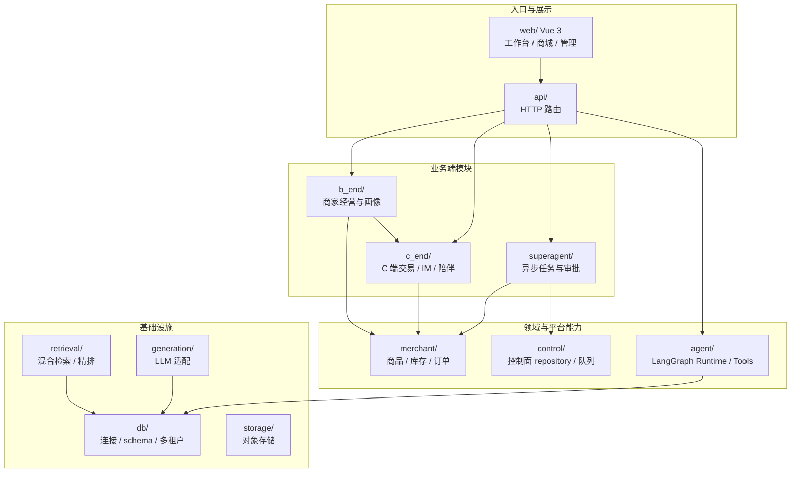

# 如何拆分系统模块

> 模块拆分的本质不是“把文件分到不同目录”，而是决定**哪些变化应该被隔离、哪些数据必须只有一个所有者、哪些边界不能被跨过**。

## 1. 为什么需要拆分系统模块

一个不断增长的系统如果没有任何模块边界，最终会变成：

```text
改一个功能要读十几个文件
一个模块修改引发另一个模块故障
权限与租户过滤散落在各处，无法确认是否遗漏
想单独部署或替换某个能力时发现到处是隐式依赖
```

模块拆分的收益是隔离复杂度、降低变更影响面、明确 ownership；代价是接口、通信、数据一致性和治理成本。拆分不是越多越好，错误的拆分比不拆更贵。

## 2. 基本机制

拆分的核心判断是**内聚**与**耦合**：

```text
内聚：一个模块内部的东西是否因为同一个原因变化
耦合：两个模块之间是否存在隐式知识共享
```

常见的拆分轴：

| 拆分轴 | 问题 | 例子 |
|---|---|---|
| 业务能力 | 这块能力是否服务同一类业务目标？ | 商家经营分析、C 端交易、管理端审计 |
| 变更原因 | 哪些代码总是一起改？ | 订单状态机与售后流程 |
| 数据所有权 | 谁拥有这张表、谁能写？ | 商家库、控制面、向量库 |
| 安全边界 | 是否有不同的权限与租户范围？ | 平台管理端 vs 商家端 |
| 部署需求 | 是否需要独立扩缩容或隔离故障？ | 异步 Worker、模型推理 |
| 团队 ownership | 谁负责维护与值班？ | B 端、C 端、平台 |

先按变化原因和数据所有权拆，再按部署拆。把部署单元当成模块边界，通常会得到“分布式单体”。

## 3. 总体架构

以 Qianke 当前代码为例，模块大致按“入口 → 业务端 → 领域/基础设施”分布：



这张图是**职责地图**，不是严格的依赖方向。真实代码中仍存在跨端 import 与共享实现，这些正是后续要收敛的耦合点。

## 4. 关键设计

**边界优先于粒度。** 先把“平台 / 商家 / C 端 / 管理端”的权限与数据边界划清，再讨论目录怎么分。Qianke 的三端决策先规定 C/B/A 三端 Graph 与 API 独立、共享 Runtime 与 Tool 框架，然后才给出 Monorepo 目录建议。

**数据所有权单一。** 每张表、每类数据必须有明确的所有者与写入入口。例如商家订单归 `merchant/` 的 Repository，控制面任务表归 `control/`，Agent 不直接写库。否则拆分后会出现多个模块同时写同一张表，边界名存实亡。

**契约放在边界上。** 模块之间共享 Protocol、数据模型、结构化错误码，而不是共享内部实现。Qianke 的 `MerchantRepository` / `MerchantWriteRepository` 协议与 `get_merchant_repository()` 工厂让 SQLite 与 PostgreSQL 可以互换；`Tool` / `ToolResult` 让 Agent 与具体工具解耦。

**拆分要算迁移成本。** 把 `src/rag_demo` 直接改成 `apps/packages/services` 会破坏 import、Docker 构建、测试路径与部署脚本。Qianke 的迁移清单因此先做现状盘点、目标映射和分阶段计划，而不是一次性搬目录；并明确“先模块化、后拆部署”。

## 5. 工程实现

Qianke 当前包结构（`src/rag_demo/`）与目标结构（`docs/decisions/monorepo-migration-inventory-v0.1.md`）：

```text
agent/  Runtime/State/Tool        api/       FastAPI 路由
b_end/  商家经营/画像/洞察         c_end/     C 端交易/IM/推荐/陪伴
superagent/ 任务/队列/审批         merchant/  商品/库存/订单（Repository 协议）
control/ 控制面 Repository/队列    retrieval/ RAG 混合检索/精排
generation/ LLM 调用               db/        连接/schema/多租户
storage/ 对象存储                  tools/     运维与校验脚本（非 Agent Tool）
```

目标结构把 `agent/loop.py` 拆到 `packages/agent-runtime/` 与 `agents/b_agent/graph.py`，把 `agent/tools/sql.py` 拆到 `services/merchant-data-access/` 与 B Tool adapter。现状也暴露了真实难点：`c_end/store.py` 约 6,578 行、`superagent/store.py` 约 1,202 行（2026-11-23 当前文件总行数，含空行），单文件同时承担 schema、查询、状态迁移，说明按端拆目录之后仍需继续按变化原因拆分存储实现。

## 6. 企业级要求

| 维度 | 模块拆分时必须保证 |
|---|---|
| 安全 | 模块边界不能成为绕过权限检查的路径 |
| 租户 | 数据访问集中在少数入口，避免各处手写过滤条件 |
| 一致性 | 跨模块事务边界明确，不能假设分布式事务 |
| 可观测 | 每个模块的失败、延迟、队列积压可独立观察 |
| 演进 | 模块接口向后兼容，废弃有迁移与下线计划 |
| 团队 | 模块 owner 明确，跨团队依赖有契约与评审 |

企业系统中最危险的不是模块太小，而是“看起来拆了、实际共享数据库和内部实现”。这种拆分只会增加调用成本，不提供隔离收益。

## 7. 方案对比

| 方案 | 优点 | 代价 | 适用场景 |
|---|---|---|---|
| 按技术分层 | 结构统一、易理解 | 业务变化横跨多层，改动分散 | 早期项目、技术栈统一 |
| 按业务领域 | 变更集中、边界清晰 | 需要领域建模与团队对齐 | 中大型业务系统 |
| 按端/团队 | ownership 清晰、发布独立 | 公共能力容易重复或耦合 | 多端产品、多团队 |
| 模块化单体 | 隔离收益高、部署简单 | 需要依赖约束与契约测试 | 多数企业应用的起点 |
| 微服务 | 独立部署、故障隔离 | 分布式复杂度高 | 边界稳定且负载确有需要 |

Qianke 当前是“模块化单体的雏形”：一个 Python 包、多业务目录、部分独立进程（Super-agent Worker）。这是成本与收益平衡后的阶段性选择。

## 8. Qianke Engine 实践

| 拆分实践 | 证据 | 状态 |
|---|---|---|
| 按端拆业务模块 | `b_end/`、`c_end/`、`superagent/` | 已实现 |
| 商家领域数据层独立 | `merchant/` + Repository 协议 + SQLite/PG adapter | 已实现 |
| 控制面存储抽象 | `control/repository`、`factory.py`、双后端 | 已实现 |
| Agent Runtime 与 Tool 分层 | `agent/loop.py`、`registry.py`、`tools/` | 已实现 |
| 目标 Monorepo 结构 | `docs/decisions/three_agent_platform_architecture_decisions_v0.1.md` §14 | 已设计，未实施 |
| 迁移映射与分阶段计划 | `docs/decisions/monorepo-migration-inventory-v0.1.md` | 已设计 |
| 模块依赖边界 CI | 目标要求 CI 检查跨端依赖 | 规划中 |
| 大文件继续按变化原因拆分 | `c_end/store.py`、`superagent/store.py` 规模已盘点 | 部分实现 / 待继续 |

一个值得学习的点是“拆分必须先修安全边界”。迁移清单的结论是：在租户绑定和 `request_id` 幂等没有修好之前，先不要做 C 端与新目录，否则只是把不安全的结构搬进更复杂的目录。这说明拆分顺序应服从风险，而不是服从目录美观。

## 9. 评估 / 验收

```text
[ ] 每个模块有明确职责与 owner
[ ] 每类数据只有一个写入入口
[ ] 模块间通过契约交互，不共享内部实现
[ ] 跨模块变更能定位受影响测试与调用方
[ ] 拆分后构建、测试、部署路径仍可工作
[ ] 安全与租户过滤没有被拆分路径绕过
```

可执行的验证包括：契约测试（如控制面 SQLite/PG 双后端）、租户隔离测试、import 边界检查、模块级性能基线。Qianke 已具备前两类测试，依赖边界检查仍未落地。

## 10. 常见误区

1. 按文件类型拆（models、services、utils），业务改动仍然横跨所有目录。
2. 先拆微服务，再补领域边界与数据所有权。
3. 共享数据库表却宣称模块独立。
4. 模块之间通过直接 import 内部函数“复用”，形成隐式耦合。
5. 为了目录整齐做一次性大迁移，破坏构建与测试。
6. 没有 owner 的模块最终无人维护。
7. 把“拆得细”当成“架构好”，忽略接口与治理成本。

## 11. 总结

```text
模块拆分 = 变化隔离 + 数据所有权 + 契约边界
```

1. 先按变化原因和数据所有权拆，再考虑部署拆分。
2. 契约（Protocol / Schema / 错误码）比共享实现更重要。
3. 模块化单体通常是企业应用的合理起点。
4. 拆分顺序应服从风险：先修安全边界，再搬目录。

## 12. 延伸阅读

项目内部资料：

- `docs/decisions/monorepo-migration-inventory-v0.1.md`：现状、目标映射与迁移顺序
- `docs/decisions/three_agent_platform_architecture_decisions_v0.1.md`：三端边界与目录建议
- `src/rag_demo/merchant/`：Repository 协议与工厂
- `src/rag_demo/control/`：控制面存储抽象

外部资料：

- Martin Fowler，微服务与单体权衡：https://martinfowler.com/articles/microservices.html
- Martin Fowler，MonolithFirst：https://martinfowler.com/bliki/MonolithFirst.html
- C4 model：https://c4model.com/
