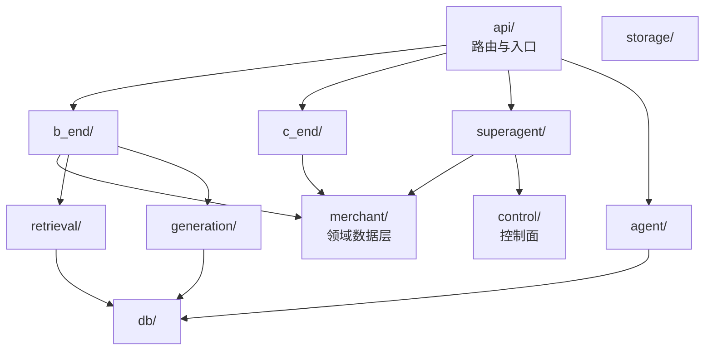

# 如何设计模块依赖关系

> 模块拆得再漂亮，只要依赖方向失控，系统仍然会退化成一张互相纠缠的网。
> 依赖设计的核心任务是：**规定谁可以依赖谁，并让这条规定可以被检查。**

## 1. 为什么需要设计依赖关系

依赖是变化的传导路径。A 依赖 B 的内部实现，意味着 B 的修改可能破坏 A；如果两端互相依赖，修改就无法独立进行。常见的依赖问题：

```text
循环依赖：改 A 要改 B，改 B 又要改 A
反向依赖：领域层反向 import API 层，测试时必须启动整个应用
隐式依赖：函数不接收参数，直接读全局/上下文，调用方无法从签名看出前置条件
跨端直连：C 端模块直接 import B 端内部实现，边界形同虚设
```

依赖问题在编译期可能只是 import 报错，在运行时则表现为初始化顺序、循环导入、线程上下文丢失、测试无法隔离。企业系统还需要依赖关系承载租户与权限边界，因此不能只当作代码风格问题。

## 2. 基本机制

**依赖方向应指向更稳定的东西。** 业务策略比框架、数据库、外部服务更稳定，因此通常由业务层定义接口，基础设施层实现接口，而不是反过来。这就是依赖倒置原则（DIP）。

**依赖必须无环。** 有环依赖意味着无法独立理解、测试、部署任何一个模块。无环依赖原则（ADP）要求把依赖组织成有向无环图（DAG）。

**显式依赖优先于隐式依赖。** 通过参数、构造函数、工厂注入依赖，比在函数内部直接 import 具体实现或读取全局状态更容易测试与替换。

**运行时依赖也要设计。** 除了 import 依赖，还有调用链、数据库连接、ContextVar、线程池、消息队列等运行时依赖。Qianke 的 `merchant_scope` / `dataset_scope` 就是运行时依赖：API 层不传参数给每个函数，而是通过 ContextVar 传递可信上下文，因此必须额外保证线程边界不丢上下文。

## 3. 总体架构

以 Qianke 当前代码的 import 关系为例，理想的依赖方向大致如下：



这张图表达的是**期望方向**：入口依赖业务，业务依赖领域与基础设施，基础设施不反向依赖业务。真实代码并非完全符合，存在若干跨层 import，后文会列出并说明其性质。

## 4. 关键设计

**分层规则。** 常见分法是入口层（API/CLI）、应用层（编排用例）、领域层（业务规则与数据所有权）、基础设施层（DB/缓存/外部服务）。规则是：入口可以依赖应用，应用可以依赖领域和基础设施接口，领域不依赖入口与具体基础设施实现。

**通过接口与工厂隔离实现。** 上层只依赖 Protocol/抽象类，具体实现由工厂在运行时选择。Qianke 的 `MerchantRepository` 与 `get_merchant_repository()` 让业务代码不关心 SQLite 还是 PostgreSQL；`control/factory.py` 根据 `backend()` 返回 SQLite 或 PostgreSQL repository。这样替换后端不需要改调用方。

**跨端调用走契约，不直接 import 内部实现。** 三端架构决策要求 C/B/A 三端维护独立 Graph 与 API，共享的是 Runtime、Tool 框架、认证基础设施等稳定能力，而不是各端业务实现。端与端之间的直接内部依赖应被视为需要收敛的债务。

**隐式上下文依赖必须显式建模。** 可信 `dataset` 与 `merchant_id` 不能来自 LLM 参数，而应由服务端上下文提供。Qianke 的做法是 `dataset_scope()` / `merchant_scope()` 在入口建立作用域，领域代码通过 `current_dataset()` / `require_merchant_id()` 读取，缺失时失败关闭。代价是：ContextVar 不会自动跨线程传播，`_run_with_deadline` 的 deadline 线程必须在执行线程内部重新建立 scope。

## 5. 工程实现

Qianke 中已有的依赖设计实践（可核验代码）：

```python
# src/rag_demo/control/factory.py
def get_control_repository(*, schema: str | None = None):
    if backend() == "postgres":
        return PostgresControlRepository(schema=schema)
    return SQLiteControlRepository()
```

```python
# src/rag_demo/merchant/context.py（节选）
def run_in_merchant_scope(fn, merchant_id: str, *, source: str = "runner"):
    """在线程入口显式建立 scope；ContextVar 不会自动跨线程传播。"""
    with merchant_scope(merchant_id, source=source):
        return fn()
```

`agent/service.py` 在进入 Agent 执行前同时建立 `dataset_scope` 与 `merchant_scope`，这就是“运行时依赖显式化”的落点。调用方从签名看不出这两个依赖，因此必须靠测试和文档约束，不能随意重排执行顺序。

现存的不理想依赖（已核验 import，属于待收敛债务）：

| 位置 | 依赖 | 问题 |
|---|---|---|
| `agent/tools/chat_profile.py` | `b_end.identity`、`c_end.store` | Agent Tool 直接依赖两个业务端的内部实现 |
| `b_end/user_pool.py` | `c_end.store` | B 端模块直接读 C 端存储 |
| `control/sqlite_repository.py` | `c_end`、`superagent` | 基础设施适配器反向依赖业务模块 |

这些依赖不一定是错误设计——它们记录了系统从单包快速演进的历史。但如果要继续拆部署或做三端统一 Runtime，就必须通过接口、事件或适配器把它们收敛掉。

## 6. 企业级要求

| 维度 | 依赖设计必须保证 |
|---|---|
| 安全 | 依赖链上只有一个可信身份/租户来源，不能由下层绕过检查 |
| 数据 | 数据访问只经过领域仓库或统一数据访问层，不允许多个模块直连同一张表 |
| 故障隔离 | 外部服务依赖有超时、降级、错误码，不能无限向上传播 |
| 可测试 | 业务逻辑可以在不启动数据库/模型的情况下用替身测试 |
| 可演进 | 依赖接口而非实现，替换后端不影响业务代码 |
| 可观测 | 依赖调用有 trace/日志，能定位是哪一层慢或失败 |

依赖图同时也是**信任边界图**。如果 C 端模块可以直接 import B 端实现，那么“C 端不能访问 B 端数据”这种安全声明就很难在代码层被保证。

## 7. 方案对比

| 方式 | 优点 | 缺点 | 适用场景 |
|---|---|---|---|
| 直接 import 具体实现 | 简单、调用快 | 耦合强、无法替换、测试困难 | 同模块内部、极小项目 |
| 接口 + 工厂/依赖注入 | 可替换、可测试 | 多一层抽象，代码量增加 | 跨模块、需要替换实现 |
| 进程内事件/回调 | 解耦发送方与接收方 | 调试链路变长，顺序不直观 | 旁路通知、审计、缓存失效 |
| HTTP/RPC | 边界清晰、可独立部署 | 网络故障、延迟、版本兼容 | 跨团队、跨部署单元 |

大多数企业项目应从“接口 + 工厂/DI”开始，只在有真实独立部署或异步需求时才引入 RPC/MQ。Qianke 的 Super-agent 使用独立队列与 Worker，是因为异步任务的生命周期与主请求不同，而不是因为“微服务更先进”。

## 8. Qianke Engine 实践

| 依赖实践 | 证据 | 状态 |
|---|---|---|
| 商家数据层协议 + 工厂 | `merchant/repository.py`、`merchant/factory.py` | 已实现 |
| 控制面 repository 工厂与双后端 | `control/factory.py`、`sqlite_repository.py`、`postgres_repository.py` | 已实现 |
| 可信数据集上下文 | `agent/context.py::dataset_scope` | 已实现 |
| 商家可信上下文 | `merchant/context.py::merchant_scope` | 已实现 |
| 线程边界重新建立上下文 | `run_in_merchant_scope`；M0 计划记录 deadline 线程风险 | 已实现（基础设施）/ 部分实现（全链路验证） |
| 三端依赖方向规则 | 三端决策 §3.3 要求 CI 检查跨端依赖 | 已设计，未实施 |
| 现存的跨层 import 收敛 | 见 §5 表格，尚未建立统一约束 | 部分实现 / 规划中收敛 |

值得注意的是，Qianke 已经踩过“隐式上下文”的坑并有文档记录：Merchant Dashboard M0 审查发现 `merchant_scope` 只在 API 请求线程设置，不会自动进入 `_run_with_deadline` 的 deadline 线程，因此要求在 Agent 执行线程内部重新建立上下文。这是依赖设计中“运行时依赖”必须显式处理的最好例子。

## 9. 评估 / 验收

```text
[ ] 依赖图有明确方向，且不存在环
[ ] 入口/业务/领域/基础设施的分层规则可执行
[ ] 领域层不直接依赖具体数据库、模型服务或 API 层
[ ] 替换后端实现不需要修改业务代码
[ ] ContextVar 等隐式上下文在异步/线程边界有测试覆盖
[ ] 跨端依赖有清单与收敛计划
```

检查方法示例（本次未运行，仅给出可执行方式）：

```bash
rg "^from rag_demo\.c_end" src/rag_demo/agent src/rag_demo/b_end
rg "^from rag_demo\.b_end" src/rag_demo/c_end src/rag_demo/control
```

## 10. 常见误区

1. 只检查 import 是否报错，不检查运行时上下文与线程边界。
2. 用共享数据库表代替接口，表面解耦、实际直连。
3. 公共工具模块无限膨胀，成为所有模块的隐式依赖。
4. 为了避免循环 import 在函数内部 import，掩盖了设计问题。
5. 把 ContextVar 当作全局变量随意读写，不规定建立与失效边界。
6. 先拆服务再补接口，产生大量跨服务强耦合调用。

## 11. 总结

```text
依赖设计 = 方向 + 无环 + 契约 + 运行时边界
```

1. 依赖应指向更稳定的抽象，而不是具体实现。
2. 显式依赖（参数/工厂/接口）优先于隐式依赖（全局状态/ContextVar）。
3. 运行时上下文与线程边界必须纳入依赖设计。
4. 依赖规则要有检查手段，否则会随着交付压力失效。

## 12. 延伸阅读

项目内部资料：

- `src/rag_demo/merchant/repository.py`、`src/rag_demo/merchant/factory.py`：协议与工厂
- `src/rag_demo/control/factory.py`：控制面后端切换
- `src/rag_demo/agent/context.py`、`src/rag_demo/merchant/context.py`：可信上下文
- `docs/product/merchant-dashboard-v1.1-m0-architecture-plan.md`：线程传播风险记录

外部资料：

- Martin Fowler，依赖注入：https://martinfowler.com/articles/injection.html
- Robert C. Martin，无环依赖原则（ADP）：https://web.archive.org/web/20150905084504/http://www.objectmentor.com/resources/articles/granularity.pdf
- Python contextvars 官方文档：https://docs.python.org/3/library/contextvars.html
