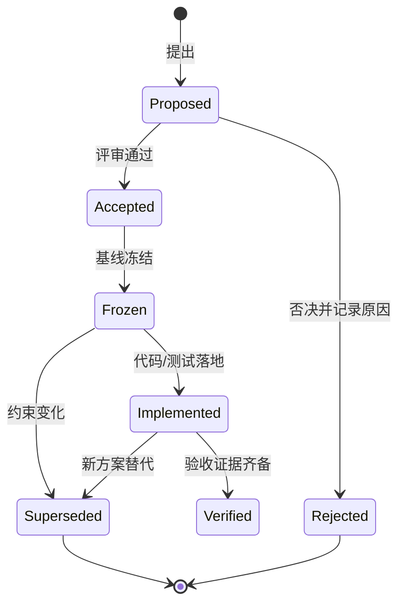

# ADR 架构决策记录

> ADR 的价值不是“留一份文档”，而是让未来的工程师知道：
> **当时有哪些选择、为什么选这个、代价是什么、什么时候应该推翻它。**

## 1. 为什么需要 ADR

架构决策会长期影响系统，但决策过程往往只存在于会议、聊天记录和个人记忆里。几个月后常见的问题：

```text
为什么当初选 PostgreSQL 而不是别的？
为什么 C 端没有复用主 Agent Runtime？
为什么这里要保留 SQLite 双后端？
这个限制是谁加的，能不能删？
上次不是讨论过这个方案吗，为什么又被否决？
```

没有记录时，团队会重复讨论、重复犯错，新人只能从代码反推意图，而代码通常无法表达“被否决的方案”和“当时的约束”。

ADR（Architecture Decision Record）用简短、结构化、可版本化的文档记录一次决策，并保留其上下文与后果。它不追求完整设计文档，而是保留决策的“为什么”。

## 2. 基本机制

一份 ADR 通常包含：

| 部分 | 内容 |
|---|---|
| 标题与编号 | 唯一、稳定、可引用 |
| 状态 | 提议 / 已接受 / 已冻结 / 已实施 / 已废弃 / 被替代 |
| 上下文 | 问题、约束、相关需求与风险 |
| 决策 | 选了什么，边界是什么 |
| 备选方案 | 还考虑过什么，为什么没选 |
| 后果 | 正向影响、代价、风险、迁移与回滚 |
| 证据 | 代码路径、测试、PoC、验收条件 |
| 关联 | 需求、设计文档、其他 ADR |

几条关键规则：

```text
一个 ADR 只记录一个决策（或一组不可分割的决策）
决策一旦接受，不改原文，用新 ADR 标记“替代”
状态必须诚实：设计完成不等于已实施，已实施不等于已验证
必须写“被否决的方案”，否则无法判断决策质量
```

## 3. 总体架构

ADR 的生命周期：



仓库中的组织方式通常是：

```text
docs/decisions/
  ADR-0001-xxx.md
  ADR-0002-xxx.md
  index.md            # 可选：决策索引与状态总览
```

Qianke 当前使用 `docs/decisions/` 目录，但尚未形成统一编号与索引，后文会具体说明。

## 4. 关键设计

**决策与设计文档分开。** 设计文档描述“系统怎么工作”，ADR 描述“为什么这样选、放弃了什么”。一个设计文档可以引用多份 ADR；一份 ADR 不应承载完整设计细节。

**必须记录备选方案。** 只有最终方案而没有备选方案的 ADR，无法证明决策经过比较。备选方案不一定要很长，但要写清放弃原因。Qianke 的 ADR-0002 专门列出方案 A/B/C/D 及放弃原因，这是高质量做法。

**后果要写代价。** 只写优点的 ADR 是宣传材料。代价至少包括：实现复杂度、运维成本、迁移风险、对团队能力的要求、未来可能的技术债。

**状态与证据绑定。** “已实施”应有代码路径与测试；“已验证”应有验收记录与运行证据。Qianke 的控制面迁移方案把 P1/P2/P3 实施记录单独链接，形成“决策 → 实施 → 证据”的链条，值得复用。

**不可逆决策需要更正式。** 数据库、租户隔离方式、对外契约、安全边界属于高影响决策，应经过评审、记录风险与回滚；可逆的小决策可以轻量记录。

## 5. 工程实现

一个轻量 ADR 模板（伪模板，不是仓库现有文件）：

```text
标题：ADR-XXXX：一句话决策标题
状态：提议 / 已接受 / 已冻结 / 已实施 / 已替代
日期、决策人、关联需求/设计/代码
背景与问题
决策（做什么、不做什么）
备选方案与放弃原因
后果（正向、代价、风险）
迁移与回滚
验证证据
关联 ADR 与参考
```

Qianke 的 `docs/decisions/merchant_dashboard_v1_1_m0_adr.md` 是一份接近标准 ADR 的实例，结构包括：背景与问题；五项架构决策（状态、选择、理由、实现约束）；三项不可违反边界；八项 M0 验收条件（通过条件与证据）；M1 实施边界（允许范围、明确不做、开始前条件）；影响面（正向、代价、不引入）；备选方案与放弃原因（A/B/C/D）；状态说明（完成什么、不代表什么）。

其中“状态说明”一节尤其重要：它明确写出“本文档完成的是决策冻结与验收定义，不代表 M0 验收完成，也不代表可以开始 M1 编码”。这种边界声明能防止文档被误读为进度承诺。

另一个案例是控制面 PostgreSQL 迁移：主文档记录结论、现状、目标架构、类型映射、代码改造、回填、切换、回滚、阶段计划、验收与风险；P1/P2-A/P2-B/P3-A/P3-B 分别有独立实施记录。这实际上形成了“ADR + 实施日志”的组合，但主文档没有编号，检索与引用不如标准 ADR 方便。

## 6. 企业级要求

| 维度 | ADR 治理要求 |
|---|---|
| 审计 | 关键决策可追溯到决策人、时间、依据与批准记录 |
| 合规 | 涉及安全、隐私、资金的决策必须留痕并定期复审 |
| 变更 | 决策被替代时保留旧记录，不覆盖历史 |
| 一致性 | 决策与代码、测试、运行配置不能长期矛盾 |
| 可发现 | 有索引、编号、标签与交叉链接 |
| 生命周期 | 有 owner、复审周期与废弃机制 |

对受监管行业，ADR 还是审计证据的一部分：它证明组织在做出高风险选择时进行了评估，而不是事后解释。

## 7. 方案对比

| 形式 | 优点 | 缺点 | 适用场景 |
|---|---|---|---|
| ADR | 短、聚焦决策、可版本化 | 不承载完整设计，需要配套文档 | 架构与技术选型决策 |
| 设计文档 | 完整、可指导实现 | 决策理由容易被细节淹没 | 复杂方案设计 |
| RFC | 评审充分、跨团队共识 | 流程重、周期长 | 平台级、跨团队变更 |

实际项目通常组合：RFC 用于重大跨团队方案，ADR 记录最终决策，设计文档负责实现细节。Qianke 目前的实践更接近“设计文档 + 决策文档”混合，尚未形成统一流程。

## 8. Qianke Engine 实践

| 文档 | 内容 | 状态 |
|---|---|---|
| `docs/decisions/merchant_dashboard_v1_1_m0_adr.md`；`docs/product/merchant-dashboard-v1.1-m0-closure.md` | ADR-0002：Dashboard V1.1 M0 架构基线与 M1 边界；M0 收口证据见 closure 文档 | 已实现（M0 ACCEPTED 2026-11-22；M1 未批准） |
| `docs/decisions/control_plane_postgres_migration_v0.1.md` | 控制面 PostgreSQL 迁移方案 + P1–P3 实施记录 | 已实现（P1–P3 已实施，生产观察待补） |
| `docs/decisions/three_agent_platform_architecture_decisions_v0.1.md` | 三端平台架构决策基线 | 已设计（待技术验证与正式评审） |
| `docs/decisions/monorepo-migration-inventory-v0.1.md` | Monorepo 迁移盘点与计划校准 | 已设计（待评审） |
| 统一 ADR 模板 / 编号规则 / 索引 | 仓库中未见 | 待核验 / 规划中 |
| ADR 与代码、测试的自动关联 | 目前靠人工在文档里引用 | 规划中 |

Qianke 的优点是关键决策确实被写下来了，而且写清楚了“不做什么”和“什么不代表已完成”。例如三端决策把决策分为“已确认 / 第一版约束 / 待验证”三类，并保留 12 项待确认决策清单；这比把所有内容都写成确定结论更可信。

缺口也很明确：`docs/decisions/` 里只有 ADR-0002 使用编号，其余是方案/盘点文档；没有统一模板、索引和状态字段；部分决策散落在 `docs/product/` 与 `docs/design/`。这意味着新人很难快速回答“当前有哪些生效中的架构决策”。这是后续治理的优先项，而不是靠再写一份总览文档就能解决。

## 9. 评估 / 验收

```text
[ ] 每个高影响决策都有一份 ADR
[ ] ADR 包含背景、决策、备选方案、后果
[ ] 状态与实际实施进度一致
[ ] “不做”和“不引入”边界写清楚
[ ] 有验收条件与证据形式
[ ] 被替代的 ADR 保留并标记 superseded
[ ] ADR 可从设计文档、代码或索引找到
```

评审 ADR 时可以问四个问题：这个决策解决了什么问题？还考虑过什么？代价是什么？什么时候应该重新评估？答不上来，说明 ADR 还不完整。

## 10. 常见误区

1. 把 ADR 写成设计文档，重点放在实现细节而不是决策理由。
2. 只写最终方案，不写被否决的备选方案。
3. 状态永远停在“已接受”，与实际代码脱节。
4. 决策变化后直接改旧 ADR，丢失历史。
5. ADR 没有编号和索引，写完就找不到。
6. 每个小改动都写 ADR，流程过重导致没人执行。

## 11. 总结

```text
ADR = 决策 + 理由 + 备选方案 + 后果 + 状态证据
```

1. ADR 记录的是“为什么”，不是完整设计。
2. 备选方案与代价是判断决策质量的关键。
3. 状态必须诚实，设计、实施、验证分开标注。
4. 编号、索引与关联关系决定 ADR 能否被真正使用。

## 12. 延伸阅读

项目内部资料：

- `docs/decisions/merchant_dashboard_v1_1_m0_adr.md`：接近标准 ADR 的实例
- `docs/decisions/control_plane_postgres_migration_v0.1.md`：决策 + 迁移 + 回滚
- `docs/decisions/three_agent_platform_architecture_decisions_v0.1.md`：决策状态分类与待确认清单
- `docs/handbook/_meta/reviews/`：文档评审与修订记录

外部资料：

- Michael Nygard，Documenting Architecture Decisions：https://cognitect.com/blog/2011/11/15/documenting-architecture-decisions
- ADR 社区与模板：https://adr.github.io/
