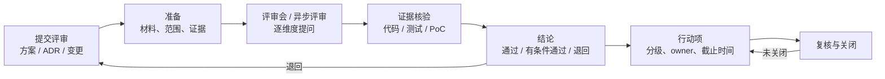

# 架构评审方法

> 架构评审不是“给方案挑毛病”，而是用证据回答：
> **这个设计能否在给定约束下达成目标，失败时是否可控，未来是否可演进。**

## 1. 为什么需要架构评审

架构问题发现得越晚，修复成本越高：

```text
上线前发现租户边界缺失 → 数据模型与接口大改
实现完成后发现权限只在 Prompt 里 → 需要补服务端授权链路
发布后才发现没有失败终态与告警 → 先救火再补设计
评审时没人提出替代方案 → 方案进入实施后无法回头
```

评审的价值在于：提前暴露高风险假设、让不同角色对边界达成共识、留下可追溯的决策依据、把“个人判断”变成“可复核的证据”。但评审也可能流于形式：只开会不读材料、只提意见不给结论、结论没有 owner 与截止时间。

## 2. 基本机制

架构评审的基本要素：

| 要素 | 说明 |
|---|---|
| 评审对象 | 架构方案、ADR、设计文档、关键代码变更 |
| 评审输入 | 需求与约束、架构视图、风险清单、验证证据 |
| 评审维度 | 目标、边界、安全、数据、失败、运维、演进、成本 |
| 评审证据 | 代码路径、测试、PoC、压测、schema 契约 |
| 评审结论 | 通过 / 有条件通过 / 退回修改 |
| 行动项 | 问题、分级、owner、截止时间、验证方式 |

结论必须可执行。“整体不错，建议再优化”不是评审结论；“P0：租户上下文未进入 Agent 执行线程，需补线程内 scope 建立与 A/B 越权测试，M1 前完成”才是。

## 3. 总体架构



评审类型可以按目标区分：

```text
架构评审：边界、质量属性、演进、风险
设计评审：接口、数据模型、时序、异常
安全评审：身份、权限、租户、注入、审计
代码评审：实现质量、契约一致性、可维护性
文档评审：事实准确性、状态标注、可读性
```

## 4. 关键设计

**证据优先于观点。** 评审意见应能指向具体材料：代码、测试、文档、PoC 数据。Qianke 的 V0.1 技术审核逐条列出代码位置、实际行为与修正建议，并把“34 passed”明确限定为只覆盖已运行测试，不替所有结论背书，这是证据式评审的范例。

**分级而不是笼统反对。** 问题按影响分级：P0 阻断（安全、数据正确性、不可上线）、P1 重要（可靠性、可维护性、验收缺口）、P2 优化（表达、风格、后续项）。分级让团队知道哪些必须现在改、哪些可以排期。

**同时评审“不做什么”。** 范围与非目标是架构的一部分。只评审目标方案，不检查是否偷偷扩大范围，会导致实施阶段失控。M0 类评审应把“允许修改范围 / 明确不做 / 开始前条件”一起冻结。

**结论与条件分离。** “有条件通过”必须写清条件、验证方式和截止时间；条件未满足不能视为通过。Qianke 的设计评审文档中出现过“评审有条件通过不等于用户批准上线”的表述，这种边界声明应成为惯例。

**评审要覆盖失败路径。** 正常路径通常写得最完整，真正风险在超时、重试、并发、回滚、降级、租户越权与数据迁移。评审清单应强制覆盖这些内容。

**行动项闭环。** 没有跟踪的评审等于没评审。行动项至少要有 owner、状态、验证证据与关闭时间；重大风险未关闭前，应有明确的放行或接受决策。

## 5. 工程实现

一个可复用的架构评审清单：

```text
目标：是否解决了真实问题？成功标准是否可验证？
边界：模块/租户/端/数据边界是否明确？是否有禁止项？
安全：身份来源是否可信？权限在哪一层执行？Prompt 能否绕过？
数据：谁拥有数据？读写路径是否唯一？迁移与回滚是什么？
失败：超时、重试、幂等、取消、降级、恢复如何设计？
运维：日志、指标、trace、告警、容量与成本是否覆盖？
演进：接口是否兼容？模块能否替换？是否引入不可逆锁定？
证据：关键结论有代码/测试/PoC 支撑吗？
```

Qianke 的评审实践有三种典型形态：

1. **文档技术审核。** `docs/handbook/_meta/reviews/01-enterprise-agent-architecture-v0.1-technical-review.md` 逐条核对文档与代码，结论是“需修订后复审”，并列出 5 项技术错误、4 项设计不完整、2 项表达优化，每项都有代码依据与修改建议。
2. **编码前代码审查。** `docs/product/merchant-dashboard-v1.1-code-review.md` 在实现前确认现有模块可复用性与 5 个真实缺口，指出命名冲突、schema 双来源、队列复用边界，先冻结方案再进入编码。
3. **架构决策评审。** Merchant Dashboard V1.1 的 M0 计划与 ADR-0002 定义八项验收条件，每项都要求证据（pytest 输出、DDL diff、契约测试、隔离测试）；“M0 架构计划完成不等于 M0 验收完成”被明确写出。

这三种形态共同的优点是：**评审材料可核验、结论有分级、后续有验证条件。** 但还没有形成统一模板、评审记录索引与 CI 门禁。

## 6. 企业级要求

| 维度 | 评审治理要求 |
|---|---|
| 安全与合规 | 高风险变更必须有安全/合规评审与签字 |
| 数据 | 涉及 schema、迁移、删除的变更必须有回滚与恢复演练 |
| 租户 | 多租户变更必须验证跨租户隔离，不接受“理论上不会” |
| 可用性 | 关键链路必须有降级与故障演练结论 |
| 审计 | 评审结论、参与人、风险接受记录可追溯 |
| 流程 | 评审在开发前/合并前/上线前的门禁位置明确 |
| 跟踪 | 行动项有 owner、截止时间与关闭证据 |

企业级评审还要允许“风险接受”存在：某些问题在当前阶段不修，但必须有明确的接受人、理由、影响范围与复审时间，而不是被忽略。

## 7. 方案对比

| 形式 | 优点 | 缺点 | 适用场景 |
|---|---|---|---|
| 正式评审会 + 材料 | 充分讨论、跨角色对齐 | 组织成本高，容易变成宣讲 | 重大架构、跨团队变更 |
| 异步文档评审 | 可留痕、可逐条回复 | 互动弱，容易拖期 | 远程团队、普通设计变更 |
| 清单式快速评审 | 成本低、覆盖关键风险 | 深度有限 | 小变更、例行检查 |
| 代码评审代替架构评审 | 贴近实现 | 发现问题太晚，难改结构 | 局部实现修改 |
| ATAM 等正式方法 | 系统化权衡质量属性 | 重、需要培训 | 高复杂度、高风险系统 |

多数团队应组合使用：重大变更用正式评审，普通变更用异步文档 + 清单，代码评审兜底实现质量。不要用代码评审替代架构评审。

## 8. Qianke Engine 实践

| 评审实践 | 证据 | 状态 |
|---|---|---|
| 文档技术审核与复审 | `docs/handbook/_meta/reviews/01-enterprise-agent-architecture-v0.1-technical-review.md` | 已实现 |
| 修订记录与未解决问题跟踪 | `docs/handbook/_meta/reviews/*-revision-log.md` | 已实现（部分） |
| 编码前代码审查 | `docs/product/merchant-dashboard-v1.1-code-review.md` | 已实现 |
| M0 架构计划评审 | `docs/product/merchant-dashboard-v1.1-m0-architecture-plan.md` | 已实现 |
| 决策评审与验收条件 | `docs/decisions/merchant_dashboard_v1_1_m0_adr.md` | 已实现 |
| 统一评审模板与记录索引 | 仓库中未见 | 待核验 / 规划中 |
| 评审门禁进入 CI / 发布流程 | 未见自动化门禁 | 规划中 |

值得复用的一点是“评审对象版本必须对齐”。V0.1 审核报告发现审核意见提到的行数与工作区文件不一致，于是明确声明“本报告以工作区当前版本为依据，不能用它替另一个快照背书”。这类版本声明能避免评审结论被错误引用。

另一个值得复用的点是“问题总表”。该审核报告用 R-01 到 R-11 编号列出问题、严重级别、位置与类型，后续修订可以逐项关闭。相比散落在会议纪要里的意见，编号化问题更容易跟踪。

## 9. 评估 / 验收

```text
[ ] 评审对象、版本、范围明确
[ ] 材料包含需求约束、架构视图、风险与证据
[ ] 评审覆盖安全、数据、失败、运维、演进
[ ] 问题有编号、分级、位置与建议
[ ] 结论为通过 / 有条件通过 / 退回，且条件可验证
[ ] 行动项有 owner、截止时间与关闭证据
[ ] 重大风险有接受人或修复计划
[ ] 评审记录可检索、可追溯到决策与代码
```

评审效果可以用指标观察：发现的 P0/P1 问题数、返工量、行动项关闭率、平均评审周期、上线后因设计问题导致的故障数。指标不是考核工具，而是判断评审是否有效。

## 10. 常见误区

1. 评审会变成方案宣讲，没有人提前读材料。
2. 只评审正常路径，不检查失败、迁移与回滚。
3. 只给意见不给结论，问题没有 owner 与截止时间。
4. 把“有条件通过”当成通过，条件从未验证。
5. 评审范围失控，纠结命名与格式，遗漏安全与数据边界。
6. 用代码评审替代架构评审，发现问题时结构已难改。
7. 评审记录不版本化，结论被错误引用到另一个快照。

## 11. 总结

```text
架构评审 = 明确对象 + 证据核验 + 风险分级 + 结论闭环
```

1. 评审的目标是降低决策风险，不是证明谁对谁错。
2. 证据、分级与可验证结论决定评审是否有效。
3. 结论必须转化为有 owner 的行动项并闭环。
4. 评审记录要版本化，才能被长期引用。

## 12. 延伸阅读

项目内部资料：

- `docs/handbook/_meta/reviews/01-enterprise-agent-architecture-v0.1-technical-review.md`：逐条技术审核
- `docs/product/merchant-dashboard-v1.1-code-review.md`：编码前代码审查
- `docs/decisions/merchant_dashboard_v1_1_m0_adr.md`：验收条件与证据
- `AGENTS.md` §14、§15：架构变更前问题与验收标准

外部资料：

- Google 工程实践，代码评审：https://google.github.io/eng-practices/review/
- SEI ATAM 架构权衡分析方法：https://www.sei.cmu.edu/library/architecture-tradeoff-analysis-method-collection/
- arc42 架构沟通与评审：https://arc42.org/overview
- NIST AI 风险管理框架：https://www.nist.gov/itl/ai-risk-management-framework
