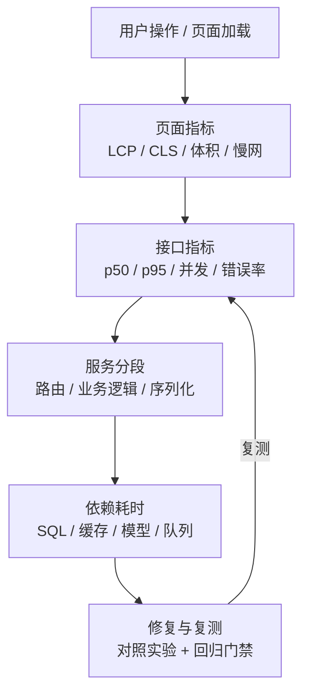

# 系统性能分析

> 性能分析的第一步不是优化，而是**测量并证明瓶颈在哪里**。
> 没有测量数据的优化，通常只是把复杂度从一个地方搬到另一个地方。

## 1. 为什么需要性能分析

性能问题很少以“平均耗时变慢”这种干净的形式出现，更常见的是：

```text
用户说“页面卡”，但接口平均耗时正常
单请求很快，并发五个就超时
首屏指标看起来不错，慢网下完全不可用
Agent 回答慢，但检索、SQL、精排都很快
优化了数据库，整体耗时几乎没变
```

## 2. 基本机制

性能分析的基本循环：

```text
定义指标与场景 → 建立基线 → 分层测量 → 提出瓶颈假设
→ 做对照实验 → 修复 → 复测 → 固化为门禁
```

常用指标：

| 层次 | 指标 |
|---|---|
| 页面 | TTFB、FCP、LCP、CLS、long task、首屏传输体积 |
| 接口 | p50 / p95 / p99 延迟、吞吐、错误率、响应体积 |
| 数据库 | 查询耗时、扫描行数、索引命中、锁等待 |
| Agent | 端到端耗时、LLM 调用次数与耗时、工具耗时、排队时间 |

两个关键原则：

1. **用分位数而不是只看平均。** 平均值会掩盖长尾，而用户体验和超时由尾部决定。
2. **先分层再端到端。** 端到端告诉你“慢不慢”，分段测量告诉你“慢在哪”。

## 3. 总体架构

性能分析可以按“页面 → 接口 → 服务 → 数据/外部依赖”逐层定位：



## 4. 关键设计

**区分平均与分位。** 本地顺序请求 p95 良好，不代表并发 5 也良好；服务端 p50 快，不代表慢网下 LCP 合格。至少同时看顺序 p50/p95 与并发 p95。

**先找主因素，再优化。** 如果端到端耗时 92%–99% 来自 LLM 调用，那么优化检索算法收益很小。Qianke 在 RAG 链路上实测得出“LLM 调用占单次问答耗时 92%~99%，本地检索与计算合计不到 1 秒”，因此优化方向是减少 LLM 往返与输出长度，而不是反复调精排参数。

**警惕 N+1 与全量扫描。** 接口慢经常不是单条 SQL 慢，而是循环里查了 N 次。B 端售后列表就是典型案例：29 条工单逐条查订单、再逐条做商家校验，最终 p50 726ms、并发 p95 2.1s；改为数据库层按 `merchant_id` 过滤 + JOIN 后降到 p50 56.5ms。

**前端性能看体积与布局稳定性。** C 端 CShop 的 CLS 超标来自“数据返回后插入内容把已有区块往下推”，首屏 1.59MB 未压缩导致慢网 LCP 约 8s。修复不是调渲染框架，而是预留稳定高度、路由级代码分割与 gzip 压缩。修复后必须复测并把结果固化为门禁。

## 5. 工程实现

Qianke 已使用的测量方法（来自 B/C 端性能报告）：

```text
浏览器页面：Chrome DevTools trace + Playwright，桌面 1440 / 移动 390
慢网模拟：Fast 3G（150ms RTT / 1.6Mbps）+ 冷缓存
接口：本地同机，20 次顺序请求 + 5 并发 × 50 次，统计 p50 / p95 / max
体积：curl -H "Accept-Encoding: gzip" 验证压缩后字节与 Content-Encoding
Agent：Eval 报告记录平均耗时、Steps、Tool Calls、Tokens
```

性能报告的建议结构：

```text
环境与基线（代码提交、账号、数据、机器）
结论（通过 / 不通过 / 阻断点）
页面指标与接口延迟表
根因分析与证据（trace、SQL、调用链）
修复方案、改动清单、改前/改后对比
门禁建议与残留风险
```

对照实验要尽量只改一个变量。例如修复 N+1 时同时改了缓存与索引，就无法判断收益来自哪一项；如果必须一起改，应分别记录可归因的证据。

## 6. 企业级要求

| 维度 | 性能治理要求 |
|---|---|
| SLO | 关键链路有明确目标与统计口径，不用“感觉快”验收 |
| 告警 | p95、错误率、队列积压、模型调用失败有阈值与通知 |
| 容量 | 并发、数据量、模型长度增长时有容量评估 |
| 多租户 | 单租户慢查询不能拖垮其他租户，需要配额与隔离 |
| 成本 | token、算力、存储与延迟一起看，避免“快但贵” |
| 回归 | 性能门禁进入 CI 或发布检查，防止退化 |

Qianke 当前已有性能测试报告与部分门禁建议，但生产 SLO、p95 告警、容量基线与 CI 性能门禁尚未完整建立，属于“已设计 / 部分实现”。

## 7. 方案对比

| 做法 | 优点 | 缺点 | 适用场景 |
|---|---|---|---|
| 只看平均耗时 | 简单 | 掩盖长尾与并发问题 | 粗略观察 |
| 分位数 + 分层指标 | 能定位长尾与瓶颈 | 采集与解释成本更高 | 生产性能治理 |
| 本地基准测试 | 可控、可复现 | 与生产网络/数据差异大 | 开发阶段回归 |
| 生产 APM / trace | 真实负载、真实用户 | 噪声大、需要采样与治理 | 线上问题定位 |
| 先测量再优化 | 结论可验证、收益可归因 | 前期需要投入观测 | 推荐默认做法 |

## 8. Qianke Engine 实践

案例一：B 端售后列表 N+1（已修复并复测）

```text
改前：29 条售后全量扫描 + 逐条 get_order + 逐条商家校验
      p50 726ms / p95 870ms / 并发 5 p95 2,139ms
改法：c_after_sale JOIN c_order，在 DB 层按 merchant_id 过滤
改后：p50 56.5ms / p95 71.5ms / 并发 5 p95 83.5ms
测试：tests/test_b_workbench_api.py::test_after_sales_only_for_bound_merchant
```

案例二：C 端 CShop 布局偏移与首屏体积（已修复并复测）

```text
改前：CLS 1440 0.17 / 390 0.576（阈值 0.1）
      首屏 1.59MB 未压缩；Fast 3G 冷启动 LCP 约 8,004ms
改法：今日手记常驻同高结构（骨架 + 固定行数）；
      26 个视图路由级动态 import；
      FastAPI GZipMiddleware(minimum_size=1024)
改后：CLS 0.03 / 0.00；首屏约 104KB；Fast 3G LCP 870ms
提交：e40b704 perf(c): stabilize CShop CLS, split routes and enable gzip
```

其他性能事实：

| 指标 | 数值 | 来源 |
|---|---|---|
| `/qa` 典型耗时 | 9–17s，生成占 92–96% | `docs/接口文档.md` |
| RAG 单次问答耗时构成 | LLM 92%–99%，本地计算 < 1s | `docs/项目背景.md` |
| Agent Eval 平均耗时 | Regression 3.8s；Benchmark 4.0–4.1s | `docs/e2e/agent-eval-2026-11-14.md` |
| 页面性能门禁 | LCP ≤ 2.5s、CLS ≤ 0.1、TTFB ≤ 0.8s | B/C 性能报告建议 |
| 生产 p95 告警 / SLO | 未建立统一看板 | 待核验 / 已设计 |

状态小结：B/C 端性能报告与已修复项属于已实现；生产 SLO/告警属于已设计、未完整落地；持续性能门禁与容量基线属于规划中。这些案例说明一个共同方法：先用 trace/接口表定位主因素，再做最小改动，最后用同一套测量方法复测并写入报告。

## 9. 评估 / 验收

| 对象 | 建议门禁（示例，不是当前承诺） |
|---|---|
| 页面 | LCP ≤ 2.5s、CLS ≤ 0.1、TTFB ≤ 0.8s、无 >50ms long task |
| 接口 | 顺序 p95 ≤ 500ms；并发 5 p95 ≤ 1s |
| 首屏 | 传输体积 ≤ 500KB（gzip 后） |
| Agent | 交互式任务 p95 ≤ 30s；工具调用 p95 ≤ 3s |

验收时应提供：改前/改后数据、原始报告、复测命令与环境、残留风险。只有一次“看起来变快了”的演示，不能算性能验收。

## 10. 常见误区

1. 只看平均耗时，不看 p95/p99 与并发。
2. 不建立基线就开始优化，无法判断收益。
3. 把本地顺序基准当成生产性能结论。
4. 只优化后端，忽略页面体积、布局偏移与慢网。
5. 在未定位主因素前同时改多个变量，结果不可归因。
6. 修复后不复测、不写报告、不设门禁，问题很快复发。

## 11. 总结

```text
性能分析 = 基线 + 分层测量 + 主因素 + 对照实验 + 门禁
```

1. 先测量再优化，用分位数与分层指标定位问题。
2. 关注端到端，也关注页面、接口、依赖各层的主因素。
3. 修复必须复测，并把结果固化为门禁。
4. 性能目标要写清口径，避免“感觉快”式验收。

## 12. 延伸阅读

项目内部资料：

- `docs/e2e/b-end-performance-2026-11-14.md`：B 端页面与接口性能
- `docs/e2e/c-end-performance-2026-11-14.md`：C 端 CLS / 体积 / 慢网复测
- `docs/e2e/b-end-acceptance-2026-11-14.md`：售后 N+1 修复复验
- `docs/接口文档.md`：`/qa` 典型耗时与生成占比

外部资料：

- web.dev Core Web Vitals：https://web.dev/articles/vitals
- Brendan Gregg，USE 方法：https://www.brendangregg.com/usemethod.html
- PostgreSQL EXPLAIN 文档：https://www.postgresql.org/docs/current/using-explain.html
