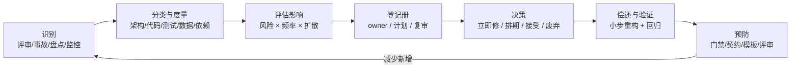

# 技术债务治理

> 技术债务不是“代码写得丑”，而是**为了短期交付而做出的、未来需要付利息的取舍**。
> 治理的目标不是清零，而是让债务可见、可控、有偿还计划。

## 1. 为什么需要技术债务治理

几乎每个系统都会有技术债务，问题在于债务是否被记录和管理：

```text
大文件持续膨胀，没人敢改
两套 schema 手工同步，新增表漏一边
跨层 import 越来越多，无法拆部署
已知测试缺口一直存在，回归时没人知道风险
性能问题记录了但没人认领
旧的兼容代码保留太久，没人敢删
```

债务本身不致命，致命的是“看不见”。看不见的债务无法评估影响、无法排优先级，最终在紧急需求或人员变动时集中爆发。治理技术债务不是追求“完美代码”，而是建立一套识别、记录、偿还与预防机制。

## 2. 基本机制

技术债务的完整生命周期：

```text
识别 → 分类 → 评估影响 → 分级 → 登记 → 排期偿还 / 明确接受 → 验证 → 预防
```

常见分类：

| 类别 | 例子 |
|---|---|
| 架构债务 | 模块边界模糊、跨层依赖、无法独立部署 |
| 代码债务 | 超大文件、重复实现、命名不清、隐式全局状态 |
| 测试债务 | 关键路径无测试、测试依赖真实外部服务、缺口未记录 |
| 数据债务 | 双 schema 来源、口径不一致、缺少迁移脚本 |
| 依赖债务 | 版本锁定、废弃依赖、环境脆弱、供应链风险 |
| 文档债务 | 文档过期、状态标注不实、缺少 ADR |
| 性能债务 | 已知慢查询、N+1、首屏过大、未设门禁 |
| 运维债务 | 无监控、无告警、备份未演练、手工操作 |

每项债务至少登记：描述、位置、影响、风险等级、owner、偿还方式、预计成本、复审时间。没有 owner 的债务通常永远不会被偿还。

## 3. 总体架构



债务登记册不需要复杂系统，一张表或一个 Markdown 文件即可，关键是：**能被检索、有人负责、能反映状态变化**。

## 4. 关键设计

**区分“有意债务”与“无意债务”。** 为了赶上线临时保留双写，是经过评估的有意债务；因为没人知道边界而复制代码，是无意债务。前者需要登记与偿还计划，后者需要靠评审与测试预防。

**用影响而不是“难看”排序。** 债务优先级应看：是否影响安全/数据正确性、是否阻塞交付、是否频繁引发故障、是否扩散到更多模块。一个命名不规范但稳定的模块，优先级远低于一个缺少租户过滤的查询。

**偿还要小步、可验证。** 大爆炸式重构风险极高。优先选择“带测试的小重构”：先补测试锁定行为，再改结构，最后删除旧路径。数据库迁移用扩展-收缩（expand/contract）或维护窗口切换，并保留回滚。

**明确“接受债务”也是决策。** 有些债务在当前阶段不值得偿还，例如为兼容旧前端保留别名接口。接受时要写清理由、影响与复审时间，而不是默认忽略。

**预防比偿还便宜。** 契约测试、schema parity 测试、依赖边界检查、性能门禁、评审清单都能减少新增债务。治理的成熟标志不是“债务清零”，而是新增速度下降。

## 5. 工程实现

Qianke 中已识别/已记录的债务示例（可核验）：

| 债务 | 证据 | 影响 |
|---|---|---|
| 超大存储文件 | `c_end/store.py` 约 6,578 行、`superagent/store.py` 约 1,202 行（2026-11-23 当前文件总行数，含空行） | 难理解、难测试、冲突频繁 |
| 双 schema 来源 | SQLite `c_end/store.py::_SCHEMA` + PG `control/schema_pg.sql` | 新表必须双端同步，否则契约测试失败 |
| 跨层 import | `agent/tools/chat_profile.py` → `b_end`/`c_end`；`control/sqlite_repository.py` → `c_end`/`superagent` | 边界模糊，阻碍拆部署与统一 Runtime |
| 架构文档过期 | `docs/architecture-diagrams.md` 自述“部分内容已落后于当前实现” | 新人与评审被误导 |
| 兼容旧页面 | `BOrders.vue` 保留为回滚备份；Ant 订单页 chunk 约 686KB | 包体与维护成本 |
| 测试缺口 | 超时后 Worker 返回、同 request_id 重试等场景未覆盖（v0.5.2） | 失败语义无回归保护 |
| 性能遗留 | B 端商品列表并发 p95 862ms、C 端商家商品 5 并发 p95 870ms（报告记录） | 弱网/并发体验风险，当前状态待核验 |
| 环境脆弱 | `torch` 必须锁定本地 cu126 wheel，否则 `uv` 可能换回 CPU 版 | 换机/清缓存后服务静默降级 |

偿还证据（说明债务治理并非只登记不行动）：

```text
售后列表 N+1：p50 726ms → 56.5ms，并有租户过滤测试
C 端首屏：CLS 0.17/0.576 → 0.03/0.00；1.59MB → 约 104KB
控制面 SQLite → PostgreSQL：P1–P3 实施记录与双后端契约测试
request_id 幂等、dataset/merchant scope、Tool Policy：由缺失变为已实现
```

这些修复的共同点是：先有测量或盘点证据，再有改动，最后有测试或报告。技术债务治理如果只有“重构”没有验证，很容易把旧问题换成新问题。

## 6. 企业级要求

| 维度 | 治理要求 |
|---|---|
| 安全 | 安全类债务优先级最高，不能以“业务忙”长期搁置 |
| 数据 | schema 变更、迁移、删除必须有回滚与演练 |
| 可用性 | 已知故障隐患要有监控、降级或明确风险接受 |
| 审计 | 债务登记与接受决策可追溯，定期复审 |
| 预算 | 每季度预留固定比例用于偿还与预防 |
| owner | 每项债务有负责人，避免“公共债务无人管” |
| 度量 | 债务数量、年龄、事故关联、偿还速度可观察 |

企业级治理还要防止“债务成为政治工具”：既不能把所有不喜欢的代码都叫债务，也不能因为“业务优先”永远不偿还安全与数据类债务。

## 7. 方案对比

| 策略 | 优点 | 风险 | 适用场景 |
|---|---|---|---|
| 接受并登记 | 成本低、保持节奏 | 需要复审，否则遗忘 | 影响小、有明确复审时间 |
| 小步重构 | 风险可控、可持续 | 需要测试保护 | 大多数代码/模块债务 |
| 扩展-收缩迁移 | 可并行、可回滚 | 双写与一致性成本 | 数据库/schema/接口迁移 |
| 大爆炸重写 | 可彻底解决结构问题 | 周期长、风险高、容易失败 | 系统已不可维护且边界清晰 |
| 直接删除旧能力 | 最彻底 | 需确认无调用方与回滚窗口 | 已废弃功能与兼容层 |

Qianke 的迁移清单选择了“先修安全与幂等、再抽 Runtime、最后评估部署拆分”的顺序，而不是直接重写。这符合“先偿还高风险债务，再做结构性重构”的治理逻辑。

## 8. Qianke Engine 实践

| 治理实践 | 证据 | 状态 |
|---|---|---|
| 安全/幂等前置的债务排序 | `docs/decisions/monorepo-migration-inventory-v0.1.md` §4–§7 | 已实现（文档决策） |
| 控制面迁移盘点 | `docs/decisions/control_plane_postgres_migration_v0.1.md` §2 | 已实现 |
| 已知缺口与待补测试记录 | `docs/handbook/01-agent-architecture/01-enterprise-agent-architecture-v0.5.2.md` | 已实现（记录） |
| 性能债务修复与复测 | B/C 端性能报告与验收报告 | 已实现（部分项） |
| 旧文档过期标注 | `docs/architecture-diagrams.md` 头部声明 | 已实现 |
| 统一债务登记册与季度复审 | 仓库中未见 | 待核验 / 规划中 |
| 依赖边界 CI 与债务预算 | 目标要求存在，未落地 | 规划中 |

Qianke 做得较好的地方是：债务没有被包装成“已完成”。例如 Agent 文档明确列出未覆盖的测试场景、把“统一 HITL”“Prompt Injection 独立防护”标为未完成；迁移清单直接指出租户绑定与幂等缺失，并把它们放在 C 端开发之前。这种“把风险写在前面”的文化，比任何债务看板都重要。

不足是缺少统一的债务台账：信息散落在决策文档、性能报告、review 记录和代码注释里，没有单一入口回答“当前有哪些 P0/P1 债务、谁负责、何时复审”。这是下一步治理的起点。

## 9. 评估 / 验收

```text
[ ] 债务有统一入口可检索
[ ] 每项债务有分类、影响、等级、owner
[ ] P0/P1 债务有明确偿还计划或风险接受人
[ ] 偿还有测试/报告等验证证据
[ ] 迁移类债务有回滚方案与演练
[ ] 新增债务速度在下降（门禁/契约/评审）
[ ] 定期复审，过时债务被关闭或重新分级
[ ] 事故复盘中识别出的债务进入登记册
```

治理效果的合理指标：高风险债务数量与年龄、债务关联事故数、按期偿还率、新增债务趋势、回归测试通过率。不要用“代码行数减少”作为唯一指标。

## 10. 常见误区

1. 把技术债务等同于“代码丑”，忽略安全、数据、测试与文档债务。
2. 只登记不排期，债务册变成许愿池。
3. 只做大规模重写，没有测试与回滚，风险高于收益。
4. 为了“零债务”无限重构，影响业务交付。
5. 新增债务没有预防机制，偿还速度赶不上产生速度。
6. 把接受债务当作忽略债务，不写理由与复审时间。
7. 债务没有 owner，最终无人负责。

## 11. 总结

```text
技术债务治理 = 可见 + 分级 + 偿还 + 预防
```

1. 债务不可怕，不可见才可怕。
2. 按安全、数据、交付影响排序，而不是按代码美观排序。
3. 小步偿还、测试保护、迁移可回滚。
4. 接受债务也是决策，但必须有理由与复审时间。

## 12. 延伸阅读

项目内部资料：

- `docs/decisions/monorepo-migration-inventory-v0.1.md`：安全前置的债务排序
- `docs/decisions/control_plane_postgres_migration_v0.1.md`：迁移盘点与偿还路径
- `docs/handbook/01-agent-architecture/01-enterprise-agent-architecture-v0.5.2.md`：已知限制与测试缺口
- `docs/e2e/b-end-performance-2026-11-14.md`、`docs/e2e/c-end-performance-2026-11-14.md`：性能债务与修复

外部资料：

- Martin Fowler，Technical Debt：https://martinfowler.com/bliki/TechnicalDebt.html
- Martin Fowler，Technical Debt Quadrant：https://martinfowler.com/bliki/TechnicalDebtQuadrant.html
- Ward Cunningham，债务隐喻原始讨论：https://c2.com/cgi/wiki?TechnicalDebt
- Google SRE 手册（可靠性债务视角）：https://sre.google/sre-book/table-of-contents/
