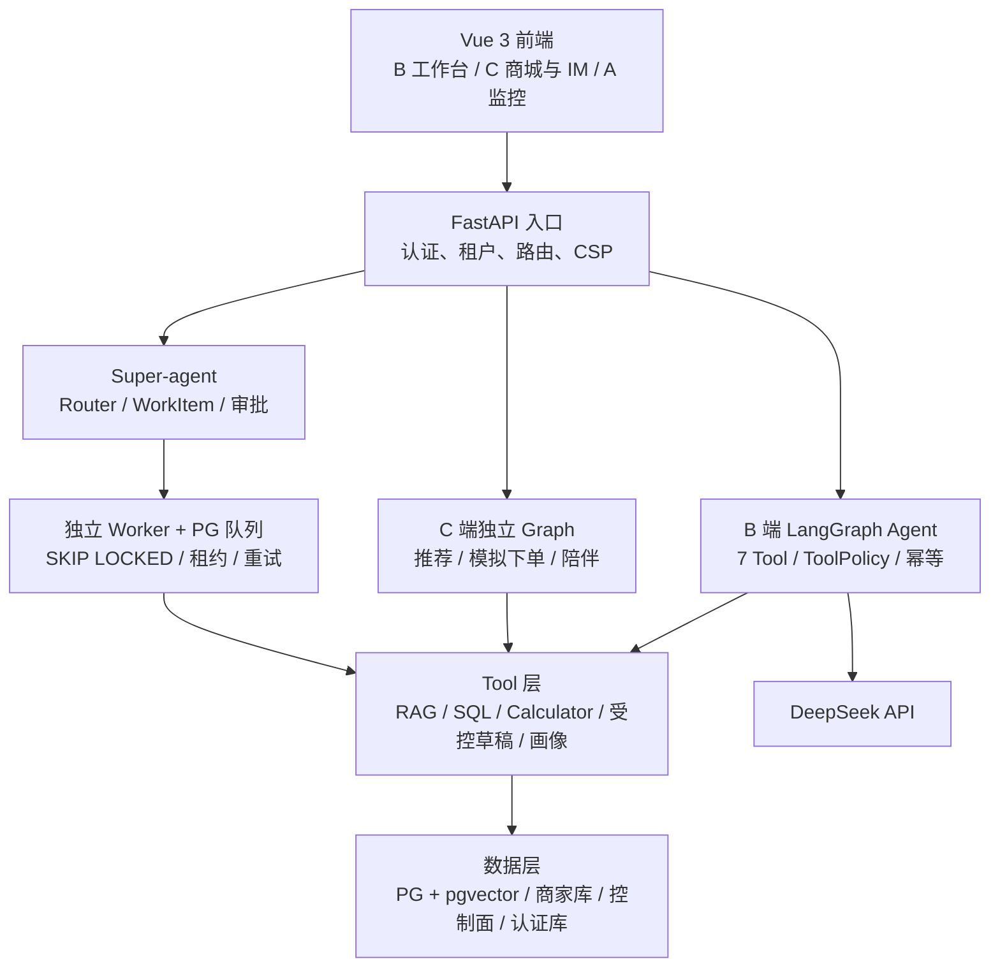

# 企业级项目架构案例

> 案例的价值不在于“照抄架构图”，而在于理解：在当时的约束下，为什么选择这些结构、付出了什么代价、哪些问题仍未解决。
> 本文以 Qianke Engine 为案例；它是**面向企业经营分析与 C 端交易的原型/开发系统**，不是已承载大规模生产流量的企业平台。

## 1. 为什么需要架构案例

架构原理容易讲，难的是在真实约束下做取舍：

```text
需求一直在变，边界怎么定？
团队只有几个人，要不要拆微服务？
LLM 不确定，哪些环节必须交给确定性代码？
领导要功能、安全要边界，先做哪个？
已有实现不完美，是重构还是继续演进？
```

Qianke Engine 提供了一个相对完整的样本：从 RAG 问答起步，演进到 B 端经营分析 Agent、C 端模拟交易与 IM、管理端监控与审计、Super-agent 异步任务、控制面数据库迁移与 Eval 体系。它的价值不在于“每项都做到生产级”，而在于每个阶段都留下了可核验的文档、代码与测试证据；本文通用方法部分属于理论知识，Qianke 事实部分按证据标注状态。

## 2. 基本机制

案例复盘建议按以下框架组织，避免写成产品介绍：

```text
背景与目标：业务问题、使用场景、成功标准
约束：团队、时间、数据、合规、技术栈
架构：上下文、组件、数据流、部署形态
关键决策：选了什么、放弃什么、为什么
实施路径：先做什么、后做什么、如何验证
结果与指标：功能、测试、Eval、性能
遗留问题与可复用经验：适用条件与不适用条件
```

其中“约束”和“遗留问题”最容易被省略，却恰恰是案例最值得学习的地方。

## 3. 总体架构

Qianke 的当前逻辑架构可以概括为“多端入口 + 三条链路（B 端 Agent、C 端 Graph、Super-agent）+ 共享数据与治理能力”：



需要强调：这是**逻辑架构**，当前部署仍是 FastAPI 单应用 + 数据库 + 独立 Worker 进程，不是微服务集群。三端共享的是 Runtime、Tool 框架、认证与数据基础设施，而不是业务权限或数据。

## 4. 关键设计

**三端独立、底座共享。** 三端决策明确 C/B/A 各自拥有独立 Agent Graph、API 与业务策略，共享 Runtime、Tool 框架、认证、Memory 基础机制与可观测性。这样可以避免为三端复制基础设施，又不会把三端业务权限混在一个 Graph 里。

**确定性系统负责事实，LLM 负责解释。** 订单统计、库存预占、退款、权限判断由 SQL/代码完成；LLM 负责理解问题、规划、解释与建议。高风险动作必须人工确认，资金自动执行上限为 0。这条原则同时是安全边界与架构边界。

**Tool 是受治理契约，不是普通函数。** 当前注册 7 个 Tool，每个有输入 Schema、结构化结果与错误码；Tool Policy 按角色做暴露前过滤，执行时再复核。模型决定调用不等于用户已授权。

**可信上下文由服务端注入。** `dataset_scope` 与 `merchant_scope` 由认证会话或可信任务记录建立，LLM 不得传入或修改租户/商家 ID；ContextVar 缺失时失败关闭，线程边界显式重建。

**异步任务与主请求分离。** Super-agent 使用独立 WorkItem/Job、PG 队列、租约、重试、死信与 Worker，不把长任务塞进 `/api/agent/run`。这是按任务生命周期拆分，而不是为了“微服务化”。**迁移先于重构。** 控制面从 SQLite 迁移到 PostgreSQL 时，先做 repository 抽象、双后端契约测试、回填校验、维护窗口切换与回滚，再切运行时。

## 5. 工程实现

| 能力 | 实现证据 | 状态 |
|---|---|---|
| B 端 Agent Runtime | `src/rag_demo/agent/loop.py`、`service.py`：LangGraph、State、预算、超时、幂等 | 已实现 |
| 7 个 Tool 与 Tool Policy | `agent/registry.py`、`agent/policy.py`、`agent/tool.py` | 已实现 |
| 受控写草稿 | `agent/tools/action.py`、`api/main.py::confirm_agent_action` | 已实现 |
| C 端交易与 IM 闭环 | `c_end/`：商品、订单、售后、IM、推荐、模拟下单 | 已实现（Mock 交易闭环） |
| Super-agent 队列 | `superagent/queue_pg.py`、`runtime.py`、`worker.py` | 已实现（独立链路） |
| 商家数据层 | `merchant/`：Repository 协议 + SQLite/PG adapter + 幂等库存/订单 | 已实现 |
| 控制面双后端 | `control/`：SQLite 与 PostgreSQL repository + 契约测试 | 已实现 |
| 测试与 Eval | `tests/` 顶层 126 个 `test_*.py`（含子目录共 130 个）；AGENTS v3.28.0 记录 823 tests；Regression 20/20 | 已实现（测试数量为项目记录，本次未重跑） |

三条链路需要区分清楚：

```text
主 B 端交互：/api/agent/run → Execution Store → execute_agent → LangGraph
Super-agent：WorkItem → PG 队列 → Worker → Deep Agents / actions
C 端：/api/c/* → 独立 C Graph / 状态机 → 模拟订单与 IM
```

## 6. 企业级要求

| 维度 | 当前状态 | 证据/说明 |
|---|---|---|
| 身份与权限 | 部分实现 | 认证、角色 ToolPolicy、API 二次收口；统一策略引擎未形成 |
| 多租户隔离 | 部分实现 | dataset/merchant scope、按商家过滤、测试覆盖；独立数据库/账号为设计目标 |
| 受控写与 HITL | 部分实现 | 受控草稿确认已实现；通用高风险动作统一审批未接入 |
| 幂等与可靠性 | 已实现（有限场景） | request_id 幂等、wall timeout、retry、checkpoint 有限使用；stale RUNNING 无自动回收 |
| 可观测性 | 部分实现 | event_trace、ai_monitor、`/ready`、`/metrics`；无统一生产 SLO/告警看板 |
| 评测 | 已实现（B 端为主） | Regression/Benchmark/Eval v2.2；生产性能与安全对抗评测待补 |
| 安全与合规 | 部分实现 | SQL 只读、Tool Policy、租户隔离、审计事件；Prompt Injection 独立防护与统一保留期未完成 |

Qianke 的诚实之处是这些边界大多被写进文档，而不是被包装成“已完成”。例如 Agent 文档明确把“统一 C/B/A Runtime”标为已设计、把 Multi-Agent 标为规划中、把 Prompt Injection 独立防护标为未完成。这是架构案例能成立的前提。

## 7. 方案对比
| 对比 | Qianke 的选择 | 替代方案 | 取舍原因 |
|---|---|---|---|
| 产品形态 | 企业分析 + C 端交易 + 管理审计多端 | 只做 B 端分析工具 | 验证 IM 社交电商方向，但增加复杂度 |
| Agent 编排 | 单 Agent ReAct 为主，Super-agent 异步任务独立 | 一开始做多 Agent 协作 | 工具数量未到必须拆分的程度，先保证可靠性 |
| 部署 | 单应用 + 独立 Worker + 数据库 | 一开始微服务化 | 团队与流量不需要，降低分布式复杂度 |
| 数据库 | PostgreSQL + pgvector，SQLite 本地回退 | 专用向量库 + 独立控制面 | 复用现有运维与事务能力，减少组件 |
| 写操作 | 受控草稿 + 用户确认 + 动作白名单 | 让 Agent 直接执行 | 安全与合规优先，自动化逐步放开 |

这些选择不一定适用于其他企业。例如已有成熟微服务体系的团队，可能不需要再走“模块化单体 → 拆部署”的路径；没有 C 端业务的项目，也不应复制 C/B/A 三端结构。

## 8. Qianke Engine 实践

演进时间线（依据 `AGENTS.md` 变更记录，节选）：

| 阶段 | 里程碑 | 架构意义 |
|---|---|---|
| Agent v0.1 / Runtime v0.2.2 | State、Loop、Tool Contract、预算、超时、重试 | 把 Demo 循环升级为受控执行 |
| 1.6.0 | `prepare_followup_task` 受控草稿 | 写操作从“禁止”变为“受控写” |
| 2.0.0 | 商家租户与 B 端工作台 | 从单租户走向租户隔离 |
| 2.1–2.30 | Super-agent、PG 队列、Worker、审批、审计 | 异步任务与人工审批链路 |
| 2.40–2.45 | 控制面 SQLite → PostgreSQL | 多实例、事务、备份监控统一 |

可复用的经验：

1. **先补安全边界，再扩业务功能。** 迁移清单把租户绑定与 `request_id` 幂等放在 C 端开发之前。
2. **把“未完成”写清楚。** 文档区分已实现/部分实现/已设计/规划中，避免把目标态当现状。
3. **用证据替代口号。** 性能有报告、迁移有实施记录、Eval 有结果文件、评审有问题编号。
4. **按真实需求演进。** 单 Agent 能解决时不拆多 Agent；SQLite 够用时先不换库；迁移前先抽象。

## 9. 评估 / 验收

判断这个案例是否被正确理解，可以问：

```text
[ ] 能说清 B/C/A 三端哪些共享、哪些隔离
[ ] 能区分主 Agent、Super-agent、C 端三条链路
[ ] 能指出已实现、部分实现、已设计、规划中的边界
[ ] 能说出至少三个关键取舍及其代价
[ ] 能指出当前未验证的风险（生产 SLO、安全对抗、统一 Runtime）
```

当前已被证据支持的部分：B 端 Agent Runtime、7 Tool 与 Policy、受控草稿、C 端 Mock 交易闭环、Super-agent 队列、商家数据层、控制面双后端、Regression/Benchmark Eval、部分性能修复。

尚未被充分证明的部分：大规模生产流量下的可用性与延迟、完整租户隔离（独立数据库/账号）、统一 C/B/A Runtime、Prompt Injection 防护、生产 SLO 与告警、安全红队与灾难恢复演练。这些应标为“待核验/规划中”，不能引用为已完成能力。

## 10. 常见误区

1. 看到架构图就照抄，忽略团队规模、流量与合规约束。
2. 把“有 Mock 闭环”当成“生产可用”。
3. 把“已设计/已规划”写成“已实现”。
4. 认为企业级等于微服务、多 Agent、复杂框架。
5. 让 LLM 承担金额、权限、状态迁移等确定性职责。
6. 只做功能，不做 Eval、性能、审计与失败处理。

## 11. 总结

```text
企业级架构案例 = 约束 + 取舍 + 证据 + 遗留问题
```

1. Qianke 的核心经验是“让模型负责智能，让系统负责边界”。
2. 三端独立、底座共享、可信上下文、受控写是结构性决策。
3. 每条关键能力都应有代码、测试、报告或决策记录支撑。
4. 案例必须同时呈现未完成与未验证部分，才具有参考价值。

## 12. 延伸阅读

项目内部资料：

- `docs/decisions/three_agent_platform_architecture_decisions_v0.1.md`：三端架构决策
- `docs/handbook/01-agent-architecture/01-enterprise-agent-architecture-v0.5.2.md`：Agent 架构与实现边界
- `docs/decisions/control_plane_postgres_migration_v0.1.md`：控制面迁移案例
- `docs/decisions/merchant_dashboard_v1_1_m0_adr.md`：架构决策与验收条件
- `AGENTS.md`：产品定位、工作协议与版本记录

外部资料：

- AWS Well-Architected Framework：https://docs.aws.amazon.com/wellarchitected/latest/framework/welcome.html
- C4 model：https://c4model.com/
- The Twelve-Factor App：https://12factor.net/
