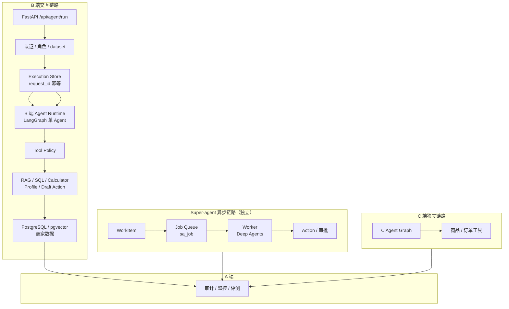
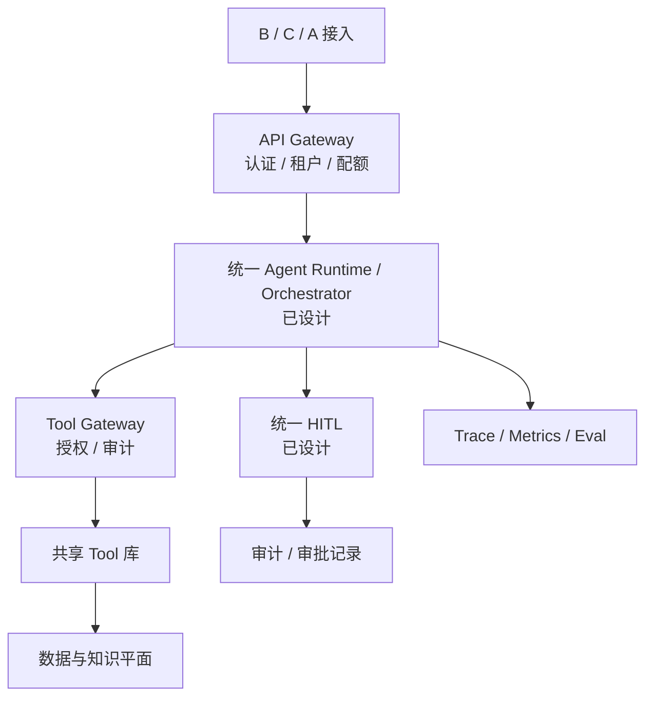
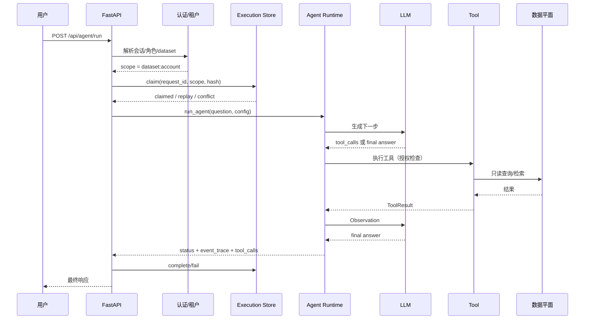

# 企业级 Agent 架构概述（V0.2 修订稿）

> V0.2 修订说明：本文响应 V0.1 技术审核报告 R-01～R-11；V0.1 原文保持不变。  
> 修订重点：拆开当前/目标架构、修正 Tool 清单与权限矩阵、澄清 Execution Store 失败语义、区分 Checkpoint/Retry/硬取消、收窄 HITL 边界、补充代码/测试证据。  
> V0.1 审核文件：`docs/handbook/_meta/reviews/01-enterprise-agent-architecture-v0.1-technical-review.md`

> 本文是 Qianke Engine Architecture Handbook 的第一篇，属于 **Agent Architecture** 分类。  
> 目标不是介绍某个框架 API，而是建立一套能用于企业系统的 Agent 架构判断框架，并明确 Qianke Engine 当前实现到哪里、哪些仍是目标设计。

## 1. 文档基本信息

| 项 | 内容 |
|---|---|
| 文档名称 | 企业级 Agent 架构概述 |
| 所属分类 | 01 · Agent Architecture |
| 版本 | 0.1.0 |
| 最后更新 | 2026-11-23 |
| 文档状态 | 草稿 |
| 实现状态 | 已实现（当前 Runtime） + 已设计（统一三端目标） |
| 前置知识 | LLM 基础、Tool Calling、HTTP API、异步任务 |
| 对应代码 | `src/rag_demo/agent/`、`src/rag_demo/api/main.py`、`src/rag_demo/superagent/` |
| 对应文档 | `docs/agent.md`、`docs/agent-design-current-vs-target.md`、`AGENTS.md` |

阅读建议：

```text
L1 先读第 2、3 节：理解企业级 Agent 的问题与原理
L2 再读第 4、5、6、7 节：理解架构、工程实现和取舍
L3 最后读第 8、9 节：对照 Qianke 当前实现、限制和误区
```

## 2. 核心问题

### 2.1 从“会聊天”到“能完成企业任务”

一个普通聊天 Agent 通常只需要：

```text
用户输入 → LLM 生成回答
```

企业级 Agent 要面对的是：

```text
用户提出业务问题
→ 系统确认身份、租户、权限和数据范围
→ Agent 规划调查步骤
→ 调用真实工具获取证据
→ 对结果做校验和解释
→ 需要时进入人工确认
→ 记录执行过程、成本、错误和最终结果
```

差距不在“模型是否更聪明”，而在**系统是否能把不确定的模型行为约束成可负责的业务流程**。

### 2.2 企业级 Agent 的六个核心问题

| 问题 | 如果缺失会发生什么 |
|---|---|
| 任务边界 | Agent 越权执行、答非所问、无限循环 |
| 身份与租户 | 查到其他商家/企业的数据 |
| 工具安全 | SQL 被写操作利用、外部内容注入工具调用 |
| 证据与可解释 | 结论无法追溯，业务不敢采用 |
| 人工确认 | 高风险动作未经审批直接生效 |
| 运行可靠性 | 超时、重试、重复执行、成本失控、故障不可恢复 |

所以企业级 Agent 不是“LLM + 几个 tool”的加法，而是：

```text
Agent Runtime
+ Tool Contract & Gateway
+ 数据/知识平面
+ 身份/租户/权限
+ Human-in-the-loop
+ 证据/审计/评测
+ 可靠性机制
```

### 2.3 Qianke Engine 的边界

Qianke Engine 当前定位是 **Decision Support Agent**，不是 Autonomous Business Agent。

已明确的边界：

```text
可以：理解问题、规划调查、调用 SQL/RAG/Calculator、分析、给建议
不可以：自动执行营销、自动发消息、无确认修改业务数据
```

这不是能力不足，而是企业系统的安全选择：

```text
模型可以提出动作，但不能成为最终授权者。
```

对应项目规则见 `AGENTS.md` §13 和 `docs/agent.md` §1。

## 3. 基础原理

### 3.1 Agent 的最小闭环

从控制论角度，一个 Agent 可以抽象为：

```text
State_t
  → Policy/LLM 选择 Action_t
  → Environment/Tool 执行 Action_t
  → Observation_t
  → State_{t+1}
  → ... → Terminal
```

其中：

```text
State        当前对话、任务、证据、预算、执行状态
Policy       通常由 LLM 承担，决定下一步
Action       调用工具、生成回答、请求人工确认
Observation  工具返回的结构化结果
Terminal     完成、超限、超时、取消、失败
```

Qianke 当前实现采用 LangGraph 的 `chatbot ↔ tools` 循环：

```text
chatbot 节点调用 LLM
→ LLM 返回 tool_calls
→ ToolNode 执行工具
→ ToolMessage 回到 chatbot
→ 直到最终回答或终态
```

### 3.2 为什么必须把“循环”变成“运行时”

只写一个 while 循环也能跑 Agent，但企业系统需要回答：

```text
最多能跑几步？
最多调用几个工具？
超时了怎么办？
失败能否重试？
重试会不会重复副作用？
每次执行的 ID 是什么？
执行过程能否回放？
租户上下文会不会串？
```

Qianke 的 Runtime 用显式配置把这些变成硬约束：

```python
AgentConfig(
    max_steps=5,
    max_tool_calls=10,
    timeout_seconds=60.0,
    max_total_tokens=0,
)
```

关键点：

```text
max_steps / max_tool_calls / timeout / budget 都是真正的运行时参数，
不是展示字段。
```

源码：`src/rag_demo/agent/state.py`。

### 3.3 工具不是函数，而是契约

企业级 Agent 的 Tool 必须可授权、可校验、可观测、可测试。

Qianke 的统一契约：

```python
class ToolResult(BaseModel):
    ok: bool
    data: dict[str, Any] = Field(default_factory=dict)
    error: ToolError | None = None

@dataclass(frozen=True)
class Tool:
    name: str
    description: str
    input_schema: dict[str, Any]
    fn: Callable[..., dict[str, Any]]
```

成功：

```json
{"ok": true, "data": {"columns": [], "rows": []}}
```

失败：

```json
{
  "ok": false,
  "data": {},
  "error": {"code": "READ_ONLY_VIOLATION", "message": "只允许 SELECT"}
}
```

原则：

```text
调用方依赖 error.code，不依赖 error.message 字符串匹配。
```

源码：`src/rag_demo/agent/tool.py`。

### 3.4 为什么需要“证据优先”而不是“答案优先”

企业业务不接受：

```text
模型说“本月销售额下降了 12%”，但没有任何查询或来源。
```

Qianke 的 Agent 回答要求：

```text
RAG：返回检索片段与来源，不直接生成结论
SQL：只读查询 + 明确口径 + 可核对结果
Calculator：确定性计算
Final Answer：关键结论带来源或口径
```

这决定了架构中必须有：

```text
工具结果 → 证据 → 生成 → 后置审查
```

而不是：

```text
用户问题 → 模型直接生成
```

### 3.5 单体 Agent 与多 Agent 的边界

多 Agent 不是企业级的同义词。

Qianke 当前的选择是：

```text
先用单 Agent + 有限工具集 + 明确边界
等工具规模、路由复杂度和协作需求真正出现，再拆多 Agent
```

原因：

```text
1. 单 Agent 更容易调试、评测和归因
2. 多 Agent 会放大状态同步、权限、成本和失败面
3. 当前工具数量有限，单 ReAct 足够
4. 先把 Runtime、Tool Contract、HITL、Eval 做扎实
```

`AGENTS.md` 也明确：工具超过约 10 个且出现路由混乱，才评估 Supervisor 多 Agent 拆分。

## 4. 架构设计

### 4.1 当前架构与目标架构

V0.1 曾把当前实现和目标设计画在同一张图，导致 Super-agent Queue 被误读为主 Agent Runtime 的编排依赖。V0.2 拆成两张图。

#### 当前已实现架构



关键边界：

```text
B 端 /api/agent/run：同步交互式 Agent，不先入 Super-agent 队列
Super-agent：独立 WorkItem + job queue + Worker，处理调查/审批/动作
C 端：独立 C Agent Graph，不复用 B 端 /api/agent/run 的 runtime
A 端：审计/监控，不是主 Agent 执行者
```

#### 目标架构（已设计 / 规划中）



目标态中的 `统一 Runtime / Orchestrator / Tool Gateway / 统一 HITL` 目前不是已上线能力，必须在正文和状态表中标注为“已设计 / 规划中”。本文后续的“当前实现”默认指 B 端主 Agent Runtime。

### 4.2 核心模块与职责

| 模块 | 负责 | 不负责 | 当前状态 |
|---|---|---|---|
| 接入层 | B/C/A 入口、协议、会话 | Agent 决策 | 部分实现 |
| 认证/租户 | 身份、角色、dataset 绑定 | 业务查询结果正确性 | 已实现 |
| Execution Store | request_id 幂等、claim、完成/失败记录、响应回放 | 排队、执行、重试策略 | 已实现（无 stale TTL） |
| Agent Runtime | Graph、State、预算、超时、终态、协作取消 | 进程外调度、写审批 | 已实现（B 端主链路） |
| LangGraph Checkpointer | 持久化 Graph state | 进程硬取消、对外 resume API | 已接入（有限使用） |
| Tool Contract | 输入/输出/错误结构 | 业务授权决策 | 已实现 |
| Tool Policy | 角色 → 可用 Tool 集合 | 数据级权限 | 已实现（角色级白名单） |
| Tool 实现 | RAG / SQL / Calculator / Profile / 受控草稿 | 直接修改业务订单/库存 | 已实现（范围见 5.5） |
| Super-agent Queue/Worker | WorkItem 异步调查、job lease、审批动作 | 主 `/api/agent/run` 编排 | 已实现（独立链路） |
| HITL | 受控写草稿确认、Super-agent 审批 | 所有高风险动作自动审批 | 部分实现 |
| 审计/Trace | event_trace、动作记录、监控 | 业务决策 | 部分实现 |
| Eval | Regression / Benchmark / 门禁 | 运行时执行 | 已实现（独立评测链） |

#### 为什么必须写清“不负责”

```text
Execution Store 不是消息队列
Agent Runtime 不是异步 Worker
Super-agent Queue 不承接主 /api/agent/run
Checkpointer 不是硬取消机制
HITL 不是“所有工具都自动需要审批”
```

这些边界不清，会导致错误的企业级架构结论。

### 4.3 请求控制流



### 4.4 数据流与边界

```text
身份上下文：账号 → 角色 → dataset/租户
执行上下文：request_id → execution_id → parent_execution_id
任务上下文：messages → step_count → tool_call_count → status
证据上下文：tool result → trace / sources / final answer
治理上下文：policy → HITL → audit
```

企业级设计的关键不是“把数据都塞进 Prompt”，而是：

```text
只让 Agent 看到当前身份允许的数据，
只让工具返回完成任务所需的最小结果，
只让最终回答引用可追溯的证据。
```

## 5. 工程实现

### 5.1 当前目录结构

```text
src/rag_demo/agent/
├── state.py              AgentState / AgentConfig / AgentStatus
├── loop.py               LangGraph 主循环 + TraceCallbackHandler + Retry
├── service.py            execute_agent / 请求幂等 / wall deadline
├── execution_store.py    InMemory / PostgresExecutionStore
├── tool.py               Tool / ToolResult / ToolError
├── registry.py           7 个 Tool 的注册
├── policy.py             角色 → ToolPolicy
├── checkpoint.py         LangGraph SqliteSaver
├── actions.py            受控写草稿 / 确认 / 审计
└── tools/
    ├── rag.py
    ├── sql.py
    ├── calculator.py
    ├── action.py          prepare_followup_task（草稿）
    └── chat_profile.py    resolve_customer_identity / profile tools
```

实际注册的 7 个 Tool：

```text
rag_search
execute_sql
calculator
prepare_followup_task
resolve_customer_identity
get_chat_user_profile
search_chat_user_profiles
```

注意：

```text
docs/agent.md 仍写着 3 个 Tool，已经落后于 registry.py 与 policy.py。
Handbook 的“已实现”结论必须回到代码注册表核对，不能只依赖旧文档。
```

### 5.2 当前状态字段

```python
class AgentState(TypedDict, total=False):
    messages: Annotated[list, add_messages]
    step_count: int
    tool_call_count: int
    status: str
    error: str | None
    started_at: float
    request_id: str
    execution_id: str
    parent_execution_id: str | None
```

为什么需要这些字段：

```text
messages     对话与工具观察
step_count   推理步数预算
tool_call_count 工具调用预算
status       明确终态，避免把超限伪装成正常回答
error        失败原因
started_at   超时与耗时
request_id   请求幂等
execution_id 本次执行身份
parent_execution_id retry 血缘
```

### 5.3 终态与失败语义

Qianke 明确区分：

```text
COMPLETED
MAX_STEPS_EXCEEDED
MAX_TOOL_CALLS_EXCEEDED
TIMEOUT
CANCELLED
BUDGET_EXCEEDED
TOOL_NOT_ALLOWED
FAILED
```

原则：

```text
超限不是“回答得短一点”，而是明确终态。
工具未授权不是“碰运气执行”，而是 TOOL_NOT_ALLOWED。
失败不伪装成模型正常输出。
```

### 5.4 幂等、失败状态与重试

这是 V0.1 最需要修正的部分。必须区分三种概念：

```text
A. Execution Store 的记录状态
B. Agent Runtime 的终态
C. Retry 尝试（attempt）
```

#### A. Execution Store 记录状态

幂等键：

```text
request_id + agent_scope(dataset, account) + request_hash(query, parent_execution_id)
→ agent_execution
```

`claim` 的可能结果：

```text
claimed     首次请求，记录为 RUNNING
in_progress 已存在 RUNNING，API 返回 409
conflict    同 request_id + 不同 query/parent，API 返回 409
completed   已存在 COMPLETED，回放 response
failed      已存在 FAILED，API 返回 409
```

实际代码：

```text
src/rag_demo/agent/service.py
src/rag_demo/agent/execution_store.py
```

#### B. Runtime 终态与 Execution Store 的关系

`run_agent_with_retry` 正常返回一个 result 字典，即使其 `status` 是：

```text
FAILED
TIMEOUT
MAX_STEPS_EXCEEDED
MAX_TOOL_CALLS_EXCEEDED
```

`execute_agent` 在 runner 正常返回后调用：

```python
store.complete(request_id, scope, execution_id, result)
```

所以此时的 `agent_execution.status` 是 `COMPLETED`，保存的是“一次带失败终态的响应”。

只有以下情况会调用 `store.fail`：

```text
runner 抛出异常
请求级 wall timeout 抛出 AgentRunTimedOut
返回结果不是 dict
```

结论：

```text
“Runtime 终态 FAILED” != “Execution Store 记录 FAILED”。
V0.1 写成“执行失败：记录 FAILED”，过于笼统，需修正。
```

对使用者的实际影响：

```text
同一 request_id 重复提交：
  - 若上次 runner 正常返回 FAILED，会回放该失败响应
  - 若上次异常/超时被 store.fail，则返回 409 / failed
```

#### C. Retry 尝试

`run_agent_with_retry` 内部：

```text
每次 attempt 生成新的 execution_id
retry 的 parent_execution_id 指向上一次 execution_id
只有 FAILED / TIMEOUT / MAX_STEPS_EXCEEDED / MAX_TOOL_CALLS_EXCEEDED 会触发下一次
BUDGET_EXCEEDED / CANCELLED 不重试
API 默认 max_retries=0；请求参数可提高到 3
```

重要：

```text
retry = 重新执行，不是 resume。
retry 过程中可能再次调用 Tool；有副作用的 Tool 必须幂等，或在 retry 时禁用。
当前受控写 Tool `prepare_followup_task` 创建的是 SQLite DRAFT；
如果 Agent 在失败前已经创建草稿，retry 可能产生重复草稿。写 Tool 应改为幂等键唯一，
或禁止在 retry 中重复执行写 Tool。
```

#### D. Stale RUNNING

当前没有 stale RUNNING TTL：

```text
进程崩溃后可能留下 RUNNING 记录
同一 request_id 后续请求会得到 409 in_progress
需要人工清理或后续增加 stale 回收
```

### 5.5 工具授权与受控写

#### 实际注册 Tool（7 个）

| Tool | 类型 | 作用 |
|---|---|---|
| `rag_search` | 只读检索 | 企业知识 / SOP / 规则 |
| `execute_sql` | 只读查询 | SELECT/WITH，必须 LIMIT |
| `calculator` | 确定性计算 | AST 解析，不使用裸 eval |
| `prepare_followup_task` | 受控写草稿 | 只创建 DRAFT，不写正式任务 |
| `resolve_customer_identity` | 画像/身份 | 顾客身份消歧 |
| `get_chat_user_profile` | 画像读取 | 会话用户画像 |
| `search_chat_user_profiles` | 画像检索 | 画像搜索 |

#### 角色级 ToolPolicy（实际代码）

```text
admin / ent_admin / exec / analyst / ops
  → 全部 7 个 Tool

cs
  → rag_search
     calculator
     resolve_customer_identity
     get_chat_user_profile
     search_chat_user_profiles

guest / disabled / demo
  → 无
```

代码：

```text
src/rag_demo/agent/policy.py::ToolPolicy.for_account
```

#### API 层二次收口

`/api/agent/run` 还会对“商家操作者成员”进一步限制：

```text
merchant_member → 只允许 get_chat_user_profile / search_chat_user_profiles
```

因此不能只看 ToolPolicy 表就推断所有 B 端角色的实际可用工具；API 还会按账号类型和商家成员关系做二次过滤。

#### 受控写边界

`prepare_followup_task` 的实际行为：

```text
1. 创建 agent_action 记录，status = DRAFT
2. 返回 requires_confirmation = true
3. 用户通过独立 API confirm_agent_action 后才进入 CONFIRMED
4. 只写 agent_action 表，不直接改订单/库存/用户/活动
```

相关代码：

```text
src/rag_demo/agent/tools/action.py
src/rag_demo/agent/actions.py
src/rag_demo/api/main.py::confirm_agent_action
```

因此：

```text
“Agent 不直接写业务数据”成立；
但“Agent 完全没有写操作”不成立——它有一个受控草稿写入。
```

### 5.6 当前实现边界

```text
已实现（B 端主链路）：
  LangGraph 单 Agent 循环（B 端 /api/agent/run）
  AgentState / AgentConfig / 终态
  Execution Store 请求幂等
  request_id / execution_id
  event_trace
  Tool Contract / Tool Policy
  7 个注册 Tool（含受控草稿）
  受控草稿的确认 API
  Retry（attempt 级）
  LangGraph SqliteSaver checkpointer（传入 API）
  初始化/更新/停止路径

部分实现：
  主 Agent 通用 HITL：interrupt_before_tools 原语与测试存在；
    没有通用 resume API，也没有把普通 B 端请求暴露为 interrupt 流程
  C 端：独立 C Agent Graph + checkpointer；不是统一三端 Runtime
  A 端：审计/监控/评测；不是独立 Agent Graph
  Super-agent：独立 WorkItem + Queue + Worker + 审批动作；不是主 Runtime 的队列

已设计 / 规划中：
  统一三端 Runtime / Orchestrator
  Tool Gateway 统一入口
  Prompt Injection 防护层
  进程隔离的硬取消 / 硬超时
  Multi-Agent 协作
  Planner / 统一 Memory Runtime 组件
```

## 6. 企业级设计要求

### 6.1 安全

企业级 Agent 安全要分成“已实现边界”和“仍需补齐”两部分。

#### 已实现的边界

```text
SQL Tool：
  只读连接
  只允许 SELECT / WITH
  必须 LIMIT
  表白名单 / 超时 / fetch limit
  DROP / DELETE / UPDATE / INSERT / ALTER / TRUNCATE 禁止

Tool Policy：
  角色级白名单
  LLM 只绑定当前身份允许的 Tool
  模型若返回未授权 Tool call → TOOL_NOT_ALLOWED，不执行

受控写：
  prepare_followup_task 只创建 DRAFT
  独立 confirm API 后才 CONFIRMED

租户：
  dataset_scope / _tenant_scope / 每企业物理库
  前端不能传 dataset/tenant 参数

输出：
  answer_guard 做后置审查
```

#### 尚未形成独立防护层

```text
Prompt Injection：
  当前没有独立的、可验证的 Prompt Injection 防火墙；
  检索文档/工具输出属于不可信数据，不能被当成系统指令。
  这是需要在治理篇单独展开的缺口。

通用 HITL：
  受控草稿确认已实现；
  但不是所有高风险动作都走统一 HITL 中间件。

工具输出注入：
  Tool 输出必须按数据处理，
  不能直接拼入系统提示或作为下一轮授权依据。
```

#### 安全原则

```text
模型可以提出动作，不能成为最终授权者。
工具输出不可信。
检索文档不可信。
写动作必须人工确认。
```

### 6.2 可扩展性

当前单进程 FastAPI + 同步 Agent 请求适合交互式 B 端分析；重任务应走异步队列。

已存在：

```text
Super-agent Worker / Job Queue
```

尚未统一：

```text
主 /api/agent/run 的异步任务化
按租户/任务的并发隔离与配额
```

### 6.3 可维护性

Qianke 的可维护性来自：

```text
Tool Contract 统一
Prompt / Graph / Runtime 分离
Trace / Eval 可回归
配置显式化
```

风险：

```text
Prompt 与业务规则容易散落
文档与代码可能漂移
多端复制 Agent 逻辑会重复
```

### 6.4 可观测性

已有：

```text
event_trace
LangSmith 可选接入
Eval 报告
```

要继续补齐：

```text
统一 trace_id / request_id / execution_id
工具级延迟与错误率
token/成本指标
租户维度脱敏
```

### 6.5 数据一致性

Agent 执行不是数据库事务。

Qianke 用：

```text
request_id 幂等
execution store
retry 血缘
只读工具
HITL
```

避免：

```text
重试导致重复写
模型失败但业务动作已执行
多 Agent 共享状态互相污染
```

### 6.6 故障恢复：Checkpoint、Attempt Snapshot、Wall Timeout

V0.1 把三者统称为“retry / checkpoint”，容易让读者误以为超时后能恢复执行。这里分开：

#### 1. LangGraph Graph Checkpoint

```text
实现：src/rag_demo/agent/checkpoint.py
类型：LangGraph SqliteSaver
用途：保存 Graph state（messages、step 等）
API：/api/agent/run 通过 get_checkpointer() 传入
thread_id：默认 execution_id
能力：可读取 state snapshot；interrupt_before_tools 原语可挂起
当前限制：
  没有对外“恢复某个 interrupt 并继续”的 API
  不能替代硬取消
```

#### 2. Attempt Snapshot（JSON）

```text
实现：run_agent_with_retry(checkpoint_dir=...)
用途：每次 attempt 写一个 JSON 文件，记录状态/错误/event_trace
性质：失败复盘快照，不是可恢复的 LangGraph checkpoint
当前 API：/api/agent/run 没有传 checkpoint_dir
```

#### 3. Wall Timeout

```text
实现：src/rag_demo/agent/service.py::_run_with_deadline
语义：调用方最多等待 N 秒；到期抛 AgentRunTimedOut
不是：安全强杀 Python 线程
后果：
  API 可返回 504
  执行线程可能仍在后台收尾
  store.fail 会把 RUNNING 记录标记 FAILED
```

#### 4. Retry

```text
实现：run_agent_with_retry
语义：同一 request_id 内重新执行
不是：从 checkpoint resume
副作用：有写操作的 Tool 必须幂等，或被禁止在 retry 中重复执行
```

#### 5. Stale RUNNING

```text
当前没有 TTL 回收
进程崩溃后 RUNNING 记录可能永久占用 request_id
需要人工清理，后续增加 stale 回收
```

## 7. 方案对比

### 7.1 单 Agent vs Multi-Agent

| 维度 | 单 Agent ReAct | Multi-Agent |
|---|---|---|
| 调试 | 简单 | 复杂 |
| 状态 | 单一 | 多状态、同步成本 |
| 权限 | 易统一 | 跨 Agent 传播风险 |
| 成本 | 低 | 高 |
| 适用 | 工具少、流程清晰 | 多角色/多工具/长任务 |
| Qianke 当前 | 已实现（B 端主链路） | 目标设计/规划 |

结论：

```text
不要为了“看起来企业级”提前拆多 Agent。
先解决 Runtime、Tool Contract、权限、HITL、Eval。
```

### 7.2 LangGraph vs 自研循环

必须区分“框架具备的能力”和“Qianke 当前实际采用/对外提供的能力”。

| 维度 | LangGraph 框架能力 | Qianke 当前采用 | 对外状态 |
|---|---|---|---|
| Graph/State | 有 | 采用 StateGraph | 已实现 |
| Checkpointer | 有 | SqliteSaver，API 传入 | 已接入，有限使用 |
| Interrupt/HITL | 有原语 | `interrupt_before_tools` 已实现并有测试 | 原语已实现；通用恢复 API 未接入 |
| Callback/Trace | 有 | TraceCallbackHandler + event_trace | 已实现 |
| Retry | 框架可做 | Qianke 自己在 `run_agent_with_retry` 实现 attempt 级重试 | 已实现 |
| Multi-Agent | 有编排能力 | 未采用 | 规划中 |
| 硬取消 | 不等同于 interrupt | 协作式 cancel_event；无硬杀线程 | 限制明确 |

结论：

```text
LangGraph 负责图与状态能力；
Qianke 的 Tool Contract、Tool Policy、Execution Store、终态、Eval
仍由项目自己掌握。
不能用框架能力替代项目安全边界。
```

### 7.3 同步 API vs 异步任务

| 维度 | 同步 `/api/agent/run` | 异步队列 |
|---|---|---|
| 交互体验 | 即时 | 需要轮询/推送 |
| 长任务 | 不适合 | 适合 |
| 超时控制 | 请求级 | Worker 级 |
| 重试 | 请求级 | 任务级 |
| Qianke | 当前交互链路 | Super-agent 已有独立 Worker |

结论：

```text
交互式分析走同步；长任务/批处理/审批执行走异步。
```

## 8. Qianke Engine 实践

### 8.1 当前真实链路

```text
Vue B 端
→ POST /api/agent/run
→ 认证 / 角色 / dataset
→ ExecutionStore claim
→ LangGraph Agent Runtime
→ LLM + RAG/SQL/Calculator
→ final answer / 终态
→ event_trace + tool_calls
```

对应代码：

```text
src/rag_demo/api/main.py
src/rag_demo/agent/service.py
src/rag_demo/agent/loop.py
src/rag_demo/agent/state.py
src/rag_demo/agent/tool.py
src/rag_demo/agent/policy.py
src/rag_demo/agent/execution_store.py
```

### 8.2 已实现能力与证据

| 能力 | 状态 | 代码/证据 | 限制 |
|---|---|---|---|
| LangGraph B 端单 Agent 循环 | 已实现 | `agent/loop.py`；`tests/test_agent_architecture.py` | 仅 B 端主链路 |
| AgentState / AgentConfig | 已实现 | `agent/state.py` | — |
| max_steps / max_tool_calls / timeout | 已实现 | `AgentConfig`、`make_chatbot_node` | wall timeout 非硬杀 |
| Tool Contract | 已实现 | `agent/tool.py` | — |
| 7 个注册 Tool | 已实现 | `agent/registry.py`、`agent/tools/` | `prepare_followup_task` 是草稿写 |
| Tool Policy | 已实现 | `agent/policy.py` | 角色级；API 还有二次收口 |
| request_id 幂等 | 已实现 | `service.py`、`execution_store.py`；`test_agent_execution_safety.py` | 失败终态语义见 5.4 |
| event_trace | 已实现 | `TraceCallbackHandler` | 输出需脱敏 |
| attempt 级 retry | 已实现 | `run_agent_with_retry` | 默认 max_retries=0 |
| LangGraph checkpointer | 已实现 | `agent/checkpoint.py`；`test_agent_checkpoint.py` | 无通用 resume API |
| 受控草稿确认 | 已实现 | `tools/action.py`、`actions.py`、`confirm_agent_action` | 只限运营跟进任务 |
| 租户 dataset 绑定 | 已实现 | `api/main.py`、`_tenant_scope` | — |
| Eval 回归/基准 | 已实现 | `tests/evals/agent/` | 依赖环境，不可伪造跑分 |

核验命令：

```powershell
$env:QIANKE_CONTROL_BACKEND='sqlite'
$env:QIANKE_CEND_BACKEND='sqlite'
python -m pytest   tests/test_agent_execution_safety.py   tests/test_agent_checkpoint.py   tests/test_agent_architecture.py -q
```

本次结果：

```text
34 passed
```

注意：

```text
通过测试只证明已覆盖路径可用；
不证明文章所有结论都正确；
不实现 Docs/网页发布验收。
```

### 8.3 部分实现 / 目标设计

| 能力 | 状态 | 说明 |
|---|---|---|
| 主 Agent 通用 HITL | 部分实现 | `interrupt_before_tools` 原语已实现/测试；没有通用 resume API；普通 B 端请求未接入 interrupt 流程 |
| 受控写草稿确认 | 已实现 | `prepare_followup_task` → DRAFT → `confirm_agent_action` |
| Super-agent 审批 | 已实现（独立链路） | WorkItem + queue + Deep Agents + approval/action |
| C 端 Agent Graph | 已实现（独立链路） | `c_end/agent.py`；有自己的 checkpointer/工具；非统一 Runtime |
| 三端统一 Runtime | 已设计 | 目标 C/B/A 独立 Graph，共享 Runtime/Tool；未上线 |
| Tool Gateway 统一入口 | 已设计/规划中 | 当前 Policy + Tool 实现，不是独立 Gateway |
| Prompt Injection 防护 | 未完成 | 暂无独立运行时防护层；工具/检索内容按不可信数据处理 |
| Multi-Agent 协作 | 规划中 | 当前 B 端主 Agent 单 Agent |
| Planner / 统一 Memory | 规划中/局部 | 有相关产品与局部实现，未形成统一 Runtime 组件 |

### 8.4 为什么这样设计

```text
1. 先保证可解释、可评测、可审计，再扩展自治
2. 单 Agent 足以覆盖当前 B 端经营分析任务
3. 高风险动作不交给 LLM 直接执行
4. 用确定性 Runtime 约束模型的不确定性
```

### 8.5 企业级演进方向

```text
短期：补齐 HITL API、Tool Gateway、Prompt Injection 防护、硬取消
中期：统一三端 Runtime、任务队列、租户配额、Trace 标准化
长期：按工具规模/协作需求评估 Orchestrator 与 Multi-Agent
```

## 9. 常见问题与设计误区

### 误区 1：Agent 越自主越企业级

错误：

```text
让 Agent 自己决定调用哪些工具、自己执行写操作、自己审批。
```

正确：

```text
模型负责建议，系统负责权限、限制、审批和审计。
```

### 误区 2：把所有数据塞进上下文

错误：

```text
把全量订单、用户画像、SOP 拼成一个巨大 Prompt。
```

正确：

```text
按租户/权限绑定数据，工具返回最小必要证据。
```

### 误区 3：只评测最终答案

错误：

```text
只看答案关键词是否命中。
```

正确：

```text
同时评业务正确性、工具策略、执行成功、引用来源、成本。
```

Qianke 的 Eval 已拆分 Business Correctness 与 Tool Policy Compliance。

### 误区 4：重试没有幂等

错误：

```text
失败后直接再执行一次 Agent；写动作重复。
```

正确：

```text
request_id + scope + hash 幂等，retry 新 execution_id，写动作走 HITL。
```

### 误区 5：把 Tool 输出当指令

错误：

```text
工具返回的网页/文档内容被当作新的系统指令。
```

正确：

```text
工具结果只作为数据；工具调用必须经过授权和校验。
```

### 误区 6：过早拆多 Agent

错误：

```text
为了架构图好看，先拆 5 个 Agent。
```

正确：

```text
先测量工具数量、路由复杂度、任务长度和失败代价，再决定。
```

### 误区 7：超时等于线程被杀

错误：

```text
API 超时返回 504，就认为执行线程已经停止。
```

正确：

```text
Qianke 当前 wall timeout 是调用方等待上限；执行线程可能仍在收尾。
写操作必须使用独立 Worker/可取消执行器。
```

## 10. 本篇总结

```text
1. 企业级 Agent 的核心不是“更自主”，而是“可约束、可解释、可审计、可恢复”。
2. Agent Runtime 必须把步数、工具数、超时、预算、终态、幂等变成真正的运行时约束。
3. Tool 不是普通函数，而是需要授权、结构化输入输出、错误码和治理的契约。
4. 证据优先：RAG/SQL/Calculator 的结果必须可追溯，最终回答不能凭空生成。
5. 高风险动作必须 Human-in-the-loop；模型不能成为最终授权者。
6. 单 Agent 不是落后；在工具和协作复杂度未达到前，单 Agent + 强 Runtime 更可靠。
7. Qianke 当前已实现 B 端主 Agent Runtime、Tool Policy、幂等、Trace、Retry、Eval；
   三端统一、HITL API、多 Agent 仍是目标/规划，不能写成已上线。
```

## 11. 延伸阅读

### 项目内部

```text
docs/agent.md
docs/agent-design-current-vs-target.md
docs/architecture-diagrams.md
docs/数据模型.md
docs/接口文档.md
docs/decisions/three_agent_platform_architecture_decisions_v0.1.md
AGENTS.md
src/rag_demo/agent/
tests/evals/agent/
docs/handbook/_meta/reviews/01-enterprise-agent-architecture-v0.1-technical-review.md
```

### 外部权威资料

- LangGraph 官方文档：<https://langchain-ai.github.io/langgraph/>
- FastAPI 官方文档：<https://fastapi.tiangolo.com/>
- OWASP Top 10 for LLM Applications：<https://genai.owasp.org/llm-top-10/>
- NIST AI Risk Management Framework：<https://www.nist.gov/itl/ai-risk-management-framework>
- PostgreSQL 官方文档：<https://www.postgresql.org/docs/>
- OpenTelemetry 官方文档：<https://opentelemetry.io/docs/>
- The Twelve-Factor App：<https://12factor.net/>

> 外部链接仅作为学习入口；发布前由构建期链接检查器复核可访问性。  
> Qianke 当前实现以仓库代码与 `docs/agent.md` 为准；本文状态标注不替代运行验证。
