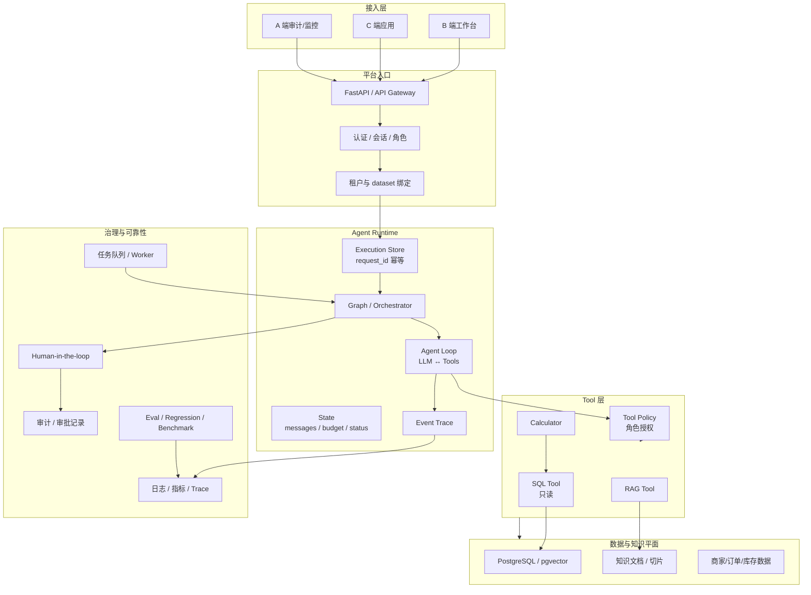
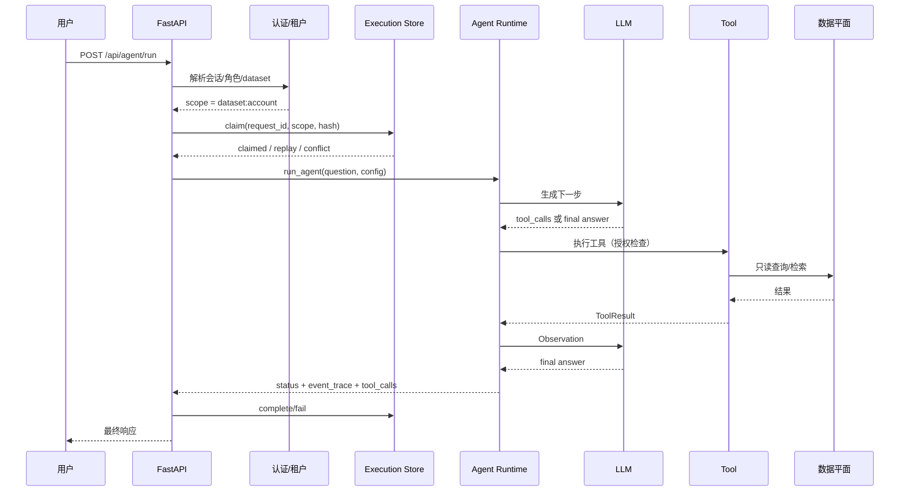

# 企业级 Agent 架构概述

> 本文是 Qianke Engine Architecture Handbook 的第一篇，属于 **Agent Architecture** 分类。  
> 目标不是介绍某个框架 API，而是建立一套能用于企业系统的 Agent 架构判断框架，并明确 Qianke Engine 当前实现到哪里、哪些仍是目标设计。

## 1. 文档基本信息

| 项 | 内容 |
|---|---|
| 文档名称 | 企业级 Agent 架构概述 |
| 所属分类 | 01 · Agent Architecture |
| 版本 | 0.1.0 |
| 最后更新 | 2026-11-23 |
| 文档状态 | 草稿 |
| 实现状态 | 已实现（当前 Runtime） + 已设计（统一三端目标） |
| 前置知识 | LLM 基础、Tool Calling、HTTP API、异步任务 |
| 对应代码 | `src/rag_demo/agent/`、`src/rag_demo/api/main.py`、`src/rag_demo/superagent/` |
| 对应文档 | `docs/agent.md`、`docs/agent-design-current-vs-target.md`、`AGENTS.md` |

阅读建议：

```text
L1 先读第 2、3 节：理解企业级 Agent 的问题与原理
L2 再读第 4、5、6、7 节：理解架构、工程实现和取舍
L3 最后读第 8、9 节：对照 Qianke 当前实现、限制和误区
```

## 2. 核心问题

### 2.1 从“会聊天”到“能完成企业任务”

一个普通聊天 Agent 通常只需要：

```text
用户输入 → LLM 生成回答
```

企业级 Agent 要面对的是：

```text
用户提出业务问题
→ 系统确认身份、租户、权限和数据范围
→ Agent 规划调查步骤
→ 调用真实工具获取证据
→ 对结果做校验和解释
→ 需要时进入人工确认
→ 记录执行过程、成本、错误和最终结果
```

差距不在“模型是否更聪明”，而在**系统是否能把不确定的模型行为约束成可负责的业务流程**。

### 2.2 企业级 Agent 的六个核心问题

| 问题 | 如果缺失会发生什么 |
|---|---|
| 任务边界 | Agent 越权执行、答非所问、无限循环 |
| 身份与租户 | 查到其他商家/企业的数据 |
| 工具安全 | SQL 被写操作利用、外部内容注入工具调用 |
| 证据与可解释 | 结论无法追溯，业务不敢采用 |
| 人工确认 | 高风险动作未经审批直接生效 |
| 运行可靠性 | 超时、重试、重复执行、成本失控、故障不可恢复 |

所以企业级 Agent 不是“LLM + 几个 tool”的加法，而是：

```text
Agent Runtime
+ Tool Contract & Gateway
+ 数据/知识平面
+ 身份/租户/权限
+ Human-in-the-loop
+ 证据/审计/评测
+ 可靠性机制
```

### 2.3 Qianke Engine 的边界

Qianke Engine 当前定位是 **Decision Support Agent**，不是 Autonomous Business Agent。

已明确的边界：

```text
可以：理解问题、规划调查、调用 SQL/RAG/Calculator、分析、给建议
不可以：自动执行营销、自动发消息、无确认修改业务数据
```

这不是能力不足，而是企业系统的安全选择：

```text
模型可以提出动作，但不能成为最终授权者。
```

对应项目规则见 `AGENTS.md` §13 和 `docs/agent.md` §1。

## 3. 基础原理

### 3.1 Agent 的最小闭环

从控制论角度，一个 Agent 可以抽象为：

```text
State_t
  → Policy/LLM 选择 Action_t
  → Environment/Tool 执行 Action_t
  → Observation_t
  → State_{t+1}
  → ... → Terminal
```

其中：

```text
State        当前对话、任务、证据、预算、执行状态
Policy       通常由 LLM 承担，决定下一步
Action       调用工具、生成回答、请求人工确认
Observation  工具返回的结构化结果
Terminal     完成、超限、超时、取消、失败
```

Qianke 当前实现采用 LangGraph 的 `chatbot ↔ tools` 循环：

```text
chatbot 节点调用 LLM
→ LLM 返回 tool_calls
→ ToolNode 执行工具
→ ToolMessage 回到 chatbot
→ 直到最终回答或终态
```

### 3.2 为什么必须把“循环”变成“运行时”

只写一个 while 循环也能跑 Agent，但企业系统需要回答：

```text
最多能跑几步？
最多调用几个工具？
超时了怎么办？
失败能否重试？
重试会不会重复副作用？
每次执行的 ID 是什么？
执行过程能否回放？
租户上下文会不会串？
```

Qianke 的 Runtime 用显式配置把这些变成硬约束：

```python
AgentConfig(
    max_steps=5,
    max_tool_calls=10,
    timeout_seconds=60.0,
    max_total_tokens=0,
)
```

关键点：

```text
max_steps / max_tool_calls / timeout / budget 都是真正的运行时参数，
不是展示字段。
```

源码：`src/rag_demo/agent/state.py`。

### 3.3 工具不是函数，而是契约

企业级 Agent 的 Tool 必须可授权、可校验、可观测、可测试。

Qianke 的统一契约：

```python
class ToolResult(BaseModel):
    ok: bool
    data: dict[str, Any] = Field(default_factory=dict)
    error: ToolError | None = None

@dataclass(frozen=True)
class Tool:
    name: str
    description: str
    input_schema: dict[str, Any]
    fn: Callable[..., dict[str, Any]]
```

成功：

```json
{"ok": true, "data": {"columns": [], "rows": []}}
```

失败：

```json
{
  "ok": false,
  "data": {},
  "error": {"code": "READ_ONLY_VIOLATION", "message": "只允许 SELECT"}
}
```

原则：

```text
调用方依赖 error.code，不依赖 error.message 字符串匹配。
```

源码：`src/rag_demo/agent/tool.py`。

### 3.4 为什么需要“证据优先”而不是“答案优先”

企业业务不接受：

```text
模型说“本月销售额下降了 12%”，但没有任何查询或来源。
```

Qianke 的 Agent 回答要求：

```text
RAG：返回检索片段与来源，不直接生成结论
SQL：只读查询 + 明确口径 + 可核对结果
Calculator：确定性计算
Final Answer：关键结论带来源或口径
```

这决定了架构中必须有：

```text
工具结果 → 证据 → 生成 → 后置审查
```

而不是：

```text
用户问题 → 模型直接生成
```

### 3.5 单体 Agent 与多 Agent 的边界

多 Agent 不是企业级的同义词。

Qianke 当前的选择是：

```text
先用单 Agent + 有限工具集 + 明确边界
等工具规模、路由复杂度和协作需求真正出现，再拆多 Agent
```

原因：

```text
1. 单 Agent 更容易调试、评测和归因
2. 多 Agent 会放大状态同步、权限、成本和失败面
3. 当前工具数量有限，单 ReAct 足够
4. 先把 Runtime、Tool Contract、HITL、Eval 做扎实
```

`AGENTS.md` 也明确：工具超过约 10 个且出现路由混乱，才评估 Supervisor 多 Agent 拆分。

## 4. 架构设计

### 4.1 总体分层



这张图表达的是**目标架构**。Qianke 当前只实现了其中一部分；第 8 节逐项标注。

### 4.2 核心模块与职责

| 模块 | 职责 | Qianke 对应位置 | 当前状态 |
|---|---|---|---|
| 接入层 | B/C/A 入口、协议、会话 | FastAPI、Vue 前端 | 部分实现 |
| 认证/租户 | 身份、角色、dataset 绑定 | `auth.py`、`api/main.py` | 已实现 |
| Execution Store | request_id 幂等、执行记录 | `agent/execution_store.py` | 已实现 |
| Agent Runtime | 状态、预算、超时、重试、终态 | `agent/state.py`、`service.py` | 已实现 |
| Graph/Loop | LLM ↔ Tool 循环 | `agent/loop.py` | 已实现（B 端主链路） |
| Tool Contract | 输入/输出/错误/授权 | `agent/tool.py`、`registry.py` | 已实现 |
| Tool Policy | 角色 → 可用 Tool 集合 | `agent/policy.py` | 已实现 |
| Tool 实现 | RAG / SQL / Calculator | `agent/tools/` | 已实现 |
| 数据平面 | 检索、SQL、租户数据 | PostgreSQL/pgvector | 已实现 |
| HITL | 人工确认/审批 | `superagent` 审批链路；主 Agent interrupt 原语 | 部分实现 |
| 审计/Trace | 执行轨迹、动作记录 | event_trace、`superagent` 审计 | 部分实现 |
| Eval | 回归/基准/门禁 | `tests/evals/agent` | 已实现 |
| 异步任务 | 队列、Worker、重试 | `superagent`、job queue | 已实现（独立链路） |

### 4.3 请求控制流



### 4.4 数据流与边界

```text
身份上下文：账号 → 角色 → dataset/租户
执行上下文：request_id → execution_id → parent_execution_id
任务上下文：messages → step_count → tool_call_count → status
证据上下文：tool result → trace / sources / final answer
治理上下文：policy → HITL → audit
```

企业级设计的关键不是“把数据都塞进 Prompt”，而是：

```text
只让 Agent 看到当前身份允许的数据，
只让工具返回完成任务所需的最小结果，
只让最终回答引用可追溯的证据。
```

## 5. 工程实现

### 5.1 当前目录结构

```text
src/rag_demo/agent/
├── state.py              AgentState / AgentConfig / AgentStatus
├── loop.py               LangGraph 主循环 + TraceCallbackHandler
├── tool.py               Tool / ToolResult / ToolError
├── registry.py           LangChain Tool 与 JSON Contract
├── policy.py             角色 → ToolPolicy
├── service.py            execute_agent / 幂等 / deadline
├── execution_store.py    InMemory / PostgresExecutionStore
└── tools/
    ├── rag_search.py
    ├── execute_sql.py
    └── calculator.py
```

### 5.2 当前状态字段

```python
class AgentState(TypedDict, total=False):
    messages: Annotated[list, add_messages]
    step_count: int
    tool_call_count: int
    status: str
    error: str | None
    started_at: float
    request_id: str
    execution_id: str
    parent_execution_id: str | None
```

为什么需要这些字段：

```text
messages     对话与工具观察
step_count   推理步数预算
tool_call_count 工具调用预算
status       明确终态，避免把超限伪装成正常回答
error        失败原因
started_at   超时与耗时
request_id   请求幂等
execution_id 本次执行身份
parent_execution_id retry 血缘
```

### 5.3 终态与失败语义

Qianke 明确区分：

```text
COMPLETED
MAX_STEPS_EXCEEDED
MAX_TOOL_CALLS_EXCEEDED
TIMEOUT
CANCELLED
BUDGET_EXCEEDED
TOOL_NOT_ALLOWED
FAILED
```

原则：

```text
超限不是“回答得短一点”，而是明确终态。
工具未授权不是“碰运气执行”，而是 TOOL_NOT_ALLOWED。
失败不伪装成模型正常输出。
```

### 5.4 幂等与重试

Qianke 的请求幂等键：

```text
request_id + scope(dataset:account_id) + request_hash
→ agent_execution
```

规则：

```text
同一 request_id 已完成 → 回放结果
执行中 → 409
同 request_id 不同 query → 409
不同 dataset/account 的相同 request_id → 互不冲突
```

Retry：

```text
同一 request_id
每次重试生成新 execution_id
parent_execution_id 指向上一次
只重试 FAILED / TIMEOUT / MAX_STEPS_EXCEEDED / MAX_TOOL_CALLS_EXCEEDED
不重试 BUDGET_EXCEEDED / CANCELLED
```

这解决了一个常见企业问题：

```text
网络重试 ≠ 业务重复执行。
```

### 5.5 工具授权

执行前：

```text
account → ToolPolicy.allowed_tools()
→ LLM bind_tools
→ ToolNode
```

执行后再次复核：

```text
模型若请求未授权 Tool
→ TOOL_NOT_ALLOWED
→ 不执行该 Tool
```

默认 B 端矩阵（当前实现）：

```text
admin / ent_admin / exec / analyst / ops
  → rag_search + execute_sql + calculator

cs
  → rag_search + calculator

guest / demo / disabled
  → 无
```

`execute_sql` 不暴露给客服角色。

### 5.6 当前实现边界

必须明确：

```text
已实现：
  B 端主 Agent Runtime
  LangGraph 单 Agent 循环
  3 个 Tool
  状态/预算/超时/重试/幂等
  request_id / execution_id
  event trace
  Tool 授权
  离线 Eval

部分实现：
  HITL：Super-agent 审批链路存在；主 Agent 的 interrupt 原语已有，HITL API/统一确认流程未接入
  C 端：有独立导购/交易流程，但未统一到同一个三端 Agent Runtime
  A 端：审计/监控存在，但不是独立 Agent Graph

已设计/规划：
  三端独立 Graph
  Agent Orchestrator 统一编排
  Multi-Agent 协作
  Planner / 统一 Memory 子系统
  进程隔离的硬取消/硬超时
```

> 状态依据：`docs/agent.md` §3、§11、§7；`docs/agent-design-current-vs-target.md`；`AGENTS.md` §12、§18。

## 6. 企业级设计要求

### 6.1 安全

必须回答：

```text
Agent 能访问哪些数据？
能调用哪些工具？
能不能写？
写之前谁批准？
工具返回内容会不会被当成指令？
```

Qianke 当前：

```text
SQL 只读、只允许 SELECT/WITH、必须 LIMIT
Tool Policy 按角色授权
ToolResult 错误结构化
Agent 不直接写库
真实业务状态变化需要人工确认
```

仍需补齐：

```text
Prompt Injection 专项防护
Tool Gateway 统一入口
HITL API 与统一审批
写 Tool 的进程隔离/可取消执行
```

### 6.2 可扩展性

当前单进程 FastAPI + 同步 Agent 请求适合交互式 B 端分析；重任务应走异步队列。

已存在：

```text
Super-agent Worker / Job Queue
```

尚未统一：

```text
主 /api/agent/run 的异步任务化
按租户/任务的并发隔离与配额
```

### 6.3 可维护性

Qianke 的可维护性来自：

```text
Tool Contract 统一
Prompt / Graph / Runtime 分离
Trace / Eval 可回归
配置显式化
```

风险：

```text
Prompt 与业务规则容易散落
文档与代码可能漂移
多端复制 Agent 逻辑会重复
```

### 6.4 可观测性

已有：

```text
event_trace
LangSmith 可选接入
Eval 报告
```

要继续补齐：

```text
统一 trace_id / request_id / execution_id
工具级延迟与错误率
token/成本指标
租户维度脱敏
```

### 6.5 数据一致性

Agent 执行不是数据库事务。

Qianke 用：

```text
request_id 幂等
execution store
retry 血缘
只读工具
HITL
```

避免：

```text
重试导致重复写
模型失败但业务动作已执行
多 Agent 共享状态互相污染
```

### 6.6 故障恢复

已实现：

```text
retry
checkpoint
终态
```

已知限制：

```text
Python 线程不能安全强杀
请求 wall timeout（70s）是调用方等待上限，不是执行线程硬终止
崩溃后 RUNNING 记录需要清理
```

这也是为什么写操作必须先走 HITL / 独立 Worker。

## 7. 方案对比

### 7.1 单 Agent vs Multi-Agent

| 维度 | 单 Agent ReAct | Multi-Agent |
|---|---|---|
| 调试 | 简单 | 复杂 |
| 状态 | 单一 | 多状态、同步成本 |
| 权限 | 易统一 | 跨 Agent 传播风险 |
| 成本 | 低 | 高 |
| 适用 | 工具少、流程清晰 | 多角色/多工具/长任务 |
| Qianke 当前 | 已实现（B 端主链路） | 目标设计/规划 |

结论：

```text
不要为了“看起来企业级”提前拆多 Agent。
先解决 Runtime、Tool Contract、权限、HITL、Eval。
```

### 7.2 LangGraph vs 自研循环

| 维度 | LangGraph | 自研 while 循环 |
|---|---|---|
| 状态/检查点 | 内置 | 自建 |
| HITL/interrupt | 原生原语 | 自建 |
| 可观测 | 回调生态 | 自建 |
| 学习成本 | 中 | 低 |
| 控制力 | 高但需理解 | 最高 |

Qianke 选择 LangGraph，但保留自己的：

```text
AgentConfig
ToolContract
ToolPolicy
ExecutionStore
终态
Eval
```

结论：

```text
框架负责图与状态，业务安全边界必须由自己的确定性代码掌握。
```

### 7.3 同步 API vs 异步任务

| 维度 | 同步 `/api/agent/run` | 异步队列 |
|---|---|---|
| 交互体验 | 即时 | 需要轮询/推送 |
| 长任务 | 不适合 | 适合 |
| 超时控制 | 请求级 | Worker 级 |
| 重试 | 请求级 | 任务级 |
| Qianke | 当前交互链路 | Super-agent 已有独立 Worker |

结论：

```text
交互式分析走同步；长任务/批处理/审批执行走异步。
```

## 8. Qianke Engine 实践

### 8.1 当前真实链路

```text
Vue B 端
→ POST /api/agent/run
→ 认证 / 角色 / dataset
→ ExecutionStore claim
→ LangGraph Agent Runtime
→ LLM + RAG/SQL/Calculator
→ final answer / 终态
→ event_trace + tool_calls
```

对应代码：

```text
src/rag_demo/api/main.py
src/rag_demo/agent/service.py
src/rag_demo/agent/loop.py
src/rag_demo/agent/state.py
src/rag_demo/agent/tool.py
src/rag_demo/agent/policy.py
src/rag_demo/agent/execution_store.py
```

### 8.2 已实现能力

| 能力 | 状态 | 证据 |
|---|---|---|
| LangGraph 单 Agent 循环 | 已实现 | `agent/loop.py` |
| AgentState | 已实现 | `agent/state.py` |
| max_steps / max_tool_calls / timeout | 已实现 | `AgentConfig` |
| Tool Contract | 已实现 | `agent/tool.py` |
| Tool Policy | 已实现 | `agent/policy.py` |
| RAG / SQL / Calculator | 已实现 | `agent/tools/` |
| request_id 幂等 | 已实现 | `agent/service.py`、`execution_store.py` |
| event_trace | 已实现 | `TraceCallbackHandler` |
| retry / checkpoint | 已实现 | `docs/agent.md` §3.4 |
| 租户 dataset 绑定 | 已实现 | `api/main.py`、`dataset_scope` |
| Eval 回归/基准 | 已实现 | `tests/evals/agent/` |

### 8.3 部分实现 / 目标设计

| 能力 | 状态 | 说明 |
|---|---|---|
| 主 Agent HITL | 部分实现 | interrupt 原语已有；统一 HITL API/确认流程未接入 |
| 三端统一 Agent Runtime | 已设计 | 目标 C/B/A 独立 Graph，共享 Runtime/Tool |
| Multi-Agent 协作 | 规划中 | 当前单 Agent；先满足工具与路由复杂度门槛 |
| Planner / 统一 Memory | 规划中 | 有相关产品文档与局部实现，尚未形成统一 Runtime 组件 |
| 写操作自动执行 | 明确不做 | 必须人工确认 + 独立 Worker |

### 8.4 为什么这样设计

```text
1. 先保证可解释、可评测、可审计，再扩展自治
2. 单 Agent 足以覆盖当前 B 端经营分析任务
3. 高风险动作不交给 LLM 直接执行
4. 用确定性 Runtime 约束模型的不确定性
```

### 8.5 企业级演进方向

```text
短期：补齐 HITL API、Tool Gateway、Prompt Injection 防护、硬取消
中期：统一三端 Runtime、任务队列、租户配额、Trace 标准化
长期：按工具规模/协作需求评估 Orchestrator 与 Multi-Agent
```

## 9. 常见问题与设计误区

### 误区 1：Agent 越自主越企业级

错误：

```text
让 Agent 自己决定调用哪些工具、自己执行写操作、自己审批。
```

正确：

```text
模型负责建议，系统负责权限、限制、审批和审计。
```

### 误区 2：把所有数据塞进上下文

错误：

```text
把全量订单、用户画像、SOP 拼成一个巨大 Prompt。
```

正确：

```text
按租户/权限绑定数据，工具返回最小必要证据。
```

### 误区 3：只评测最终答案

错误：

```text
只看答案关键词是否命中。
```

正确：

```text
同时评业务正确性、工具策略、执行成功、引用来源、成本。
```

Qianke 的 Eval 已拆分 Business Correctness 与 Tool Policy Compliance。

### 误区 4：重试没有幂等

错误：

```text
失败后直接再执行一次 Agent；写动作重复。
```

正确：

```text
request_id + scope + hash 幂等，retry 新 execution_id，写动作走 HITL。
```

### 误区 5：把 Tool 输出当指令

错误：

```text
工具返回的网页/文档内容被当作新的系统指令。
```

正确：

```text
工具结果只作为数据；工具调用必须经过授权和校验。
```

### 误区 6：过早拆多 Agent

错误：

```text
为了架构图好看，先拆 5 个 Agent。
```

正确：

```text
先测量工具数量、路由复杂度、任务长度和失败代价，再决定。
```

### 误区 7：超时等于线程被杀

错误：

```text
API 超时返回 504，就认为执行线程已经停止。
```

正确：

```text
Qianke 当前 wall timeout 是调用方等待上限；执行线程可能仍在收尾。
写操作必须使用独立 Worker/可取消执行器。
```

## 10. 本篇总结

```text
1. 企业级 Agent 的核心不是“更自主”，而是“可约束、可解释、可审计、可恢复”。
2. Agent Runtime 必须把步数、工具数、超时、预算、终态、幂等变成真正的运行时约束。
3. Tool 不是普通函数，而是需要授权、结构化输入输出、错误码和治理的契约。
4. 证据优先：RAG/SQL/Calculator 的结果必须可追溯，最终回答不能凭空生成。
5. 高风险动作必须 Human-in-the-loop；模型不能成为最终授权者。
6. 单 Agent 不是落后；在工具和协作复杂度未达到前，单 Agent + 强 Runtime 更可靠。
7. Qianke 当前已实现 B 端主 Agent Runtime、Tool Policy、幂等、Trace、Retry、Eval；
   三端统一、HITL API、多 Agent 仍是目标/规划，不能写成已上线。
```

## 11. 延伸阅读

### 项目内部

```text
docs/agent.md
docs/agent-design-current-vs-target.md
docs/architecture-diagrams.md
docs/数据模型.md
docs/接口文档.md
docs/decisions/three_agent_platform_architecture_decisions_v0.1.md
AGENTS.md
src/rag_demo/agent/
tests/evals/agent/
```

### 外部权威资料

- LangGraph 官方文档：<https://langchain-ai.github.io/langgraph/>
- FastAPI 官方文档：<https://fastapi.tiangolo.com/>
- OWASP Top 10 for LLM Applications：<https://genai.owasp.org/llm-top-10/>
- NIST AI Risk Management Framework：<https://www.nist.gov/itl/ai-risk-management-framework>
- PostgreSQL 官方文档：<https://www.postgresql.org/docs/>
- OpenTelemetry 官方文档：<https://opentelemetry.io/docs/>
- The Twelve-Factor App：<https://12factor.net/>

> 外部链接仅作为学习入口；版本与内容以官方站点为准。  
> Qianke 当前实现以仓库代码与 `docs/agent.md` 为准，本文状态标注不替代运行验证。
