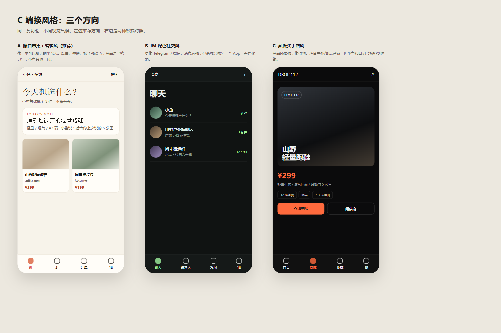

# C 端换风格调研

日期：2026-11-11

## 1. 当前 C 端风格审计

现状：

```text
白色纸面 + 黑色 ink + 大圆角
WhatsApp / iMessage 式对话
右侧信息栏 + 桌面三栏
C 商城仍是企业后台卡片风
C 底部 Tab 刚统一
```

优点：

- 对话干净、信息密度低
- 适合文字聊天
- 小鱼 / 日记 / 记忆不抢戏

问题：

- 太像通用聊天工具，缺少“社交电商 / 市集”的记忆点
- 商城和对话像两个产品拼接
- 白色极简在 2026 已经非常同质化，用户说的“没有区分度”仍然存在
- 商品没有内容感，只有价格和库存

## 2. 外部案例

### 2.1 小红书「市集」：内容先于交易

小红书把“市集”放到首页第二 Tab，采用双列信息流，商品信息页、直播、商品笔记混排；页面克制，不用“秒杀/立降”的大红字，先让用户逛和看笔记。

来源：

- [21 经济网：年轻人的新“逛”法，小红书用“市集”激活一个消费场](https://www.21jingji.com/article/20250901/herald/dcef5ff7abe6d2c4debc595caac03c2e.html)
- [人人都是产品经理：小红书“市集”，想“chill”的做电商](https://www.woshipm.com/share/6264309.html)
- [网易：小红书把“市集”入口顶到首页了](https://www.163.com/dy/article/K7TNNHK2053144S4.html)

可借鉴：

```text
双列“商品笔记”而不是商品表格
标题像内容标题，不像 SKU
价格弱化，故事和场景强化
底部一级入口直接叫“市集”
```

### 2.2 得物 POIZON：商品视觉语言

得物海外版做了独立设计语言、主色/中性色、空态插图和 2.5D 插图；商品详情、出价、搜索都围绕“商品”组织。

来源：

- [POIZON 设计案例](https://duchuanhu.com/work/archives/work12_poizon.html)

可借鉴：

```text
商品图必须大
主色只用于按钮/价格/状态
中性色承担页面背景
2.5D / 插画用于空态和活动，不用 AI 渐变
```

不适合照搬：

```text
得物是“商品优先”，千客是“关系 + 对话优先”
全盘潮牌化会让小鱼和日记失去位置
```

### 2.3 Replika / Character.AI：伙伴层怎么做

Replika 的强项是伙伴感：对话式 onboarding、头像定制、日记、记忆、语音；Character.AI 用 For You 信息流把“对话场景”变成可浏览的内容，并支持记忆/贴纸/语音。

来源：

- [Replika UI Breakdown](https://screensdesign.com/showcase/replika-ai-friend)
- [Character.AI UI Breakdown](https://screensdesign.com/showcase/character-ai-chat-talk-text)

可借鉴：

```text
小鱼不是“客服头像”，而是有日记、记忆、状态的角色
伙伴层可以出现在首页、商品卡、订单卡，而不是只在一个聊天页
记忆/日记是产品差异点，应该被看见
```

风险：

```text
如果整个 C 端做成 Replika 风格，商城会变成附属品
陪伴感和交易感需要分层，而不是混成一个粉紫渐变界面
```

### 2.4 2026 视觉趋势：从纯白极简转向暖中性

2026 的色彩趋势在离开“纯白 + 灰色”的扁平极简，转向暖 off-white、自然中性色、柔和但更有性格的强调色；同时保留可读性和克制。

来源：

- [Envato：2026 mobile app color scheme trends](https://elements.envato.com/learn/color-scheme-trends-in-mobile-app-design)
- [Green Record：2025 social media app UI/UX trends](https://greenrecord.co.uk/top-ui-ux-design-trends-for-social-media-apps-in-2025/)

可借鉴：

```text
暖纸白替代纯白
陶土 / 柿子 / 鼠尾草绿做强调色
少量 serif 标题，正文继续 sans
微动效，不要大面积发光渐变
```

### 2.5 微信小程序电商：中断、分享、少一步

NN/g 对微信小程序的研究强调：移动端要支持“被打断后回来”、保存进度、利用微信的分享/群聊能力；Wiredcraft 的电商小程序案例则强调减少瀑布流、强化分类和商品卡、简化退款流程。

来源：

- [NN/g：Apps Within Apps: UX Lessons from WeChat Mini Programs](https://www.nngroup.com/articles/wechat-mini-programs/)
- [Wiredcraft：UX Design Clichés Revamp on WeChat E-commerce Mini-program](https://wiredcraft.com/blog/ux-design-cliches-revamp-on-wechat-e-commerce-mini-program/)

可借鉴：

```text
聊天里发起购买，退出后能回来
商品卡可以直接分享给好友/群
订单和售后要能在 C 端独立完成
```



可交互预览页：[c-style-preview.html](c-style-preview.html)

## 3. 四个可选方向

| 方向 | 关键词 | 主色 | 适合 | 风险 |
|---|---|---|---|---|
| A. 暖白市集·编辑风 | 纸张、市集、商品笔记 | 暖白 / 墨黑 / 柿子 / 鼠尾草 | 社交电商 + 伙伴 | 内容供给不足会显空 |
| B. IM 深色社交风 | 夜聊、消息、联系人 | 炭黑 / 米白 / 荧光绿 | 纯 IM | 更像 Telegram，电商弱 |
| C. 潮流买手店风 | 商品、街头、2.5D | 黑白 / 橙红 / 金属灰 | 户外/潮流商家 | 伙伴和日记被边缘化 |
| D. AI 伙伴疗愈风 | 头像、日记、柔和渐变 | 奶油 / 蜜桃 / 雾紫 | 陪伴 | 商城像外挂，容易“AI 味” |

## 4. 推荐方向

推荐 **A. 暖白市集·编辑风**，并吸收 C 的商品卡和 Replika 的伙伴层。

一句话：

> 像一本可以聊天的生活方式小杂志，而不是一个换皮微信。

### 4.1 视觉 Token

```text
背景纸白     #F7F3EA
卡片纸白     #FFFDF8
主墨色       #1E1B16
次级文字     #6B6258
细线         #E4DCCD
强调柿子     #D95F3B
辅助鼠尾草   #6F7F63
价格/提醒    #B4492F
```

字体：

```text
标题：思源宋体 / Noto Serif SC，字重 600
正文：思源黑体 / Noto Sans SC
数字：等宽数字用于价格和订单号
```

### 4.2 导航

```text
底部 4 Tab
├── 聊   小鱼对话
├── 逛   市集 / 商品笔记
├── 订单  订单 + 售后
└── 我   记忆 / 日记 / 头像 / 设置
```

“消息”不再单独占一级 Tab，社交会话并入“聊”里的会话列表；商品和店宠对话在“逛”里承接。

### 4.3 首页结构

```text
顶部：小鱼状态 + 搜索
中部：今日手记 / 为你挑的 3 件
下部：双列商品笔记
```

商品卡不再是：

```text
[图] 轻量跑鞋
¥299  库存 13
[咨询]
```

而是：

```text
[大图]
「通勤也能穿的轻量跑鞋」
轻量 / 透气 / 42 码
¥299
小鱼说：这双适合你上次说的 5 公里
```

### 4.4 伙伴层

```text
小鱼头像在顶部，不抢主视觉
商品卡下方出现一句“小鱼说”
日记/记忆进入“我”，不塞进聊天流
店宠报价仍是结构化卡片，不做成聊天气泡
```

### 4.5 动效与质感

```text
纸纹很轻，几乎看不见
卡片出现 120–180ms 上浮
发送消息用墨点扩散，不用紫色光晕
不做大面积玻璃拟态
```

## 5. 不推荐

```text
紫蓝 AI 渐变 + 发光边框
纯黑霓虹赛博风
把所有页面做成 Replika 头像房
把商城做成得物式潮流黑
```

这些都能“换风格”，但会和“IM 社交电商 + 可配置伙伴”的产品定位冲突。

## 6. 下一步

如果确认 A 方向，先做 3 张视觉稿，不直接改全站：

```text
1. C 首页（对话 + 今日手记）
2. 市集双列商品笔记
3. 商品详情 + 小鱼推荐卡
```

确认视觉稿后，再改 C App 和 CShell 的 Token、导航、商品卡。
