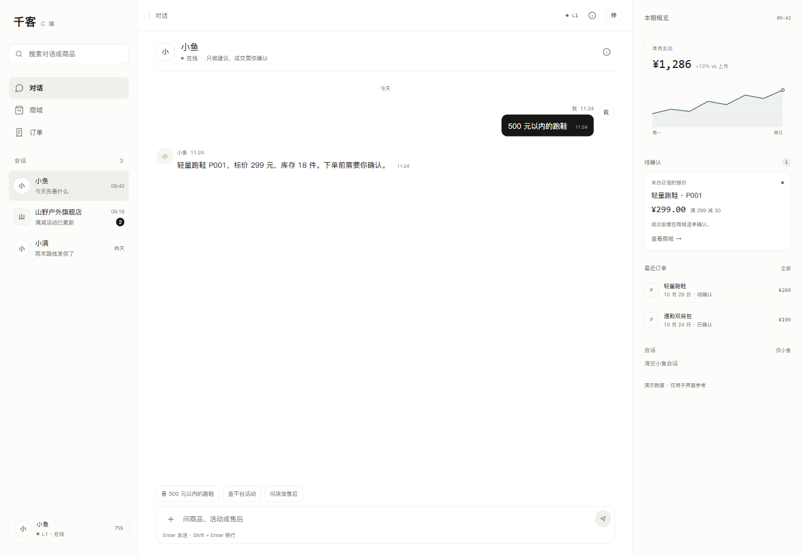
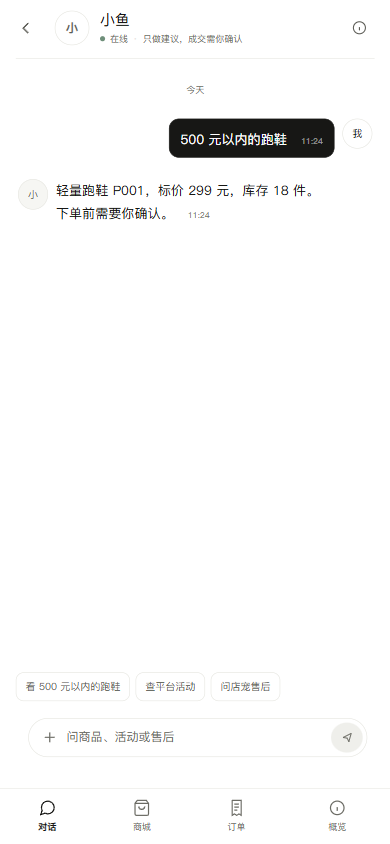

# C 端 UI 参考：去「AI 味」的消费级界面

> 页面：`/v2/#/c/app`
> 状态：可运行的界面参考，不是最终生产设计稿。

## 1. 设计目标

C 端入口从「企业工作台里的一个页面」改成独立的消费级应用：

```text
对话优先
服务关系清楚
交易状态可追溯
纸白、哑光、低饱和
```

初始进入页是「小鱼」对话，而不是数据仪表盘。





## 2. 六条改造要求的落地

| 要求 | 落地 |
|---|---|
| 背景与间距 | 背景 `#FFFFFF`，侧栏 / 上下文 `#FCFCFB`；8px 基准，主要间距 16/20/24/32 |
| 去饱和 | 无紫蓝渐变、无外发光；强调色仅用于状态与图表 |
| 品牌精简 | 左上角纯文字「千客」；无 AI/PRO 徽章 |
| 数据可视化 | 1.5px 低饱和折线；网格透明度极低；无发光 |
| 微文案 | 无感叹号、火焰、情绪符号；状态用中性描述 |
| 材质层级 | 纸白面板 + 1px 细线；阴影只用于浮层；圆角 8–12px |

## 3. 设计变量

```css
--c-bg:       #ffffff;
--c-bg-soft:  #fcfcfb;
--c-panel:    #ffffff;
--c-panel-2:  #f6f6f3;
--c-panel-3:  #efefeb;
--c-line:     #e4e4de;
--c-line-soft:#efefeb;
--c-text:     #171715;
--c-text-2:   #5c5c56;
--c-text-3:   #6b6b64;
--c-accent:   #587376;
--c-positive: #6f8f7a;
--c-warning:  #7a6340;
--c-negative: #8a4f4f;
```

## 4. 桌面端结构

```text
左侧 248px：品牌 / 搜索 / 主导航 / 会话 / 伙伴卡
中间自适应：对话标题 / 消息流 / 快捷问题 / 输入区
右侧 304px：本期概览 / 图表 / 待确认报价 / 最近订单
```

桌面端截图：`docs/screenshots/c-app-white-desktop.png`

## 5. 移动端结构

参考 WhatsApp iOS 的移动端信息架构（Mobbin）：

https://mobbin.com/apps/whats-app-ios-8738dbc9-e7a8-4fef-91e5-6afd1c9d092b

映射方式：

```text
对话页：返回箭头 / 头像 / 名称 / 在线状态 / 右侧信息按钮
消息：深色发件块 + 行式收件文本 + 气泡内时间
输入：加号 / 细边框输入 / 圆形发送
会话列表：顶部「消息」/ 搜索 / 头像 / 名称 / 预览 / 时间 / 未读
底部：对话 / 商城 / 订单 / 概览
```

保留 C 端自己的纸白和低饱和规则，不直接复制 WhatsApp 的高饱和绿色。


验证：

```text
390 × 844 无横向溢出
对话页返回按钮打开消息列表
消息列表搜索 / 选中会话可用
底部导航与气泡内时间正常
控制台错误 0
```

## 6. 交互边界

```text
小鱼只做解释、提醒、锐评
店宠负责商品/活动/SOP 查询
成交必须由用户逐单确认
```

初始种子对话、报价卡和图表是界面参考数据；快捷问题之后的链路会调用真实 C Agent。


### 真实链路

点击「看 500 元以内的跑鞋」会调用真实 C 端 Agent：

```text
C Agent 查商品
→ 生成待确认订单草稿
→ 右侧面板出现「确认并创建订单」
→ 用户确认
→ 调用 C Agent resume 创建订单
```

Agent 不能自行确认订单；确认动作始终由用户触发。

实测：

```text
POST /api/c/agent/run      200
POST /api/c/agent/resume   200
订单 order_... 已创建
```

### 店宠会话

「山野户外旗舰店」会话已接入 IM 店宠接口：

```text
GET  /api/c/friends/store_demo/messages?limit=20
POST /api/c/friends/store_demo/messages
WS   /api/c/ws/chat/store_demo
```

- 加载最近 20 条持久化消息
- 进入店宠会话时建立 WebSocket
- 断线后自动重连，退避 1s / 2s / 4s / 8s，最多 5 次
- 头部状态显示「店宠在线 / 连接中 / 正在重连 / 连接已断开」
- `@店宠` 唤醒真实店宠 Agent
- WebSocket 不可用时回退 HTTP POST
- 店宠回复 + 小鱼锐评一起进入消息流
- 店宠返回的 quote_id 会显示在右侧「待确认」卡片
- 点击「查看报价」进入商城逐单确认

历史消息会做 emoji/感叹号清理后再展示，避免旧数据破坏新 UI 的克制风格。

## 7. 会话持久化

小鱼会话通过以下接口持久化：

```text
GET    /api/c/app/messages?thread_id=companion&limit=30
GET    /api/c/app/messages?thread_id=companion&limit=30&before=<cursor>
POST   /api/c/app/messages
DELETE /api/c/app/messages?thread_id=companion
```

保存内容：

```text
role: user / companion
content
metadata（如 order_id）
created_at
```

页面加载时优先展示最近 30 条持久化消息；没有历史时使用演示种子。发送消息、Agent 回复、订单确认结果都会写入该表。

会话分页与清理：

- 顶部「加载更早消息」按 `created_at < before` 取上一页；
- 右侧「清空小鱼会话」二次确认后删除当前 buyer 的 companion 消息；
- 删除只影响当前买家与会话，不影响订单或报价审计。

## 8. PWA 与移动端安全区

已加入可安装 PWA：

```text
/v2/manifest.webmanifest
/v2/sw.js
/v2/icons/icon-192.png
/v2/icons/icon-512.png
```

PWA 配置：

```text
display: standalone
start_url: /v2/#/c/app
scope: /v2/
theme_color: #ffffff
background_color: #ffffff
```

Service Worker 缓存：

```text
script / style / image / font
导航 HTML 外壳（离线兜底）
manifest / icons 由浏览器缓存
```

明确不缓存：

```text
/api/*
/auth/*
/whoami
/admin/*
```

安装提示：

- 监听 `beforeinstallprompt`，支持 Chromium 安装；
- iOS Safari 显示「分享 → 添加到主屏幕」提示；
- 已 standalone 打开时不显示。

在线状态：

- 监听 online / offline；
- 离线时顶部显示「当前处于离线状态」；
- WebSocket 断线继续走重连退避；HTTP 请求失败由页面错误处理兜底。

移动端增加 iOS 安全区：

```css
padding-top: env(safe-area-inset-top);
padding-bottom: env(safe-area-inset-bottom);
height: calc(56px + env(safe-area-inset-bottom));
```

覆盖对话头部、底部导航、消息列表头部和主体底部。

验证：

```text
manifest         200
icon-192         200
icon-512         200
Service Worker   activated，scope /v2/
shell cache      存在
离线事件         顶部提示出现，恢复后消失
安装事件         安装条出现
C 端 App 控制台  0 errors / 0 warnings
```

## 9. 文件

```text
web/src/views/CApp.vue
web/src/App.vue          # standalone 路由不套企业工作台外壳
web/src/router.js
web/public/manifest.webmanifest
web/public/sw.js
web/public/icons/
```
